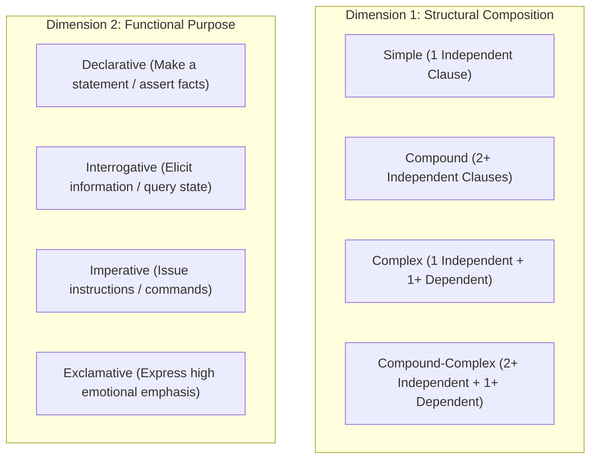
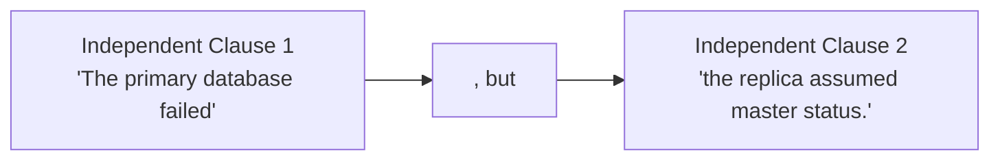
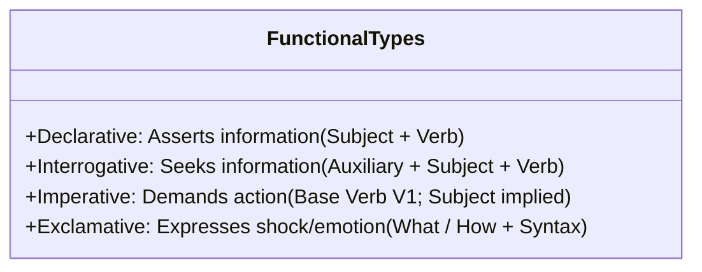
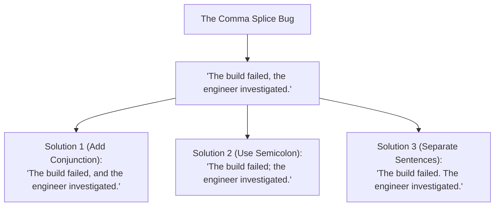

# Sentence Types and Communicative Purposes 🏗️

> **Level:** CEFR A2 (Syntactic Design)  
> **Primary References:** Michael Swan (*Practical English Usage*, §19, 215–224, 226); Raymond Murphy (*English Grammar in Use*, Units 49–52)  
> **Key Architecture:** Sentences are classified across two orthogonal dimensions: **Structural Architecture** (how clauses are wired together) and **Communicative Purpose** (the pragmatic intent of the speaker/writer).

---

## 1. The Two-Dimensional Matrix

---

## 2. Dimension 1: Structural Sentence Types

### 1. The Simple Sentence
Contains exactly **one independent clause** (one subject-predicate nexus). It may contain compound subjects, compound verbs, or multiple modifying phrases, but only one finite clause:

$$\mathbf{Simple\ Sentence} = \mathbf{Independent\ Clause} \times 1$$

- *The caching server restarted.*
- *The frontend engineer and the backend architect reviewed the database schema.* (Compound subject, single clause)

### 2. The Compound Sentence
Contains **two or more independent clauses** of equal syntactic rank, linked by a coordinating conjunction (FANBOYS: *for, and, nor, but, or, yet, so*) or a semicolon:

$$\mathbf{Compound\ Sentence} = \mathbf{Indep\ Clause}_1 + \mathbf{FANBOYS} / (;) + \mathbf{Indep\ Clause}_2$$

- *The API received thousands of concurrent requests, **so** the auto-scaler deployed four new instances.*
- *The code passed the unit test suite**;** however, the integration tests timed out.*

### 3. The Complex Sentence
Contains **one independent clause** and **at least one dependent (subordinate) clause**, linked by a subordinating conjunction (*although, because, if, since, when*) or relative pronoun (*who, which, that*):

$$\mathbf{Complex\ Sentence} = \mathbf{Independent\ Clause} + \mathbf{Dependent\ Clause}_{\ge 1}$$

- *Because the token expired, the gateway rejected the request.* (Dependent clause initial $\to$ requires comma)
- *The gateway rejected the request because the token expired.* (Independent clause initial $\to$ no comma)

### 4. The Compound-Complex Sentence
Contains **two or more independent clauses** and **at least one dependent clause**:

$$\mathbf{Compound\text{-}Complex} = \mathbf{Indep\ Clause}_1 + \mathbf{Indep\ Clause}_2 + \mathbf{Dep\ Clause}_{\ge 1}$$

- *Although the database crashed, the backup service restored all critical records, and the engineering team deployed a permanent patch.*
  - Subordinate Clause: *Although the database crashed*
  - Independent Clause 1: *the backup service restored all critical records*
  - Independent Clause 2: *the engineering team deployed a permanent patch*

---

## 3. Structural Comparison Matrix

| Sentence Type | Independent Clauses | Dependent Clauses | Conjunction Type | Rhythm / Style Impact |
| :--- | :---: | :---: | :--- | :--- |
| **Simple** | 1 | 0 | None (or phrasal) | Direct, punchy, high clarity, emphatic. |
| **Compound** | $\ge 2$ | 0 | Coordinating (FANBOYS) or `;` | Balanced, parallel, shows contrast/addition. |
| **Complex** | 1 | $\ge 1$ | Subordinating / Relative | Analytical, shows cause-effect, hierarchy of ideas. |
| **Compound-Complex** | $\ge 2$ | $\ge 1$ | Both Coordinating & Subordinating | Sophisticated, dense, comprehensive technical synthesis. |

---

## 4. Dimension 2: Functional Sentence Types

### 1. Declarative Sentences (Statements)
- **Word Order:** Subject + Verb (SV).
- **Punctuation:** Period (full stop).
- **Use in Tech:** Architecture specifications, release notes, bug descriptions:
  - *The database connection pool maintains fifty open sockets.*

### 2. Interrogative Sentences (Questions)
- **Word Order:** Auxiliary Verb + Subject + Main Verb (Subject-Auxiliary Inversion).
- **Punctuation:** Question mark (`?`).
- **Types:**
  - *Yes/No Question:* "Does this endpoint require authentication?"
  - *WH- Question:* "Where does the application store encrypted secrets?"
  - *Tag Question:* "The server restarted, didn't it?"

### 3. Imperative Sentences (Directives / Commands)
- **Word Order:** Base form of verb (V1). The subject (*you*) is grammatically covert/implied.
- **Punctuation:** Period or exclamation mark.
- **Use in Tech:** Technical documentation, tutorials, command-line guides, git commit messages:
  - *Execute `pytest -v` to verify test isolation.*
  - *Do not modify the production database directly.* (Negative Imperative)

### 4. Exclamative Sentences (Expressions of Emotion)
- **Word Order:** Introduced by *What* (+ noun phrase) or *How* (+ adjective/adverb), ending in an exclamation mark.
- **Use in Tech:** Colloquial and spoken contexts; rare in formal technical documentation:
  - *What a catastrophic failure that outage was!*
  - *How quickly this query executes!*

---

## 5. Dual-Domain Practical Examples

### Everyday Conversational English
1. *The sun is shining.* (Simple / Declarative)
2. *I wanted to buy groceries, but the supermarket was closed.* (Compound / Declarative)
3. *When we finish dinner, we can watch a movie.* (Complex / Declarative)
4. *Did you remember to lock the front door?* (Simple / Interrogative)
5. *Please pass the water.* (Simple / Imperative)
6. *What a magnificent view!* (Exclamative)
7. *Turn off the lights before you leave the house.* (Complex / Imperative)

### Professional Software Engineering Context
8. *The distributed worker consumes messages from RabbitMQ.*  
   $\to$ **Simple Sentence / Declarative**.
9. *The primary node dropped offline, but the standby replica intercepted all incoming queries.*  
   $\to$ **Compound Sentence / Declarative** (Joined by *but*).
10. *If network latency exceeds 200 milliseconds, the circuit breaker opens.*  
    $\to$ **Complex Sentence / Declarative** (Subordinate conditional clause + main clause).
11. *Because the security audit flagged vulnerabilities, the team refactored the auth module, and management approved an immediate hotfix.*  
    $\to$ **Compound-Complex Sentence / Declarative**.
12. *Does the microservice enforce mutual TLS across internal endpoints?*  
    $\to$ **Simple Sentence / Interrogative**.
13. *Clone the repository, configure the environment variables, and run the migration scripts.*  
    $\to$ **Compound Sentence / Imperative** (Coordinated base imperative verbs).
14. *Never commit unencrypted API keys to a public version control system.*  
    $\to$ **Simple Sentence / Negative Imperative**.
15. *How remarkably fast the new database engine indexes foreign keys!*  
    $\to$ **Simple Sentence / Exclamative**.

---

## 6. Common Mistakes & Diagnostic Anti-Patterns

| Bug (Incorrect Syntax) | Patch (Syntactically Valid) | Diagnostic Root Cause |
| :--- | :--- | :--- |
| ❌ *The server crashed, the engineer restarted it.* | ✅ *The server crashed, **so** the engineer restarted it.* (or `; the engineer...`) | **The Comma Splice:** Joining two independent clauses with only a comma without a coordinating conjunction. |
| ❌ *You should to clone the repository.* | ✅ *Clone the repository.* (or *You should clone...*) | **Malformed Imperative / Modal Error:** Imperatives use bare base verbs without *to* or modal clutter. |
| ❌ *Why the system threw an exception?* | ✅ *Why **did** the system throw an exception?* | **Missing Subject-Auxiliary Inversion:** Direct WH-questions require auxiliary *did* before the subject. |
| ❌ *Although we optimized the query but latency stayed high.* | ✅ *Although we optimized the query, latency stayed high.* | **Double Conjunction Bug:** Never pair subordinating *although* with coordinating *but* in the same sentence. |

---

## 7. Self-Assessment Practice Exercises

### Section A: Structural Classification
Classify each sentence as **Simple, Compound, Complex,** or **Compound-Complex**:

1. The test runner executed thirty test cases in four seconds.
2. The authorization service validated the JWT, and the gateway dispatched the request.
3. While the backup process was running, the read replica exhibited increased disk I/O.
4. The engineer reviewed the code, but she requested changes because several boundary tests were missing.
5. In spite of the unexpected network partition, all transaction logs remained consistent.
6. When the memory usage spiked, the container orchestrator killed the pod, but the autoscaler immediately launched a replacement.

### Section B: Functional Classification & Correction
Identify the functional type (**Declarative, Interrogative, Imperative, Exclamative**) and fix any grammatical defects:

7. *Execute the integration test suite before merging.*
8. *Why the backend returns a 500 status code?*
9. *The database migration finished without errors, the application is healthy.*
10. *What an elegant software architecture this is!*
11. *Where we can find the API documentation?*
12. *Although the Redis cache was warm but database queries remained slow.*

---

## 8. Comprehensive Answer Key & Explanations

1. **Simple** — Exactly one independent clause (*The test runner executed...*).
2. **Compound** — Two independent clauses joined by coordinating conjunction *and*.
3. **Complex** — One dependent adverbial clause (*While the backup process was running*) + one independent clause (*the read replica exhibited...*).
4. **Compound-Complex** — Two independent clauses (*The engineer reviewed the code* / *she requested changes*) + one dependent cause clause (*because several boundary tests were missing*).
5. **Simple** — Exactly one independent clause. *In spite of the unexpected network partition* is a prepositional phrase, not a clause!
6. **Compound-Complex** — One dependent clause (*When the memory usage spiked*) + two independent clauses linked by *but*.
7. **Imperative.** (Valid directive using base verb *Execute*).
8. **Interrogative.**  
   *Patch:* *Why **did** the backend return a 500 status code?* (Requires past auxiliary *did* + base verb *return*).
9. **Declarative (Bug: Comma Splice).**  
   *Patch:* *The database migration finished without errors**;** the application is healthy.* (or *...without errors, **and** the application...*).
10. **Exclamative.** (Valid exclamation introduced by *What* + NP).
11. **Interrogative.**  
    *Patch:* *Where **can we** find the API documentation?* (Requires subject-auxiliary inversion).
12. **Complex / Declarative (Bug: Double Conjunction).**  
    *Patch:* *Although the Redis cache was warm, database queries remained slow.* (Delete *but*).

---

## 9. Revision Flashcards & Key Takeaways

- **Simple:** 1 Independent Clause.
- **Compound:** 2+ Independent Clauses linked by FANBOYS (*for, and, nor, but, or, yet, so*) or semicolon (`;`).
- **Complex:** 1 Independent Clause + 1+ Dependent Clauses (*because, although, if, when, which*).
- **Compound-Complex:** 2+ Independent Clauses + 1+ Dependent Clauses.
- **The Comma Splice Rule:** Never connect two independent clauses with just a comma ($\mathbf{Indep} + \mathbf{,} + \mathbf{Indep} \to \text{Syntax Error}$). Add a FANBOYS conjunction, use a semicolon, or split into two sentences.
- **Imperatives in Tech Writing:** Always prefer direct base imperatives (*Run, Configure, Install*) for tutorials and documentation rather than weak descriptive phrases (*You should run...*).
