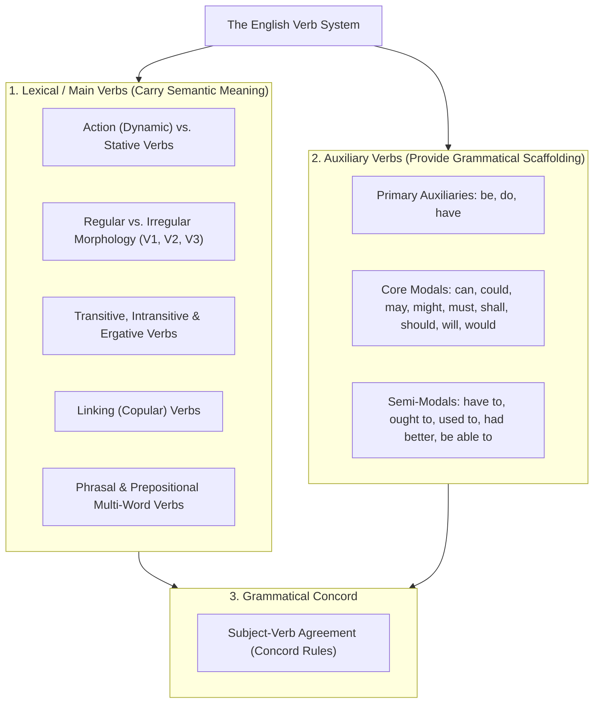

# Verbs and Auxiliaries ⚙️

> *"Verbs are the kinetic energy of language. Without nouns, you have no entities; without verbs, nothing can happen, change, communicate, or compute."*  
> — Reference: Michael Swan (*Practical English Usage*, §1–2, 7); Raymond Murphy (*English Grammar in Use*, Units 17, 26–37, 51)

Welcome to the **Verbs and Auxiliaries** module of the English Grammar Knowledge System. This module equips you with the foundational mechanisms governing the verbal system of English.

---

## 🧭 Topic Catalog & Navigation

| Document | Core Focus | CEFR Level | Key Practical Takeaway |
| :--- | :--- | :---: | :--- |
| **[1. Action vs. Stative Verbs](verb-types-action-vs-stative.md)** | Dynamic events vs cognitive/sensory states | A2 | Stop saying *"I am knowing the answer"* or *"The API is having an error"*. |
| **[2. Primary Auxiliaries (`be`, `do`, `have`)](primary-auxiliaries-be-do-have.md)** | Aspect, voice, question formation, and dummy *do* | A1–B1 | Master the 3 verbs that function simultaneously as auxiliary and main verbs. |
| **[3. Regular and Irregular Verbs](regular-and-irregular-verbs.md)** | V1/V2/V3 conjugations & pronunciation of `-ed` | A1–B2 | Memorize high-frequency software irregulars (*run/ran/run*, *write/wrote/written*). |
| **[4. Transitive and Intransitive Verbs](transitive-and-intransitive-verbs.md)** | Verb valency, direct/indirect objects, ergatives | A2–B1 | Learn which verbs can form passives and which verbs reject direct objects. |
| **[5. Linking Verbs (Copulas)](linking-verbs-copulas.md)** | *Be, seem, appear, look, feel, become* + adjectives | A2 | Modify copulas with predicate adjectives, never adverbs (*looks strange*, not *strangely*). |
| **[6. Subject-Verb Agreement](subject-verb-agreement.md)** | Number concord across complex subjects | A1–B2 | Eliminate number mismatch bugs with collective nouns, compound subjects, and indefinite pronouns. |
| **[7. Core Modal Verbs](modal-verbs-core.md)** | *Can, could, may, might, must, should, will, would* | B1–B2 | Express degrees of certainty, deduction, technical capability, and polite obligation. |
| **[8. Semi-Modals and Marginal Modals](semi-modals-and-marginal-modals.md)** | *Have to, ought to, used to, had better, be supposed to* | B1–B2 | Differentiate internal obligation (*must*) from external mandates (*have to*). |
| **[9. Phrasal and Prepositional Verbs](phrasal-verbs-and-prepositional-verbs.md)** | Separable vs inseparable particles | B1–B2 | Master particle placement (*turn it off* vs *turn off the server*). |

---

## ⚡ Core Invariants of the English Verb

1. **The Finite Verb Law:** Every independent clause must contain exactly **one finite verb** inflected for tense or modal mood.
2. **The Modal Invariant:** Core modal verbs (*can, must, should*) never take `-s` in the 3rd person singular and must be followed by a **bare infinitive** (V1) without *to*:
   $$\mathbf{Modal} + \mathbf{V1\ (Bare\ Infinitive)} \quad [\text{e.g., } \text{The service must restart}]$$
3. **The Do-Support Rule:** In standard modern English, lexical verbs cannot form questions or negatives directly; they require **do-support** (*Do you agree?*, *I do not know*).
