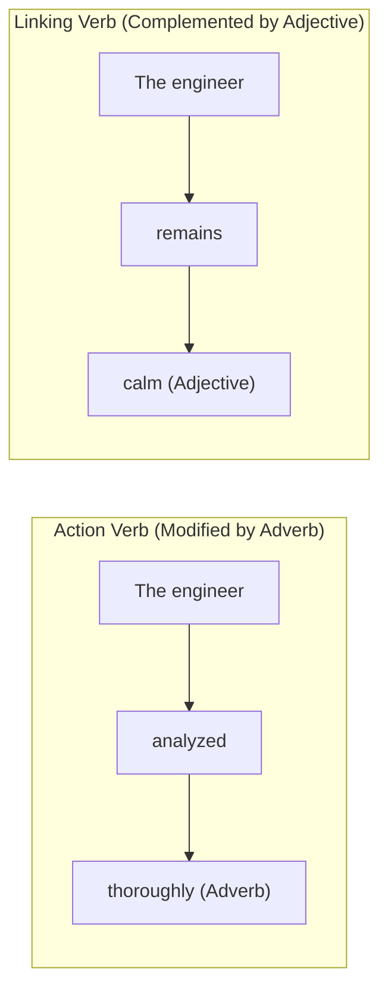
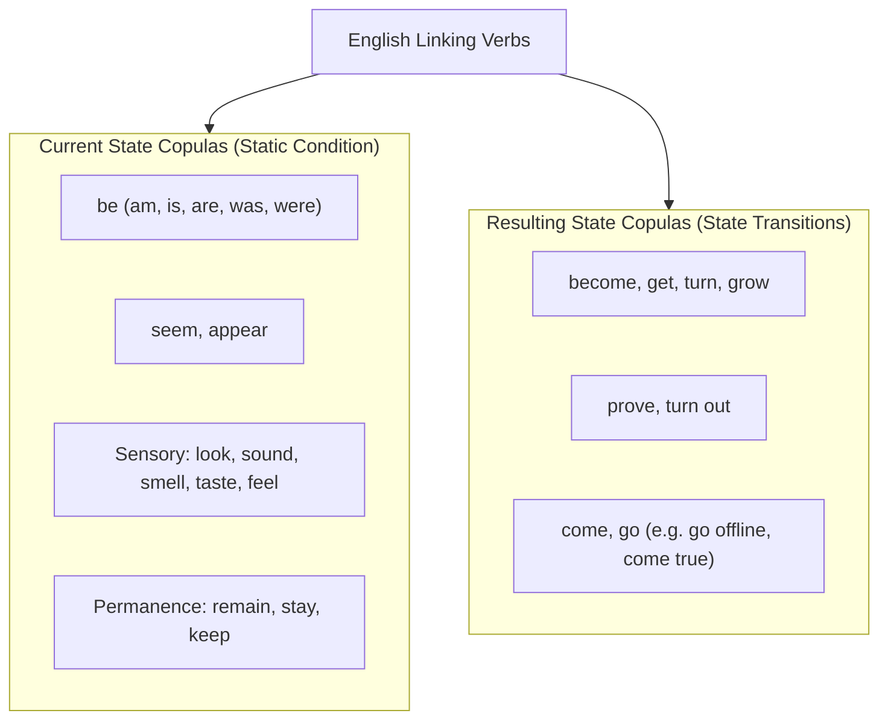
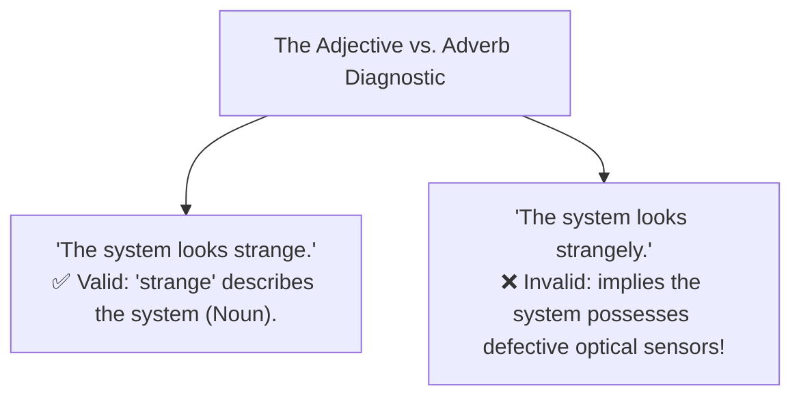

# Linking Verbs (Copulas) 🔗

> **Level:** CEFR A2 (Core Structural Pattern)  
> **Primary References:** Michael Swan (*Practical English Usage*, §11); Raymond Murphy (*English Grammar in Use*, Unit 99)  
> **Cardinal Law:** Linking verbs are followed by **Adjectives** (Subject Complements), **never Adverbs**. A linking verb functions as a semantic equals sign ($=$) connecting the subject to its state.

---

## 1. Intent & The "Equals Sign" ($=$) Mental Model

Unlike action verbs (which denote physical or mental processes and are modified by adverbs), a **linking verb** (or **copula**) asserts identity, sensory quality, or state of being. It completes the clause with a **Subject Complement** ($\mathbf{C_s}$):

$$\mathbf{Subject} + \mathbf{V_{copula}} + \mathbf{Complement\ (Adjective\ or\ Noun\ Phrase)}$$

$$\mathbf{Subject} \iff \mathbf{Subject\ Complement}$$

- *The API server **is** [unreachable] ($\mathbf{C_s}$ - Adjective).*
- *The proposed solution **seems** [viable] ($\mathbf{C_s}$ - Adjective).*
- *PostgreSQL **became** [our primary database] ($\mathbf{C_s}$ - Noun Phrase).*

---

## 2. Taxonomy of Linking Verbs

Linking verbs divide into two broad categories: **Current State** (maintaining an existing condition) and **Resulting State** (transitioning into a new condition).

| Type | Copular Verbs | Canonical Production Example |
| :--- | :--- | :--- |
| **Existence & Identity** | *be* | *The architecture **is** modular.* |
| **Sensory Quality** | *look, sound, smell, taste, feel* | *The deployment script **looks** dangerous.* |
| **Perception & Probability** | *seem, appear* | *The database replica **appears** healthy.* |
| **Persistence of State** | *remain, stay, keep* | *Network latency **remained** stable.* |
| **State Transformation** | *become, get, turn, grow* | *The container **became** unresponsive.* |
| **Verification & Outcome** | *prove, turn out* | *The refactoring **proved** successful.* |
| **Negative Idiomatic Shifts**| *go (bad/offline), fall (silent)* | *The payment service **went** offline.* |

---

## 3. The Cardinal Copula Invariant: Adjective vs. Adverb

Because linking verbs describe the **Subject** (a noun) rather than the **Action** (a verb), the complement **must be an Adjective**:

$$\mathbf{Subject} + \mathbf{Linking\ Verb} + \mathbf{Adjective} \quad \mathbf{[SYNTACTICALLY\ VALID]}$$
$$\mathbf{Subject} + \mathbf{Linking\ Verb} + \mathbf{Adverb} \quad \mathbf{[SYNTAX\ ERROR]}$$

- ❌ *The logs look **badly**.*
- ✅ *The logs look **bad**.*
- ❌ *The team feels **confidently** about the release.*
- ✅ *The team feels **confident** about the release.*
- ❌ *The database remained **stably** during the surge.*
- ✅ *The database remained **stable** during the surge.*

---

## 4. Dual-Mode Verbs: Copular vs. Action Usage

Several verbs function both as linking verbs (modified by adjectives) and as action verbs (modified by adverbs):

| Verb | Copular Function (Subject Complement Adjective) | Action Function (Action Modified by Adverb) |
| :--- | :--- | :--- |
| **Look** | *The query **looks slow**.* (*looks* = appears) | *The engineer **looked closely** at the trace.* (Active looking) |
| **Feel** | *The keyboard **feels comfortable**.* (Tactile property) | *The doctor **felt the pulse gently**.* (Deliberate action) |
| **Taste** | *The coffee **tastes sweet**.* (Flavor property) | *The chef **tasted the soup cautiously**.* (Physical testing) |
| **Smell** | *The server room **smells smoky**.* (Odor attribute) | *The dog **smelled the package eagerly**.* (Active sniffing) |
| **Turn** | *The telemetry alert **turned red**.* (Became red) | *The motor **turned rapidly**.* (Rotated in space) |
| **Appear** | *The cluster **appears stable**.* (Seems stable) | *A dialog box **appeared suddenly**.* (Became visible) |

---

## 5. Dual-Domain Practical Examples

### Everyday Conversational English
1. *She is a software developer.* (Copula *be* + Noun Complement)
2. *This soup tastes delicious.* (Sensory copula + Adjective)
3. *He looked tired after the long flight.* (Sensory copula + Adjective)
4. *The weather turned cold in November.* (Resulting copula + Adjective)
5. *Please stay calm during an emergency.* (Persistence copula + Adjective)
6. *Her prediction proved correct.* (Verification copula + Adjective)
7. *He became an architect at age thirty.* (Resulting copula + Noun Complement)
8. *The milk went sour in the heat.* (Negative transition copula)

### Professional Software Engineering Context
9. *The distributed database cluster **remains responsive** under heavy traffic.*  
   $\to$ Copula *remains* + predicate adjective *responsive*.
10. *The newly implemented cache **proved highly effective** in staging.*  
    $\to$ Copula *proved* + adjective phrase *highly effective*.
11. *The telemetry dashboard **turned red** when CPU usage hit 100%.*  
    $\to$ Resulting copula *turned* + predicate adjective *red*.
12. *The memory allocation graph **looks suspicious**.*  
    $\to$ Sensory copula *looks* + predicate adjective *suspicious*.
13. *The secondary authorization gateway **went offline** at midnight.*  
    $\to$ Idiomatic resulting copula *went* + adjective *offline*.
14. *The microservice **seems reliable**, but it lacks comprehensive integration tests.*  
    $\to$ Perception copula *seems* + predicate adjective *reliable*.
15. *The configuration values **stay valid** until the session terminates.*  
    $\to$ Persistence copula *stay* + predicate adjective *valid*.

---

## 6. Common Mistakes & Diagnostic Anti-Patterns

| Bug (Ungrammatical Construction) | Patch (Correct Copular Syntax) | Root Cause Diagnostic |
| :--- | :--- | :--- |
| ❌ *The API responds **quick**.* | ✅ *The API responds **quickly**.* | *Respond* is an action verb; modifying an action verb requires an adverb (*quickly*). |
| ❌ *The microservice looks **reliably**.* | ✅ *The microservice looks **reliable**.* | *Look* is a copula here; subject complement must be an adjective (*reliable*). |
| ❌ *The architecture remains **stably**.* | ✅ *The architecture remains **stable**.* | *Remain* links the subject to a state; use adjective *stable*. |
| ❌ *The coffee smells **deliciously**.* | ✅ *The coffee smells **delicious**.* | Passive sensory perception requires an adjective complement. |
| ❌ *The deployment turned out **disastrously**.* | ✅ *The deployment turned out **disastrous**.* (or *a disaster*) | Copula *turn out* governs adjective complement *disastrous*. |

---

## 7. Self-Assessment Practice Exercises

### Section A: Copular vs. Dynamic Function
Identify whether the highlighted verb is acting as a **Linking Verb** (Copula) or an **Action Verb**:

1. The test results [**look**] promising.
2. The security analyst [**looked**] carefully through the audit logs.
3. The database server [**remained**] silent for fifteen minutes.
4. The engineer [**felt**] the surface of the overheated drive.
5. The memory utilization [**grew**] alarmingly large.
6. The background process [**turned**] the data into encrypted ciphertext.

### Section B: Adjective vs. Adverb Debugging
Choose the correct word in brackets to complete each sentence grammatically:

7. The authentication mechanism appears [secure / securely].
8. The database engine executed the aggregation query [fast / fastly / quickly].
9. The telemetry metrics smell [fishy / fishily].
10. The microservice stayed [healthy / healthily] despite the distributed denial-of-service attack.
11. The team feels [confident / confidently] that the deployment will succeed.
12. The worker thread terminated [abrupt / abruptly].

---

## 8. Comprehensive Answer Key & Explanations

1. **Linking Verb** — Links subject *test results* to adjective complement *promising*.
2. **Action Verb** — Describes physical gazing; modified by adverb *carefully*.
3. **Linking Verb** — Connects subject *database server* to adjective complement *silent*.
4. **Action Verb** — Describes deliberate physical touch; modified by adverb *carefully*.
5. **Linking Verb** — Resulting copula meaning *became*; complements with adjective *large*.
6. **Action Verb** — Transitive verb of transformation; takes direct object *the data*.
7. **secure** — Linking verb *appears* demands an adjective complement.
8. **quickly** — Action verb *executed* demands an adverb of manner.
9. **fishy** — Sensory copula *smell* (meaning *seem suspicious*) demands an adjective complement.
10. **healthy** — Persistence copula *stayed* demands an adjective complement.
11. **confident** — Linking verb *feels* (emotional state) demands an adjective complement.
12. **abruptly** — Action verb *terminated* demands an adverb of manner.

---

## 9. Revision Flashcards & Key Takeaways

- **Linking Verb Formula:** $\mathbf{Subject} + \mathbf{Linking\ Verb} + \mathbf{Adjective}$.
- **Never Adverbs after Copulas:** *The server looks bad* (not *badly*); *remains stable* (not *stably*); *feels confident* (not *confidently*).
- **The "Be" Test:** If you can substitute *be* (*is, are, was*) into the sentence and maintain coherent grammatical structure, the verb is functioning as a copula:
  - *The query looks slow* $\to$ *The query **is** slow* (Valid $\to$ *looks* is a copula).
  - *The developer looked closely* $\to$ *The developer **is** closely* (Invalid $\to$ *looked* is an action verb).
