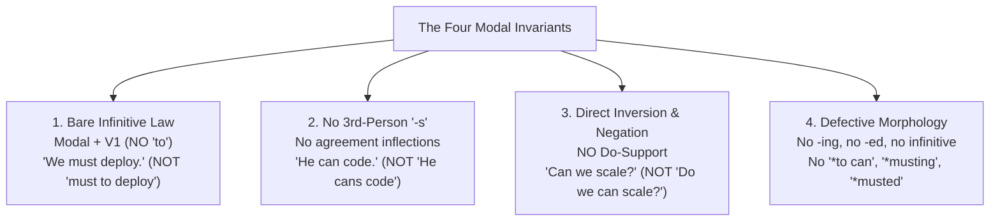
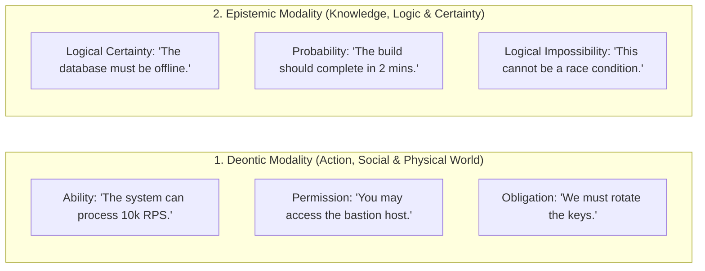
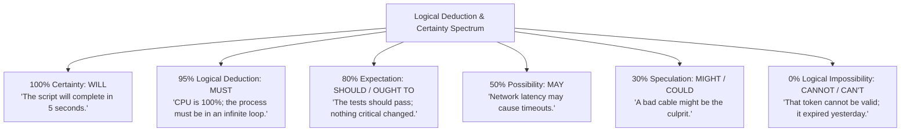
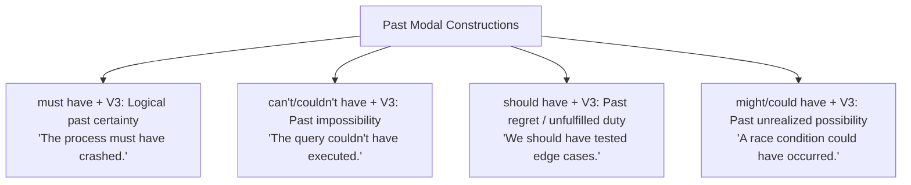

# Core Modal Auxiliary Verbs 🎛️

> **Level:** CEFR B1–B2 (Modal Systematics)  
> **Primary References:** Michael Swan (*Practical English Usage*, §7, 68–87); Raymond Murphy (*English Grammar in Use*, Units 26–37)  
> **Core Concept:** Modal auxiliary verbs do not express physical events; they express the speaker's judgment about **possibility**, **probability**, **obligation**, **ability**, and **certainty**.

---

## 1. The Four Inviolable Laws of Modal Verbs

Every core modal (*can, could, may, might, must, shall, should, will, would*) adheres strictly to four syntactic constraints:

---

## 2. The Dual Continuum of Modality

Modal verbs operate across two distinct semantic axes:

---

## 3. The Epistemic Scale of Logical Certainty

When deducing the cause of a system behavior or predicting an outcome, English uses modal verbs to calibrate degrees of certainty:

| Modal | Degree of Certainty | Production Technical Example |
| :--- | :--- | :--- |
| **Must** | Logical deduction (Positive certainty) | *The disk is full; that **must** be why writes are failing.* |
| **Cannot / Can't** | Logical impossibility (Negative certainty)| *The port **cannot** be open; the firewall blocked it.* |
| **Should** | Reasonable expectation based on normal facts | *The deployment **should** finish before the user traffic peaks.* |
| **May** | Factual possibility | *The database **may** throttle queries under high load.* |
| **Might / Could** | Hypothetical or remote possibility | *A concurrent write **might** cause data corruption.* |

> [!CAUTION]
> **The Negative Deduction Trap:**
> The negative counterpart of logical deduction *must* is **cannot / can't**, **never** *must not*!
> - *The logs show 200 OK. The service **must** be healthy.* (Positive deduction)
> - *The logs show 500 errors. The service **cannot** be healthy.* (Negative deduction)
> - *Must not* expresses **prohibition**, not deduction (*You **must not** deploy on Friday*).

---

## 4. Deontic Functions (Ability, Permission, and Obligation)

### 1. Ability (*Can* vs. *Could* vs. *Was Able To*)
- **General Present Ability:** *Python **can** handle multi-threading via multiprocessing.*
- **General Past Ability:** *In the 1990s, computers **could** not handle 4K video rendering.*
- **Specific Past Achievement:** When an action succeeded in a single, specific situation, use **was/were able to** or **managed to** (NOT *could*):
  - ❌ *Although the server hung, we **could** reboot it.* (Unnatural)
  - ✅ *Although the server hung, we **were able to** (or **managed to**) reboot it.*

### 2. Permission (*May* vs. *Can* vs. *Could*)
- *May I inspect the production database?* (High formal politeness)
- *Could I review your pull request?* (Polite professional inquiry)
- *You can push to the feature branch.* (Standard permission)

### 3. Obligation & Advice (*Must* vs. *Should*)
- **Must:** Urgent, non-negotiable obligation:
  - *All engineers **must** enable two-factor authentication.*
- **Should:** Recommendation, best practice, or technical advice:
  - *You **should** write parameterized unit tests for edge cases.*

---

## 5. Past Modals of Deduction & Regret ($\mathbf{Modal} + \mathbf{have} + \mathbf{V3}$)

To project modal judgments into the past, English pairs the modal with the perfect auxiliary `have` + past participle (V3):

$$\mathbf{Modal} + \mathbf{have} + \mathbf{V3\ (Past\ Participle)}$$

- *The server **must have run out of** memory during the batch import.* (High deductive certainty about the past)
- *The hacker **couldn't have bypassed** the firewall without valid credentials.* (Past impossibility)
- *We **should have written** integration tests before releasing the API.* (Unfulfilled past obligation / regret)
- *The power surge **might have damaged** the storage controller.* (Past possibility)

---

## 6. Dual-Domain Practical Examples

### Everyday Conversational English
1. *I **can** speak three languages.* (General ability)
2. *You **must** wear a seatbelt.* (Strict obligation)
3. *She **should** arrive by 10:00 AM.* (Expectation)
4. *It **might** rain this afternoon.* (Weak possibility)
5. *He **must have left** his phone at home.* (Past logical deduction)
6. *We **should have bought** tickets earlier.* (Past regret)
7. * **Could** you pass the water, please?* (Polite request)
8. *That **cannot** be true!* (Logical disbelief / impossibility)

### Professional Software Engineering Context
9. *The database **can support** up to 50,000 active concurrent connections.*  
   $\to$ Deontic modal of technical capability.
10. *All production microservices **must implement** health check probes.*  
    $\to$ Deontic modal of absolute architectural obligation.
11. *The build failed at the final step; a linter error **must have occurred**.*  
    $\to$ Epistemic modal deduction about a past event.
12. *The authorization token **cannot be** expired; it was issued two seconds ago.*  
    $\to$ Epistemic modal of logical impossibility.
13. *We **should have containerized** the application before scaling to multiple regions.*  
    $\to$ Past modal of technical regret (*should have* + V3).
14. *A sudden spike in user registration **could saturate** the authentication service.*  
    $\to$ Epistemic modal of potential future risk.
15. *Despite the corrupted file table, the recovery team **was able to restore** 99% of user records.*  
    $\to$ Specific past achievement (*was able to*, not *could*).

---

## 7. Common Mistakes & Diagnostic Anti-Patterns

| Bug (Ungrammatical Modal Usage) | Patch (Syntactically Correct) | Root Cause Diagnostic |
| :--- | :--- | :--- |
| ❌ *We **must to** deploy the hotfix.* | ✅ *We **must deploy** the hotfix.* | **The Bare Infinitive Law:** Core modals must be followed by base V1 without *to*. |
| ❌ *The microservice **can able to** scale.* | ✅ *The microservice **can scale** (or **is able to scale**).* | **Double Modal Redundancy:** *Can* and *able to* express the same semantic ability. |
| ❌ *The service is offline. It **must not be running**.* (deduction) | ✅ *The service is offline. It **cannot be running**.* | The negative of logical deduction *must* is **cannot**, not *must not*. |
| ❌ *The engineer **musted** restart the server.* | ✅ *The engineer **had to** restart the server.* | Modals are morphologically defective; the past of obligation *must* is **had to**. |
| ❌ *We **could fix** the critical production bug yesterday.* | ✅ *We **managed to fix** (or **were able to fix**) the critical bug yesterday.* | Specific past triumph demands *managed to* or *was/were able to*, not *could*. |

---

## 8. Self-Assessment Practice Exercises

### Section A: Modal Meaning Identification
Identify whether the highlighted modal expresses **Ability, Obligation, Logical Deduction, Permission,** or **Past Regret**:

1. All developers [**must**] sign their git commits with GPG keys.
2. The telemetry graphs are completely flat; the collector daemon [**must have crashed**].
3. Clients [**may**] request up to 100 records per API page.
4. This encryption cipher [**can**] resist brute-force attacks.
5. We [**should have added**] database indices before running the benchmark.
6. The token [**cannot**] be valid because the digital signature does not match.

### Section B: Modal Syntax Debugging
Correct all modal errors in the following sentences:

7. *The backend engineer must to migrate the schema tonight.*
8. *Although the network connection dropped, the client could reconnect.* (Specific single event)
9. *The API gateway cans handle 10,000 requests per second.*
10. *The database must not be healthy because all query responses are timing out.* (Expressing logical deduction)
11. *We should had written end-to-end tests earlier.*
12. *The frontend is can able to render the charts efficiently.*

---

## 9. Comprehensive Answer Key & Explanations

1. **Obligation** — Strict organizational policy.
2. **Logical Deduction (Past)** — Deduction based on visible flat graphs (*must have* + V3).
3. **Permission** — Permitted API threshold.
4. **Ability** — Technical capability of the cipher.
5. **Past Regret** — Unfulfilled past best practice (*should have* + V3).
6. **Logical Deduction (Impossibility)** — Negative logical deduction based on signature mismatch.
7. **Correction:** *The backend engineer **must migrate** the schema tonight.*  
   *Explanation:* Omit *to*; core modals demand a bare infinitive.
8. **Correction:** *Although the network connection dropped, the client **was able to reconnect** (or **managed to reconnect**).*  
   *Explanation:* A single, specific past success demands *was able to*, not *could*.
9. **Correction:** *The API gateway **can handle** 10,000 requests per second.*  
   *Explanation:* Core modals never take 3rd-person singular `-s`.
10. **Correction:** *The database **cannot be** healthy because all query responses are timing out.*  
    *Explanation:* The negative logical deduction of *must* is *cannot*.
11. **Correction:** *We should **have written** end-to-end tests earlier.*  
    *Explanation:* Past modal formula is strictly $\mathbf{Modal} + \mathbf{have} + \mathbf{V3}$ (never *had*).
12. **Correction:** *The frontend **can render** the charts efficiently.* (or *...**is able to render**...*)  
    *Explanation:* Eliminate redundant *can able to*.

---

## 10. Revision Flashcards & Key Takeaways

- **The Core Modals:** *can, could, may, might, must, shall, should, will, would*.
- **The Bare Infinitive Rule:** $\mathbf{Modal} + \mathbf{V1}$ (No *to*, no `-s`, no `-ed`).
- **Logical Deduction:**
  - Positive 95%: *The server **must be** down.*
  - Negative 95%: *The server **cannot be** down.* (Never *must not* for deduction).
- **Past Modal Formula:** $\mathbf{Modal} + \mathbf{have} + \mathbf{V3}$ (*must have failed*, *should have tested*).
- **Could vs Was Able To:** Use *could* for general past ability (*I could run fast*); use *was able to* or *managed to* for a specific single past achievement (*We were able to recover the data*).
