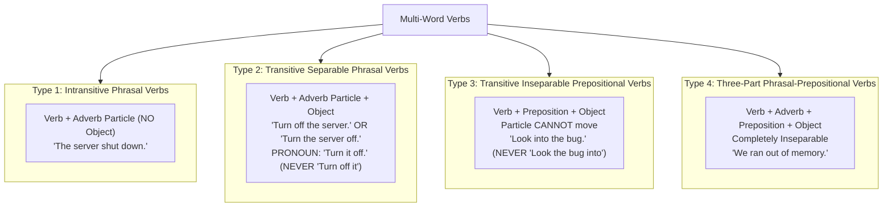
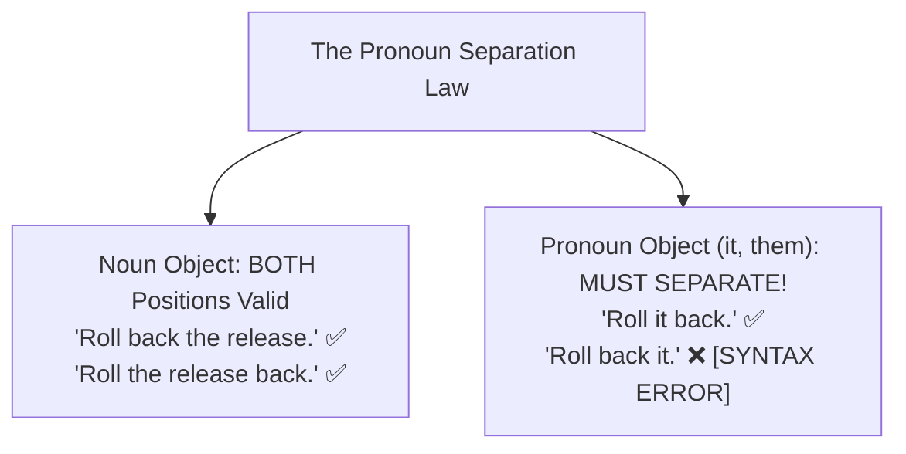

# Phrasal Verbs and Prepositional Verbs 🔄

> **Level:** CEFR B1–B2 (Idiomatic Syntax)  
> **Primary References:** Michael Swan (*Practical English Usage*, §1, 12–14); Raymond Murphy (*English Grammar in Use*, Units 137–145)  
> **Core Concept:** A multi-word verb consists of a base verb combined with one or two **particles** (an adverb, a preposition, or both). The resulting combination produces an idiomatic meaning that cannot be parsed by analyzing the individual words in isolation.

---

## 1. The Four Syntactic Types of Multi-Word Verbs

Multi-word verbs are categorized into four structural patterns based on **transitivity** and **particle separability**:

---

## 2. Type 1: Intransitive Phrasal Verbs (No Object)

These verbs require no direct object. The particle is an adverb:
- *The container **shut down** gracefully.*
- *A race condition **cropped up** during concurrency testing.*
- *When the primary node crashed, the backup **kicked in**.*
- *The network latency suddenly **backed off**.*

---

## 3. Type 2: Transitive Separable Phrasal Verbs

With noun objects, the adverb particle can appear either **before** or **after** the direct object:
1. *The engineer **turned off** [the server].*
2. *The engineer **turned** [the server] **off**.*

> [!IMPORTANT]
> **The Pronoun Invariant:** If the direct object is a personal pronoun (*it, them, him, her, us*), it **must be placed between the verb and the particle**:
> - ✅ *Turn **it** off.*
> - ❌ *Turn off **it**.* (Ungrammatical in English)
> - ✅ *Spin **them** up.*
> - ❌ *Spin up **them**.*

---

## 4. Type 3: Transitive Inseparable Prepositional Verbs

In these verbs, the particle is a **preposition**, not an adverb. The preposition governs the noun that follows it. Consequently, the object **can never** split the verb and preposition:

$$\mathbf{Verb} + \mathbf{Preposition} + \mathbf{Object\ (Noun\ or\ Pronoun)}$$

- *The SRE team is **looking into** the outage.* (Valid)
- ❌ *The SRE team is **looking the outage into**.* (Syntax Error!)
- *The team is **looking into** it.* (Valid)
- ❌ *The team is **looking it into**.* (Syntax Error!)

### Common Inseparable Prepositional Verbs
*account for, call for, come across, cope with, deal with, look after, look into, rely on, run into.*

---

## 5. Type 4: Three-Part Phrasal-Prepositional Verbs

These verbs combine a base verb + an adverb particle + a preposition. They are strictly **transitive and inseparable**:

$$\mathbf{Verb} + \mathbf{Adverb} + \mathbf{Preposition} + \mathbf{Object}$$

- *The service **ran out of** memory.*
- *We need to **catch up with** our sprint commitments.*
- *The architecture team **came up with** a caching strategy.*
- *We must **get rid of** legacy dead code.*
- *The API will **fall back on** cached responses during an outage.*

---

## 6. High-Frequency Software Engineering Phrasal Verbs

| Phrasal Verb | Type | Technical Meaning | Production Example |
| :--- | :---: | :--- | :--- |
| **spin up / tear down** | 2 (Sep) | Provision / destroy compute resources | *The CI worker **spun up** four containers and **tore them down**.* |
| **roll out / roll back**| 2 (Sep) | Deploy / revert a release | *We **rolled out** the patch, but had to **roll it back**.* |
| **scale up / scale out**| 1 (Intr) | Expand vertically / horizontally | *The Kubernetes cluster **scales out** when traffic spikes.* |
| **back up** | 2 (Sep) | Create duplicate data archive | *Always **back up** the database before migrating.* |
| **track down** | 2 (Sep) | Locate and isolate a difficult bug | *The team **tracked down** the elusive memory leak.* |
| **drill down into** | 4 (3-part) | Examine granular log/metric details | *Let us **drill down into** the APM traces.* |
| **fall back on** | 4 (3-part) | Utilize a backup strategy on failure | *The payment worker **falls back on** synchronous RPC.* |
| **time out** | 1 (Intr) | Exceed allocated duration threshold | *The HTTP request **timed out** after 30 seconds.* |

> [!TIP]
> **Verb vs. Noun Spelling Trap:**
> - Two words = **Verb**: *We need to **back up** the database and **roll back** the release.*
> - One word / Hyphenated = **Noun/Adjective**: *We created a **backup** and performed a **rollback**.*

---

## 7. Dual-Domain Practical Examples

### Everyday Conversational English
1. *The plane **took off** on time.* (Type 1 — Intransitive)
2. *Please **turn off** the light.* / *Please **turn the light off**.* (Type 2 — Separable)
3. *Please **turn it off**.* (Type 2 — Pronoun between)
4. *She **looks after** her younger sister.* (Type 3 — Inseparable)
5. *We **ran out of** milk.* (Type 4 — Three-part)
6. *He **gave up** smoking.* (Type 2 — Separable)
7. *I **ran into** an old friend yesterday.* (Type 3 — Inseparable)
8. *I am **looking forward to** the weekend.* (Type 4 — Three-part)

### Professional Software Engineering Context
9. *The background worker **timed out** while awaiting database lock acquisition.*  
   $\to$ Type 1 (Intransitive Phrasal).
10. *The DevOps pipeline **spun up** three ephemeral test environments.*  
    $\to$ Type 2 (Separable Transitive).
11. *When the containers were no longer needed, the runner **tore them down**.*  
    $\to$ Type 2 with pronoun *them* separating verb and particle.
12. *The incident response team is **looking into** the latency degradation.*  
    $\to$ Type 3 (Inseparable Prepositional Verb).
13. *We must **get rid of** unused microservice endpoints.*  
    $\to$ Type 4 (Three-part Inseparable).
14. *If the primary database fails, the application **falls back on** read replicas.*  
    $\to$ Type 4 (Three-part Inseparable).
15. *The QA team **tracked it down** to an off-by-one error in the parser.*  
    $\to$ Type 2 with pronoun *it* placed between *tracked* and *down*.

---

## 8. Common Mistakes & Diagnostic Anti-Patterns

| Bug (Ungrammatical Placement) | Patch (Correct Syntax) | Root Cause Diagnostic |
| :--- | :--- | :--- |
| ❌ *The server was broken, so I turned off **it**.* | ✅ *The server was broken, so I turned **it off**.* | **Pronoun Placement Violation:** Pronoun objects must split separable phrasal verbs. |
| ❌ *The team is looking the bug **into**.* | ✅ *The team is **looking into** the bug.* | *Look into* is an inseparable prepositional verb; the particle cannot be moved. |
| ❌ *We need to **backup** the database.* (as a verb) | ✅ *We need to **back up** the database.* | Verb form is two separate words (*back up*); single word *backup* is a noun. |
| ❌ *The service ran out **from** memory.* | ✅ *The service ran **out of** memory.* | Fixed particle combination is *run out of*. |
| ❌ *The engineer came up a new solution.* | ✅ *The engineer came **up with** a new solution.* | Omission of required preposition in three-part verb *come up with*. |

---

## 9. Self-Assessment Practice Exercises

### Section A: Particle Placement & Pronoun Rules
Rewrite each sentence by replacing the bracketed noun phrase with a personal pronoun (*it* or *them*):

1. The DevOps engineer spun up [the staging environment].
2. The team rolled back [the unstable release].
3. The security team looked into [the unauthorized login attempts].
4. Please turn off [the test runners].
5. We need to back up [the PostgreSQL database].
6. The service fell back on [the legacy auth system].

### Section B: Phrasal Verb Error Correction
Correct all phrasal and prepositional verb syntax bugs:

7. *We noticed the memory leak and immediately tore down it.*
8. *The architect came up a scalable event-driven pattern.*
9. *Always backup your files before modifying the kernel.*
10. *The systems engineer dealt the issue with quickly.*
11. *The background worker shut it down.* (Intransitive usage intended)
12. *The script will roll out it tomorrow morning.*

---

## 10. Comprehensive Answer Key & Explanations

1. *The DevOps engineer **spun it up**.* (Type 2: Pronoun *it* must go between verb and particle).
2. *The team **rolled it back**.* (Type 2: Pronoun *it* must separate *rolled* and *back*).
3. *The security team **looked into them**.* (Type 3: Inseparable prepositional verb; pronoun follows preposition).
4. *Please **turn them off**.* (Type 2: Pronoun *them* must separate *turn* and *off*).
5. *We need to **back it up**.* (Type 2: Pronoun *it* must separate *back* and *up*).
6. *The service **fell back on it**.* (Type 4: Inseparable three-part verb; pronoun follows final preposition).
7. **Correction:** *We noticed the memory leak and immediately **tore it down**.*  
   *Explanation:* Pronoun *it* must split separable verb *tear down*.
8. **Correction:** *The architect **came up with** a scalable event-driven pattern.*  
   *Explanation:* The complete three-part verb is *come up with*.
9. **Correction:** *Always **back up** your files before modifying the kernel.*  
   *Explanation:* As an action verb, use two words *back up* (single word *backup* is a noun).
10. **Correction:** *The systems engineer **dealt with the issue** quickly.*  
    *Explanation:* *Deal with* is inseparable; the object *the issue* must follow *with*.
11. **Correction:** *The background worker **shut down**.*  
    *Explanation:* In the intransitive sense (self-terminating), omit object *it*.
12. **Correction:** *The script will **roll it out** tomorrow morning.*  
    *Explanation:* Pronoun *it* must separate *roll* and *out*.

---

## 11. Revision Flashcards & Key Takeaways

- **The Four Types:**
  - Type 1: Intransitive (*shut down*).
  - Type 2: Separable Transitive (*turn off the server* OR *turn the server off*).
  - Type 3: Inseparable Prepositional (*look into the problem*).
  - Type 4: Three-Part (*fall back on, come up with*).
- **The Pronoun Invariant:** $\mathbf{Verb} + \mathbf{Pronoun} + \mathbf{Particle}$ (*turn it off*, *tear them down*). Never *turn off it*.
- **Verb vs Noun:**
  - *We **back up** the server.* (Verb = 2 words)
  - *We saved the **backup**.* (Noun = 1 word)
  - *We **rolled back** the code.* (Verb = 2 words)
  - *The **rollback** succeeded.* (Noun = 1 word)
