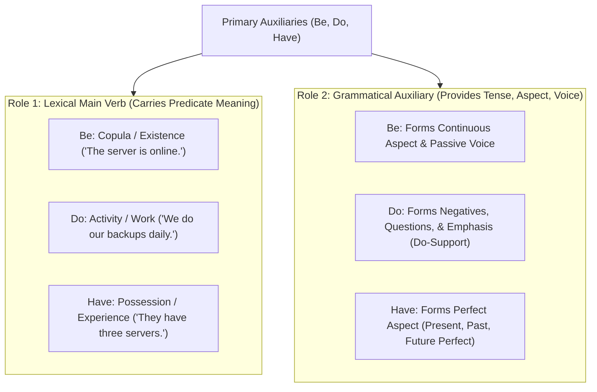
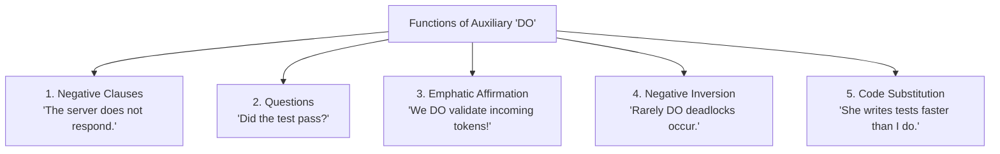

# Primary Auxiliaries: Be, Do, and Have 🛠️

> **Level:** CEFR A1–B1 (Core Mechanical System)  
> **Primary References:** Michael Swan (*Practical English Usage*, §2, 17–29); Raymond Murphy (*English Grammar in Use*, Units 17, 51)  
> **Core Concept:** Unlike lexical verbs (which only express semantic meaning) and modal verbs (which only act as helpers), **be**, **do**, and **have** are the three **Primary Auxiliary Verbs** capable of operating both as full lexical main verbs and as grammatical auxiliary engines.

---

## 1. Dual-Role Architecture: Main Verb vs. Auxiliary Verb

---

## 2. The Auxiliary `BE` (*am, is, are, was, were, being, been*)

`BE` is the most irregular verb in the English language with eight distinct forms:

| Form | Present Tense | Past Tense | `-ing` Form | Past Participle |
| :--- | :--- | :--- | :--- | :--- |
| **Singular (1st)** | *am* | *was* | *being* | *been* |
| **Singular (3rd)** | *is* | *was* | *being* | *been* |
| **Plural / 2nd** | *are* | *were* | *being* | *been* |

### Function 1: Building Continuous (Progressive) Aspect
`BE` pairs with the present participle (`-ing`) to denote ongoing actions:

$$\mathbf{BE} + \mathbf{V\text{-}ing} \implies \text{Continuous Aspect}$$

- *The daemon **is processing** telemetry data.* (Present Continuous)
- *The database **was migrating** records when the power failed.* (Past Continuous)

### Function 2: Building the Passive Voice
`BE` pairs with the past participle (V3) to convert an active clause into the passive voice:

$$\mathbf{BE} + \mathbf{V3\ (Past\ Participle)} \implies \text{Passive Voice}$$

- *The API request **was intercepted** by the security proxy.*
- *All encrypted secrets **are stored** in HashiCorp Vault.*

### Function 3: Lexical Copula (Main Verb)
Links the subject to an adjective or noun complement ($\mathbf{SVC}$ pattern):
- *The Kubernetes cluster **is** highly available.* (Linking verb)

---

## 3. The Auxiliary `DO` (*do, does, did*)

`DO` is the mechanical rescue engine of English grammar. When a lexical verb lacks an auxiliary, `DO` is invoked to perform syntactic operations (**Do-Support**).

### 1. Negative Formation
In standard English, lexical verbs cannot take *not* directly (*The server crashes not* $\to$ archaic/invalid). `DO` is mandatory:

$$\mathbf{Subject} + \mathbf{do/does/did} + \mathbf{not} + \mathbf{V1\ (Bare\ Base\ Verb)}$$

- *The microservice **does not accept** unauthenticated payloads.*
- *The build **did not fail** during compilation.*

### 2. Question Formation (Subject-Auxiliary Inversion)
$$\mathbf{Do/Does/Did} + \mathbf{Subject} + \mathbf{V1\ (Bare\ Base\ Verb)} \mathbf{?}$$

- * **Does** the database **support** distributed transactions?*
- * **Did** the operations team **deploy** the rollback script?*

### 3. Emphatic `DO` (Stressing Truth)
Used in affirmative sentences to contradict a negative assumption or assert certainty:
- *"You didn't update the documentation."* $\to$ *"I **did** update the documentation!"*
- *Although performance dipped, the system **did** remain operational throughout the attack.*

### 4. Auxiliary Substitution
Prevents clunky repetition of the main verb:
- *PostgreSQL handles concurrent writes better than SQLite **does**.* (*does* = *handles concurrent writes*).

---

## 4. The Auxiliary `HAVE` (*have, has, had*)

### Function 1: Building Perfect Aspect
`HAVE` pairs with the past participle (V3) to link an action to a subsequent point in time:

$$\mathbf{HAVE} + \mathbf{V3\ (Past\ Participle)} \implies \text{Perfect Aspect}$$

- *The pipeline **has completed** all test stages.* (Present Perfect $\to$ completed with present relevance)
- *By midnight, the team **had resolved** the incident.* (Past Perfect $\to$ completed before past threshold)
- *Tomorrow we **will have finished** the migration.* (Future Perfect)

### Function 2: Causative `HAVE`
To arrange for someone else to perform a task:
- *We **had** the security auditor **inspect** the encryption keys.* ($\mathbf{Have + Agent + V1}$)
- *We **had** the database **migrated** over the weekend.* ($\mathbf{Have + Object + V3}$ — Causative Passive)

### Function 3: Lexical Possession (`Have` vs `Have got`)
- **American Standard:** *We **have** three staging servers.* (Negative: *We **do not have**...*)
- **British Standard:** *We **have got** three staging servers.* (Negative: *We **haven't got**...*)

---

## 5. Dual-Domain Practical Examples

### Everyday Conversational English
1. *She **is** reading a book.* (`be` as continuous auxiliary)
2. *The window **was** broken by the wind.* (`be` as passive auxiliary)
3. *I **do not** like cold coffee.* (`do` as negative auxiliary)
4. * **Do** you know the time?* (`do` as interrogative auxiliary)
5. *I **did** lock the front door, I'm certain of it!* (`do` for emphasis)
6. *They **have** lived here for five years.* (`have` as perfect auxiliary)
7. *We **had** our house painted last summer.* (Causative `have`)
8. *He works hard, and so **does** his sister.* (Substitute `do`)

### Professional Software Engineering Context
9. *The background worker **is ingesting** logs from CloudWatch.*  
   $\to$ `BE` forming the **Present Continuous aspect**.
10. *The database tables **were partitioned** by region.*  
    $\to$ `BE` forming the **Past Passive voice**.
11. *The API gateway **does not expose** internal service addresses.*  
    $\to$ `DO` providing **do-support for negation**.
12. * **Did** the smoke tests **detect** any regression bugs?*  
    $\to$ `DO` providing **interrogative inversion**.
13. *Although the microservice crashed, it **did persist** all committed transactions to disk.*  
    $\to$ `DO` providing **emphatic confirmation of truth**.
14. *The continuous integration pipeline **has executed** 120 builds today.*  
    $\to$ `HAVE` forming the **Present Perfect aspect**.
15. *The infrastructure team **had the vendor review** our cloud architecture.*  
    $\to$ Causative `HAVE` governing base verb *review*.

---

## 6. Common Mistakes & Diagnostic Anti-Patterns

| Bug (Ungrammatical Construction) | Patch (Syntactically Correct) | Root Cause Diagnostic |
| :--- | :--- | :--- |
| ❌ *The script **did not generated** logs.* | ✅ *The script **did not generate** logs.* | **Double Inflection Bug:** Auxiliary *did* carries the past tense; the lexical verb must remain a bare base verb (V1). |
| ❌ *The microservice **has not** a cache layer.* | ✅ *The microservice **does not have** a cache layer.* | **Missing Do-Support:** In modern English, lexical *have* requires auxiliary *do* for negation. |
| ❌ * **Does** the query **runs** fast?* | ✅ * **Does** the query **run** fast?* | Auxiliary *does* carries the 3rd person singular `-s`; lexical verb must be bare *run*. |
| ❌ *The database was **corrupting** during the crash.* | ✅ *The database was **corrupted** during the crash.* | Continuous participle (*corrupting*) misused instead of passive participle (*corrupted*). |
| ❌ *The tests **are passed**.* | ✅ *The tests **passed**.* (or *The tests **have passed**.*) | Misusing passive `be` with an unaccusative verb; tests pass actively. |

---

## 7. Self-Assessment Practice Exercises

### Section A: Auxiliary vs. Main Verb Identification
Identify the grammatical role of each bracketed bold verb as either **Main Verb (Lexical)** or **Auxiliary Verb**:

1. The cloud engineer [**is**] in the conference room.
2. The compiler [**is**] generating optimized machine code.
3. The server [**was**] restarted at 03:00 UTC.
4. We always [**do**] our code reviews before lunch.
5. The container [**did**] not terminate cleanly.
6. The frontend team [**has**] two open pull requests.
7. The monitoring service [**has**] detected an anomaly.

### Section B: Do-Support & Auxiliary Debugging
Correct the grammatical errors in the following software engineering statements:

8. *The caching layer not works under high concurrency.*
9. *Did the engineer resolved the merge conflict?*
10. *Does the backend service provides health endpoints?*
11. *We had the database administrator tuned the slow queries.*
12. *Although the disk was full, the operating system did maintained core services.*

---

## 8. Comprehensive Answer Key & Explanations

1. **Main Verb (Copula)** — Connects subject to prepositional location complement.
2. **Auxiliary Verb** — Pairs with *-ing* participle *generating* to build Present Continuous.
3. **Auxiliary Verb** — Pairs with past participle *restarted* to build Past Passive.
4. **Main Verb** — Expresses the lexical action of performing reviews.
5. **Auxiliary Verb** — Provides negative do-support for lexical verb *terminate*.
6. **Main Verb** — Expresses lexical possession of pull requests.
7. **Auxiliary Verb** — Pairs with past participle *detected* to build Present Perfect.
8. **Correction:** *The caching layer **does not work** under high concurrency.*  
   *Explanation:* Modern lexical verbs require do-support (*does not*) + base verb (*work*) for negation.
9. **Correction:** *Did the engineer **resolve** the merge conflict?*  
   *Explanation:* Auxiliary *did* already carries past tense; verb must be base form *resolve*.
10. **Correction:** *Does the backend service **provide** health endpoints?*  
    *Explanation:* Auxiliary *does* carries 3rd-person singular `-s`; verb must be bare *provide*.
11. **Correction:** *We had the database administrator **tune** the slow queries.*  
    *Explanation:* Causative structure (*have someone do something*) requires the bare infinitive (*tune*).
12. **Correction:** *Although the disk was full, the operating system did **maintain** core services.*  
    *Explanation:* Emphatic *did* must be followed by base verb *maintain* (not past *maintained*).

---

## 9. Revision Flashcards & Key Takeaways

- **The Big Three Auxiliaries:** `BE`, `DO`, `HAVE`.
- **`BE` Builders:** Continuous aspect (`be + V-ing`) and Passive voice (`be + V3`).
- **`DO` Rescues:** Negatives (`do not + V1`), Questions (`Do/Did + S + V1?`), and Emphasis (`We DO care`).
- **`HAVE` Anchors:** Perfect tenses (`have/has/had + V3`) and Causatives (`have someone do`).
- **The Bare Verb Rule after `DO`:** Whenever *do, does,* or *did* is used as an auxiliary, the following lexical verb **must be in its bare base form (V1)** (*did go*, not *did went*).
