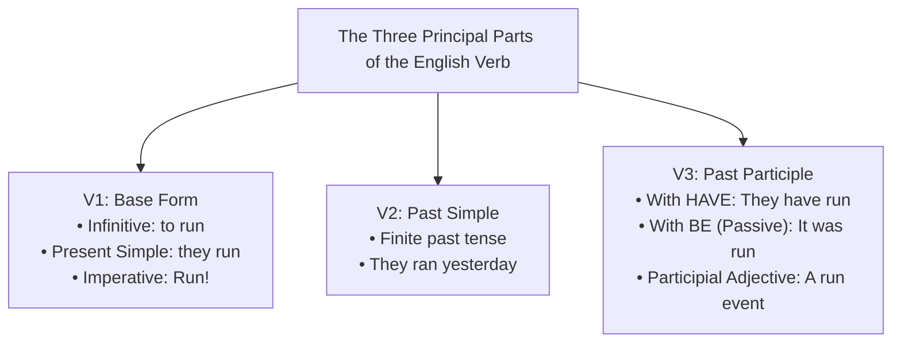
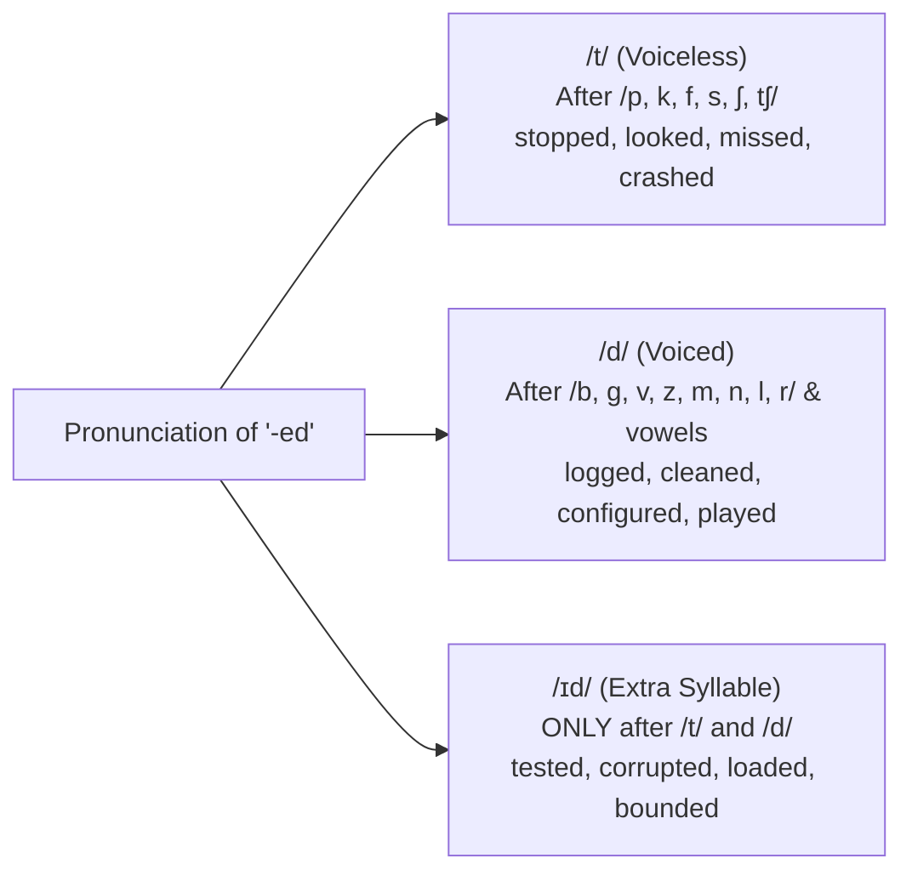
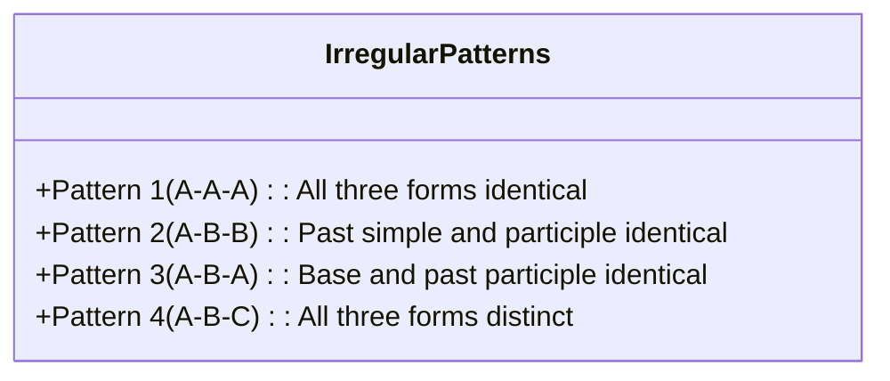
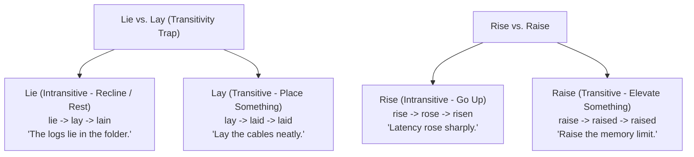

# Regular and Irregular Verbs 🧬

> **Level:** CEFR A1–B2 (Morphological Mastery)  
> **Primary References:** Michael Swan (*Practical English Usage*, §1); Raymond Murphy (*English Grammar in Use*, Appendix 1)  
> **Core Architecture:** Every English verb has three principal morphological forms: **V1** (Base / Bare Infinitive), **V2** (Past Simple), and **V3** (Past Participle). How a verb forms V2 and V3 classifies it as either **Regular** or **Irregular**.

---

## 1. The Principal Parts Matrix

---

## 2. Regular Verbs and the `-ed` Phonetic Code

Regular verbs form their past simple (V2) and past participle (V3) by appending `-ed` (or `-d` if the verb ends in silent `-e`):
$$\mathbf{V2} = \mathbf{V3} = \mathbf{V1} + \mathbf{\text{-}(e)d} \quad [\text{e.g., } \text{compile} \to \text{compiled} \to \text{compiled}]$$

### The Three Phonetic Pronunciation Laws of `-ed`
The suffix `-ed` is pronounced in three distinct ways depending on the **final sound** of the base verb:

| Phonetic Category | Final Sound of Base Verb | Examples | Phonetic Breakdown | Syllable Count |
| :--- | :--- | :--- | :--- | :---: |
| **1. `/t/`** | Voiceless: `/p, k, f, s, ʃ (sh), tʃ (ch), θ/` | *stop, check, sniff, pass, push, watch* | `/stɒpt/`, `/tʃɛkt/`, `/pæst/` | Same as base (1 syllable) |
| **2. `/d/`** | Voiced: `/b, g, v, z, m, n, l, r/` + Vowels | *log, live, zoom, scan, scale, deploy* | `/lɒɡd/`, `/lɪvd/`, `/dɪˈplɔɪd/` | Same as base (1 or 2) |
| **3. `/ɪd/` or `/əd/`**| Dental stops: `/t/` or `/d/` | *test, start, encrypt, load, divide* | `/ˈtɛstɪd/`, `/ɪnˈkrɪptɪd/`, `/ˈloʊdɪd/` | **Adds +1 extra syllable!** |

> [!WARNING]
> **The Extra Syllable Mistake:** Never pronounce an extra syllable for categories 1 and 2. 
> - *crashed* is pronounced `/kræʃt/` (one syllable), **never** *crash-ed*!
> - Only verbs ending in a `/t/` or `/d/` sound (*tested*, *needed*) add an extra syllable.

---

## 3. Irregular Verbs: The Four Structural Patterns

Irregular verbs do not form their past parts with `-ed`. They descend from historical Old English Germanic "strong verbs" and group into four predictable patterns:

### Pattern 1: Invariant Verbs (A-A-A)
All three forms are identical. Essential in computing because they often describe state actions:

| V1 (Base) | V2 (Past Simple) | V3 (Past Participle) | Production Example |
| :--- | :--- | :--- | :--- |
| **cast** | *cast* | *cast* | *The method cast the object to an integer.* |
| **cost** | *cost* | *cost* | *The cloud compute cost five thousand dollars.* |
| **cut** | *cut* | *cut* | *The deployment cut network latency by half.* |
| **hit** | *hit* | *hit* | *Incoming requests hit the cache layer.* |
| **put** | *put* | *put* | *The worker put the message on the queue.* |
| **reset** | *reset* | *reset* | *The watchdog timer reset the microcontroller.* |
| **set** | *set* | *set* | *The script has set the environment variables.* |
| **read** `/riːd/` | *read* `/rɛd/` | *read* `/rɛd/` | *The process read the entire binary into memory.* |

### Pattern 2: Coinciding Past Forms (A-B-B)
The past simple (V2) and past participle (V3) are identical:

| V1 (Base) | V2 (Past Simple) | V3 (Past Participle) | Production Example |
| :--- | :--- | :--- | :--- |
| **bind** | *bound* | *bound* | *The socket bound to port 443.* |
| **build** | *built* | *built* | *The CI pipeline built the container image.* |
| **catch** | *caught* | *caught* | *The try-catch block caught a runtime error.* |
| **find** | *found* | *found* | *The vulnerability scanner found zero defects.* |
| **keep** | *kept* | *kept* | *The database kept a persistent WAL log.* |
| **leave** | *left* | *left* | *The engineer left comments in the PR.* |
| **make** | *made* | *made* | *The team made significant progress.* |
| **send** | *sent* | *sent* | *The service sent a notification webhook.* |
| **spend** | *spent* | *spent* | *We spent two sprints refactoring legacy code.* |
| **understand** | *understood* | *understood* | *The team understood the architectural goals.* |

### Pattern 3: Circular Invariant Forms (A-B-A)
The base form (V1) and past participle (V3) are identical:

| V1 (Base) | V2 (Past Simple) | V3 (Past Participle) | Production Example |
| :--- | :--- | :--- | :--- |
| **become** | *became* | *become* | *The monolith has become difficult to scale.* |
| **come** | *came* | *come* | *The response came back within 15ms.* |
| **run** | *ran* | *run* | *The cron job has run every hour.* |

> [!CAUTION]
> **The "Run" Bug:**
> - Past Simple (V2): *The test **ran** yesterday.*
> - Present Perfect (V3): *The test has **run** successfully.* (NOT *has ran*!)

### Pattern 4: Fully Differentiated Forms (A-B-C)
All three principal parts are distinct (often ending in `-n` or `-en` in V3):

| V1 (Base) | V2 (Past Simple) | V3 (Past Participle) | Production Example |
| :--- | :--- | :--- | :--- |
| **begin** | *began* | *begun* | *The benchmark has begun.* |
| **break** | *broke* | *broken* | *A breaking change broke the client API.* |
| **choose** | *chose* | *chosen* | *The team chose Rust for system components.* |
| **do** | *did* | *done* | *The worker has done its tasks.* |
| **drive** | *drove* | *driven* | *Metrics drove our design decisions.* |
| **freeze** | *froze* | *frozen* | *The pipeline froze during artifact upload.* |
| **give** | *gave* | *given* | *The token was given a 24-hour TTL.* |
| **grow** | *grew* | *grown* | *The telemetry dataset has grown exponentially.* |
| **see** | *saw* | *seen* | *We have never seen this error code before.* |
| **throw** | *threw* | *thrown* | *The service threw an unhandled exception.* |
| **write** | *wrote* | *written* | *She wrote clean, type-hinted code.* |

---

## 4. Confusing Word Trios (Homophonic Traps)

---

## 5. Dual-Domain Practical Examples

### Everyday Conversational English
1. *She **closed** the window.* (`/d/` sound — regular)
2. *He **watched** a documentary.* (`/t/` sound — regular)
3. *They **decided** to move abroad.* (`/ɪd/` sound — regular with extra syllable)
4. *I **put** my keys on the counter.* (A-A-A invariant)
5. *We **bought** a new car last weekend.* (A-B-B irregular)
6. *She **ran** five miles this morning.* (A-B-A V2)
7. *Have you **written** to your parents?* (A-B-C V3)
8. *The river has **frozen** overnight.* (A-B-C V3)

### Professional Software Engineering Context
9. *The deployment pipeline **failed** during integration testing.*  
   $\to$ Regular verb (*fail $\to$ failed*), pronounced `/feɪld/` (one syllable).
10. *The database administrator **reset** the master replication credentials.*  
    $\to$ A-A-A irregular verb (*reset $\to$ reset $\to$ reset*). Never: *reseted*.
11. *The telemetry service **caught** three unhandled network exceptions.*  
    $\to$ A-B-B irregular verb (*catch $\to$ caught $\to$ caught*).
12. *Yesterday, the load tester **ran** for six continuous hours.*  
    $\to$ A-B-A irregular past simple V2 (*run $\to$ ran*).
13. *The background daemon has **run** without interruption for 90 days.*  
    $\to$ A-B-A irregular past participle V3 (*has run*).
14. *The function **threw** a `ValueError` when given null inputs.*  
    $\to$ A-B-C irregular past simple V2 (*throw $\to$ threw*).
15. *All database mutations have been **written** to the write-ahead log.*  
    $\to$ A-B-C irregular past participle V3 (*write $\to$ wrote $\to$ written*).

---

## 6. Common Mistakes & Diagnostic Anti-Patterns

| Bug (Ungrammatical Form) | Patch (Correct Morphology) | Root Cause Diagnostic |
| :--- | :--- | :--- |
| ❌ *The script has **ran**.* | ✅ *The script has **run**.* | **V2/V3 Confusion:** *Ran* is past simple (V2); the present perfect requires past participle (V3) *run*. |
| ❌ *The server **resetted** the connection.* | ✅ *The server **reset** the connection.* | *Reset* is an invariant A-A-A verb; `-ed` is invalid. |
| ❌ *The exception was **catched**.* | ✅ *The exception was **caught**.* | *Catch* is irregular (V3 = *caught*). |
| ❌ *The latency has **rose**.* | ✅ *The latency has **risen**.* | *Rose* is V2; auxiliary *has* demands V3 *risen*. |
| ❌ *The build was **fail-ed**.* | ✅ *The build **failed**.* (`/feɪld/`) | Pronunciation error: *failed* is a single syllable `/feɪld/`, never two. |

---

## 7. Self-Assessment Practice Exercises

### Section A: V2 (Past Simple) and V3 (Past Participle) Form Identification
Provide the correct V2 and V3 forms for each verb:

1. `build` $\to$ V2: ______, V3: ______
2. `write` $\to$ V2: ______, V3: ______
3. `set` $\to$ V2: ______, V3: ______
4. `run` $\to$ V2: ______, V3: ______
5. `throw` $\to$ V2: ______, V3: ______
6. `freeze` $\to$ V2: ______, V3: ______

### Section B: Pronunciation & Morphological Error Correction
Identify the phonetic ending of `-ed` (`/t/`, `/d/`, or `/ɪd/`) and fix grammatical errors:

7. Classify the `-ed` pronunciation in: *compiled, checked, connected, parsed*.
8. *The monitoring tool has began sending alert notifications.*
9. *The database administrator has setted the maximum connection threshold.*
10. *The application choosed the fastest replica.*
11. *Network latency has raised significantly.*
12. *The system administrator has already wrote the deployment runbook.*

---

## 8. Comprehensive Answer Key & Explanations

1. `build` $\to$ V2: **built**, V3: **built** (A-B-B pattern).
2. `write` $\to$ V2: **wrote**, V3: **written** (A-B-C pattern).
3. `set` $\to$ V2: **set**, V3: **set** (A-A-A pattern).
4. `run` $\to$ V2: **ran**, V3: **run** (A-B-A pattern).
5. `throw` $\to$ V2: **threw**, V3: **thrown** (A-B-C pattern).
6. `freeze` $\to$ V2: **froze**, V3: **frozen** (A-B-C pattern).
7. Pronunciations:
   - *compiled* $\to$ **/d/** (Ends in voiced sound /l/ $\to$ 2 syllables).
   - *checked* $\to$ **/t/** (Ends in voiceless sound /k/ $\to$ 1 syllable).
   - *connected* $\to$ **/ɪd/** (Ends in /t/ sound $\to$ adds extra syllable: 3 syllables).
   - *parsed* $\to$ **/t/** (Ends in voiceless sound /s/ $\to$ 1 syllable).
8. **Correction:** *The monitoring tool has **begun** sending alert notifications.*  
   *Explanation:* V3 past participle is *begun* (V2 = *began*).
9. **Correction:** *The database administrator has **set** the maximum connection threshold.*  
   *Explanation:* *Set* is an invariant A-A-A verb.
10. **Correction:** *The application **chose** the fastest replica.*  
    *Explanation:* Past simple of *choose* is *chose* (V3 = *chosen*).
11. **Correction:** *Network latency has **risen** significantly.*  
    *Explanation:* Latency rises on its own (intransitive: *rise $\to$ rose $\to$ risen*). *Raise* is transitive (*We raised the limit*).
12. **Correction:** *The system administrator has already **written** the deployment runbook.*  
    *Explanation:* With auxiliary *has*, the past participle (V3) *written* is required.

---

## 9. Revision Flashcards & Key Takeaways

- **The Three Principal Parts:** V1 (Base), V2 (Past Simple), V3 (Past Participle).
- **The Three `-ed` Sounds:**
  - `/t/` after voiceless (*stopped, crashed*).
  - `/d/` after voiced (*configured, deployed*).
  - `/ɪd/` **only** after `/t/` and `/d/` (*tested, connected*).
- **The Four Irregular Patterns:**
  - **A-A-A:** *set / set / set*, *reset / reset / reset*, *cost / cost / cost*.
  - **A-B-B:** *build / built / built*, *catch / caught / caught*.
  - **A-B-A:** *run / ran / run*, *become / became / become*.
  - **A-B-C:** *write / wrote / written*, *throw / threw / thrown*, *freeze / froze / frozen*.
- **The "Has Run" Rule:** It is *The test ran* (V2), but *The test has run* (V3). Never *has ran*.
