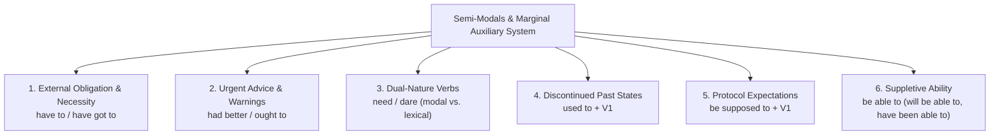
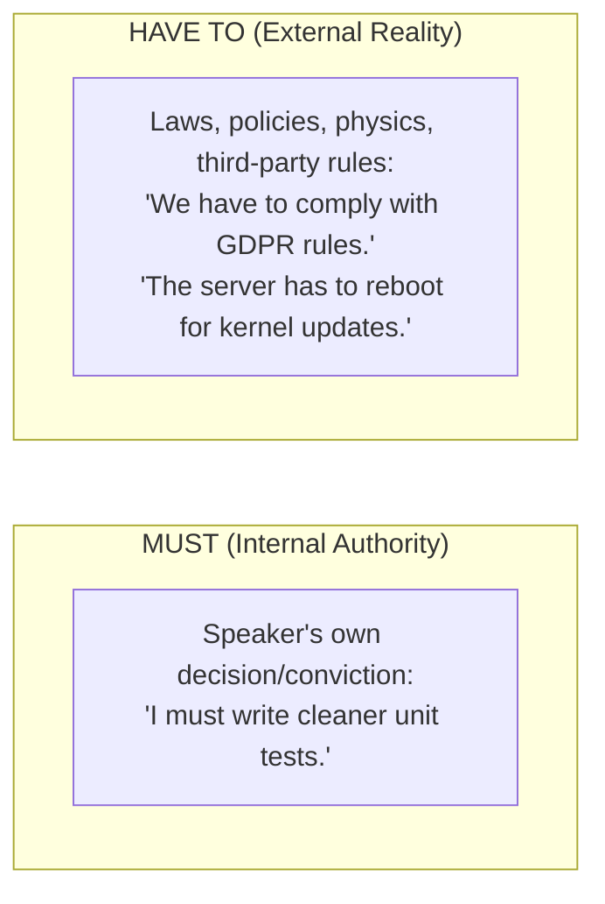
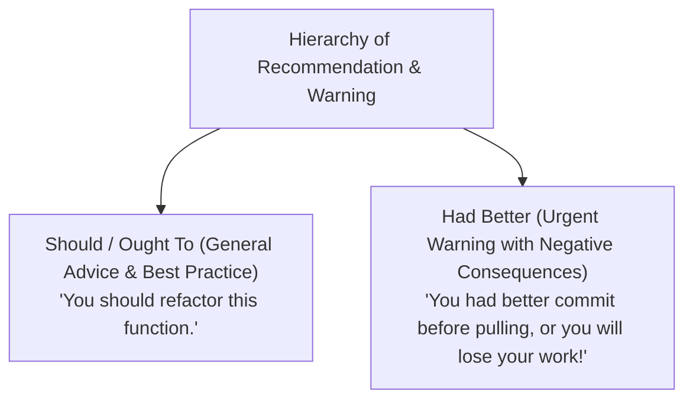

# Semi-Modals and Marginal Modals 🎚️

> **Level:** CEFR B1–B2 (Modal Periphery)  
> **Primary References:** Michael Swan (*Practical English Usage*, §7, 74–78, 85–87); Raymond Murphy (*English Grammar in Use*, Units 31–36)  
> **Core Architecture:** **Semi-modals** (or marginal modals) combine characteristics of core modal verbs and lexical main verbs. They often take *to*-infinitives (*have to, ought to, be able to*), conjugate for tense and person, and supply modal meanings in tenses where core modals are defective.

---

## 1. The Semi-Modal Spectrum

---

## 2. *Must* vs. *Have To*: The Obligation Matrix

Both express necessity, but English distinguishes between **Internal Authority** (*must*) and **External Constraints** (*have to*):

### The Negation Contrast: Prohibition vs. Lack of Obligation
This is one of the most critical functional contrasts in professional communication:

$$\mathbf{Must\ not} \iff \mathbf{Prohibition}\ (\text{Do NOT do this; strictly forbidden})$$
$$\mathbf{Do\ not\ have\ to} \iff \mathbf{Absence\ of\ Obligation}\ (\text{Optional; not required})$$

- *You **must not** commit AWS credentials to GitHub.* (Forbidden! Security violation)
- *You **do not have to** run end-to-end tests locally.* (Optional; the CI server will run them for you)

---

## 3. *Should* vs. *Ought To* vs. *Had Better*

### *Had Better* (`'d better`)
- Always takes a **bare infinitive** (without *to*).
- Formally uses past *had*, but strictly denotes **present or future urgency**!
- Negative form: **had better not** (NOT *hadn't better*).
  - *We **had better verify** database connection pool limits before launching.*
  - *You **had better not touch** the production configuration directly.*

---

## 4. The Dual Life of `NEED` (Modal vs. Lexical)

`NEED` can be conjugated as a regular lexical verb (with do-support and *to*-infinitive) or as an invariant modal auxiliary (chiefly in negatives and questions):

| Structure | Lexical Verb Construction | Modal Auxiliary Construction |
| :--- | :--- | :--- |
| **Negative (-)** | *You **do not need to restart** the pod.* | *You **needn't restart** the pod.* |
| **Question (?)** | * **Do we need to configure** SSL?* | * **Need we configure** SSL?* (Formal) |
| **3rd Person** | *The script **needs to run** as root.* | (Modal form rarely used in affirmative) |

### *Needn't Have Done* vs. *Didn't Need To Do*
- **`Needn't have + V3` (Unnecessary action WAS performed):**
  - *We **needn't have migrated** the database; the old version was compatible.*  
    (We performed the migration, but it proved to be a waste of effort).
- **`Didn't need to + V1` (Action was unnecessary, so was usually omitted):**
  - *We **didn't need to migrate** the database, so we canceled the maintenance window.*

---

## 5. *Used To* (Discontinued Past States & Habits)

Used to describe a regular past action, habit, or state that **is no longer true**:

$$\mathbf{Subject} + \mathbf{used\ to} + \mathbf{V1\ (Bare\ Base\ Verb)}$$

- *We **used to deploy** code manually via FTP.* (We no longer do this).
- *That service **used to be** a monolithic Java application.*
- **Negative:** *We **didn't use to have** automated integration tests.*
- **Question:** * **Did you use to work** at Google?*

> [!WARNING]
> **Do not confuse with `be/get used to`:**
> - *used to + V1:* Past discontinued habit (*We used to deploy manually*).
> - *be used to + -ing / noun:* Accustomed to / familiar with (*I am used to working with distributed systems*).

---

## 6. *Be Supposed To* (Specifications & Expectations)

Indicates what was planned, scheduled, or agreed upon, often contrasted with a diverging reality:

$$\mathbf{Subject} + \mathbf{be\ supposed\ to} + \mathbf{V1}$$

- *The API endpoint **is supposed to return** a 200 OK, but it returns a 500 error.*
- *The backup cron job **was supposed to trigger** at 02:00, but the server was down.*

---

## 7. Dual-Domain Practical Examples

### Everyday Conversational English
1. *I **have to** wake up at 06:00 tomorrow.* (External schedule obligation)
2. *You **must not** park here.* (Strict legal prohibition)
3. *You **don't have to** wear a suit.* (Absence of obligation)
4. *You **had better** wear a coat; it's freezing outside.* (Urgent warning)
5. *We **used to** live in Seattle.* (Past discontinued state)
6. *The train **is supposed to** arrive at noon.* (Schedule expectation)
7. *You **needn't have bought** milk; we already had three cartons.* (Action done unnecessarily)
8. *Will you **be able to** join the dinner tonight?* (Future ability)

### Professional Software Engineering Context
9. *Under SOC-2 compliance, engineers **have to rotate** database credentials every 90 days.*  
   $\to$ External regulatory mandate (*have to*).
10. *Engineers **must not bypass** the automated CI security gates.*  
    $\to$ Strict policy prohibition (*must not*).
11. *Developers **do not have to write** manual mocks; the testing framework generates them.*  
    $\to$ Absence of obligation (*do not have to*).
12. *We **had better increase** disk allocation before the Black Friday sale begins.*  
    $\to$ Urgent warning of severe consequence (*had better* + bare verb).
13. *The monolith **used to handle** all billing, but we extracted it into a separate service.*  
    $\to$ Discontinued past architectural state (*used to*).
14. *The health check probe **is supposed to ping** the cluster every 10 seconds.*  
    $\to$ Architectural specification expectation (*is supposed to*).
15. *We **didn't need to provision** additional cloud hardware because query caching dropped CPU load.*  
    $\to$ Unnecessary task that was correctly avoided (*didn't need to*).

---

## 8. Common Mistakes & Diagnostic Anti-Patterns

| Bug (Ungrammatical Construction) | Patch (Syntactically Correct) | Root Cause Diagnostic |
| :--- | :--- | :--- |
| ❌ *You **had better to commit**.* | ✅ *You **had better commit**.* | *Had better* is followed by a bare infinitive without *to*. |
| ❌ *You **must not** write unit tests.* (when intended as optional) | ✅ *You **do not have to** write unit tests.* | Confusing prohibition (*must not*) with optionality (*don't have to*). |
| ❌ *Next year, we **will can** scale.* | ✅ *Next year, we **will be able to** scale.* | Core modal *can* has no future form; use suppletive semi-modal *will be able to*. |
| ❌ *We **used to deployed** code.* | ✅ *We **used to deploy** code.* | *Used to* must be followed by base verb V1 (*deploy*). |
| ❌ *You **better not** touch it.* | ✅ *You **had better not** touch it.* | Formal technical English requires the auxiliary *had* before *better*. |

---

## 9. Self-Assessment Practice Exercises

### Section A: Meaning & Usage Selection
Select the most accurate semi-modal construction for each scenario:

1. [Prohibition vs Optionality]: You [must not / don't have to] deploy unapproved code to production.
2. [Prohibition vs Optionality]: You [must not / don't have to] attend the optional brown-bag session.
3. [Warning]: The database is at 98% capacity; we [had better / used to] expand the volume immediately.
4. [Past Habit]: Our engineering team [used to / was supposed to] manage bare-metal servers before migrating to AWS.
5. [Specification]: The webhook [is supposed to / had better] fire within 500 milliseconds of user registration.
6. [Future Ability]: With this new cluster, we [will can / will be able to] benchmark 100,000 concurrent requests.

### Section B: Semi-Modal Error Correction
Correct all errors in the following software engineering statements:

7. *You had better to back up the database before running migrations.*
8. *Under the new security policy, employees must not to share passwords.*
9. *The background daemon didn't use to crashing under heavy traffic.*
10. *We had to didn't need to provision more RAM.*
11. *The developer didn't needed to rewrite the query.*
12. *We needn't to worry about cold starts with provisioned concurrency.*

---

## 10. Comprehensive Answer Key & Explanations

1. **must not** — Expresses strict organizational prohibition.
2. **don't have to** — Expresses lack of obligation (the session is optional).
3. **had better** — Expresses an urgent warning with imminent negative consequences.
4. **used to** — Expresses a discontinued past practice.
5. **is supposed to** — Expresses a design specification / protocol expectation.
6. **will be able to** — Suppletive modal construction for future capability.
7. **Correction:** *You had better **back up** the database before running migrations.*  
   *Explanation:* *Had better* requires a bare infinitive without *to*.
8. **Correction:** *Under the new security policy, employees **must not share** passwords.*  
   *Explanation:* Core modal *must not* takes a bare infinitive without *to*.
9. **Correction:** *The background daemon didn't **use to crash** under heavy traffic.*  
   *Explanation:* Negative *didn't use to* takes base verb *crash* (not *-ing*).
10. **Correction:** *We **didn't need to provision** more RAM.*  
    *Explanation:* Eliminate conflicting modal auxiliaries.
11. **Correction:** *The developer **didn't need to rewrite** the query.*  
    *Explanation:* Auxiliary *didn't* already carries the past tense; verb must be base *need*.
12. **Correction:** *We **needn't worry** about cold starts with provisioned concurrency.*  
    *Explanation:* Modal *needn't* takes a bare infinitive without *to*.

---

## 11. Revision Flashcards & Key Takeaways

- **Must vs Have To:** *Must* = internal conviction; *Have to* = external policy/rules.
- **Prohibition vs Optionality:**
  - *Must not* = It is forbidden!
  - *Don't have to* = It is optional (no obligation).
- **Had Better Formula:** $\mathbf{had\ better} + \mathbf{V1}$ (No *to*). Used for urgent present/future warnings.
- **Future Ability:** Use *will be able to* (never *will can*).
- **Used To Formula:** $\mathbf{used\ to} + \mathbf{V1}$ denotes a discontinued past state/habit (*We used to use SVN*).
