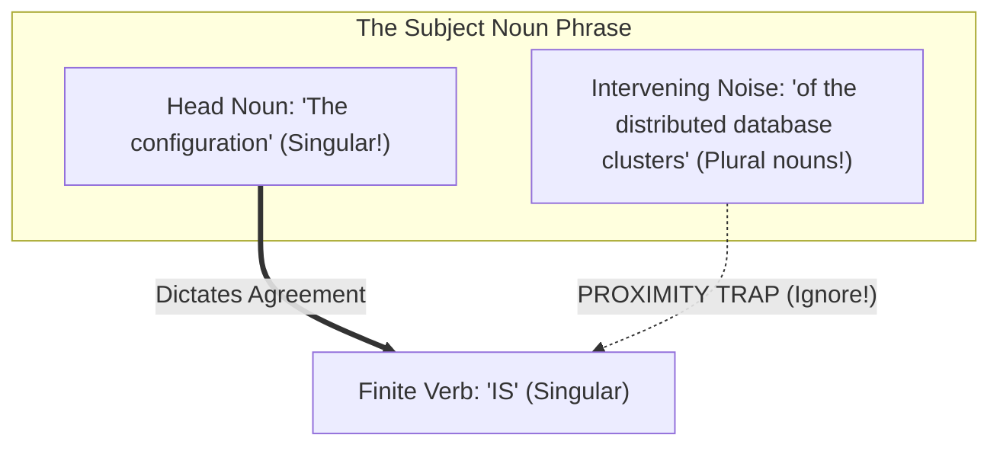
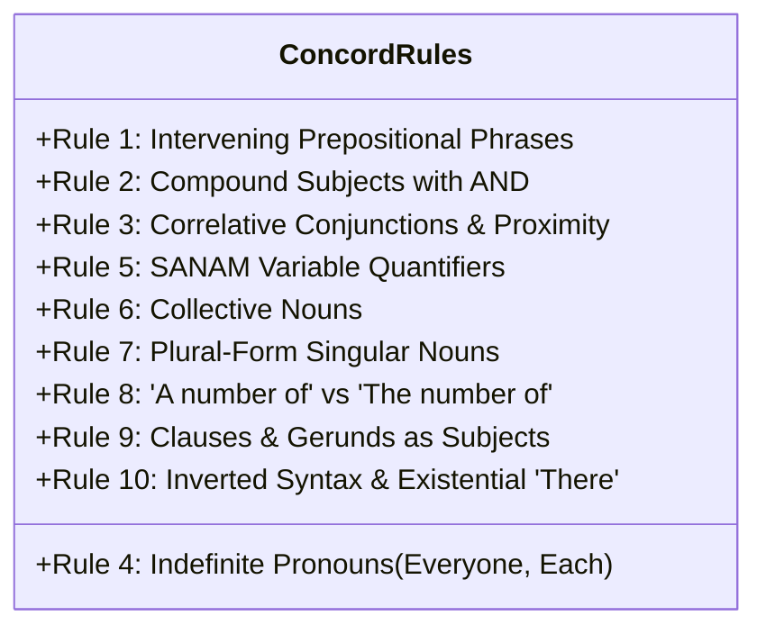

# Subject-Verb Agreement (Concord) ⚖️

> **Level:** CEFR A1–B2 (Essential Mechanical Precision)  
> **Primary References:** Michael Swan (*Practical English Usage*, §11, 182–209); Raymond Murphy (*English Grammar in Use*, Units 79, 88–91)  
> **The Golden Law:** A finite verb must agree in **person** and **number** with its grammatical **Subject**. Number agreement is strictly determined by the **Head Noun** of the subject phrase—never by intervening prepositional phrases or modifiers.

---

## 1. Intent & The "Signal vs. Noise" Mental Model

Subject-Verb Agreement errors in technical writing almost never occur in simple sentences like *"The server runs."* They occur when modifying clauses, prepositional phrases, and parenthetical elements create syntactic noise between the subject and its verb:

- ❌ *The [configuration] ($\mathbf{S_{sg}}$) of the distributed database servers [are] ($\mathbf{V_{pl}}$) invalid.* (Proximity Bug!)
- ✅ *The [configuration] ($\mathbf{S_{sg}}$) of the distributed database servers [is] ($\mathbf{V_{sg}}$) invalid.*

---

## 2. The Ten Cardinal Concord Rules

### Rule 1: The Intervening Prepositional Phrase
Modifiers between the subject and verb do not change the number of the subject:
- *The list of authorized IP addresses **is** stored in Redis.* (Head: *list* $\to$ singular)
- *The vulnerabilities identified by the security audit **were** patched.* (Head: *vulnerabilities* $\to$ plural)

### Rule 2: Compound Subjects Linked by `AND`
Two or more singular subjects joined by *and* form a plural subject:
- *Python and Go **are** used across our microservices.*
> [!NOTE]
> **Exception (Unitary Concepts):** When two nouns joined by *and* represent a single integrated unit or entity, use a singular verb:
> - *Trial and error **is** fundamental to engineering discovery.*
> - *The founder and CEO **has** approved the acquisition.* (One person holding both titles).

### Rule 3: Alternative Conjunctions (`OR`, `NOR`, `EITHER...OR`, `NEITHER...NOR`)
The verb agrees with the subject **nearest to the verb** (**The Principle of Proximity**):
- *Neither the lead architect nor the **developers** **were** in agreement.* (Developers $\to$ plural verb *were*)
- *Neither the developers nor the **lead architect** **was** in agreement.* (Lead architect $\to$ singular verb *was*)
- *Either the primary host or the **backup nodes** **handle** the traffic.*

### Rule 4: Indefinite Singular Pronouns
Words ending in *-body, -one, -thing*, as well as *each, every, either, neither*, are **strictly singular**:
- ***Everyone** on the platform engineering team **has** write access.* (Not: *have*)
- ***Each** of the API endpoints **requires** an authorization header.* (Not: *require*)
- ***Neither** of the suggested frameworks **meets** our latency requirements.*

### Rule 5: SANAM Variable Quantifiers
Five quantifiers vary based on the noun inside the prepositional phrase (*of + noun*):
$$\mathbf{SANAM} = \mathbf{Some},\ \mathbf{Any},\ \mathbf{None},\ \mathbf{All},\ \mathbf{Most}$$

| Quantifier Target | Governing Noun in 'of'-Phrase | Verb Number | Production Example |
| :--- | :--- | :---: | :--- |
| **All** | Uncountable Noun (*data, memory*) | **Singular** | *All of the memory **is** allocated.* |
| **All** | Countable Plural Noun (*servers*) | **Plural** | *All of the servers **are** healthy.* |
| **Some** | Uncountable Noun (*traffic*) | **Singular** | *Some of the traffic **was** throttled.* |
| **Some** | Countable Plural Noun (*requests*) | **Plural** | *Some of the requests **were** dropped.* |
| **None** | Uncountable Noun (*information*) | **Singular** | *None of the confidential information **was** leaked.* |
| **None** | Countable Plural Noun (*endpoints*)| **Plural / Singular** | *None of the endpoints **are** responsive.* (Modern standard) |

### Rule 6: Collective Nouns (*team, committee, company, crew*)
- **American Standard (Default for Tech):** Treated uniformly as **singular** units:
  - *The infrastructure team **has** scheduled maintenance.*
  - *Apple **is** releasing a new framework.*
- **British Standard:** Treated as plural when highlighting individual members:
  - *The team **are** debating the pull request.*

### Rule 7: Plural-Form Nouns with Singular Meaning
Nouns ending in `-s` that denote a singular discipline, disease, or entity take a **singular verb**:
- *Mathematics / Physics / Economics / Statistics / News*
  - *The news regarding the data breach **was** shocking.*
  - *Statistics **is** a core prerequisite for machine learning.*
> [!TIP]
> When *statistics* refers to raw data points rather than the academic field, it is plural:
> - *The benchmark statistics **show** a 40% speedup.*

### Rule 8: *A number of* vs. *The number of*
$$\text{"A number of"} + \text{Plural Noun} \implies \mathbf{Plural\ Verb}\ (\text{"Several"})$$
$$\text{"The number of"} + \text{Plural Noun} \implies \mathbf{Singular\ Verb}\ (\text{The Mathematical Count})$$

- ***A number of** microservices **have** failed health checks.* (Several microservices have failed)
- ***The number of** active database connections **is** escalating.* (The metric count is escalating)

### Rule 9: Gerund Phrases and Noun Clauses as Subjects
When a clause or gerund phrase acts as the subject, it is **always singular**:
- *[Writing clean, self-documenting tests] **requires** discipline.* (Singular verb *requires*)
- *[That the deployment failed] **is** undeniable.* (Singular verb *is*)

### Rule 10: Inverted Syntax & Existential `There`
In sentences introduced by dummy *there*, the grammatical subject follows the verb:
- *There **is** [a syntax error] ($\mathbf{S_{sg}}$) in your SQL query.*
- *There **are** [multiple syntax errors] ($\mathbf{S_{pl}}$) in your SQL query.*

---

## 3. Dual-Domain Practical Examples

### Everyday Conversational English
1. *The dog and the cat **are** playing.* (Compound subject with *and*)
2. *Neither of my parents **is** retired.* (Indefinite singular *neither*)
3. *A bouquet of yellow roses **was** delivered to her door.* (Head: *bouquet*)
4. *Either you or John **needs** to take out the trash.* (Proximity: *John*)
5. *The committee **has** decided on a venue.* (American singular collective)
6. *Writing novels **takes** patience.* (Gerund subject)
7. *There **were** five apples in the basket.* (Inverted subject *five apples*)
8. *The news **was** better than expected.* (Plural-form singular)

### Professional Software Engineering Context
9. *The performance of the read-heavy database clusters **is** acceptable.*  
   $\to$ Head noun *performance* is singular $\implies$ *is*.
10. *Every engineer and engineering manager **must sign** the security pledge.*  
    $\to$ Preceded by *Every* $\implies$ singular agreement.
11. *A number of microservices **are** experiencing network timeout errors.*  
    $\to$ *A number of* $\implies$ plural verb *are*.
12. *The number of unhandled exceptions **has decreased** by 50%.*  
    $\to$ *The number of* $\implies$ singular verb *has*.
13. *Neither the primary database nor the replicas **were** damaged.*  
    $\to$ Nearest subject *replicas* is plural $\implies$ *were*.
14. *All of the telemetry data **was persisted** to S3.*  
    $\to$ *Data* is uncountable $\implies$ singular verb *was*.
15. *Refactoring legacy monolithic components **requires** comprehensive regression tests.*  
    $\to$ Gerund phrase subject (*Refactoring...*) is singular $\implies$ *requires*.

---

## 4. Common Mistakes & Diagnostic Anti-Patterns

| Bug (Concord Violation) | Patch (Syntactically Correct) | Root Cause Diagnostic |
| :--- | :--- | :--- |
| ❌ *The list of dependencies **are** outdated.* | ✅ *The list of dependencies **is** outdated.* | **Proximity Error:** The subject is singular *list*, not plural *dependencies*. |
| ❌ *Everyone on the call **agree** with the RFC.* | ✅ *Everyone on the call **agrees** with the RFC.* | *Everyone* is an indefinite singular pronoun requiring 3rd-person singular `-s`. |
| ❌ *There **is** three critical bugs.* | ✅ *There **are** three critical bugs.* | Inverted subject *three critical bugs* is plural; demands plural *are*. |
| ❌ *The number of outages **have** grown.* | ✅ *The number of outages **has** grown.* | *The number of* denotes the singular metric count; demands *has*. |
| ❌ *Deploying updates **cause** downtime.* | ✅ *Deploying updates **causes** downtime.* | Gerund phrase subject (*Deploying updates*) is grammatically singular. |

---

## 5. Self-Assessment Practice Exercises

### Section A: Concord Selection
Choose the correct verb form in brackets for each sentence:

1. The configuration of the load balancers [is / are] automatically synchronized.
2. A number of Kubernetes pods [has / have] entered a CrashLoopBackOff state.
3. The number of active websocket connections [has / have] reached the system limit.
4. Neither the security team nor the systems architect [was / were] notified of the migration.
5. All of the incoming streaming telemetry [is / are] routed through Apache Kafka.
6. Each of the microservices [exposes / expose] a `/healthz` endpoint.
7. Writing integration tests for legacy monoliths [takes / take] substantial engineering effort.
8. There [is / are] several unindexed queries causing CPU spikes.

### Section B: Sentence Concord Debugging
Identify and patch the Subject-Verb Agreement error in each statement:

9. *The engineering team have approved the architectural blueprint.* (US tech standard)
10. *Neither the database administrator nor the backend engineers was able to reproduce the deadlock.*
11. *Some of the database storage are corrupted due to hardware failure.*
12. *The series of benchmarks demonstrate high throughput.*

---

## 6. Comprehensive Answer Key & Explanations

1. **is** — The grammatical head noun is singular *configuration*; ignore plural *load balancers*.
2. **have** — *A number of* means *several*; it takes a plural verb (*have*).
3. **has** — *The number of* refers to the single numerical count; it takes a singular verb (*has*).
4. **was** — In *neither...nor*, the verb agrees with the nearest subject (*the systems architect* $\to$ singular *was*).
5. **is** — *Telemetry* is an uncountable noun; *all of the telemetry* takes a singular verb (*is*).
6. **exposes** — *Each* is an indefinite singular pronoun; takes 3rd-person singular verb *exposes*.
7. **takes** — Gerund phrase subject (*Writing integration tests...*) is singular $\implies$ *takes*.
8. **are** — Inverted subject *several unindexed queries* is plural $\implies$ *There are*.
9. **Correction:** *The engineering team **has** approved the architectural blueprint.*  
   *Explanation:* In American English and software documentation, collective nouns (*team*) are singular units.
10. **Correction:** *Neither the database administrator nor the backend engineers **were** able to reproduce the deadlock.*  
    *Explanation:* Proximity principle: the nearest subject is plural *backend engineers*, requiring plural *were*.
11. **Correction:** *Some of the database storage **is** corrupted due to hardware failure.*  
    *Explanation:* *Storage* is uncountable $\implies$ singular verb *is*.
12. **Correction:** *The series of benchmarks **demonstrates** high throughput.*  
    *Explanation:* The subject is singular *The series* (one series), demanding 3rd-person singular *demonstrates*.

---

## 7. Revision Flashcards & Key Takeaways

- **Find the Head Noun:** Strip away prepositional phrases (*of, with, in, for*) to find the real subject (*The list of items is*, not *are*).
- **Indefinite Pronouns are Singular:** *Everyone, someone, each, every, either, neither* $\to$ Singular verb.
- **The Proximity Rule:** With *or* and *nor*, match the verb to the **closest** subject noun.
- **A Number vs The Number:**
  - *A number of...* = Plural (*A number of servers are down*).
  - *The number of...* = Singular (*The number of servers is rising*).
- **Gerunds are Singular:** *Writing tests is essential*, not *are essential*.
