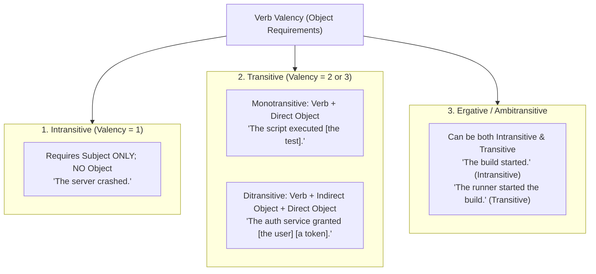
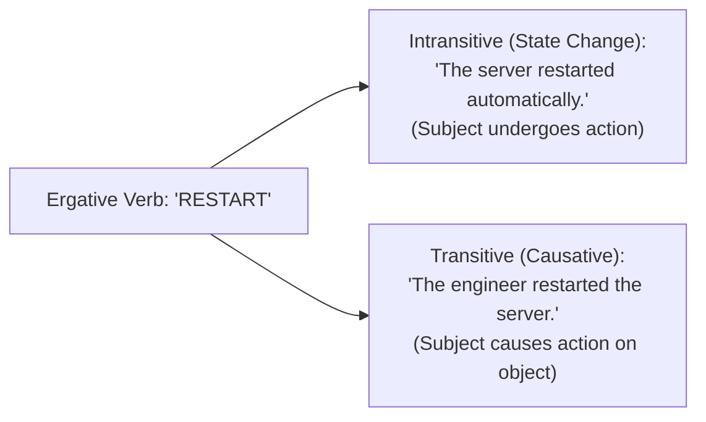

# Transitive, Intransitive, and Ergative Verbs 🎯

> **Level:** CEFR A2–B1 (Syntactic Valency)  
> **Primary References:** Michael Swan (*Practical English Usage*, §7–9); Raymond Murphy (*English Grammar in Use*, Units 42, 44)  
> **Golden Invariant:** **Only transitive verbs can form passive sentences.** Intransitive verbs can never take a direct object and can never be converted into the passive voice.

---

## 1. Verb Valency: The Three Core Categories

**Valency** refers to the number and type of arguments (objects) a verb demands to form a syntactically complete clause:

---

## 2. Intransitive Verbs & The Passivization Prohibition

An **intransitive verb** expresses an action that does not pass over to a recipient entity. It takes no direct object:

$$\mathbf{Subject} + \mathbf{V_{intransitive}} + (\mathbf{Adverbials})$$

- *The distributed lock **expired**.*
- *A critical race condition **occurred** at 04:00 UTC.*
- *The container **died** unexpectedly.*

> [!CAUTION]
> **The Illegal Passive Bug:**
> Because passivization operates by promoting the **Direct Object** of an active clause to the **Subject** of a passive clause, **intransitive verbs can never be passive**:
> - ❌ *The outage was happened.* (Syntax Error)
> - ✅ *The outage **happened**.*
> - ❌ *A memory error was occurred.* (Syntax Error)
> - ✅ *A memory error **occurred**.*
> - ❌ *The thread was disappeared.* (Syntax Error)
> - ✅ *The thread **disappeared**.*

### Purely Intransitive Verbs (Never Passive)
*appear, arrive, belong, collapse, crash, die, disappear, emerge, exist, expire, fall, happen, hesitate, lie, occur, remain, rise, sleep, vanish.*

---

## 3. Transitive Verbs (Monotransitive vs. Ditransitive)

### 1. Monotransitive Verbs (One Object: $\mathbf{SVO_d}$)
Require a direct object to be grammatically complete:
- ❌ *The developer fixed.* (Incomplete: fixed what?)
- ✅ *The developer fixed [the bug] ($\mathbf{O_d}$).*
- Passive conversion: *[The bug] **was fixed** by the developer.* (Valid)

### 2. Ditransitive Verbs (Two Objects: $\mathbf{SVO_iO_d}$)
Take an Indirect Object (the recipient) and a Direct Object (the item transferred):
- *The gateway sent [the client] ($\mathbf{O_i}$) [a 404 response] ($\mathbf{O_d}$).*
- **Dative Alternation:** *The gateway sent [a 404 response] ($\mathbf{O_d}$) [to the client] ($\text{PP}$).*

---

## 4. Ergative (Change-of-State) Verbs in Computing

In software engineering, many verbs are **ergative** (or ambitransitive). They can operate in two modes:
1. **Intransitive Mode:** The grammatical subject undergoes the change of state.
2. **Transitive Mode:** The grammatical subject causes another entity to undergo the change of state.

| Ergative Verb | Intransitive (Self-Acting) | Transitive (Caused by Agent) |
| :--- | :--- | :--- |
| **start / stop** | *The background service **started**.* | *The script **started** the service.* |
| **compile** | *The source code **compiles** cleanly.* | *The engineer **compiled** the source code.* |
| **open / close**| *The TCP socket **closed**.* | *The operating system **closed** the socket.* |
| **boot** | *The virtual machine **booted** in 5 seconds.*| *The hypervisor **booted** the virtual machine.*|
| **terminate** | *The hung process **terminated**.* | *The kernel **terminated** the hung process.* |
| **scale** | *The application **scales** horizontally.* | *Kubernetes **scales** the application.* |

---

## 5. Dual-Domain Practical Examples

### Everyday Conversational English
1. *The baby slept peacefully.* (Intransitive)
2. *She opened the front door.* (Monotransitive)
3. *He gave his sister a birthday present.* (Ditransitive: $\mathbf{SVO_iO_d}$)
4. *The accident occurred at midnight.* (Intransitive — cannot be passive)
5. *The door opened slowly.* (Ergative — Intransitive)
6. *The wind opened the door.* (Ergative — Transitive)
7. *They discussed the political situation.* (Transitive — never *discussed about*)
8. *The sun rose at 06:00.* (Intransitive)

### Professional Software Engineering Context
9. *The database deadlock **occurred** during peak write volume.*  
   $\to$ Intransitive verb *occur*. No object permitted.
10. *The load balancer **routes** client traffic across four backend pods.*  
    $\to$ Monotransitive verb *route* + direct object *client traffic*.
11. *The key management service **allocated** the microservice a private key.*  
    $\to$ Ditransitive verb *allocate* ($\mathbf{SVO_iO_d}$).
12. *The Docker daemon **restarted** after the host reboot.*  
    $\to$ Ergative verb *restart* acting intransitively.
13. *The systems engineer **restarted** the Docker daemon.*  
    $\to$ Ergative verb *restart* acting transitively on direct object *Docker daemon*.
14. *The cloud instance **terminated** because it ran out of disk space.*  
    $\to$ Intransitive usage of *terminate*.
15. *The infrastructure team **discussed** the migration plan.*  
    $\to$ Transitive verb *discuss* directly governing object *the migration plan*.

---

## 6. Common Mistakes & Diagnostic Anti-Patterns

| Bug (Ungrammatical Syntax) | Patch (Correct Valency) | Root Cause Diagnostic |
| :--- | :--- | :--- |
| ❌ *The system outage was **occurred**.* | ✅ *The system outage **occurred**.* | **Passive of Intransitive Verb:** *Occur* has no direct object; it cannot be made passive. |
| ❌ *We must **discuss about** the architecture.* | ✅ *We must **discuss** the architecture.* | **Spurious Preposition Bug:** *Discuss* is transitive; it governs its object directly without *about*. |
| ❌ *The process was **disappeared** from `ps`.* | ✅ *The process **disappeared** from `ps`.* | *Disappear* is intransitive; passive voice is syntactically invalid. |
| ❌ *The auth service **denied**.* | ✅ *The auth service **denied access**.* | *Deny* is transitive; omitting its direct object produces a broken sentence. |
| ❌ *The engineer **arrived the datacenter**.* | ✅ *The engineer **arrived at the datacenter**.* | *Arrive* is intransitive; connecting a location requires a prepositional phrase (*at/in*). |

---

## 7. Self-Assessment Practice Exercises

### Section A: Valency Classification
Classify each highlighted verb as **Intransitive, Monotransitive, Ditransitive,** or **Ergative**:

1. The test runner [**crashed**] during teardown.
2. The proxy [**forwarded**] the request to the upstream cluster.
3. The cloud provider [**sent**] the customer an invoice.
4. The application [**restarted**] without downtime.
5. The memory leak [**persisted**] across several releases.
6. The database [**stores**] cryptographic keys in an encrypted column.

### Section B: Passivization & Transitivity Debugging
Fix any valency or passive-voice errors in the following sentences:

7. *A critical kernel panic was happened during the benchmark.*
8. *The team met to discuss about the disaster recovery strategy.*
9. *The background worker died, but it was restarted the transaction.*
10. *The latency was increased sharply after the deployment.*
11. *The microservice provides.*
12. *All records were vanished from the staging database.*

---

## 8. Comprehensive Answer Key & Explanations

1. **Intransitive** — Takes no object (*The test runner crashed*).
2. **Monotransitive** — Takes direct object *the request*.
3. **Ditransitive** — Takes indirect object *the customer* and direct object *an invoice*.
4. **Ergative (Intransitive Mode)** — The subject (*The application*) undergoes the restart action.
5. **Intransitive** — Followed by a prepositional phrase, not a direct object.
6. **Monotransitive** — Takes direct object *cryptographic keys*.
7. **Correction:** *A critical kernel panic **happened** during the benchmark.*  
   *Explanation:* *Happen* is intransitive; passive voice *was happened* is ungrammatical.
8. **Correction:** *The team met to **discuss the disaster recovery strategy**.*  
   *Explanation:* Transitive *discuss* requires a direct object without the preposition *about*.
9. **Correction:** *The background worker died, but it **restarted** the transaction.*  
   *Explanation:* In the second clause, *restarted* is active transitive governing *the transaction*.
10. **Correction:** *The latency **increased** sharply after the deployment.*  
    *Explanation:* *Increase* is functioning ergatively/intransitively here; latency increased on its own.
11. **Correction:** *The microservice **provides metrics** (or **provides a REST API**).*  
    *Explanation:* *Provide* is transitive; an overt direct object is mandatory.
12. **Correction:** *All records **vanished** from the staging database.*  
    *Explanation:* *Vanish* is intransitive; it cannot be passive.

---

## 9. Revision Flashcards & Key Takeaways

- **The Golden Rule of Passivization:** No direct object $\implies$ No passive voice.
- **Never Passive Verbs:** *happen, occur, exist, disappear, arrive, collapse, die, vanish*.
- **The "Discuss" Invariant:** Always *discuss the problem*, never *discuss about the problem*.
- **Ergative Flexibility:** Words like *restart, compile, open, close, boot* can act either on themselves (intransitive) or be caused by an external agent (transitive).
