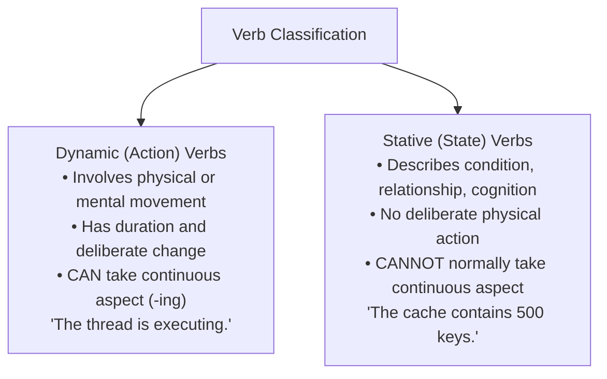
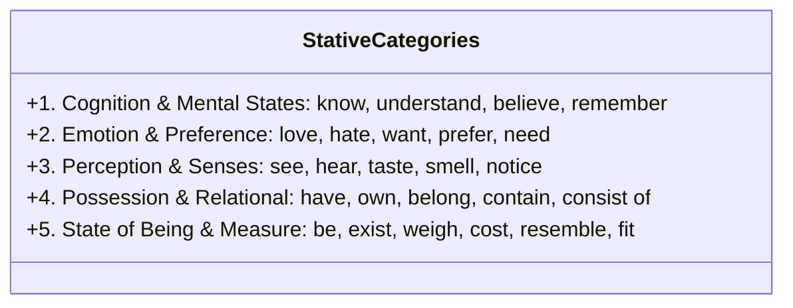
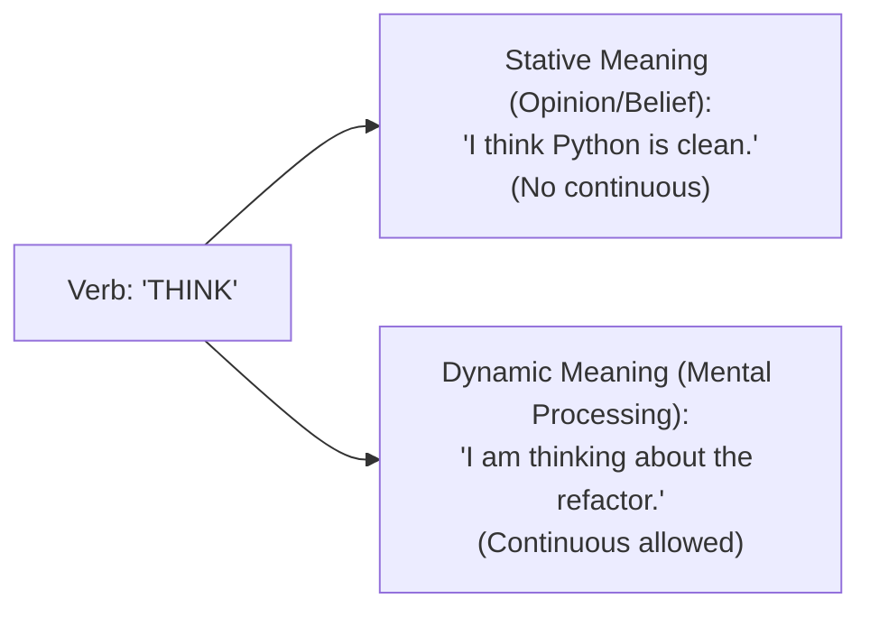

# Action (Dynamic) vs. Stative Verbs ⚡🧠

> **Level:** CEFR A2 (Core Aspectual Rule)  
> **Primary References:** Michael Swan (*Practical English Usage*, §3–4); Raymond Murphy (*English Grammar in Use*, Units 3–4)  
> **Core Rule:** **Dynamic verbs** describe actions, activities, or events and can be used in both simple and continuous (progressive) tenses. **Stative verbs** describe states, cognitive conditions, possession, or perceptions and are **not normally used in continuous (`-ing`) tenses**.

---

## 1. Intent & Conceptual Model

English grammar encodes how an action takes place in time through **aspect**. Because continuous tenses denote an action in progress with a visible beginning, middle, and end, verbs representing unchanging permanent states resist continuous aspect:

---

## 2. The Five Categories of Stative Verbs

| Category | Typical Verbs | Continuous Bug (❌) | Correct Simple Aspect (✅) |
| :--- | :--- | :--- | :--- |
| **1. Cognition & Opinion** | *know, believe, understand, remember, doubt, recognize, suppose, realize, mean* | ❌ *I am knowing Python.* | ✅ *I **know** Python.* |
| **2. Emotions & Desires** | *want, need, prefer, love, hate, dislike, wish, envy* | ❌ *The team is wanting new hardware.* | ✅ *The team **wants** new hardware.* |
| **3. Sensory Perception** | *see, hear, notice, smell, taste, feel* | ❌ *I am hearing an audio artifact.* | ✅ *I **hear** an audio artifact.* |
| **4. Possession & Inclusion** | *have, own, possess, belong, contain, consist of, include* | ❌ *The payload is containing errors.* | ✅ *The payload **contains** errors.* |
| **5. Measurement & Invariance**| *cost, weigh, measure, exist, fit, suit, depend, matter* | ❌ *The query is costing too much RAM.* | ✅ *The query **costs** too much RAM.* |

---

## 3. Verbs with Dual Personality (Stative vs. Dynamic Meanings)

Several high-frequency English verbs have **two distinct semantic modes**: a stative mode (expressing an opinion or state) and a dynamic mode (expressing an active physical or mental process).

| Verb | Stative Meaning (Simple Tense Only) | Dynamic Meaning (Continuous Tense Allowed) |
| :--- | :--- | :--- |
| **Think** | *I **think** the server is down.* (Belief / Opinion) | *I **am thinking** about our database schema.* (Mental activity) |
| **Have** | *We **have** three production replicas.* (Possession) | *We **are having** a sprint planning meeting.* (Action: experiencing) |
| **See** | *I **see** what you mean.* (Understand / Perception) | *The architect **is seeing** the CTO this afternoon.* (Meeting / Consulting) |
| **Taste** | *The coffee **tastes** bitter.* (Passive sensory quality) | *The chef **is tasting** the soup.* (Deliberate physical test) |
| **Smell** | *The server room **smells** like ozone.* (Passive attribute) | *The technician **is smelling** the burning cable.* (Active sniffing) |
| **Look** | *The new UI **looks** polished.* (Appearance / Seeming) | *The engineer **is looking** at the stack trace.* (Active physical gazing) |
| **Feel** | *The deployment **feels** risky.* (Subjective perception) | *The developer **is feeling** the temperature of the heatsink.* (Physical touch) |
| **Be** | *Alex **is** an engineer.* (Permanent identity/character) | *Why **is** the client **being** so uncooperative?* (Temporary deliberate behavior) |
| **Fit** | *This RAM stick **fits** the motherboard.* (Dimension match) | *The technician **is fitting** new SSDs into the rack.* (Physical installation) |

---

## 4. Dual-Domain Practical Examples

### Everyday Conversational English
1. *I **understand** the instructions clearly.* (Cognition — Stative)
2. *She **loves** reading software engineering books.* (Emotion — Stative)
3. *Do you **hear** that strange noise?* (Perception — Stative)
4. *We **are having** dinner with friends right now.* (Dynamic activity)
5. *He **thinks** the movie was overrated.* (Opinion — Stative)
6. *She **is thinking** of moving to San Francisco.* (Deliberation — Dynamic)
7. *Why are you **being** so quiet today?* (Temporary behavioral state)
8. *This jacket **belongs** to my brother.* (Possession — Stative)

### Professional Software Engineering Context
9. *The JSON payload **contains** metadata and authentication claims.*  
   $\to$ Stative verb of inclusion. Never: *is containing*.
10. *The database administrator **is analyzing** the slow query logs.*  
    $\to$ Dynamic verb of physical/mental work; continuous is fully valid.
11. *The engineering lead **believes** our unit tests provide sufficient coverage.*  
    $\to$ Stative verb of mental belief.
12. *The QA engineer **is testing** the API boundary limits.*  
    $\to$ Dynamic verb of execution.
13. *The success of the deployment **depends** on database connection health.*  
    $\to$ Stative verb of relationship/contingency. Never: *is depending on*.
14. *The monitoring system **detects** anomalies in network throughput.*  
    $\to$ Stative verb of perception/cognition.
15. *We **are currently having** issues with DNS resolution.*  
    $\to$ Dynamic use of *have* (experiencing an ongoing event).

---

## 5. Common Mistakes & Diagnostic Anti-Patterns

| Bug (Continuous Misuse) | Patch (Syntactically Correct) | Diagnostic Root Cause |
| :--- | :--- | :--- |
| ❌ *I **am having** a doubt about this function.* | ✅ *I **have** a question about this function.* | **ESL Regional Transfer & Stative Misuse:** *Have* (possession) cannot take `-ing`, and in English, one *has a question*, not *a doubt*. |
| ❌ *The microservice **is needing** more memory.* | ✅ *The microservice **needs** more memory.* | *Need* is an inherently stative verb of requirement; continuous is invalid. |
| ❌ *Are you **understanding** the algorithm?* | ✅ *Do you **understand** the algorithm?* | *Understand* is an instantaneous cognitive state; use Present Simple with *do*. |
| ❌ *The database **is belonging** to our cluster.* | ✅ *The database **belongs** to our cluster.* | *Belong* is a stative verb of permanent relationship. |
| ❌ *This metric **is meaning** the CPU is pinned.* | ✅ *This metric **means** the CPU is pinned.* | *Mean* is stative when denoting significance/signification. |

---

## 6. Self-Assessment Practice Exercises

### Section A: Stative vs. Dynamic Classification
Determine whether the highlighted verb is acting in a **Stative** or **Dynamic** role:

1. The configuration file [**contains**] thirty environment variables.
2. The site reliability team [**is monitoring**] latency metrics.
3. The principal architect [**thinks**] we should adopt GraphQL.
4. The engineer [**is thinking**] about refactoring the authentication filter.
5. The memory pool [**belongs**] to the parent process.
6. The client [**is having**] intermittent connection timeouts.

### Section B: Aspect Error Spotting & Correction
Correct any ungrammatical continuous verb forms in the following sentences:

7. *The server is seeming unresponsive under high load.*
8. *We are wanting to improve test execution velocity.*
9. *The senior engineer is knowing the codebase inside and out.*
10. *Our Kubernetes cluster is consisting of twelve worker nodes.*
11. *I am preferring automated integration tests over manual regression tests.*
12. *Why is the developer being so careless with production migrations?*

---

## 7. Comprehensive Answer Key & Explanations

1. **Stative** — Expresses inclusion/containment.
2. **Dynamic** — An active, observable engineering task taking place over time.
3. **Stative** — Expresses an opinion/belief (*thinks* = *believes*).
4. **Dynamic** — Represents active, ongoing cognitive deliberation (*is thinking* = *is considering*).
5. **Stative** — Expresses permanent relationship/ownership.
6. **Dynamic** — *Having* here means *experiencing*, which is an active condition that admits continuous aspect.
7. **Correction:** *The server **seems** unresponsive under high load.*  
   *Explanation:* *Seem* is a copular stative verb of appearance; it cannot take continuous aspect.
8. **Correction:** *We **want** to improve test execution velocity.*  
   *Explanation:* *Want* expresses desire and is strictly stative.
9. **Correction:** *The senior engineer **knows** the codebase inside and out.*  
   *Explanation:* *Know* expresses cognitive state; it cannot take progressive form.
10. **Correction:** *Our Kubernetes cluster **consists of** twelve worker nodes.*  
    *Explanation:* *Consist of* is a stative verb of structure/composition.
11. **Correction:** *I **prefer** automated integration tests over manual regression tests.*  
    *Explanation:* *Prefer* is an emotional/evaluative stative verb.
12. **Correct as written!**  
    *Explanation:* *Is being careless* refers to temporary, deliberate behavior at the present moment, which is a legitimate dynamic use of the copula *be*.

---

## 8. Revision Flashcards & Key Takeaways

- **Dynamic = Actions:** Walk, build, compile, debug, refactor $\to$ Use simple or continuous.
- **Stative = States:** Know, believe, contain, belong, depend, seem $\to$ Use **simple tense only**.
- **The Stative Bug Diagnostic:** If a verb describes something that is true without physical movement, it is stative (*The server belongs to us*, not *is belonging*).
- **Dual Verbs:** Watch out for *think, have, see, look, be*. Check whether they express an opinion/state (stative) or an active process/experience (dynamic).
