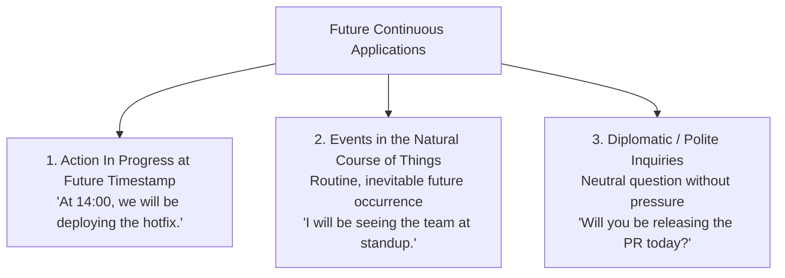

# Future Continuous (Progressive) Tense ⏳🚀

> **Level:** CEFR B1–B2 (Future Aspectual Scheduling)  
> **Primary References:** Raymond Murphy (*English Grammar in Use*, Unit 24); Michael Swan (*Practical English Usage*, §4, 41)  
> **Key Function:** Expresses an action that will be **actively in progress at a specific future timestamp**, routine events happening in the normal course of things, or **diplomatic, polite inquiries** regarding someone's future plans.

---

## 1. Intent & The "Maintenance Window" Mental Model

Just as the Past Continuous looks back at an action in progress at a past moment, the **Future Continuous** projects into the future and visualizes an action underway at a specific future reference point:

$$\mathbf{Future\ Continuous} = \mathbf{will\ be} + \mathbf{V\text{-}ing\ (Present\ Participle)}$$

```mermaid
timeline
    title Future Continuous: Action in Progress at Future Timestamp
    NOW : Planning & Notification
    02:00 UTC : Maintenance Window opens
    02:30 UTC (Snapshot) : Platform team WILL BE MIGRATING tables (In Progress!)
    03:00 UTC : Maintenance Window closes
```

- *At 02:30 UTC tonight, the platform team **will be migrating** database tables.* (The action will not start or end at 02:30; it will be actively executing at that moment).

---

## 2. Structural Formulas & Syntax Patterns

| Sentence Type | Formula | Canonical Production Example |
| :--- | :--- | :--- |
| **Affirmative (+)** | `Subject + will be + V-ing` | *The batch worker **will be processing** invoices at midnight.* |
| **Negative (-)** | `Subject + will not be (won't be) + V-ing`| *We **will not be taking** offline outages during the upgrade.* |
| **Interrogative (?)** | `Will + Subject + be + V-ing?` | * **Will** you **be using** the staging cluster this afternoon?* |
| **Negative Question** | `Won't + Subject + be + V-ing?` | * **Won't** the database **be running** its backup at that time?* |

---

## 3. The Three Distinct Usage Scenarios



### 1. In Progress at a Specific Future Timestamp (Maintenance Windows)
Indispensable for drafting operational runbooks and user-facing maintenance notifications:
- *Between 01:00 and 03:00 UTC, our engineering team **will be performing** scheduled kernel upgrades.*
- *This time next week, we **will be testing** the disaster recovery failover.*

### 2. Events Happening in the "Normal Course of Things"
Denotes an event that will occur naturally as part of an existing routine, without deliberate new decisions or special arrangements (Swan §41):
- *I **will be seeing** the engineering manager at our daily standup.* (It happens automatically; no special effort required).
- *The batch processor **will be generating** end-of-month statements as usual on Friday.*

### 3. Diplomatic, Polite Inquiries (No Pressure)
Asking about someone's future plans without sounding demanding, intrusive, or requesting a favor:
- * **Will you be using** the staging database this afternoon?*  
  $\implies$ Neutral: *If you are not using it, I would like to run my benchmark.*
- Contrast with: *Are you going to use it?* (Sounds slightly direct or confrontational).

---

## 4. Disambiguation: Future Continuous vs. Other Future Forms

| Tense Form | Focus / Nuance | Example |
| :--- | :--- | :--- |
| **`will + V1`** | Instant decision, promise, or pure prediction. | *We **will upgrade** the database.* (Promise / Decision). |
| **`be going to + V1`** | Premeditated intention or roadmap decision. | *We **are going to upgrade** the database.* (Intention). |
| **`will be + V-ing`** | In-progress at future point; routine event; polite query. | *We **will be upgrading** the database at 02:00.* (In-progress state). |

---

## 5. Dual-Domain Practical Examples

### Everyday Conversational English
1. *This time tomorrow, I **will be lying** on the beach.* (Action in progress)
2. *At 20:00 tonight, they **will be watching** the match.* (Future timestamp)
3. *I **will be seeing** John tomorrow; I can give him your message.* (Natural routine)
4. * **Will you be using** the car tonight?* (Polite inquiry)
5. *Don't phone them now; they **will be having** dinner.* (Deductive continuous prediction)
6. *She **won't be joining** us for lunch today.* (Negative future state)
7. *We **will be traveling** through Italy all next month.* (Extended future process)
8. *Will you be passing by the supermarket on your way home?* (Diplomatic inquiry)

### Professional Software Engineering Context
9. *During the scheduled maintenance window, our infrastructure **will be redirecting** all traffic to the secondary region.*  
   $\to$ Ongoing in-progress operation during a defined future window.
10. *At midnight, the data pipeline **will be ingesting** clickstream data from Kafka.*  
    $\to$ Process underway at an exact future timestamp.
11. *I **will be speaking** with the compliance officer during our weekly 1-on-1 on Thursday.*  
    $\to$ Routine event in the normal course of engineering operations.
12. * **Will you be running** performance tests on the cluster this afternoon?*  
    $\to$ Polite inquiry to avoid resource contention without demanding priority.
13. *Our system **will not be accepting** new customer registrations while the database re-indexes.*  
    $\to$ Negative continuous future condition.
14. *This time next year, the platform **will be serving** over one million requests per second.*  
    $\to$ Visionary architectural benchmark in active operation.
15. *The QA engineer **will be testing** the payment gateway throughout tomorrow's deployment.*  
    $\to$ Extended in-progress testing effort.

---

## 6. Common Mistakes & Diagnostic Anti-Patterns

| Bug (Ungrammatical Construction) | Patch (Syntactically Correct) | Root Cause Diagnostic |
| :--- | :--- | :--- |
| ❌ *At 02:00, we will **upgrading** the server.* | ✅ *At 02:00, we will **be upgrading** the server.* | Future Continuous formula strictly requires auxiliary `be` before the present participle (`-ing`). |
| ❌ *The microservice will be **belonging** to team B.* | ✅ *The microservice will **belong** to team B.* | Stative verbs (*belong*) reject continuous aspect; use Future Simple. |
| ❌ *Will you **to be using** the testbed?* | ✅ *Will you **be using** the testbed?* | Modal *will* requires bare auxiliary *be* without *to*. |
| ❌ *During the outage, the app **is not accepting** requests.* (future) | ✅ *During the outage, the app **will not be accepting** requests.* | Future operational windows demand Future Continuous, not Present Continuous. |
| ❌ *I will be **run** the batch job tonight.* | ✅ *I will be **running** the batch job tonight.* | Formula requires present participle `-ing` (*running*), not bare V1. |

---

## 7. Self-Assessment Practice Exercises

### Section A: Future Continuous Formation
Complete each sentence using the **Future Continuous** form of the verb in brackets:

1. Between 02:00 and 04:00 UTC, the operations team [execute] ______ database schema migrations.
2. The platform [not / accept] ______ API traffic during the cutover window.
3. [Will / Shall] ______ you [review] ______ the architectural blueprints tomorrow morning?
4. This time next week, the systems team [benchmarking] ______ the new memory allocator.
5. The scheduled cron daemon [purge] ______ orphan container images at midnight.
6. The frontend team [present] ______ the new dashboard during the sprint review.

### Section B: Sentence Error Spotting & Repair
Identify and correct the grammatical bugs in the following statements:

7. *At 03:00 tomorrow, our team will deploying the hotfix.*
8. *Will you to be needing the GPU instance this evening?*
9. *During the maintenance window, the database will be having elevated latency.* (Stative verb)
10. *The automated runner will be run tests throughout the night.*
11. *Don't deploy now; the backup worker will be execute its daily snapshot.*
12. *At this time on Friday, we will celebrating the successful platform launch.*

---

## 8. Comprehensive Answer Key & Explanations

1. **will be executing** — Formula: $\mathbf{will\ be} + \mathbf{V\text{-}ing}$.
2. **will not be accepting** — Negative form: $\mathbf{will\ not\ be} + \mathbf{V\text{-}ing}$.
3. **Will you be reviewing** — Interrogative formula for polite inquiry.
4. **will be benchmarking** — Process in active execution at a future reference point (*This time next week*).
5. **will be purging** — Drop silent final `-e` in *purge $\to$ purging*.
6. **will be presenting** — Routine sprint review event in the natural course of things.
7. **Correction:** *At 03:00 tomorrow, our team **will be deploying** the hotfix.*  
   *Explanation:* Missing required auxiliary *be*.
8. **Correction:** *Will you **be needing** (or **need**) the GPU instance this evening?*  
   *Explanation:* Omit ungrammatical *to*; modal *will* governs bare auxiliary *be*.
9. **Correction:** *During the maintenance window, the database **will experience** (or **will have**) elevated latency.*  
   *Explanation:* Stative verb *have* cannot take continuous aspect; use Future Simple.
10. **Correction:** *The automated runner **will be running** tests throughout the night.*  
    *Explanation:* Formula requires present participle *running* (not base *run*).
11. **Correction:** *Don't deploy now; the backup worker **will be executing** its daily snapshot.*  
    *Explanation:* Formula requires present participle *executing*.
12. **Correction:** *At this time on Friday, we **will be celebrating** the successful platform launch.*  
    *Explanation:* Missing auxiliary *be* before *celebrating*.

---

## 9. Revision Flashcards & Key Takeaways

- **Future Continuous Formula:** $\mathbf{Subject} + \mathbf{will\ be} + \mathbf{V\text{-}ing}$.
- **The Maintenance Window Tense:** Use Future Continuous to articulate what operations will be underway during a scheduled technical window (*We will be upgrading between 02:00 and 04:00*).
- **Polite Inquiry Power:** *Will you be using the server?* is more diplomatic and less intrusive than *Are you going to use the server?*.
- **Routine Future Events:** Use for events that happen automatically as part of normal operations (*I'll be seeing the team at standup*).
- **The Stative Ban:** Never use continuous with stative verbs (*will know*, NOT *will be knowing*).
