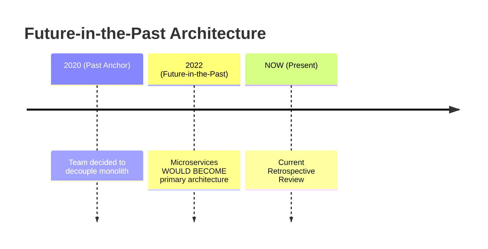
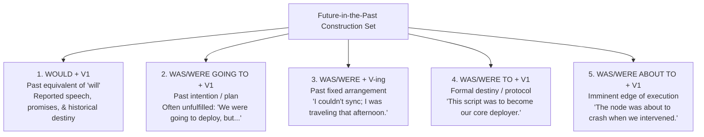

# Future-in-the-Past and Special Forms ⏪🔮

> **Level:** CEFR B2–C1 (Advanced Temporal Architecture)  
> **Primary References:** Michael Swan (*Practical English Usage*, §4, 42–43); Raymond Murphy (*English Grammar in Use*, Units 20, 36)  
> **Key Concept:** **Future-in-the-Past** refers to an event that was still in the future when viewed from a specific past reference point. It is used extensively in engineering project retrospectives, architecture evolution documents, and reported speech.

---

## 1. Intent & The "Past Perspective" Mental Model

Standard future tenses project forward from the present moment ($\mathbf{NOW} \to \mathbf{Future}$). **Future-in-the-Past** anchors itself at a past timestamp and looks forward into an event that was *then* future (regardless of whether that event has already happened by today):

- *In 2020, the team decided that microservices **would become** our primary architecture.*

---

## 2. The Five Syntactic Vehicles of Future-in-the-Past

---

## 3. Deep Dive into the Five Structures

### 1. `Would` + Base Verb (V1)
- **Reported Speech:** Backshifts future *will* into the past perspective:
  - Direct Speech: *"The service **will scale**," said the architect.*
  - Reported Speech: *The architect said that the service **would scale**.*
- **Historical Retrospection / Narrative Destiny:** Describes an event that was genuinely future at the time, but is now history (Swan §43):
  - *He joined the startup as an intern in 2018; four years later, he **would lead** the entire infrastructure division.*

### 2. `Was/Were Going To` + Base Verb (V1)
Used to describe intentions, plans, or predictions formulated in the past. Frequently introduces an **unfulfilled intention** that was derailed by circumstance:
- *We **were going to migrate** to Cassandra, but benchmark results favored ScyllaDB.*
- *The developer **was going to push** the commit, but the local linter flagged three critical syntax errors.*

### 3. Past Continuous (`Was/Were` + `-ing`) for Past Arrangements
Expresses a pre-arranged schedule that had been fixed in the past:
- *The release manager could not attend the retrospective because she **was presenting** the Q3 metrics to the board that morning.*

### 4. `Was/Were To` + Base Verb (Formal Protocol & Destiny)
Used in high formal style to describe official duties, pre-ordained schedules, or historical destiny (Swan §42):
- *The security protocol **was to take effect** at midnight on January 1st.*
- *A small proof-of-concept, which **was to become** the foundation of our entire cloud platform, was compiled in three hours.*
> [!NOTE]
> **Unfulfilled Destiny Form:** `was/were to have + V3`:
> - *The prototype **was to have launched** in Q1, but budget cuts delayed the initiative.*

### 5. `Was/Were About To` + Base Verb (Imminent Horizon)
Expresses that an event was on the absolute verge of occurring in the past when another event intervened:
- *The automated watchdog **was about to reboot** the cluster when the on-call engineer paused the daemon.*

---

## 4. The Future-in-the-Past Matrix

| Structure | Typical Nuance | Technical Scenario Example |
| :--- | :--- | :--- |
| **`would + V1`** | Reported prediction / Historic outcome | *We knew the cache **would reduce** database load.* |
| **`was/were going to + V1`** | Intended plan (frequently unfulfilled) | *We **were going to use** REST, but adopted gRPC.* |
| **`was/were + V-ing`** | Pre-scheduled past arrangement | *The team **was deploying** at 02:00, so I stayed awake.* |
| **`was/were to + V1`** | Formal destiny / Official requirement | *The new regulation **was to govern** all user data.* |
| **`was/were about to + V1`**| On the immediate brink of happening | *The disk **was about to fill up** when we purged logs.* |

---

## 5. Dual-Domain Practical Examples

### Everyday Conversational English
1. *I thought it **would rain**, so I brought an umbrella.* (Past prediction)
2. *She told me she **would call** me later.* (Reported future)
3. *We **were going to visit** the beach, but the storm arrived.* (Unfulfilled intention)
4. *I couldn't meet you because I **was leaving** for Paris that evening.* (Past arrangement)
5. *They **were about to leave** the house when the phone rang.* (Imminent action)
6. *Little did he know that he **would win** the championship the following year.* (Narrative destiny)
7. *The treaty **was to be signed** in Geneva.* (Formal protocol)
8. *I **was going to ask** you that exact question!* (Coincidental intention)

### Professional Software Engineering Context
9. *The engineering director promised that management **would approve** our cloud budget.*  
   $\to$ Reported speech commitment backshifted from *will approve*.
10. *The systems team **was going to adopt** a multi-cloud strategy, but egress costs proved prohibitive.*  
    $\to$ Unfulfilled architectural intention (*was going to*).
11. *The developer was about to commit credentials to Git, but the pre-commit hook **intercepted** the file.*  
    $\to$ Imminent disaster averted by automation (*was about to commit*).
12. *A small Python prototype authored over a weekend **would eventually evolve** into our core distributed engine.*  
    $\to$ Retrospective narrative destiny (*would eventually evolve*).
13. *The new data retention policy **was to take effect** immediately following the audit.*  
    $\to$ Formal administrative mandate in the past (*was to take effect*).
14. *We knew the database **would not handle** a 10x surge without read replicas.*  
    $\to$ Past prediction based on engineering deduction.
15. *The QA team could not test the feature on Thursday because they **were preparing** the staging cluster for load tests.*  
    $\to$ Past arrangement acting as context for an unavailability.

---

## 6. Common Mistakes & Diagnostic Anti-Patterns

| Bug (Ungrammatical Construction) | Patch (Syntactically Correct) | Root Cause Diagnostic |
| :--- | :--- | :--- |
| ❌ *She said she **will deploy** the code.* (past reporting) | ✅ *She said she **would deploy** the code.* | **Tense Backshift Failure:** Past reporting verb *said* requires future-in-the-past *would*. |
| ❌ *We **were about to deployed** the patch.* | ✅ *We **were about to deploy** the patch.* | *About to* takes a bare base verb V1 (*deploy*). |
| ❌ *The team **was going to adopting** microservices.* | ✅ *The team **was going to adopt** microservices.* | Formula: $\mathbf{was/were\ going\ to} + \mathbf{V1}$ (not *-ing*). |
| ❌ *In 2019, he **will make** a critical discovery.* (historical) | ✅ *In 2019, he **would make** a critical discovery.* | Historical retrospection from a past anchor requires *would*, not *will*. |
| ❌ *We **was going to** scale the cluster.* | ✅ *We **were going to** scale the cluster.* | Plural subject *We* demands plural auxiliary *were*. |

---

## 7. Self-Assessment Practice Exercises

### Section A: Future-in-the-Past Construction Selection
Select the most accurate Future-in-the-Past structure for each context:

1. [Reported Speech]: The CTO confirmed that the company [will / would] transition to remote work.
2. [Unfulfilled Intention]: Our team [was going to / will] build a custom authentication service, but we selected Auth0 instead.
3. [Imminent Edge]: The database [was about to / would] exhaust its disk space when the automated purge script kicked in.
4. [Historical Retrospection]: In 2015, they launched a small utility that [will / would] later become Docker.
5. [Formal Protocol]: The terms of the service level agreement [were to / was going to] apply to all enterprise tenants.
6. [Past Arrangement]: I couldn't attend the triage bridge because I [was boarding / will board] a flight to San Francisco.

### Section B: Sentence Error Spotting & Repair
Identify and correct the grammatical bugs in the following architectural review excerpts:

7. *The architect promised that the microservice will support horizontal scaling.*
8. *We was about to terminate the pod when it recovered.*
9. *The team was going to deploying the database migration on Saturday.*
10. *Little did we know that this simple script will cause a total outage two years later.*
11. *They were to launched the new feature in Q2, but technical debt delayed it.*
12. *The operations team were about to rebooted the host server.*

---

## 8. Comprehensive Answer Key & Explanations

1. **would** — Backshifted future in reported speech following past verb *confirmed*.
2. **was going to** — Unfulfilled architectural intention subsequently replaced by an alternative.
3. **was about to** — Action on the immediate verge of occurrence (*on the brink of exhausting space*).
4. **would** — Historical narrative destiny viewed from a 2015 vantage point.
5. **were to** — Formal protocol/legal mandate in the past; plural agreement with *terms*.
6. **was boarding** — Past continuous expressing a pre-scheduled past arrangement.
7. **Correction:** *The architect promised that the microservice **would support** horizontal scaling.*  
   *Explanation:* Past reporting verb *promised* demands future-in-the-past *would*.
8. **Correction:** *We **were about to terminate** the pod when it recovered.*  
   *Explanation:* Plural subject *We* requires *were*; *about to* governs base verb *terminate*.
9. **Correction:** *The team was going to **deploy** the database migration on Saturday.*  
   *Explanation:* *Was going to* takes bare base verb V1 *deploy* (not *-ing*).
10. **Correction:** *Little did we know that this simple script **would cause** a total outage two years later.*  
    *Explanation:* Retrospective historical destiny requires *would cause*, not *will cause*.
11. **Correction:** *They were to **have launched** the new feature in Q2, but technical debt delayed it.*  
    *Explanation:* Formal unfulfilled past intention uses $\mathbf{were\ to\ have} + \mathbf{V3}$.
12. **Correction:** *The operations team was (or were) about to **reboot** the host server.*  
    *Explanation:* *About to* must govern bare base verb V1 *reboot*.

---

## 9. Revision Flashcards & Key Takeaways

- **Future-in-the-Past Concept:** An event viewed as future from an anchor point in the past.
- **The Core Fleet:**
  - `would + V1`: Reported speech (*said it would scale*), historical destiny (*would later become*).
  - `was/were going to + V1`: Premeditated intention that was usually unfulfilled (*was going to deploy, but...*).
  - `was/were about to + V1`: Imminent threshold (*on the verge of crashing*).
  - `was/were to + V1`: Formal destiny or official protocol (*was to take effect*).
- **The Tense Backshift Rule:** When narrating past events, always convert *will* into *would*.
