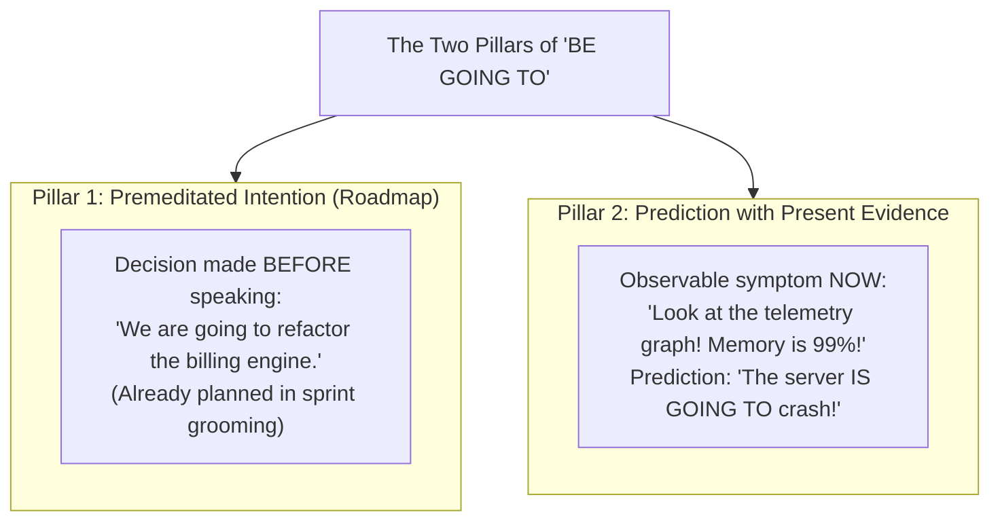
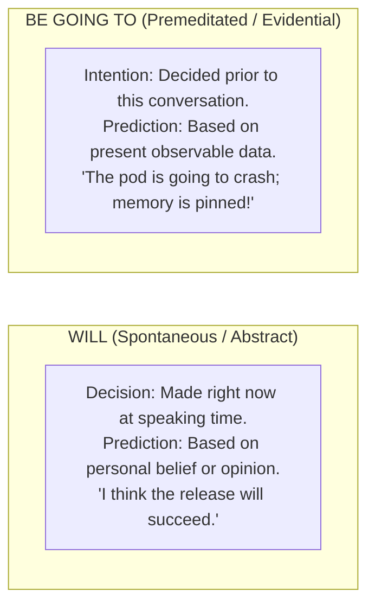

# Future Intentions: Be Going To 🎯

> **Level:** CEFR A2–B1 (Premeditated Future)  
> **Primary References:** Raymond Murphy (*English Grammar in Use*, Units 20, 23); Michael Swan (*Practical English Usage*, §4, 35, 39)  
> **Key Function:** Expresses **premeditated plans and intentions** formed prior to the moment of speaking, or **predictions based on clear, present, observable empirical evidence**.

---

## 1. Intent & The "Evidence & Premeditation" Mental Model

While **will** represents an instant decision or an abstract prediction, **be going to** signifies that the future event already has its seeds planted in the present reality:

$$\mathbf{Be\ Going\ To} = \mathbf{am/is/are} + \mathbf{going\ to} + \mathbf{V1\ (Bare\ Base\ Verb)}$$

---

## 2. Structural Formulas & Syntax Patterns

| Sentence Type | Formula | Canonical Production Example |
| :--- | :--- | :--- |
| **Affirmative (+)** | `Subject + am/is/are + going to + V1` | *We **are going to migrate** to Kubernetes.* |
| **Negative (-)** | `Subject + am/is/are not + going to + V1` | *The team **is not going to deprecate** v1 yet.* |
| **Interrogative (?)** | `Am/Is/Are + Subject + going to + V1?` | * **Are** you **going to rewrite** the parser?* |
| **Negative Question** | `Isn't/Aren't + Subject + going to + V1?`| * **Isn't** the database **going to run out of** space?* |

---

## 3. Disambiguation: *Will* vs. *Be Going To*

Understanding when to choose *will* versus *be going to* is critical for natural, professional communication:

| Dimension | `Will` | `Be Going To` |
| :--- | :--- | :--- |
| **Timing of Decision** | **Spontaneous:** Decided at the moment of speech (*"I'll help you!"*). | **Premeditated:** Decided before the moment of speech (*"We're going to refactor"*). |
| **Source of Prediction** | Opinion, abstract belief, intuition (*"I think AI will change coding"*). | Direct, observable present empirical evidence (*"Look at those error logs!"*). |
| **Software Context** | Emergency triage decisions; commitments. | Sprint goals; roadmap milestones; imminent crashes based on telemetry. |

---

## 4. Special Forms: *Was/Were Going To* (Unfulfilled Intentions)

When an intention was formulated in the past but was subsequently interrupted, abandoned, or altered, use **was/were going to**:

$$\mathbf{Subject} + \mathbf{was/were\ going\ to} + \mathbf{V1}$$

- *We **were going to deploy** the hotfix on Friday, but the security audit blocked it.*
- *The architect **was going to adopt** Cassandra, but benchmark results favored DynamoDB.*

---

## 5. Dual-Domain Practical Examples

### Everyday Conversational English
1. *I **am going to buy** a new laptop next week.* (Premeditated personal plan)
2. *Look at those black clouds! It **is going to rain**.* (Present sensory evidence)
3. *She **is not going to attend** the party.* (Prior intention)
4. *Are you **going to invite** John?* (Inquiring about prior plan)
5. *Watch out! You **are going to drop** that plate!* (Imminent danger based on sight)
6. *We **were going to visit** the museum, but it was closed.* (Unfulfilled past intention)
7. *What are you **going to do** after graduation?* (Future plan inquiry)
8. *I **am going to start** going to the gym tomorrow.* (Personal resolution)

### Professional Software Engineering Context
9. *Our platform engineering team **is going to implement** zero-trust networking in Q3.*  
   $\to$ Strategic engineering roadmap decision formed prior to the conversation.
10. *Look at the heap memory graph—the JVM **is going to throw** an `OutOfMemoryError`!*  
    $\to$ Prediction driven by active, observable telemetry evidence.
11. *The company **is going to discontinue** support for Python 3.8 at the end of the year.*  
    $\to$ Premeditated organizational policy.
12. *We **were going to build** a custom auth service, but we chose Keycloak instead.*  
    $\to$ Abandoned past architectural intention.
13. *The client payload is malformed; the serializer **is going to reject** it.*  
    $\to$ Prediction based on immediate inspection of payload bytes.
14. * **Are** you **going to author** companion pytest suites for these endpoints?*  
    $\to$ Inquiring about a developer's planned sprint scope.
15. *The infrastructure bill **is going to exceed** our quarterly budget if we do not clean up orphan disks.*  
    $\to$ Prediction anchored to present financial data.

---

## 6. Common Mistakes & Diagnostic Anti-Patterns

| Bug (Ungrammatical Construction) | Patch (Syntactically Correct) | Root Cause Diagnostic |
| :--- | :--- | :--- |
| ❌ *"The server is down!" $\to$ "I **am going to fix** it!"* | ✅ *"The server is down!" $\to$ "I **will fix** it!"* | Spontaneous emergency decisions made at speaking time demand *will*, not *be going to*. |
| ❌ *Look at the memory graph! It **will crash**!* | ✅ *Look at the memory graph! It **is going to crash**!* | Predictions based on immediate observable evidence demand *be going to*. |
| ❌ *We are **going to deploying** the container.* | ✅ *We are **going to deploy** the container.* | *Going to* must be followed by a bare base verb V1 (*deploy*). |
| ❌ *The team **is go to** migrate.* | ✅ *The team **is going to** migrate.* | Missing the continuous participle *going*. |
| ❌ *We **was going to** run the benchmark.* | ✅ *We **were going to** run the benchmark.* | Plural subject *We* requires auxiliary *were*. |

---

## 7. Self-Assessment Practice Exercises

### Section A: *Will* vs. *Be Going To* Selection
Select whether **will** or **be going to** is the most natural grammatical choice:

1. [Spontaneous Reaction]: "We have an open port on the firewall." $\to$ "Thanks for letting me know, I [will close / am going to close] it immediately."
2. [Prior Roadmap Plan]: Our organization [will migrate / is going to migrate] our data warehouse to BigQuery next quarter.
3. [Observable Present Evidence]: Look at that disk space alert! The log partition [will run out / is going to run out] of inodes within minutes!
4. [Unfulfilled Past Plan]: We [were going to adopt / will adopt] microservices, but our team was too small.
5. [Deductive Belief]: In my opinion, event-driven architectures [will dominate / are going to dominate] the next decade.
6. [Observable Present Data]: The client has sent fifty invalid credentials in ten seconds; the rate limiter [will block / is going to block] the IP.

### Section B: Sentence Error Spotting & Repair
Identify and correct the grammatical bugs in the following statements:

7. *Look at the error rates! The payment gateway will fail any second!*
8. *The team is going to deploy the patch right now, don't worry.* (spontaneous reaction)
9. *We was going to refactor the monolithic database layer.*
10. *Are you go to implement GraphQL in this sprint?*
11. *The developer is going to rewriting the unit test harness.*
12. *I think it is going to rain tomorrow, but I'm not sure.* (Abstract opinion without evidence)

---

## 8. Comprehensive Answer Key & Explanations

1. **will close** — Instant reaction to new information at the moment of speech.
2. **is going to migrate** — Pre-existing roadmap decision decided prior to the meeting.
3. **is going to run out** — Driven by active present alarm metrics (observable evidence).
4. **were going to adopt** — Unfulfilled past intention (*was/were going to*).
5. **will dominate** — Prediction based on abstract personal belief/opinion (*In my opinion...*).
6. **is going to block** — Direct prediction based on incoming real-time telemetry data.
7. **Correction:** *Look at the error rates! The payment gateway **is going to fail** any second!*  
   *Explanation:* Observable present evidence demands *is going to fail*.
8. **Correction:** *The team **will deploy** the patch right now, don't worry.*  
   *Explanation:* Instantaneous emergency decision requires *will*.
9. **Correction:** *We **were going to refactor** the monolithic database layer.*  
   *Explanation:* Plural subject *We* demands plural auxiliary *were*.
10. **Correction:** *Are you **going to implement** GraphQL in this sprint?*  
    *Explanation:* Formula requires *going to* + base verb *implement*.
11. **Correction:** *The developer is going to **rewrite** the unit test harness.*  
    *Explanation:* *Going to* must be followed by base verb V1 (*rewrite*, not *rewriting*).
12. **Correction:** *I think it **will rain** tomorrow, but I'm not sure.*  
    *Explanation:* Speculation based on uncertainty/opinion demands *will*.

---

## 9. Revision Flashcards & Key Takeaways

- **Be Going To Formula:** $\mathbf{Subject} + \mathbf{am/is/are\ going\ to} + \mathbf{V1}$.
- **Prior Intentions:** Use *be going to* for roadmap milestones, pre-planned tasks, and strategic decisions formed before the conversation.
- **Evidence-Based Predictions:** Use *be going to* when present observable data (telemetry, gauges, logs) makes the future event inevitable (*The server is going to crash!*).
- **Unfulfilled Past Plans:** $\mathbf{was/were\ going\ to} + \mathbf{V1}$ (*We were going to deploy, but tests failed*).
- **Will vs. Going To Rule of Thumb:**
  - *Decided NOW?* $\to$ **Will**.
  - *Decided BEFORE?* $\to$ **Be going to**.
  - *Look at the data NOW!* $\to$ **Be going to**.
