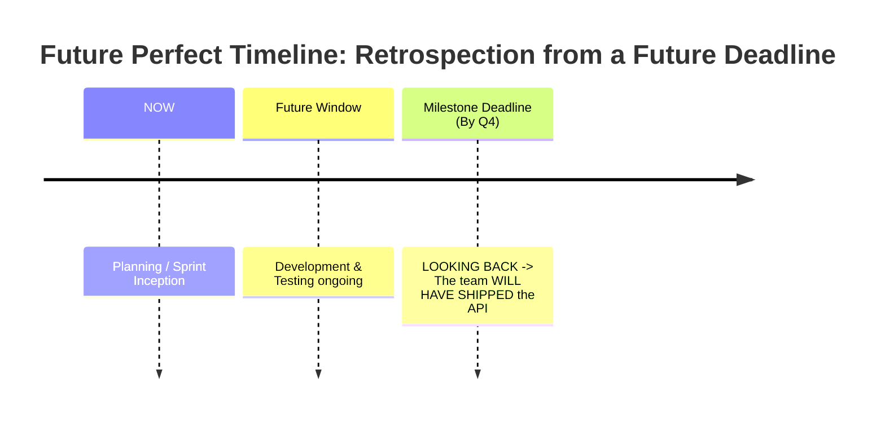
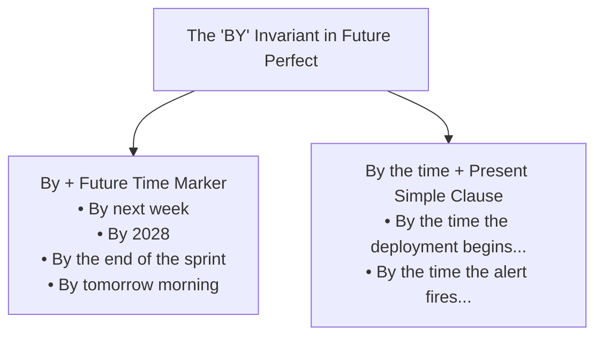

# Future Perfect and Future Perfect Continuous Tenses 🏁

> **Level:** CEFR B2 (Future Perfective Horizon)  
> **Primary References:** Raymond Murphy (*English Grammar in Use*, Unit 24); Michael Swan (*Practical English Usage*, §4, 40)  
> **Key Function:** Projects the speaker's viewpoint into a future milestone or deadline, looking backward to assert that an action **will be completed** (Future Perfect) or that an action **will have been running for a specific duration** (Future Perfect Continuous).

---

## 1. Intent & The "Future Milestone" Mental Model

The **Future Perfect** is the grammatical instrument of technical roadmap commitments and milestone delivery. It answers the question: *"What will already be completed before that future deadline arrives?"*

$$\mathbf{Future\ Perfect\ Simple} = \mathbf{will\ have} + \mathbf{V3\ (Past\ Participle)}$$
$$\mathbf{Future\ Perfect\ Continuous} = \mathbf{will\ have\ been} + \mathbf{V\text{-}ing\ (Present\ Participle)}$$

- *By the end of Q3 [Future Deadline], our team **will have shipped** the new billing engine [Future Perfect].*

---

## 2. Structural Formulas & Syntax Patterns

### 1. Future Perfect Simple (Completed Result by Deadline)
$$\mathbf{Subject} + \mathbf{will\ have} + \mathbf{V3\ (Past\ Participle)}$$

- **Affirmative (+):** *By Friday, we **will have merged** all open pull requests.*
- **Negative (-):** *By midnight, the batch runner **will not have finished**.*
- **Interrogative (?):** * **Will** you **have completed** the security audit by Monday?*

### 2. Future Perfect Continuous (Duration Leading Up to Deadline)
$$\mathbf{Subject} + \mathbf{will\ have\ been} + \mathbf{V\text{-}ing\ (Present\ Participle)}$$

- **Affirmative (+):** *By December, this server **will have been running** continuously for 500 days.*
- **Negative (-):** *By the end of the sprint, the team **will not have been working** on this feature for more than two weeks.*
- **Interrogative (?):** * **Will** the database **have been syncing** for long enough to guarantee consistency?*

---

## 3. The Essential Temporal Trigger: *BY* + Future Time

The Future Perfect almost always relies on the preposition **by** (meaning *"no later than"* or *"at or before"*):

> [!WARNING]
> **The Subordinate Clause Invariant:**
> When *by the time* introduces a clause, the verb in that clause **must be in the Present Simple**, never *will*:
> - ❌ *By the time the manager **will arrive**, we will have finished.*
> - ✅ *By the time the manager **arrives**, we will have finished.*

---

## 4. Disambiguation: Future Perfect Simple vs. Continuous

| Dimension | Future Perfect Simple | Future Perfect Continuous |
| :--- | :--- | :--- |
| **Primary Question** | *What will be completed before the deadline?* | *For how long will the process have been ongoing?* |
| **Semantic Focus** | **The Finished Milestone** / Quantity. | **The Unbroken Process Duration**. |
| **Stative Verbs** | **Mandatory** (*will have known, will have had*).| **Forbidden** (❌ *will have been knowing*). |
| **Software Example** | *By 05:00 UTC, the worker **will have processed 10,000 records**.* | *By 05:00 UTC, the worker **will have been processing records for 8 hours**.* |

---

## 5. Dual-Domain Practical Examples

### Everyday Conversational English
1. *By next month, I **will have lived** in London for two years.* (Future Perfect Simple duration)
2. *By the time you get home, I **will have cleaned** the entire house.* (Completed result)
3. *She **will have graduated** from university by July.* (Milestone achievement)
4. *By 2026, he **will have been teaching** for three decades.* (Extended career duration)
5. *Call me at 19:00; I **will have finished** dinner by then.* (Finished state)
6. *Will you **have read** the book before our book club meets?* (Interrogative milestone)
7. *They **will not have completed** the construction by winter.* (Negative deadline)
8. *By 22:00, the children **will have been sleeping** for two hours.* (Continuous duration)

### Professional Software Engineering Context
9. *By the end of the current sprint, our team **will have resolved** all high-priority security defects.*  
   $\to$ Future Perfect Simple milestone commitment.
10. *By the time the Black Friday traffic surge begins, the operations team **will have provisioned** fifty additional worker nodes.*  
    $\to$ Completion prior to a subordinate event (*by the time ... begins*).
11. *By next month, our primary PostgreSQL cluster **will have been operating** without downtime for two full years.*  
    $\to$ Future Perfect Continuous tracking high-availability SLA uptime.
12. *The continuous integration pipeline **will have executed** over 100,000 automated test suites by the end of this year.*  
    $\to$ Metric volume completed before a future calendar boundary.
13. *By 06:00 UTC, the data warehouse **will have ingested** all partition logs from the previous business day.*  
    $\to$ Scheduled ETL completion deadline.
14. *By the time the client discovers the defect, our team **will have deployed** an automated hotfix.*  
    $\to$ Proactive resolution prior to external detection.
15. *By Q4, the platform engineering division **will have been migrating** legacy services to Kubernetes for an entire year.*  
    $\to$ Continuous multi-quarter engineering journey duration.

---

## 6. Common Mistakes & Diagnostic Anti-Patterns

| Bug (Ungrammatical Construction) | Patch (Syntactically Correct) | Root Cause Diagnostic |
| :--- | :--- | :--- |
| ❌ *By tomorrow, we **will finish** the migration.* | ✅ *By tomorrow, we **will have finished** the migration.* | Time marker *by + deadline* strictly requires Future Perfect (*will have finished*). |
| ❌ *By the time the manager **will arrive**, we will have deployed.* | ✅ *By the time the manager **arrives**, we will have deployed.* | Subordinate time clauses forbid *will*; use Present Simple (*arrives*). |
| ❌ *By 2028, the team will have been **owning** the domain.* | ✅ *By 2028, the team will have **owned** the domain.* | Stative verbs (*own*) reject continuous aspect; use Future Perfect Simple. |
| ❌ *By Friday, we will have **ran** all benchmarks.* | ✅ *By Friday, we will have **run** all benchmarks.* | Future Perfect formula requires past participle V3 *run*, not past simple V2 *ran*. |
| ❌ *The script will **has finished** by noon.* | ✅ *The script will **have finished** by noon.* | Auxiliary *have* after modal *will* is invariant; never inflect to *has*. |

---

## 7. Self-Assessment Practice Exercises

### Section A: Future Perfect & Continuous Formation
Fill in the blanks with the correct form (**Future Perfect Simple** or **Future Perfect Continuous**) of the verbs in brackets:

1. By next Monday, the platform team [migrate] ______ all database clusters to the new region.
2. By the time the user registration spikes, the auto-scaler [provision] ______ forty additional pods.
3. By the end of this month, our database daemon [run] ______ continuously for 300 days.
4. By 04:00 AM, the backup script [not / complete] ______ its archive verification.
5. [Will / Have] ______ the engineers [finalize] ______ the architectural decision record by tomorrow's sync?
6. By the time the security audit concludes, the team [remediate] ______ vulnerabilities for four straight weeks.

### Section B: Deadline & Subordinate Clause Debugging
Identify and patch the grammatical bugs in the following roadmap statements:

7. *By the time the client will send the request, the proxy will have warmed up its cache.*
8. *By the end of Q2, our backend service will has achieved 99.99% uptime.*
9. *By Friday, the testing team will have been written fifty integration tests.*
10. *By next year, the company will have been owning the cloud infrastructure for a decade.*
11. *By tomorrow at 09:00, we will complete the production deployment.* (Deadline intended)
12. *By the time the incident commander joins the call, the watchdog will restarted the pod.*

---

## 8. Comprehensive Answer Key & Explanations

1. **will have migrated** — Milestone completed before deadline (*By next Monday*).
2. **will have provisioned** — Action completed prior to a subordinate future event (*by the time... spikes*).
3. **will have been running** — Continuous unbroken duration (300 days) leading up to future point.
4. **will not have completed** — Negative Future Perfect: $\mathbf{will\ not\ have} + \mathbf{V3}$.
5. **Will the engineers have finalized** — Interrogative Future Perfect: $\mathbf{Will} + \mathbf{S} + \mathbf{have} + \mathbf{V3?}$
6. **will have been remediating** — Unbroken durational effort (four straight weeks) leading up to audit conclusion.
7. **Correction:** *By the time the client **sends** the request, the proxy will have warmed up its cache.*  
   *Explanation:* Subordinate time clause with *by the time* demands Present Simple (*sends*), not *will send*.
8. **Correction:** *By the end of Q2, our backend service **will have achieved** 99.99% uptime.*  
   *Explanation:* Auxiliary *have* following modal *will* is invariant (never *has*).
9. **Correction:** *By Friday, the testing team **will have written** fifty integration tests.*  
   *Explanation:* A completed numerical quantity (50 tests) demands Future Perfect Simple.
10. **Correction:** *By next year, the company **will have owned** the cloud infrastructure for a decade.*  
    *Explanation:* *Own* is a stative verb of possession; continuous aspect is forbidden.
11. **Correction:** *By tomorrow at 09:00, we **will have completed** the production deployment.*  
    *Explanation:* Time marker *by + timestamp* strictly demands the Future Perfect.
12. **Correction:** *By the time the incident commander joins the call, the watchdog **will have restarted** the pod.*  
    *Explanation:* Missing required auxiliary *have* in Future Perfect formula.

---

## 9. Revision Flashcards & Key Takeaways

- **Future Perfect Simple Formula:** $\mathbf{Subject} + \mathbf{will\ have} + \mathbf{V3}$.
- **Future Perfect Continuous Formula:** $\mathbf{Subject} + \mathbf{will\ have\ been} + \mathbf{V\text{-}ing}$.
- **The "By" Trigger:** The presence of **by + future time** (*by tomorrow, by next year, by 05:00*) is the definitive syntactic trigger for the Future Perfect.
- **The "By the Time" Clause Rule:** In clauses starting with *by the time*, use **Present Simple** for the condition and **Future Perfect** for the main result (*By the time he arrives, we will have deployed*).
- **Milestone Commitments:** Use Future Perfect to state engineering roadmap deliverables unambiguously (*We will have shipped by Q3*).
