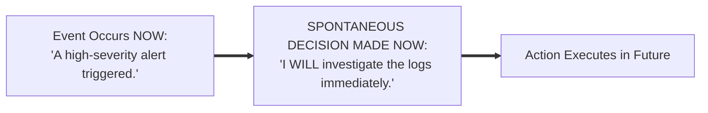
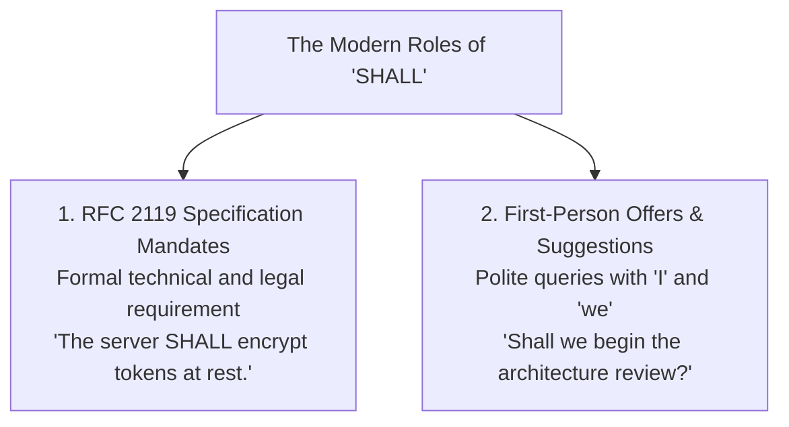

# Future Simple Tense (Will and Shall) 🚀

> **Level:** CEFR A2–B1 (Future Modality)  
> **Primary References:** Raymond Murphy (*English Grammar in Use*, Units 21–22); Michael Swan (*Practical English Usage*, §4, 38)  
> **Key Function:** Expresses **spontaneous decisions made at the moment of speech**, **predictions based on belief or deduction**, **promises and commitments**, **inanimate refusals (*won't*)**, and formal **contractual specifications (*shall*)**.

---

## 1. Intent & The "Instant Decision" Mental Model

Unlike *be going to* (which reflects a pre-existing plan formed before the conversation), **will** is the tense of **instantaneous resolve** and **abstract forecasting**:

$$\mathbf{Future\ Simple} = \mathbf{will\ ('ll)} + \mathbf{V1\ (Bare\ Base\ Verb)}$$

- *"The database connection timed out."* $\to$ *"Don't worry, I **will restart** the pool right now."* (Instant decision).

---

## 2. Structural Formulas & Syntax Patterns

| Sentence Type | Formula | Canonical Production Example |
| :--- | :--- | :--- |
| **Affirmative (+)** | `Subject + will ('ll) + Base Verb (V1)` | *The caching proxy **will reduce** network latency.* |
| **Negative (-)** | `Subject + will not (won't) + Base Verb (V1)` | *The client **will not retry** non-idempotent POSTs.* |
| **Interrogative (?)** | `Will + Subject + Base Verb (V1)?` | * **Will** the database **scale** under 50,000 RPS?* |
| **Negative Question** | `Won't + Subject + Base Verb (V1)?` | * **Won't** this migration **lock** the table during peak traffic?* |

---

## 3. The Special Role of `SHALL`

In contemporary global and technical English, **shall** has two specialized roles:

1. **RFC 2119 Requirement Levels:** In software specifications and standards, **SHALL** is synonymous with **MUST**, indicating an absolute, non-negotiable architectural requirement:
   - *The client **shall** transmit all authorization headers over TLS 1.3.*
2. **First-Person Polite Offers & Suggestions:** Used exclusively with *I* and *We* in questions:
   - * **Shall we** start the deployment meeting?* (Suggestion)
   - * **Shall I** create the Jira issue for this defect?* (Offer of assistance)

---

## 4. Five Core Usage Scenarios for `WILL`

### 1. Spontaneous Decisions Made at the Moment of Speaking
An immediate reaction to new information without prior planning:
- *"We just received an unexpected 500 error."* $\to$ *"I **will check** CloudWatch right now."*

### 2. Predictions Based on Opinion, Deduction, or Intuition
Often paired with epistemic markers: *I think, I believe, probably, certainly, in my opinion*:
- *I **think** microservices **will introduce** unnecessary operational complexity for our team.*
- *The new index **will probably speed up** read performance.*

### 3. Commitments, Guarantees, and Service Level Agreements (SLAs)
- *We **will deliver** the multi-tenant billing engine by the end of Q3.*
- *The cloud provider **will maintain** a 99.99% availability SLA.*

### 4. Inanimate Refusals (*Won't*)
When software or hardware obstinately refuses to operate as expected:
- *The database container **won't start**!* (It refuses to start).
- *The deployment script **won't accept** our environment variables.*

### 5. Conditional Result Clauses (First Conditional)
The main clause consequence of a real future condition:
- *If memory consumption exceeds 85%, the autoscaler **will spawn** a new pod.*

---

## 5. Dual-Domain Practical Examples

### Everyday Conversational English
1. *I am thirsty. I **will grab** a glass of water.* (Instant spontaneous decision)
2. *I think it **will rain** tomorrow.* (Prediction based on belief)
3. *Don't worry, I **will help** you with those bags.* (Offer / Promise)
4. *The car **won't start**; the battery must be flat.* (Inanimate refusal)
5. * **Shall we** go for a walk?* (Polite suggestion)
6. *I **will not reveal** your secret.* (Promise / Refusal)
7. *Will you be at the party on Saturday?* (Future inquiry)
8. *Shall I carry that for you?* (Offer of assistance)

### Professional Software Engineering Context
9. *Someone needs to triage these P0 security alerts; I **will handle** them.*  
   $\to$ Spontaneous workplace commitment made at the present moment.
10. *Adopting an asynchronous message bus **will decouple** our ingestion pipelines.*  
    $\to$ Architectural prediction based on engineering judgment.
11. *The authentication token **will expire** in precisely 3,600 seconds.*  
    $\to$ Objective future fact.
12. *The staging environment **won't boot** because port 5432 is already bound.*  
    $\to$ Inanimate software refusal (*won't*).
13. * **Shall we review** the pull request before merging it to master?*  
    $\to$ Professional collaborative suggestion using *shall we*.
14. *Under RFC 6749, the authorization server **shall validate** the client redirect URI.*  
    $\to$ Formal technical specification standard.
15. *If we refactor the data access layer, our unit test execution velocity **will increase** significantly.*  
    $\to$ Consequence in a First Conditional structure.

---

## 6. Common Mistakes & Diagnostic Anti-Patterns

| Bug (Ungrammatical Construction) | Patch (Syntactically Correct) | Root Cause Diagnostic |
| :--- | :--- | :--- |
| ❌ *Wait, I **am going to check** the logs.* (instant) | ✅ *Wait, I **will check** the logs.* | Instant decisions made right now require *will*, not *be going to*. |
| ❌ *If you **will deploy** tomorrow, we will test.* | ✅ *If you **deploy** tomorrow, we will test.* | **Future in Conditionals Bug:** *Will* is forbidden in *if*-clauses and time clauses! |
| ❌ *The microservice **wills** handle the load.* | ✅ *The microservice **will** handle the load.* | Modal *will* never takes 3rd-person singular `-s`. |
| ❌ *Will we to start the meeting?* | ✅ *Shall we start the meeting?* (or *Will we start...*) | Modals take bare infinitives without *to*; suggestions prefer *shall we*. |
| ❌ *The script will **cancels** the job.* | ✅ *The script will **cancel** the job.* | Auxiliary *will* must be followed by bare base verb V1 (*cancel*). |

---

## 7. Self-Assessment Practice Exercises

### Section A: Spontaneous Decision vs. Planned Future
Choose whether **will** or a different future structure is grammatically appropriate:

1. [Spontaneous Reaction]: "The staging database just crashed!" $\to$ "Don't panic, I [will restart / am restarting] it right now."
2. [Suggestion]: [Will / Shall] we schedule the architecture review for Thursday morning?
3. [Inanimate Refusal]: The Docker container [won't / shouldn't] bind to port 80; something else is using it.
4. [RFC Specification]: The server [shall / will] reject any token lacking an expiration timestamp.
5. [Prediction]: I believe that adopting Rust [will reduce / is reducing] our memory consumption by half.
6. [Conditional]: If the cluster runs out of memory, the watchdog [will terminate / terminates] the offending pod.

### Section B: Sentence Error Spotting & Repair
Identify and correct the grammatical bugs in the following statements:

7. *When the notification arrives, I will to notify the engineering team.*
8. *If the build will succeed, we will deploy to production.*
9. *Will I create the ticket for this bug?* (Offering help)
10. *The database wills maintain consistency across all read replicas.*
11. *Don't worry about the pull request; I am going to merge it right now.* (Instant decision)
12. *The script won't to execute without root privileges.*

---

## 8. Comprehensive Answer Key & Explanations

1. **will restart** — Instant spontaneous decision made at the moment of notification.
2. **Shall** — First-person collective suggestion (*Shall we*).
3. **won't** — Inanimate software refusal (*The container won't bind*).
4. **shall** — Formal technical requirement specification.
5. **will reduce** — Prediction based on architectural opinion/belief (*I believe...*).
6. **will terminate** — Main clause result of a First Conditional sentence.
7. **Correction:** *When the notification arrives, I **will notify** the engineering team.*  
   *Explanation:* Modal *will* takes a bare infinitive without *to*.
8. **Correction:** *If the build **succeeds**, we will deploy to production.*  
   *Explanation:* Never use *will* inside an *if*-clause; use Present Simple (*succeeds*).
9. **Correction:** * **Shall I create** the ticket for this bug?*  
   *Explanation:* When offering help in the first person, use *Shall I*, not *Will I*.
10. **Correction:** *The database **will maintain** consistency across all read replicas.*  
    *Explanation:* Modal *will* never takes 3rd-person singular `-s`.
11. **Correction:** *Don't worry about the pull request; I **will merge** it right now.*  
    *Explanation:* Instantaneous resolve at the moment of speech requires *will*.
12. **Correction:** *The script **won't execute** without root privileges.*  
    *Explanation:* *Won't* (will not) must be followed by a bare infinitive without *to*.

---

## 9. Revision Flashcards & Key Takeaways

- **Future Simple Formula:** $\mathbf{Subject} + \mathbf{will} + \mathbf{V1\ (Bare\ Verb)}$.
- **Core Semantic Triggers:**
  1. Instant decisions made right now (*I will check the logs*).
  2. Predictions based on belief/opinion (*I think latency will improve*).
  3. Inanimate refusals (*The server won't start*).
  4. Commitments and promises (*We will ship on Friday*).
- **The Role of Shall:**
  - RFC Technical Standards: $\mathbf{SHALL} \implies \text{Mandatory requirement}$.
  - Suggestions & Offers: *Shall I help?*, *Shall we begin?*
- **The If-Clause Ban:** Never put *will* in an *if*-clause (*If it crashes*, NOT *If it will crash*).
