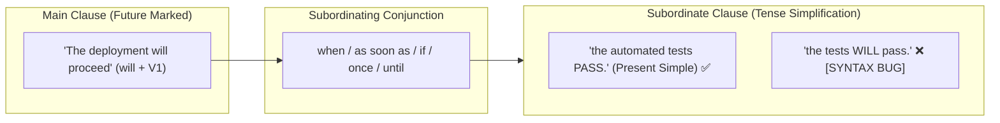
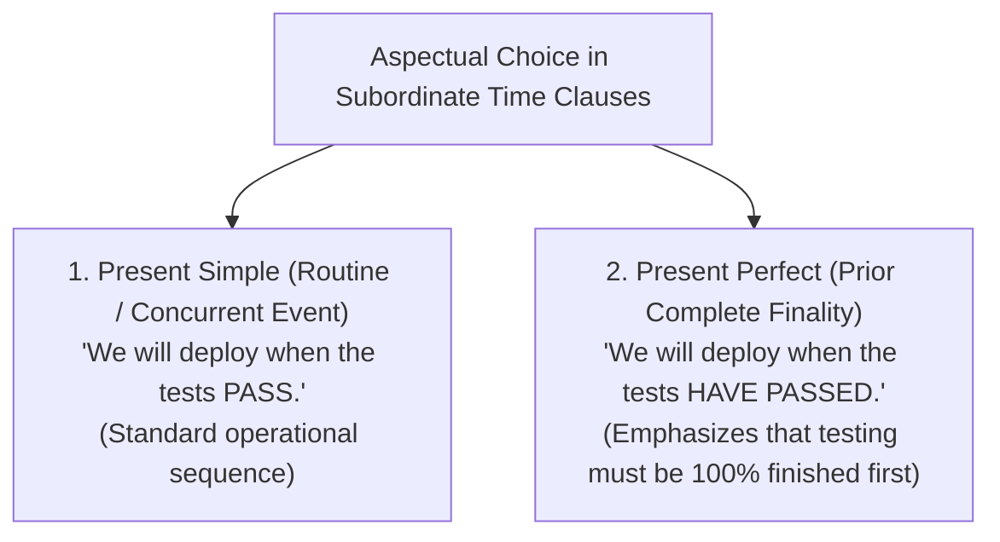
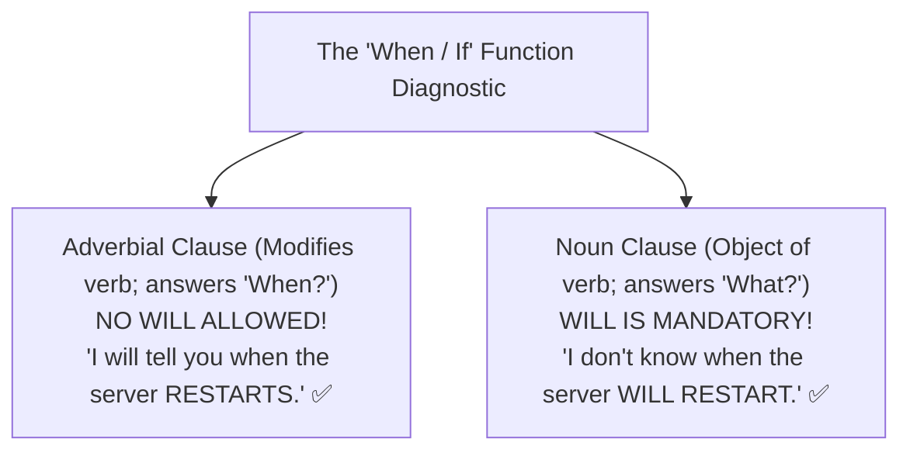

# Future Time in Subordinate Clauses ⏳⚡

> **Level:** CEFR B1–B2 (Essential Clause Rule)  
> **Primary References:** Raymond Murphy (*English Grammar in Use*, Unit 25); Michael Swan (*Practical English Usage*, §20, 231)  
> **The Golden Law:** When an adverbial clause refers to the future using a **time conjunction** (*when, as soon as, before, after, until, once*) or a **conditional conjunction** (*if, unless, provided*), the verb in that clause **must be in a Present Tense (Present Simple or Present Perfect), NEVER `will` or `shall`**.

---

## 1. Intent & The "Tense Simplification" Mental Model

In English, the modal auxiliary **will** is prohibited inside dependent adverbial clauses of time and condition because the subordinate conjunction itself already establishes the future contingency:

$$\mathbf{Main\ Clause\ (Future\ with\ WILL)} + \mathbf{Time/Condition\ Linker} + \mathbf{Subordinate\ Clause\ (PRESENT\ TENSE)}$$

- ❌ *The deployment will proceed when the tests **will pass**.* (Double Future Bug)
- ✅ *The deployment will proceed when the tests **pass**.* (Valid Present Simple)
- ✅ *The deployment will proceed when the tests **have passed**.* (Valid Present Perfect)

---

## 2. Inventory of Time and Condition Subordinators

Whenever an adverbial clause begins with one of these linkers and refers to future time, apply tense simplification:

| Category | Subordinating Conjunctions | Production Technical Example |
| :--- | :--- | :--- |
| **Simultaneous / Sequential Point** | *when, the moment (that)* | *We will notify management **the moment** the patch deploys.* |
| **Immediate Succession** | *as soon as, once* | *The runner will build the artifact **as soon as** the PR merges.* |
| **Temporal Precedence** | *before* | *Verify the hash **before** you execute the script.* |
| **Temporal Subsequent** | *after* | *We will run smoke tests **after** the container restarts.* |
| **Temporal Boundary** | *until, till, by the time* | *The client will poll **until** the transaction finishes.* |
| **Conditional Contingency** | *if, unless, provided that, as long as*| *Traffic will route to fallback **if** the primary fails.* |
| **Precautionary Contingency** | *in case* | *We will take a snapshot **in case** the migration fails.* |

---

## 3. Present Simple vs. Present Perfect in Future Clauses

You can use either the **Present Simple** or the **Present Perfect** in the subordinate clause, but they communicate distinct aspectual nuances:

1. **Present Simple (Action or Immediate Sequence):**
   - *I will call you when I **arrive** at the datacenter.*
   - *The cache will warm up as soon as traffic **hits** the router.*
2. **Present Perfect (Strict Completion Precondition):**
   - *You cannot merge this branch until the security architect **has reviewed** the diff.*  
     (Emphasizes that the review must be completely finished before merging is unlocked).
   - *We will shut down the legacy server once all customers **have migrated**.*

---

## 4. The Noun Clause Exception (When *Will* is Permitted)

> [!CRITICAL]
> **The Syntactic Function Trap:**
> The prohibition of *will* applies **only to Adverbial Clauses** (clauses answering *When?* or *Under what condition?*).
> If *when* or *if* introduces a **Noun Clause** (an indirect question acting as the Direct Object of verbs like *know, wonder, ask, doubt*), **`will` is fully grammatical and required**:

### Contrast Comparison:
1. **Adverbial Clause (No *will*):**
   - *We will start the deployment [when the clock **strikes** 02:00] ($\mathbf{A_{time}}$).*  
     (Answers: *When will we start?* $\implies$ Adverbial clause $\implies$ Present Simple).
2. **Noun Clause (Takes *will*):**
   - *Nobody knows [when the database **will recover**] ($\mathbf{O_d}$).*  
     (Answers: *What does nobody know?* $\implies$ Direct object noun clause $\implies$ *will* is valid).
3. **Conditional Clause (No *will*):**
   - *The service will fail [if the queue **fills** up] ($\mathbf{A_{condition}}$).*
4. **Noun Clause / Indirect Question (Takes *will*):**
   - *I doubt [if (whether) the database **will survive** the spike] ($\mathbf{O_d}$).*

---

## 5. Dual-Domain Practical Examples

### Everyday Conversational English
1. *I will text you as soon as I **get** home.* (Not *will get*)
2. *We can go out after the rain **stops**.* (Not *will stop*)
3. *Wait here until the doctor **calls** you.* (Not *will call*)
4. *If it **snows** tomorrow, school will be canceled.* (Not *will snow*)
5. *Once you **have finished** your dinner, you can have dessert.* (Completion nuance)
6. *Take an umbrella in case it **rains**.* (Precautionary)
7. *I don't know when the train **will arrive**.* (Noun clause indirect question)
8. *Before you **leave**, please turn off the lights.* (Imperative main clause)

### Professional Software Engineering Context
9. *The deployment pipeline will proceed automatically as soon as all unit tests **pass**.*  
   $\to$ Adverbial time clause with *as soon as* governing Present Simple *pass*.
10. *The autoscaler will provision three additional instances if CPU utilization **exceeds** 80%.*  
    $\to$ Conditional clause with *if* governing Present Simple *exceeds*.
11. *We will not cut over production traffic until the database administrator **has confirmed** data consistency.*  
    $\to$ Strict completion prerequisite using Present Perfect (*has confirmed*).
12. *The operations team will monitor the release closely once traffic **begins** routing to the new cluster.*  
    $\to$ Adverbial time clause introduced by *once*.
13. *The systems engineer cannot predict when the vendor **will release** the patch.*  
    $\to$ Noun clause direct object of *predict*; *will release* is syntactically required.
14. *Please back up your local database before you **pull** the latest upstream changes.*  
    $\to$ Temporal precedence clause introduced by *before*.
15. *The circuit breaker will trip the moment error rates **surpass** the 5% threshold.*  
    $\to$ Immediate succession clause introduced by *the moment*.

---

## 6. Common Mistakes & Diagnostic Anti-Patterns

| Bug (Ungrammatical Future Clause) | Patch (Syntactically Correct) | Root Cause Diagnostic |
| :--- | :--- | :--- |
| ❌ *We will deploy when the build **will finish**.* | ✅ *We will deploy when the build **finishes** (or **has finished**).* | **Double Future Bug:** *Will* is forbidden inside an adverbial time clause introduced by *when*. |
| ❌ *If it **will crash**, the alerts will fire.* | ✅ *If it **crashes**, the alerts will fire.* | Conditional *if*-clauses strictly forbid *will*. |
| ❌ *As soon as the PR **will be merged**, deploy.* | ✅ *As soon as the PR **is merged**, deploy.* | Passive future in time clause must use Present Simple passive (*is merged*). |
| ❌ *Wait until the server **will restart**.* | ✅ *Wait until the server **restarts**.* | Conjunction *until* demands Present Simple for future references. |
| ❌ *I wonder when the tests **pass**.* (future query) | ✅ *I wonder when the tests **will pass**.* | Indirect questions (noun clauses) require *will* to express future intent! |

---

## 7. Self-Assessment Practice Exercises

### Section A: Tense Simplification in Future Clauses
Complete each sentence using the correct form of the verb in brackets:

1. The deployment pipeline will trigger automatically as soon as the pull request [merge] ______ into master.
2. We will not decommission the legacy API until all third-party consumers [migrate] ______ their clients. (Emphasize completion)
3. If the network interface [drop] ______ packets, the watchdog daemon will trigger an alarm.
4. The client will retry the API request after the exponential backoff period [expire] ______.
5. Once the database administrator [verify] ______ the schema integrity, we will open the staging environment.
6. The container orchestrator will terminate the pod if memory consumption [exceed] ______ 2 GB.

### Section B: Noun Clause vs. Adverbial Clause Debugging
Decide whether *will* is **Forbidden (❌)** or **Mandatory (✅)**, and fix any errors:

7. *We will notify you when the migration will finish.*
8. *The architect asked when the engineering team will deliver the prototype.*
9. *Unless the firewall will allow port 443, traffic will be dropped.*
10. *I am not sure if the database will handle the Black Friday load.*
11. *The moment the alarm will trigger, the on-call engineer will be paged.*
12. *Before you will deploy the release, run the local linter.*

---

## 8. Comprehensive Answer Key & Explanations

1. **merges** (or **is merged**) — Subordinate time clause with *as soon as* requires Present Simple.
2. **have migrated** — Present Perfect emphasizes completion as an absolute prerequisite.
3. **drops** — Conditional *if*-clause requires Present Simple (*drops*).
4. **expires** — Time clause with *after* requires Present Simple.
5. **has verified** (or **verifies**) — Time clause with *once* demands Present tense.
6. **exceeds** — Conditional *if*-clause requires Present Simple.
7. **Correction:** *We will notify you when the migration **finishes** (or **has finished**).*  
   *Explanation:* Adverbial time clause answering *when will we notify you?*; *will* is forbidden.
8. **Correct as written!**  
   *Explanation:* Noun clause functioning as the direct object of *asked* (indirect question); *will deliver* is mandatory.
9. **Correction:** *Unless the firewall **allows** port 443, traffic will be dropped.*  
   *Explanation:* Conditional clause with *unless* forbids *will*; demands Present Simple *allows*.
10. **Correct as written!**  
    *Explanation:* Noun clause functioning as the direct object of *am not sure* (*if* = *whether*); *will handle* is correct.
11. **Correction:** *The moment the alarm **triggers**, the on-call engineer will be paged.*  
    *Explanation:* Time clause with *the moment* forbids *will*.
12. **Correction:** *Before you **deploy** the release, run the local linter.*  
    *Explanation:* Time clause with *before* forbids *will*.

---

## 9. Revision Flashcards & Key Takeaways

- **The Golden Subordinate Rule:** $\mathbf{when / as\ soon\ as / if / once / until} + \mathbf{Present\ Simple\ (or\ Present\ Perfect)}$.
- **No "Will" in Time/If Clauses:** Never write *when it will run* or *if it will fail* when describing conditions. Write *when it runs* and *if it fails*.
- **The Present Perfect Nuance:** Use Present Perfect in the time clause when the prior action must be **100% finished** before the main action can unlock (*once all records have synced*).
- **The Noun Clause Diagnostic:** If the clause answers *"What?"* after verbs like *know, wonder, ask, tell*, it is a noun clause and **can use `will`** (*I don't know when the build will pass*).
