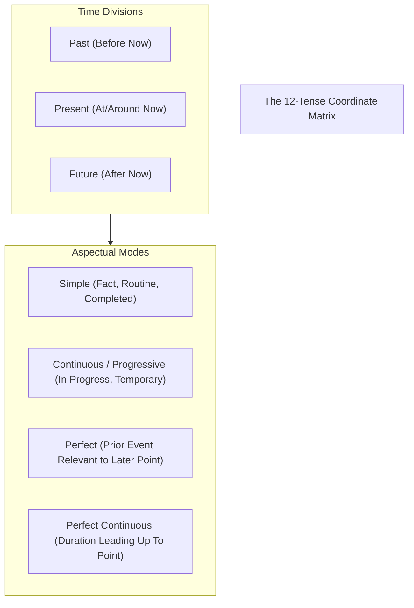
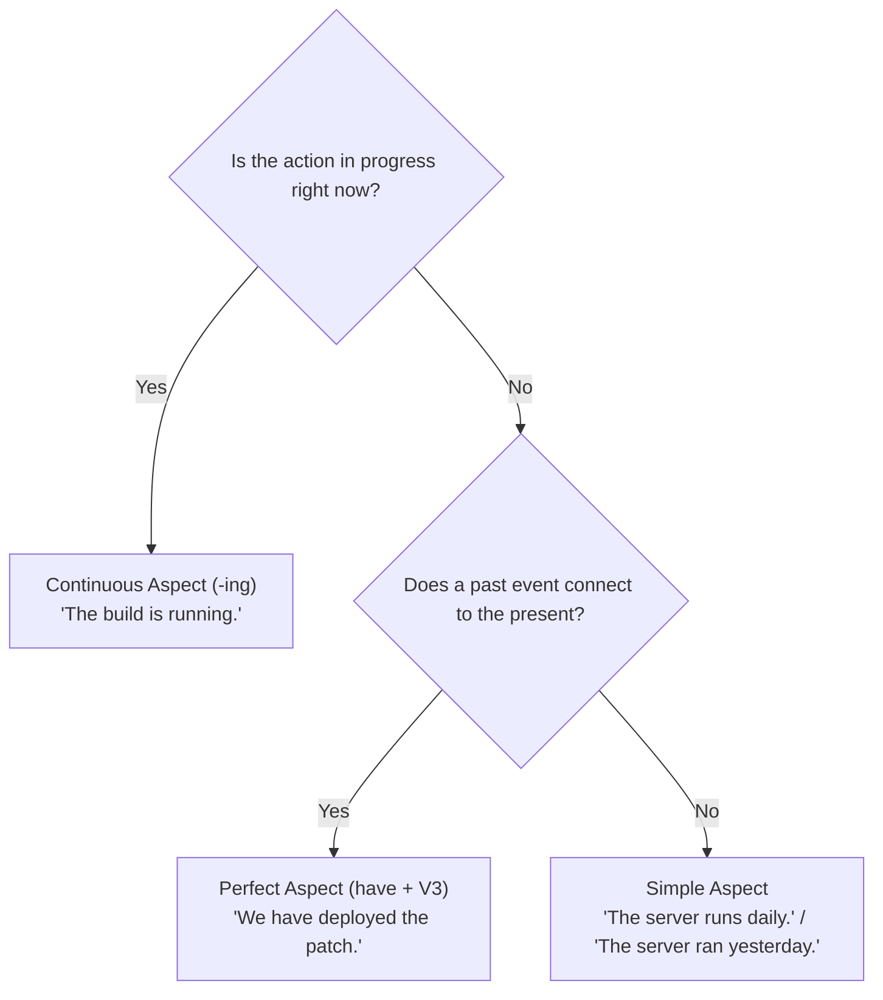

# Tenses and Aspect Knowledge System ⏳

> *"Tense locates an event in time (Past, Present, Future). Aspect describes the internal temporal structure of that event: whether it is a completed point (Simple), an ongoing process (Continuous), or an action whose consequences connect across time (Perfect)."*  
> — Reference: Raymond Murphy (*English Grammar in Use*, Units 1–25); Michael Swan (*Practical English Usage*, §3–5)

Welcome to the **Tenses and Aspect** module. English expresses time not merely as Past, Present, and Future, but through the mathematical intersection of **Three Time Divisions** $\times$ **Four Grammatical Aspects**, yielding the **12 Canonical Tenses of English**.

---

## 🧭 The 12-Tense Master Architecture Matrix

| Aspect $\downarrow$ \ Time $\to$ | **Past** | **Present** | **Future** |
| :--- | :--- | :--- | :--- |
| **Simple** | **[Past Simple](past-simple.md)** `V2` *The server crashed.* | **[Present Simple](present-simple.md)** `V1 (+(e)s)` *The server crashes.* | **[Future Simple](future-simple-will-shall.md)** `will + V1` *The server will crash.* |
| **Continuous** | **[Past Continuous](past-continuous.md)** `was/were + V-ing` *It was crashing.* | **[Present Continuous](present-continuous.md)** `am/is/are + V-ing` *It is crashing.* | **[Future Continuous](future-continuous.md)** `will be + V-ing` *It will be crashing.* |
| **Perfect** | **[Past Perfect](past-perfect-simple.md)** `had + V3` *It had crashed.* | **[Present Perfect](present-perfect-simple.md)** `have/has + V3` *It has crashed.* | **[Future Perfect](future-perfect-and-perfect-continuous.md)** `will have + V3` *It will have crashed.* |
| **Perfect Continuous** | **[Past Perfect Cont.](past-perfect-continuous.md)** `had been + V-ing` *It had been crashing.* | **[Present Perfect Cont.](present-perfect-continuous.md)** `have/has been + V-ing` *It has been crashing.* | **[Future Perfect Cont.](future-perfect-and-perfect-continuous.md)** `will have been + V-ing` *It will have been crashing.* |

---

## 🧭 Topic Catalog & Specialized Future Guides

| Document | Core Focus | CEFR Level | Key Practical Takeaway |
| :--- | :--- | :---: | :--- |
| **[1. Present Simple](present-simple.md)** | Habits, universal truths, timetables | A1 | Describe permanent software behavior and scheduled jobs. |
| **[2. Present Continuous](present-continuous.md)** | Ongoing processes, temporary states | A1 | Differentiate active runtime operations from permanent architecture. |
| **[3. Past Simple](past-simple.md)** | Definite completed historical events | A1–A2 | Express finished sprints, past incidents, and dated releases. |
| **[4. Past Continuous](past-continuous.md)** | Ongoing background events & interruptions | A2 | Narrative context during incident root-cause analysis (RCA). |
| **[5. Present Perfect Simple](present-perfect-simple.md)** | Past event with direct present consequence | B1 | Connect past development tasks to the current system state. |
| **[6. Present Perfect Continuous](present-perfect-continuous.md)** | Unbroken duration up to the present | B1 | Express how long an ongoing job or bug has been running. |
| **[7. Past Perfect Simple](past-perfect-simple.md)** | The "past before the past" | B1–B2 | Establish strict chronological priority between two past events. |
| **[8. Past Perfect Continuous](past-perfect-continuous.md)** | Duration leading up to a past threshold | B2 | Detail continuous processes preceding a past system failure. |
| **[9. Future Simple (`will` / `shall`)](future-simple-will-shall.md)** | Instant decisions, forecasts, promises | A2–B1 | Write forward-looking architecture proposals and commitments. |
| **[10. Future Intentions (`be going to`)](future-intentions-be-going-to.md)** | Prior plans, present sensory evidence | A2–B1 | Articulate planned roadmap features based on active telemetry. |
| **[11. Future Continuous](future-continuous.md)** | Action in progress at future timestamp | B1–B2 | Schedule maintenance windows (*We will be migrating at 02:00*). |
| **[12. Future Perfect & Continuous](future-perfect-and-perfect-continuous.md)** | Completion before a future deadline | B2 | Commit to milestone deliveries (*By Q3, we will have shipped*). |
| **[13. Future Time in Subordinate Clauses](future-time-in-subordinate-clauses.md)** | Time linkers (*when, as soon as, until*) | B1–B2 | **The Golden Rule:** Never use *will* inside time and if-clauses! |
| **[14. Future-in-the-Past & Special Forms](future-in-the-past-and-special-forms.md)** | *was going to, would, be to + inf* | B2–C1 | Describe past intentions that were altered or interrupted. |

---

## ⚡ The Aspectual Decider

