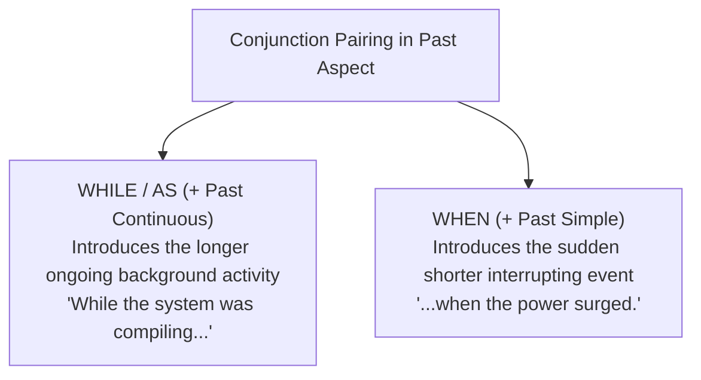

# Past Continuous (Progressive) Tense ⏳

> **Level:** CEFR A2 (Past Aspectual Narrative)  
> **Primary References:** Raymond Murphy (*English Grammar in Use*, Unit 6); Michael Swan (*Practical English Usage*, §5, 45)  
> **Key Function:** Expresses an action that was actively in progress at a specific past moment, provides background context for an incident, or frames an ongoing action interrupted by a shorter point event in the Past Simple.

---

## 1. Intent & The "Interrupted Action" Mental Model

The **Past Continuous** tense frames an event as an extended temporal backdrop. When combined with the Past Simple, it establishes a classic dual-aspect narrative structure:

$$\mathbf{Ongoing\ Background\ Action\ (Past\ Continuous)} \quad \longleftarrow \quad \mathbf{Point\ Interruption\ (Past\ Simple)}$$

```mermaid
gantt
    title Interrupted Action Timeline
    dateFormat HH:mm
    axisFormat %H:%M
    section Ongoing Action
    Database was executing vacuum :active, 03:00, 03:30
    section Point Interruption
    Connection dropped (03:15) :crit, 03:15, 03:16
```

- *The database **was executing** a vacuum operation [Past Continuous] when the network connection **dropped** [Past Simple].*

---

## 2. Structural Formulas & Syntax Patterns

$$\mathbf{Past\ Continuous} = \mathbf{was/were} + \mathbf{V\text{-}ing\ (Present\ Participle)}$$

| Sentence Type | Formula | Canonical Production Example |
| :--- | :--- | :--- |
| **Affirmative (+)** | `Subject + was/were + V-ing` | *The worker thread **was consuming** messages.* |
| **Negative (-)** | `Subject + was/were not + V-ing` | *The proxy **was not forwarding** requests.* |
| **Interrogative (?)** | `Was/Were + Subject + V-ing?` | * **Were** the replicas **syncing** with the primary?* |
| **Negative Question** | `Wasn't/Weren't + Subject + V-ing?`| * **Wasn't** the auto-scaler **monitoring** memory load?* |

| Subject Number / Person | Auxiliary Form | Example |
| :--- | :---: | :--- |
| **I, he, she, it, singular noun** | **was** | *The server **was** restarting.* |
| **You, we, they, plural noun** | **were** | *The pods **were** failing.* |

---

## 3. Conjunction Pairing: *While* vs. *When*

1. **`While` + Past Continuous:**  
   * **While** the backup service **was writing** data to disk, a disk sector failed.*
2. **`When` + Past Simple:**  
   *The backup service was writing data to disk **when** a disk sector **failed**.*

---

## 4. Four Core Usage Scenarios

### 1. In Progress at an Exact Past Timestamp
Denotes an action already underway at a specific clock time in the past:
- *At 02:30 UTC, the database **was running** daily aggregation queries.*
- *At midnight, we **were monitoring** the traffic migration.*

### 2. Simultaneous Parallel Actions
Two ongoing past actions taking place concurrently without interrupting each other:
- *While the backend engineer **was patching** the authentication filter, the frontend developer **was updating** the client SDK.*

### 3. Incident Atmosphere & Background Scene Setting
Used in incident postmortems to describe the state of the world leading up to an event:
- *Alarms **were sounding**, CPU graphs **were spiking** into the red, and users **were reporting** HTTP 504 gateway timeouts.*

### 4. Polite Professional Distancing
Using past continuous to soften requests or questions, making them more diplomatic (Swan §311):
- *I **was wondering** if you had ten minutes to review my pull request.*
- *We **were hoping** to schedule an architectural sync this afternoon.*

---

## 5. Dual-Domain Practical Examples

### Everyday Conversational English
1. *I **was watching** a film when you called.* (Interrupted action)
2. *At 08:00 yesterday, she **was driving** to work.* (Action at exact time)
3. *While I **was cooking**, my brother **was setting** the table.* (Parallel actions)
4. *It **was raining** heavily when we left the house.* (Background scene)
5. *What **were** you **doing** at 10:00 PM last night?* (Past inquiry)
6. *They **were not paying** attention during the briefing.* (Negative)
7. *I **was thinking** about calling you earlier.* (Polite formulation)
8. *Were you sleeping when the alarm went off?* (Interrogative)

### Professional Software Engineering Context
9. *The ingestion daemon **was reading** uncommitted records when the database crashed.*  
   $\to$ Ongoing background action interrupted by a point failure.
10. *At 04:00 UTC, the cron scheduler **was executing** twenty concurrent jobs.*  
    $\to$ Action in active execution at an exact past timestamp.
11. *While the replica **was catching up** with the master, query latency remained slightly elevated.*  
    $\to$ Parallel background process paired with *while*.
12. *The memory usage **was climbing** steadily for two hours before the OOM-killer intervened.*  
    $\to$ Developing trend leading to a critical event.
13. *The client **was sending** malformed payloads, which triggered validation exceptions.*  
    $\to$ Background causal action.
14. *I **was wondering** if we could revisit the database sharding proposal.*  
    $\to$ Polite professional query (*was wondering*).
15. *The cluster nodes **were exchanging** heartbeat packets normally until the network partition occurred.*  
    $\to$ Normal background operation interrupted by a network fault.

---

## 6. Common Mistakes & Diagnostic Anti-Patterns

| Bug (Ungrammatical Construction) | Patch (Syntactically Correct) | Root Cause Diagnostic |
| :--- | :--- | :--- |
| ❌ *The server **was containing** 500 keys when it crashed.* | ✅ *The server **contained** 500 keys when it crashed.* | **Stative Verb in Continuous:** *Contain* is stative; use Past Simple *contained*. |
| ❌ *When the power failed, we **migrated** the database.* (in progress) | ✅ *When the power failed, we **were migrating** the database.* | Expressing an in-progress background task requires Past Continuous (*were migrating*). |
| ❌ *The microservices **was restarting**.* | ✅ *The microservices **were restarting**.* | Plural subject *microservices* demands plural auxiliary *were*. |
| ❌ *While we **checked** the logs, the server restarted.* | ✅ *While we **were checking** the logs, the server restarted.* | Conjunction *while* introduces the continuous ongoing activity (*were checking*). |
| ❌ *At 03:00, the cron job **ran**.* (already in progress) | ✅ *At 03:00, the cron job **was running**.* | If the job started before 03:00 and was underway at 03:00, use Past Continuous. |

---

## 7. Self-Assessment Practice Exercises

### Section A: Past Simple vs. Past Continuous Integration
Complete the sentences using either the **Past Simple** or **Past Continuous** form of the verbs in brackets:

1. The distributed transaction [fail] ______ while the worker thread [write] ______ to the database.
2. At 01:30 AM, the backup runner [compress] ______ the archived log files.
3. The firewall [drop] ______ the packet because the client [not / send] ______ a valid header.
4. While the database administrator [index] ______ the user table, CPU utilization [reach] ______ 100%.
5. The engineer [debug] ______ the issue when management [call] ______ an emergency sync.
6. The cluster [seem] ______ stable while the test [run] ______.

### Section B: Sentence Error Spotting & Repair
Identify and correct the grammatical bugs in the following statements:

7. *The server was having three active network interfaces when it died.*
8. *While the CI pipeline executed unit tests, the network connection dropped.*
9. *All node was communicating over gRPC before the outage.*
10. *I was wonder if you had time to review this code snippet.*
11. *The developer was deployed the hotfix when the alarm went off.*
12. *At midnight, the data pipeline finished already its execution.*

---

## 8. Comprehensive Answer Key & Explanations

1. **failed ... was writing** — Point event in Past Simple (*failed*) interrupting ongoing background action (*was writing*).
2. **was compressing** — Action actively in progress at a precise past timestamp (*01:30 AM*).
3. **dropped ... was not sending** — Point rejection (*dropped*) caused by ongoing background omission (*was not sending*).
4. **was indexing ... reached** — Background action introduced by *while* (*was indexing*); resulting point event (*reached*).
5. **was debugging ... called** — Continuous engineering activity (*was debugging*) interrupted by point call (*called*).
6. **seemed ... was running** — *Seem* is a stative verb (demands Past Simple *seemed*); background test execution uses *was running*.
7. **Correction:** *The server **had** three active network interfaces when it died.*  
   *Explanation:* *Have* (denoting possession/hardware state) is strictly stative; use Past Simple *had*.
8. **Correction:** *While the CI pipeline **was executing** unit tests, the network connection dropped.*  
   *Explanation:* Ongoing activity introduced by *while* requires Past Continuous.
9. **Correction:** *All **nodes were communicating** over gRPC before the outage.*  
   *Explanation:* Plural subject *nodes* requires plural auxiliary *were*.
10. **Correction:** *I **was wondering** if you had time to review this code snippet.*  
    *Explanation:* Idiomatic polite formula requires present participle (*was wondering*).
11. **Correction:** *The developer **was deploying** the hotfix when the alarm went off.*  
    *Explanation:* Active continuous formula is $\mathbf{was} + \mathbf{V\text{-}ing}$ (*was deploying*, not *was deployed*).
12. **Correction:** *At midnight, the data pipeline **was already finishing** its execution (or **had already finished**).*  
    *Explanation:* Avoid awkward past simple pairing with *already* at an exact time boundary.

---

## 9. Revision Flashcards & Key Takeaways

- **Past Continuous Formula:** $\mathbf{Subject} + \mathbf{was/were} + \mathbf{V\text{-}ing}$.
- **Core Archetype:** An ongoing background movie scene (*was processing*) interrupted by a sudden snapshot photograph (*crashed*).
- **While vs When:**
  - *While* + Past Continuous (*While the server was syncing...*)
  - *When* + Past Simple (*...when the power surged.*)
- **Stative Invariant Holds:** Stative verbs (*know, have, seem, belong*) cannot be used in the Past Continuous (*The server had enough RAM*, never *was having*).
- **Polite Requests:** Use *I was wondering if...* to frame polite workplace inquiries.
