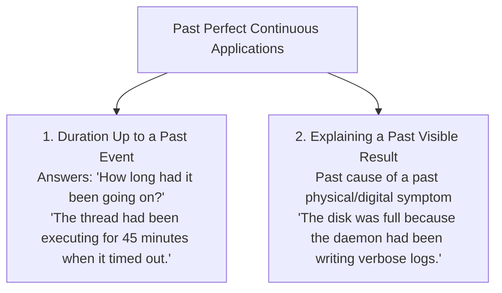
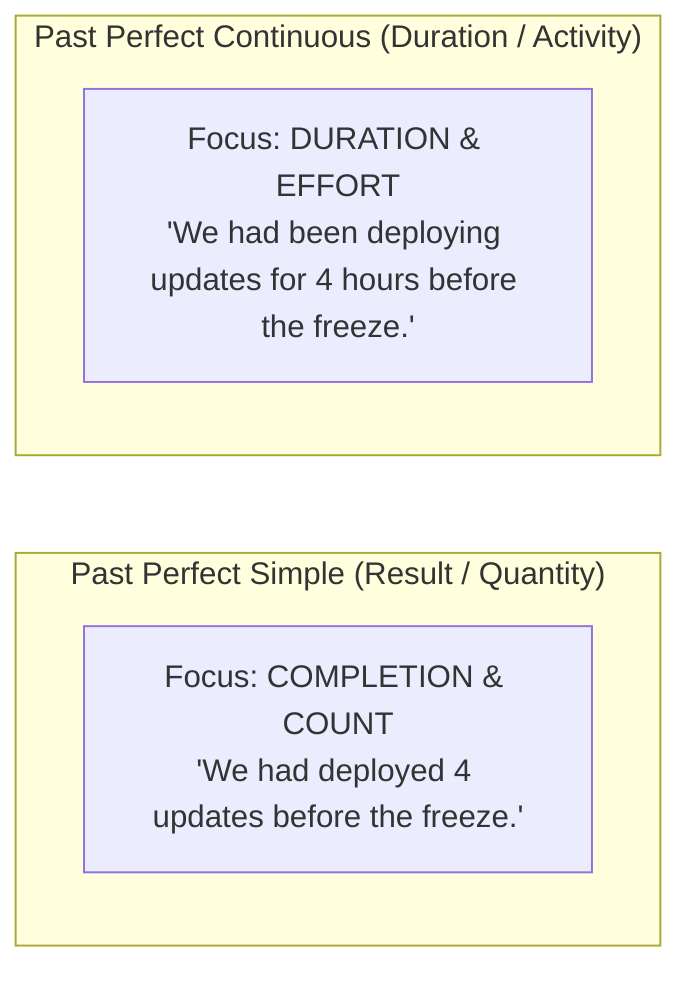

# Past Perfect Continuous (Progressive) Tense ⏳🔄

> **Level:** CEFR B2 (Pre-Past Duration)  
> **Primary References:** Raymond Murphy (*English Grammar in Use*, Unit 16); Michael Swan (*Practical English Usage*, §5, 55)  
> **Key Function:** Emphasizes the **unbroken duration or process** of an ongoing activity that took place before another past event occurred, or explains the root cause of a past condition.

---

## 1. Intent & The "Pre-Past Duration" Mental Model

The **Past Perfect Continuous** tracks an action that was actively unfolding across time in the past, terminating right before (or continuing through) a second past reference point:

$$\mathbf{Past\ Perfect\ Continuous} = \mathbf{had\ been} + \mathbf{V\text{-}ing\ (Present\ Participle)}$$

```mermaid
timeline
    title Past Perfect Continuous Timeline
    01:00 UTC : Memory leak initiated
    01:00 - 04:00 UTC : Daemon HAD BEEN LEAKING memory continuously
    04:00 UTC (Past Simple) : Kernel OOM-killer killed the process
    NOW (Present) : Current Incident Review
```

- *The daemon **had been leaking** memory for three hours [Past Perfect Continuous] before the kernel **killed** the process [Past Simple].*

---

## 2. Structural Formulas & Syntax Patterns

| Sentence Type | Formula | Canonical Production Example |
| :--- | :--- | :--- |
| **Affirmative (+)** | `Subject + had been + V-ing` | *The worker **had been consuming** queue messages for two hours.* |
| **Negative (-)** | `Subject + had not been + V-ing` | *The replica **had not been syncing** before the failover.* |
| **Interrogative (?)** | `Had + Subject + been + V-ing?` | * **Had** the network **been dropping** packets before the crash?* |
| **Negative Question** | `Hadn't + Subject + been + V-ing?`| * **Hadn't** the engineer **been monitoring** memory usage?* |

---

## 3. The Two Core Usage Scenarios



### Scenario 1: Duration Preceding a Past Threshold (*How long?*)
Emphasizes that an ongoing activity had been taking place for a measurable duration before a past turning point:
- *We **had been debugging** the concurrency deadlock for six hours when we finally identified the race condition.*
- *The application **had been functioning** normally for three months before the SSL certificate expired.*

### Scenario 2: Explaining a Past State of Affairs (Root Cause Analysis)
Explains the root cause of an observable condition in the past:
- *The heatsink was burning hot because the crypto-miner **had been running** at 100% capacity.*
- *The developer was exhausted because she **had been triaging** security vulnerabilities all night.*

---

## 4. Disambiguation: Past Perfect Simple vs. Continuous



| Dimension | Past Perfect Simple | Past Perfect Continuous |
| :--- | :--- | :--- |
| **Primary Question** | *How many? Has it completed?* | *How long? What had been ongoing?* |
| **Focus** | Completed outcome. | The activity / process itself. |
| **Stative Verbs** | **Mandatory** (*The database had belonged to us for years*). | **Forbidden** (❌ *had been belonging*). |
| **Software Example** | *The script **had processed 1,000 records** before crashing.* | *The script **had been processing records for an hour** before crashing.* |

---

## 5. Dual-Domain Practical Examples

### Everyday Conversational English
1. *I **had been waiting** for twenty minutes when the bus arrived.* (Duration prior to event)
2. *The pavement was wet because it **had been raining**.* (Past evidence of past process)
3. *She **had been playing** tennis, so she was tired.* (Physical cause)
4. *They **had been living** in Paris for two years before moving to Berlin.* (Pre-past duration)
5. *How long **had** you **been studying** before you took the exam?* (Pre-past inquiry)
6. *He **had not been feeling** well for several days.* (Ongoing negative condition)
7. *We **had been looking** for a house for months before finding this one.* (Extended past search)
8. *Her eyes were tired because she **had been reading** without glasses.* (Past symptom cause)

### Professional Software Engineering Context
9. *The database **had been experiencing** elevated lock contention for several hours before the transaction aborted.*  
   $\to$ Ongoing pre-past condition explaining failure.
10. *The application server crashed because a rogue thread **had been allocating** memory in an infinite loop.*  
    $\to$ Root-cause analysis in an incident report.
11. *The DevOps team **had been preparing** the Kubernetes migration for six months before executing the cutover.*  
    $\to$ Pre-past engineering duration.
12. *The network switches **had been dropping** packets sporadically throughout the morning before the link severed.*  
    $\to$ Intermittent process preceding total failure.
13. *The client **had been polling** the `/status` endpoint every 100ms before it received HTTP 429.*  
    $\to$ Excessive rate behavior leading to throttling.
14. *We **had been refactoring** the auth layer for three sprints before management paused the project.*  
    $\to$ Extended engineering effort interrupted by a decision.
15. *The QA team **had run thirty test suites**, but they **had been testing** the wrong deployment branch.*  
    $\to$ Past Perfect Simple (30 suites completed) vs. Past Perfect Continuous (ongoing mistaken effort).

---

## 6. Common Mistakes & Diagnostic Anti-Patterns

| Bug (Ungrammatical Construction) | Patch (Syntactically Correct) | Root Cause Diagnostic |
| :--- | :--- | :--- |
| ❌ *The server was leaking memory for hours **before it crashed**.* | ✅ *The server **had been leaking** memory for hours before it crashed.* | Expressing duration leading up to a past event demands the Past Perfect Continuous. |
| ❌ *The cluster had been **belonging** to us for years.* | ✅ *The cluster had **belonged** to us for years.* | Stative verbs (*belong*) cannot take continuous aspect; use Past Perfect Simple. |
| ❌ *We had been deploying **five microservices** before noon.* | ✅ *We had deployed **five microservices** before noon.* | Specific completed quantities (*five microservices*) demand Past Perfect Simple. |
| ❌ *How long **were you debugging** before finding it?* | ✅ *How long **had you been debugging** before finding it?* | Duration prior to a past discovery requires Past Perfect Continuous. |
| ❌ *The thread had been **execute**.* | ✅ *The thread had been **executing**.* | Continuous formula strictly requires present participle (`-ing`). |

---

## 7. Self-Assessment Practice Exercises

### Section A: Tense Disambiguation (Past Perfect Simple vs. Continuous)
Complete each sentence using either the **Past Perfect Simple** or **Past Perfect Continuous** of the verb in brackets:

1. The data ingestion runner [consume] ______ records for five continuous hours before the connection severed.
2. The team [author] ______ three complete architectural proposals before executive leadership approved the strategy.
3. The server was overheating because a mining bot [utilize] ______ 100% of the GPU cores.
4. We [know] ______ about the vulnerability for several weeks before releasing the patch.
5. How long [the database / experience] ______ replication lag before the sentinel node triggered the failover?
6. The test harness [execute] ______ twenty-four test modules by the time the CI runner timed out.

### Section B: Root Cause Analysis Debugging
Identify and patch the grammatical bugs in the following postmortem excerpts:

7. *The disk filled up because the logger was writing debug logs at 50 MB/s for three days.*
8. *The team had been releasing four minor versions before the major overhaul.*
9. *We had been having that legacy server since 2018 before replacing it.*
10. *How long was the memory leaking before the daemon crashed?*
11. *The background worker had been ran for forty-eight hours without a restart.*
12. *She had been writing fifty documentation pages before the deadline.*

---

## 8. Comprehensive Answer Key & Explanations

1. **had been consuming** — Unbroken pre-past duration spanning 5 hours (*How long?*).
2. **had authored** — Completed quantity (three proposals) demands Past Perfect Simple.
3. **had been utilizing** — Root cause of past physical overheating.
4. **had known** — *Know* is an inherently stative verb; continuous is forbidden.
5. **had the database been experiencing** — Interrogative pre-past duration: $\mathbf{Had} + \mathbf{S} + \mathbf{been} + \mathbf{V\text{-}ing?}$
6. **had executed** — Completed count of modules (24) demands Past Perfect Simple.
7. **Correction:** *The disk filled up because the logger **had been writing** debug logs at 50 MB/s for three days.*  
   *Explanation:* Duration leading up to a past failure (*for three days before the disk filled up*) demands Past Perfect Continuous.
8. **Correction:** *The team **had released** four minor versions before the major overhaul.*  
   *Explanation:* Specific count of completed tasks (*four versions*) demands Past Perfect Simple.
9. **Correction:** *We **had had** that legacy server since 2018 before replacing it.*  
   *Explanation:* Stative verb *have* (possession) cannot take continuous aspect; use Past Perfect Simple (*had had*).
10. **Correction:** *How long **had the memory been leaking** before the daemon crashed?*  
    *Explanation:* Duration prior to a past crash requires Past Perfect Continuous.
11. **Correction:** *The background worker **had been running** for forty-eight hours without a restart.*  
    *Explanation:* Participle must be present participle *running* (not past participle *ran*).
12. **Correction:** *She **had written** fifty documentation pages before the deadline.*  
    *Explanation:* Completed quantity (50 pages) demands Past Perfect Simple.

---

## 9. Revision Flashcards & Key Takeaways

- **Past Perfect Continuous Formula:** $\mathbf{Subject} + \mathbf{had\ been} + \mathbf{V\text{-}ing}$.
- **Core Function:** Emphasizes how long an ongoing process had been executing before a subsequent past event (*had been leaking for hours before it crashed*).
- **RCA Causation:** Explains the physical or telemetric symptoms observable during a past incident.
- **Simple vs. Continuous:**
  - *Had deployed 5 pods* = Completed quantity (Simple).
  - *Had been deploying pods for 5 hours* = Ongoing duration (Continuous).
- **Stative Invariant:** Stative verbs (*know, have, be*) cannot take continuous aspect (*had had*, never *had been having*).
