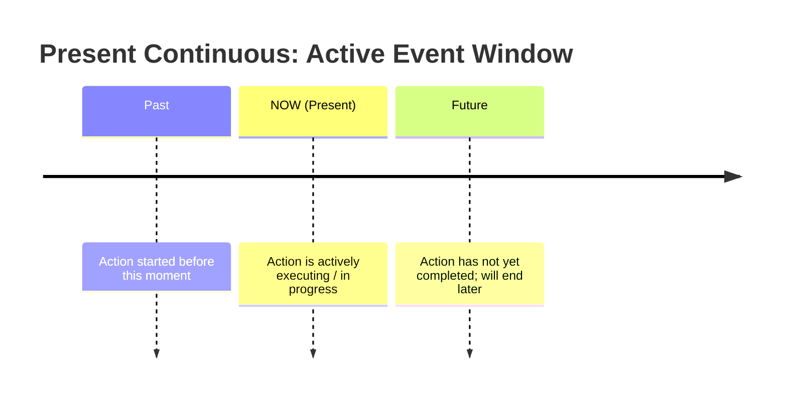
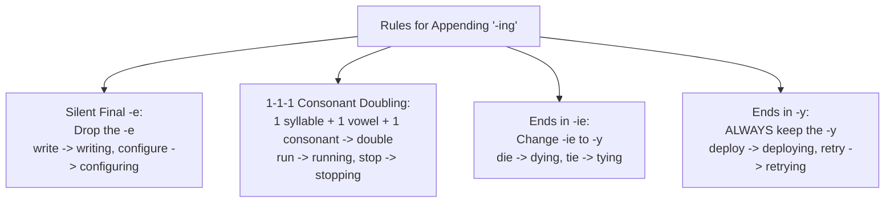

# Present Continuous (Progressive) Tense 🔄

> **Level:** CEFR A1–A2 (Core Aspect)  
> **Primary References:** Raymond Murphy (*English Grammar in Use*, Units 1, 3–4, 19); Michael Swan (*Practical English Usage*, §3, 5, 32–34)  
> **Key Function:** Expresses an action in active progress at the moment of speaking, a temporary situation around the present, an ongoing developmental trend, or a pre-arranged future event.

---

## 1. Intent & The "Timeline Window" Mental Model

The **Present Continuous** tense views an action from the inside, framing it as an ongoing, incomplete process that started before now and is expected to terminate later:

$$\mathbf{Present\ Continuous} = \mathbf{BE\ (am/is/are)} + \mathbf{V\text{-}ing\ (Present\ Participle)}$$

---

## 2. Structural Formulas & Syntax Patterns

| Sentence Type | Formula | Canonical Production Example |
| :--- | :--- | :--- |
| **Affirmative (+)** | `Subject + am/is/are + V-ing` | *The pipeline **is running** integration tests.* |
| **Negative (-)** | `Subject + am/is/are + not + V-ing` | *The database **is not accepting** write connections.* |
| **Interrogative (?)** | `Am/Is/Are + Subject + V-ing?` | * **Are** the worker threads **consuming** from the queue?* |
| **Negative Question** | `Isn't/Aren't + Subject + V-ing?` | * **Isn't** the container **restarting** automatically?* |

---

## 3. Orthography: Suffixing `-ing`

Appending `-ing` follows four strict spelling transformations:

---

## 4. Signal Words & Temporal Markers

- **Immediate Present:** *now, right now, at the moment, currently, at present*.
- **Extended Present (Around Now):** *this week, this month, nowadays, these days, currently*.
- **Trends & Developments:** *gradually, day by day, increasingly*.

---

## 5. Five Major Usage Scenarios

### 1. Actions in Progress Right Now
An active process observable at the exact moment of speech:
- *The compiler **is building** the release binary right now.*
- *The engineers **are debugging** the latency spike.*

### 2. Temporary Situations (Around Now)
An action that is true during this general period of time, even if not happening at this exact second:
- *I **am reading** *Designing Data-Intensive Applications* this month.*
- *The frontend engineer **is working** remotely this week.*

### 3. Changing Situations & Architectural Trends
Denoting evolving metrics, growth, or decline:
- *Network bandwidth utilization **is increasing** rapidly.*
- *The cost of cloud storage **is falling**.*

### 4. Fixed Future Arrangements (Pre-Agreed Events)
Events that have already been scheduled with a specific time, place, or participants (Murphy Unit 19):
- *The platform team **is deploying** the release tomorrow at 10:00 AM.*
- *We **are meeting** the security auditors on Thursday afternoon.*

### 5. Annoying Repeated Habits (with *always* or *constantly*)
Expresses emotional irritation at an unexpectedly frequent habit (Swan §5):
- *The legacy monolith **is always crashing** on Friday afternoons!*
- *He **is constantly interrupting** during sprint planning.*

---

## 6. Stative Verbs Prohibition

> [!CAUTION]
> As established in [Action vs. Stative Verbs](../02-verbs-and-auxiliaries/verb-types-action-vs-stative.md), verbs of cognition, emotion, sensory perception, and possession **do not take continuous aspect**:
> - ❌ *The cache **is containing** valid sessions.*
> - ✅ *The cache **contains** valid sessions.* (Present Simple)
> - ❌ *I **am knowing** the architecture.*
> - ✅ *I **know** the architecture.* (Present Simple)

---

## 7. Dual-Domain Practical Examples

### Everyday Conversational English
1. *I **am cooking** dinner right now.* (Active at present)
2. *She **is studying** computer science at university.* (Temporary period)
3. *The climate **is getting** warmer.* (Trend/change)
4. *We **are flying** to London on Friday.* (Future arrangement)
5. *Why **are** you **crying**?* (Observable physical state)
6. *He **is always leaving** his dirty dishes in the sink!* (Annoying habit)
7. *They **are not watching** TV at the moment.* (Negative immediate)
8. * **Are** you **listening** to me?* (Immediate question)

### Professional Software Engineering Context
9. *The background worker **is ingesting** logs from the Kafka cluster.*  
   $\to$ Active runtime process taking place now.
10. *The database administrator **is not accepting** any schema updates during the freeze.*  
    $\to$ Temporary policy during a defined period.
11. *Cloud infrastructure costs **are growing** faster than our projected budget.*  
    $\to$ Ongoing metric trend.
12. *We **are releasing** version 2.4.0 this coming Wednesday at 14:00 UTC.*  
    $\to$ Pre-arranged future event with explicit date/time.
13. *The authentication service **is currently experiencing** intermittent network timeouts.*  
    $\to$ Active temporary degraded state (*experience* used dynamically).
14. *The CI runner **is compiling** the integration test suite.*  
    $\to$ Ongoing job in progress.
15. *That staging database **is constantly running out of** disk space!*  
    $\to$ Annoying repeated occurrence paired with *constantly*.

---

## 8. Common Mistakes & Diagnostic Anti-Patterns

| Bug (Ungrammatical Continuous) | Patch (Syntactically Correct) | Root Cause Diagnostic |
| :--- | :--- | :--- |
| ❌ *The server **is crash** right now.* | ✅ *The server **is crashing** right now.* | Continuous aspect requires the present participle (`-ing`), not the bare base verb. |
| ❌ *The API **is belonging** to our team.* | ✅ *The API **belongs** to our team.* | *Belong* is an inherently stative verb of possession; progressive is forbidden. |
| ❌ *I **am understand** the problem.* | ✅ *I **understand** the problem.* | *Understand* is an instantaneous cognitive stative verb; use Present Simple. |
| ❌ *We **deploy** the hotfix tomorrow at 10 AM.* | ✅ *We **are deploying** the hotfix tomorrow at 10 AM.* | Fixed future arrangements with specific people/times demand Present Continuous. |
| ❌ *The engineer is **writeing** documentation.* | ✅ *The engineer is **writing** documentation.* | Spelling bug: drop the silent final `-e` before appending `-ing`. |

---

## 9. Self-Assessment Practice Exercises

### Section A: Suffixing & Aspect Formation
Fill in the blanks with the correct Present Continuous form of the verb in brackets:

1. The DevOps engineer [configure] ______ the Kubernetes ingress controller right now.
2. The background threads [not / poll] ______ the database currently.
3. [Is / Are] ______ the load balancer [redirect] ______ traffic to the backup region?
4. Cloud compute prices [drop] ______ significantly this quarter.
5. The platform team [migrate] ______ all staging workloads this evening.
6. The database [retry] ______ the failed transaction automatically.

### Section B: Aspect Contrast & Debugging
Choose whether **Present Simple** or **Present Continuous** is grammatically required:

7. The authentication service [runs / is running] every day at 00:00 UTC.
8. Look at the dashboard! The CPU usage [spikes / is spiking] past 99%!
9. We [prefer / are preferring] PostgreSQL over MySQL for transactional integrity.
10. The senior architect [is seeing / sees] the security director tomorrow at 11:00 AM.
11. The cluster [contains / is containing] sixty-four active nodes.
12. He [always loses / is always losing] his SSH keys; it drives the team crazy!

---

## 10. Comprehensive Answer Key & Explanations

1. **is configuring** — Drop silent final `-e` in *configure* before adding `-ing`.
2. **are not polling** — Plural subject *threads* requires auxiliary *are not*.
3. **Is ... redirecting** — Singular subject *the load balancer* requires *Is*.
4. **are dropping** — 1-1-1 rule doubles final consonant in *drop $\to$ dropping*; plural subject *prices*.
5. **is migrating** — Fixed future arrangement this evening; drop silent `-e` in *migrate*.
6. **is retrying** — Retain final `-y` before adding `-ing` in *retry $\to$ retrying*.
7. **runs** — Recurring daily schedule demands **Present Simple**.
8. **is spiking** — Action happening right now at the moment of observation ("Look at the dashboard!").
9. **prefer** — *Prefer* is a stative verb of emotional choice; continuous is invalid.
10. **is seeing** — *See* here means *meeting/consulting*, which is a planned dynamic arrangement.
11. **contains** — *Contain* is a stative verb of inclusion; continuous is ungrammatical.
12. **is always losing** — Annoying habit causing frustration demands Present Continuous with *always*.

---

## 11. Revision Flashcards & Key Takeaways

- **Present Continuous Formula:** $\mathbf{Subject} + \mathbf{am/is/are} + \mathbf{V\text{-}ing}$.
- **Core Semantic Triggers:**
  1. Happening now (*is running*).
  2. Temporary situation around now (*is working remotely this week*).
  3. Trends/Changes (*is increasing*).
  4. Fixed future arrangements with dates/times (*is deploying tomorrow at 10 AM*).
  5. Irritating repeated habits with *always* (*is always failing*).
- **The Stative Invariant:** Never use continuous with stative verbs (*I understand*, NOT *I am understanding*).
- **Spelling Invariant:** Drop final silent `-e` (*writing*); double 1-1-1 consonants (*running*); keep `-y` (*deploying*).
