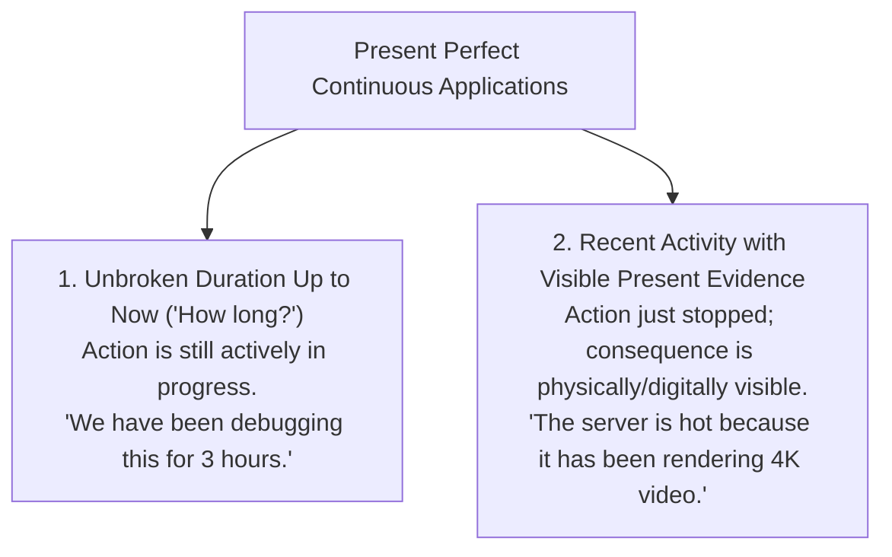
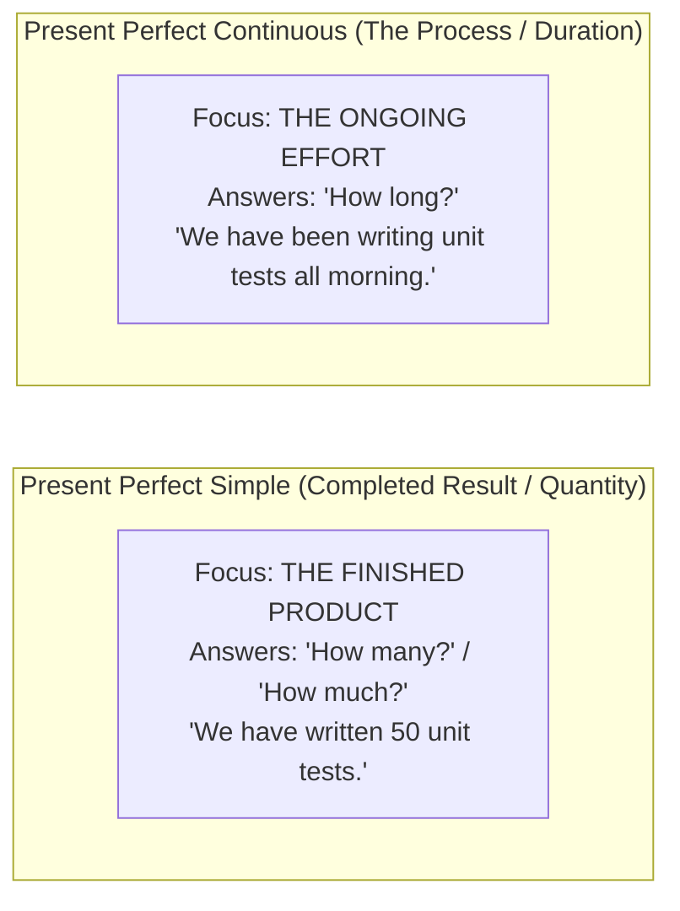

# Present Perfect Continuous (Progressive) Tense ⏳🔄

> **Level:** CEFR B1 (Durational Aspect)  
> **Primary References:** Raymond Murphy (*English Grammar in Use*, Units 9–11); Michael Swan (*Practical English Usage*, §5, 50–51)  
> **Key Function:** Emphasizes the **unbroken duration or process** of an activity that started in the past and continues into the present, or an activity that has just ceased but leaves **visible empirical evidence** at the present moment.

---

## 1. Intent & The "Durational Ribbon" Mental Model

While the Present Perfect Simple asks *"Has it finished?"* or *"How many times has it occurred?"*, the **Present Perfect Continuous** asks **"How long has this process been running?"**:

$$\mathbf{Present\ Perfect\ Continuous} = \mathbf{HAVE/HAS} + \mathbf{been} + \mathbf{V\text{-}ing}$$

```mermaid
timeline
    title Present Perfect Continuous: Process Duration Spanning into NOW
    Past (08:00 AM) : Process initiated
    Continuous Ribbon : Activity has been executing without interruption
    NOW (Present) : Action still ongoing OR just ended with visible telemetry evidence
```

- *The daemon **has been ingesting** telemetry data for twelve hours.* (Focus on the ongoing duration).
- *The CPU is overheating because the system **has been compiling** the entire Linux kernel.* (Visible present evidence of recent heavy process).

---

## 2. Structural Formulas & Syntax Patterns

| Sentence Type | Formula | Canonical Production Example |
| :--- | :--- | :--- |
| **Affirmative (+)** | `Subject + have/has been + V-ing` | *The cron job **has been running** for 45 minutes.* |
| **Negative (-)** | `Subject + have/has not been + V-ing` | *The worker **has not been consuming** messages.* |
| **Interrogative (?)** | `Have/Has + Subject + been + V-ing?` | * **Have** you **been investigating** the latency spike?* |
| **Negative Question** | `Haven't/Hasn't + Subject + been + V-ing?`| * **Hasn't** the replica **been syncing** properly?* |

---

## 3. The Two Primary Usage Scenarios



### Scenario 1: Duration Continuing into the Present (*How long?*)
Emphasizes that an ongoing activity has lasted for a measurable span of time:
- *We **have been refactoring** this monolithic service **since Monday**.* (We are still refactoring it right now).
- *The database cluster **has been experiencing** intermittent packet loss **for two days**.*

### Scenario 2: Recent Activity with Present Empirical Evidence
The action may have concluded moments ago, but its physical or digital side-effects are actively observable in the present:
- *"Why is the staging environment unresponsive?"* $\to$ *"The QA team **has been running** intensive mutation tests."*
- *"Your eyes are red!"* $\to$ *"I **have been staring** at code reviews all day."*

---

## 4. Disambiguation: Present Perfect Simple vs. Continuous

This is a high-stakes distinction in technical reporting and incident postmortems:



| Dimension | Present Perfect Simple | Present Perfect Continuous |
| :--- | :--- | :--- |
| **Primary Question** | *How many? How much? Has it finished?* | *How long? What have you been busy with?* |
| **Semantic Focus** | **The Result** (The task is completed). | **The Process** (The activity itself). |
| **Permanence** | More permanent state (*He has lived here for 20 years*). | More temporary activity (*He has been staying here for a week*). |
| **Stative Verbs** | **Mandatory** (*I have known her for years*). | **Prohibited** (❌ *I have been knowing her*). |
| **Software Example** | *We **have deployed** five microservices.* | *We **have been deploying** microservices all day.* |

---

## 5. Stative Verbs Prohibition

> [!CAUTION]
> As with all continuous tenses, **stative verbs do not take the continuous aspect**. When expressing a state that began in the past and continues into the present, use the **Present Perfect Simple**:
> - ❌ *The cache **has been containing** stale data for two hours.*
> - ✅ *The cache **has contained** stale data for two hours.*
> - ❌ *We **have been having** this server since 2021.*
> - ✅ *We **have had** this server since 2021.*

---

## 6. Dual-Domain Practical Examples

### Everyday Conversational English
1. *It **has been raining** for three hours.* (Still raining now)
2. *I **have been waiting** for the bus since 08:30.* (Still waiting)
3. *Why are your hands dirty? I **have been repairing** my bicycle.* (Recent activity evidence)
4. *She **has been learning** English for six months.* (Ongoing learning journey)
5. *He is exhausted because he **has been working** overtime.* (Observable physical state)
6. *How long **have** you **been living** in this apartment?* (Duration inquiry)
7. *They **have not been sleeping** well recently.* (Recent repeated ongoing trend)
8. *Have you **been crying**?* (Observable empirical question)

### Professional Software Engineering Context
9. *The database migration worker **has been processing** records for six continuous hours.*  
   $\to$ Ongoing duration with *for*.
10. *The incident response team **has been investigating** the root cause since 03:00 UTC.*  
    $\to$ Ongoing activity with *since*.
11. *The CPU utilization graph is pegged at 100% because the background scheduler **has been executing** an unindexed query.*  
    $\to$ Present observable telemetry evidence resulting from recent/ongoing heavy process.
12. *We **have been monitoring** memory consumption closely since the latest deployment.*  
    $\to$ Continuous monitoring activity.
13. *The client application **has been retrying** the failed payment webhook every thirty seconds.*  
    $\to$ Repeated ongoing series of actions.
14. *I **have written** forty test cases today, and I **have been testing** edge cases all afternoon.*  
    $\to$ Perfect Simple (40 test cases completed) vs. Perfect Continuous (ongoing afternoon effort).
15. *The cluster nodes **have been dropping** packets sporadically throughout the morning.*  
    $\to$ Recurrent intermittent process up to the present.

---

## 7. Common Mistakes & Diagnostic Anti-Patterns

| Bug (Ungrammatical Construction) | Patch (Syntactically Correct) | Root Cause Diagnostic |
| :--- | :--- | :--- |
| ❌ *The server **is running for** two days.* | ✅ *The server **has been running for** two days.* | Present Continuous cannot express duration spanning from past into now; demands Present Perfect Continuous. |
| ❌ *I have been **knowing** the codebase for a year.* | ✅ *I have **known** the codebase for a year.* | Stative verbs (*know*) reject continuous aspect; use Present Perfect Simple. |
| ❌ *We have been deploying **three services** today.* | ✅ *We have deployed **three services** today.* | Specific completed quantities (*three services*) demand Present Perfect Simple. |
| ❌ *How long **are you working** on this bug?* | ✅ *How long **have you been working** on this bug?* | Inquiring about duration leading up to the present requires Present Perfect Continuous. |
| ❌ *The engineer has been **work** all night.* | ✅ *The engineer has been **working** all night.* | Continuous formula requires present participle (`-ing`). |

---

## 8. Self-Assessment Practice Exercises

### Section A: Aspect Selection (Simple vs. Continuous)
Complete each sentence with either the **Present Perfect Simple** or **Present Perfect Continuous** of the verb in brackets:

1. The data pipeline [run] ______ for four hours and it still hasn't completed.
2. The team [author] ______ sixty new integration tests this sprint.
3. The platform engineer's terminal is full of logs because she [debug] ______ the auth gateway.
4. We [own] ______ this domain name since 2015.
5. How many pull requests [you / review] ______ today?
6. The database [experience] ______ intermittent lock contention all morning.

### Section B: Sentence Error Spotting & Repair
Identify and patch the grammatical bugs in the following statements:

7. *The backend engineer is investigating the latency spike for three hours.*
8. *The security auditor has been reviewing five microservice repositories today.*
9. *Our platform team has been having this monitoring tool since 2022.*
10. *How long do you have been debugging this concurrency deadlock?*
11. *The server is hot because it has been run an intensive benchmark.*
12. *We have been knowing about the architectural bottleneck for months.*

---

## 9. Comprehensive Answer Key & Explanations

1. **has been running** — Action ongoing for 4 hours and still executing (*How long?*).
2. **has authored** — Specific completed quantity (60 tests) demands Present Perfect Simple.
3. **has been debugging** — Visible present terminal evidence of recent activity.
4. **have owned** — *Own* is a stative verb of possession; continuous is forbidden.
5. **have you reviewed** — Asking about completed quantity (*How many?*) demands Present Perfect Simple.
6. **has been experiencing** — Continuous intermittent trend spanning the entire morning.
7. **Correction:** *The backend engineer **has been investigating** the latency spike for three hours.*  
   *Explanation:* Present Continuous cannot be paired with *for three hours*; requires Present Perfect Continuous.
8. **Correction:** *The security auditor **has reviewed** five microservice repositories today.*  
   *Explanation:* Completed quantity (*five repositories*) demands Present Perfect Simple.
9. **Correction:** *Our platform team **has had** this monitoring tool since 2022.*  
   *Explanation:* Stative verb *have* (possession) cannot take continuous aspect.
10. **Correction:** *How long **have you been debugging** this concurrency deadlock?*  
    *Explanation:* Interrogative formula: $\mathbf{How\ long} + \mathbf{have/has} + \mathbf{Subject} + \mathbf{been} + \mathbf{V\text{-}ing?}$
11. **Correction:** *The server is hot because it **has been running** an intensive benchmark.*  
    *Explanation:* Formula requires present participle *running* (not base *run*).
12. **Correction:** *We **have known** about the architectural bottleneck for months.*  
    *Explanation:* Stative verb *know* cannot take continuous aspect.

---

## 10. Revision Flashcards & Key Takeaways

- **Present Perfect Continuous Formula:** $\mathbf{Subject} + \mathbf{have/has\ been} + \mathbf{V\text{-}ing}$.
- **Core Semantic Question:** *"How long has this process been running?"*
- **Visible Present Evidence:** The CPU is hot / the terminal is full of logs $\implies$ *has been compiling / has been debugging*.
- **Simple vs Continuous:**
  - *I have written 5 tests* = Completed result (Simple).
  - *I have been writing tests for 2 hours* = Ongoing duration (Continuous).
- **The Stative Prohibition:** Never say *have been knowing* or *have been having* (possession). Always use *have known* and *have had*.
