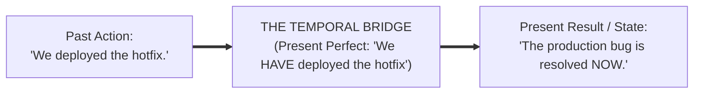
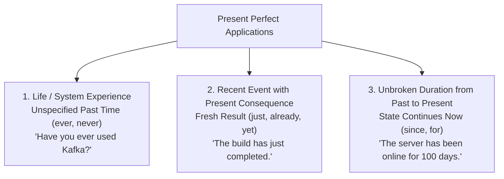
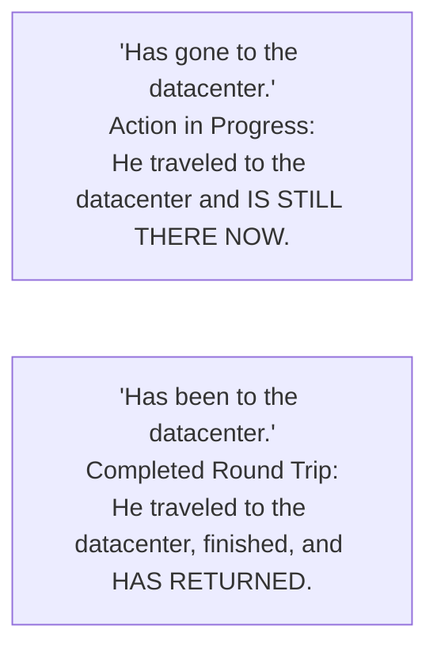

# Present Perfect Simple Tense 🌉

> **Level:** CEFR B1 (Core Bridge Tense)  
> **Primary References:** Raymond Murphy (*English Grammar in Use*, Units 7–8, 13–14); Michael Swan (*Practical English Usage*, §5, 47–49, 52)  
> **Key Function:** Constructs a grammatical bridge between a past event and the present moment. It indicates that a past action has **direct consequence, relevance, or continuation into the NOW**.

---

## 1. Intent & The "Bridge" Mental Model

Unlike the Past Simple (which isolates an event in a closed historical box), the **Present Perfect** is fundamentally a **Present Tense with Past Ingestion**. It focuses on the **current state of affairs** resulting from past operations:

$$\mathbf{Present\ Perfect} = \mathbf{HAVE\ (have/has)} + \mathbf{V3\ (Past\ Participle)}$$

- Past Simple: *I lost my cryptographic key yesterday.* (Focus: the historical event at a closed time).
- Present Perfect: *I **have lost** my cryptographic key.* (Focus: I do not possess the key **right now**; I cannot authenticate!).

---

## 2. Structural Formulas & Syntax Patterns

| Sentence Type | Formula | Canonical Production Example |
| :--- | :--- | :--- |
| **Affirmative (+)** | `Subject + have/has + V3 (Past Participle)` | *The deployment pipeline **has finished**.* |
| **Negative (-)** | `Subject + have/has not + V3` | *The worker **has not acknowledged** the message.* |
| **Interrogative (?)** | `Have/Has + Subject + V3?` | * **Have** the integration tests **passed**?* |
| **Negative Question** | `Haven't/Hasn't + Subject + V3?` | * **Hasn't** the database **migrated** yet?* |

| Subject Agreement | Auxiliary Form | Example |
| :--- | :---: | :--- |
| **I, you, we, they, plural noun** | **have** (`'ve`) | *We **have deployed** the service.* |
| **He, she, it, singular noun** | **has** (`'s`) | *The container **has crashed**.* |

---

## 3. The Three Major Usage Categories

### 1. Cumulative Experience (Unspecified Past Time)
Focuses on whether an event has ever occurred in the history of an entity up to the present moment (*ever, never, before*):
- *Have you **ever encountered** this specific kernel panic before?*
- *The company **has never experienced** a data breach of this scale.*

### 2. Recent Events with Observable Present Consequences
Denotes an action completed recently, where the focal point is the current outcome (*just, already, yet*):
- *The platform team **has just released** version 3.2.0.* (Result: v3.2.0 is available to download right now).
- *The database **has already backed up**.* (Result: Backup exists; no action needed).
- *The background worker **has not finished yet**.* (Result: We are still waiting).

### 3. Unbroken Duration from Past into the Present
Denotes a state that began in the past and **continues actively into the present** (*since, for*):
- *The database cluster **has been** operational **for** 300 days.* (It is still operational right now).
- *We **have used** Python **since** 2018.* (We still use Python today).

---

## 4. Signal Words & Temporal Markers

| Adverb | Meaning & Position | Canonical Example |
| :--- | :--- | :--- |
| **Just** | Action occurred a very short time ago (mid-position) | *The CI runner **has just started**.* |
| **Already** | Action occurred sooner than expected (mid or end) | *We **have already patched** the vulnerability.* |
| **Yet** | Expectation of completion in negatives & questions (end) | *Has the database finished indexing **yet**?* |
| **Ever / Never** | Cumulative experience up to now (mid-position) | * **Have** you **ever tested** mutation coverage?* |
| **Since** | Marks the specific starting point in time | *The daemon has been running **since Monday**.* |
| **For** | Marks the measurable duration of the time block | *The daemon has been running **for 48 hours**.* |
| **So far / Up to now**| Progress within an ongoing period | *We **have resolved** ten issues **so far** this sprint.* |

---

## 5. *Been* vs. *Gone* (The Return Invariant)

- *The on-call engineer **has gone** to the datacenter.* (She is currently at the datacenter).
- *The on-call engineer **has been** to the datacenter twice today.* (She visited and came back).

---

## 6. Dual-Domain Practical Examples

### Everyday Conversational English
1. *I **have lost** my passport!* (Present result: I do not have it now)
2. *She **has lived** in London for three years.* (She still lives in London)
3. *Have you **ever eaten** sushi?* (Life experience)
4. *We **have already seen** this movie.* (No need to watch it again)
5. *He **has just left** the office.* (He left moments ago)
6. *Have you finished your homework **yet**?* (Question of expectation)
7. *They **have been** married since 2015.* (Continuing state)
8. *Where have you **been**?* (Round trip inquiry)

### Professional Software Engineering Context
9. *The deployment pipeline **has finished** building the staging container.*  
   $\to$ Recent action with present consequence: the image is available now.
10. *The database administrator **has revoked** all unencrypted access keys.*  
    $\to$ Direct present result: unencrypted connections will now fail.
11. *We **have maintained** an uptime of 99.99% so far this year.*  
    $\to$ Ongoing, unfinished time period (*this year*).
12. * **Have** you **applied** the latest security patch to the redis cluster?*  
    $\to$ Querying current state of compliance.
13. *The client **has exceeded** its allocated rate limit of 1,000 requests per minute.*  
    $\to$ Present consequence: client is currently blocked (HTTP 429).
14. *Our engineering team **has used** event sourcing since the platform redesign.*  
    $\to$ Continuing architectural practice from a fixed past point (*since*).
15. *The QA engineer **has not validated** the checkout workflow yet.*  
    $\to$ Expected task incomplete at the present moment.

---

## 7. Common Mistakes & Diagnostic Anti-Patterns

| Bug (Ungrammatical Construction) | Patch (Syntactically Correct) | Root Cause Diagnostic |
| :--- | :--- | :--- |
| ❌ *We **have deployed** the release **yesterday**.* | ✅ *We **deployed** the release **yesterday**.* | **Finished Time Clashing:** Finished past time markers (*yesterday, in 2022, ago*) strictly forbid Present Perfect! |
| ❌ *When **have you pushed** the commit?* | ✅ *When **did you push** the commit?* | *When* pinpoints a specific completed past moment; requires Past Simple. |
| ❌ *The server is online **since** three days.* | ✅ *The server has been online **for** three days.* | Duration requires *for*; starting point requires *since*. Continuing state requires Present Perfect. |
| ❌ *I **am knowing** Bob for five years.* | ✅ *I **have known** Bob for five years.* | Stative verbs continuing up to the present demand Present Perfect Simple (*have known*). |
| ❌ *The tests **have ran**.* | ✅ *The tests **have run**.* | V3 past participle of *run* is *run* (A-B-A pattern); *ran* is V2 past simple. |

---

## 8. Self-Assessment Practice Exercises

### Section A: Present Perfect Conjugation & Particle Pairing
Fill in the blanks with the correct Present Perfect Simple form of the verb in brackets:

1. The platform team [already / deploy] ______ the critical security hotfix.
2. The authorization service [not / refresh] ______ its cache yet.
3. [Have / Has] ______ the telemetry collector [detect] ______ any network anomalies?
4. The database administrator [revoke] ______ developer access to production.
5. We [use] ______ Docker in production since 2019.
6. The test runner [run] ______ thirty integration tests so far.

### Section B: Present Perfect vs. Past Simple Disambiguation
Choose either the **Past Simple** or **Present Perfect** for each sentence:

7. The infrastructure team [migrated / has migrated] the cluster to AWS last month.
8. We [did not encounter / have not encountered] any deadlocks since the refactoring.
9. Look! Someone [deleted / has deleted] the production database configuration!
10. When [did the engineer discover / has the engineer discovered] the memory leak?
11. The server [was / has been] healthy for the past 48 hours.
12. The security auditor [reviewed / has reviewed] our code two weeks ago.

---

## 9. Comprehensive Answer Key & Explanations

1. **has already deployed** — 3rd-person singular auxiliary *has* + V3 *deployed*.
2. **has not refreshed** — Singular subject *authorization service* + negative *has not* + V3 *refreshed*.
3. **Has ... detected** — Singular auxiliary *Has* + V3 *detected*.
4. **has revoked** — Singular subject *administrator* demands *has revoked*.
5. **have used** — Continuing state starting in 2019 and holding true today demands Present Perfect with *since*.
6. **has run** — Auxiliary *has* + irregular V3 *run* (NOT *ran*).
7. **migrated** — Closed past time marker *last month* strictly demands **Past Simple**.
8. **have not encountered** — Time frame spanning from past refactoring up to the present (*since...*) demands **Present Perfect**.
9. **has deleted** — Visible present consequence ("Look! The configuration is missing now") demands **Present Perfect**.
10. **did the engineer discover** — Inquiries starting with *When* pinpoint a specific past timestamp; requires **Past Simple**.
11. **has been** — Unbroken duration extending through the past 48 hours into the present moment demands **Present Perfect**.
12. **reviewed** — Finished time marker *two weeks ago* demands **Past Simple**.

---

## 10. Revision Flashcards & Key Takeaways

- **Present Perfect Formula:** $\mathbf{Subject} + \mathbf{have/has} + \mathbf{V3}$.
- **The Core Function:** A bridge connecting past action to present state (*I have lost my key* $\to$ *I don't have it now*).
- **The Finished Time Red Line:** Never use Present Perfect with *yesterday, last week, ago, in 2021, when*.
- **Since vs For:**
  - *Since* + starting point (*since Monday, since 2020*).
  - *For* + duration (*for two days, for three hours*).
- **Just, Already, Yet:**
  - *just* = moments ago.
  - *already* = earlier than anticipated.
  - *yet* = expected in negatives and questions at clause end.
