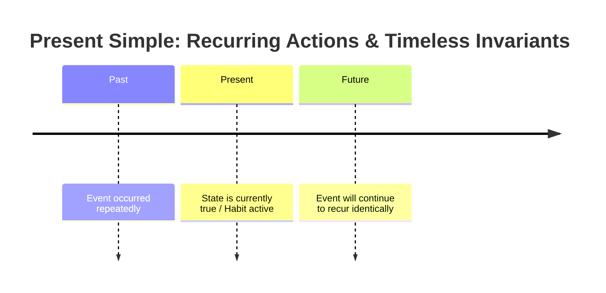
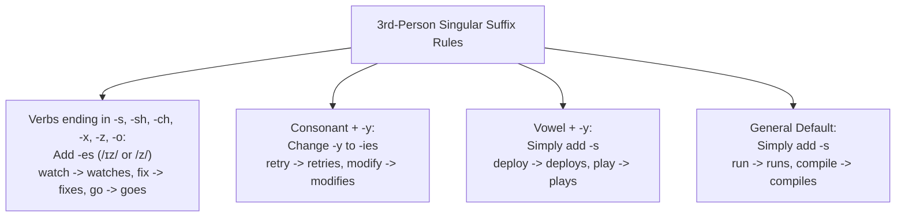

# Present Simple Tense ⏳

> **Level:** CEFR A1–A2 (Core Foundation)  
> **Primary References:** Raymond Murphy (*English Grammar in Use*, Unit 2); Michael Swan (*Practical English Usage*, §30–31)  
> **Key Function:** Expresses habits, timeless facts, unchanging states, fixed external timetables, and procedural instructions.

---

## 1. Intent & Core Definition

The **Present Simple** tense locates an event in the present, but not necessarily in the active moment of speaking. It asserts that an action occurs repeatedly, that a fact is universally true, or that a state of being exists permanently:

$$\mathbf{Present\ Simple} \implies \text{Timeless Fact, Habitual Routine, or Permanent State}$$

---

## 2. Structural Formulas & Syntax Patterns

| Sentence Type | Formula | Canonical Production Example |
| :--- | :--- | :--- |
| **Affirmative (+)** | `Subject + Base Verb (V1) [+(e)s for 3rd person singular]` | *The database replica **syncs** with the primary.* |
| **Negative (-)** | `Subject + do/does not + Base Verb (V1)` | *The client **does not cache** unauthenticated tokens.* |
| **Interrogative (?)** | `Do/Does + Subject + Base Verb (V1)?` | * **Does** the API gateway **support** WebSocket connections?* |
| **Negative Question** | `Doesn't/Don't + Subject + Base Verb (V1)?` | * **Doesn't** the server **log** unhandled exceptions?* |

---

## 3. Orthography: 3rd-Person Singular `-s/-es`

When the subject is third-person singular (*he, she, it, the server, the process*), append `-s` or `-es` to the base verb:

---

## 4. Signal Words & Temporal Adverbs

The Present Simple frequently co-occurs with **adverbs of frequency** and **temporal time markers**:
- **Frequency:** *always, usually, frequently, often, sometimes, rarely, seldom, never*.
  - *Position:* Placed immediately **before** the main verb, but **after** the verb *be*:
    - *The service **always logs** errors.* (Before lexical verb *logs*)
    - *The service **is always** available.* (After copula *is*)
- **Time Markers:** *every day, on Mondays, twice a month, periodically, annually*.

---

## 5. Detailed Usage Scenarios & Nuances

### 1. Invariant Truths & Scientific Laws
Used for timeless physical, mathematical, or computational facts:
- *Water boils at 100 degrees Celsius.*
- *A byte **consists of** eight bits.*
- *SHA-256 **produces** a 256-bit cryptographic hash.*

### 2. Habits, Routines & Automated Cron Jobs
- *The backup cron job **triggers** every night at 02:00 UTC.*
- *We **stand up** for our daily scrum at 09:30 AM.*

### 3. Permanent Architectural States
- *The authentication microservice **resides** in the EU central cluster.*
- *Our application **uses** PostgreSQL for relational storage.*

### 4. Scheduled Future Events (Timetable Future)
Used for future events that are fixed by an external timetable or calendar (Swan §37):
- *The flight **departs** at 08:00 tomorrow morning.*
- *The staging maintenance window **closes** at midnight.*

### 5. Procedural Instructions & Algorithms
- *To compile the project, you **navigate** to the root directory and **execute** `make build`.*

### 6. Performative Declarations
Verbs where saying the word performs the action (*agree, promise, recommend, suggest, refuse*):
- *I **recommend** adopting an event-driven architecture.*

---

## 6. Dual-Domain Practical Examples

### Everyday Conversational English
1. *She works at a technology company.* (Permanent state)
2. *I drink coffee every morning.* (Habitual routine)
3. *The sun rises in the east.* (Universal truth)
4. *Do you speak French?* (Cognitive ability)
5. *He doesn't eat meat.* (Habitual negative)
6. *The train leaves at 06:15 tomorrow.* (Timetable future)
7. *I promise to call you when I arrive.* (Performative)
8. *How often do you go to the gym?* (Frequency question)

### Professional Software Engineering Context
9. *The API gateway **routes** incoming requests based on path prefixes.*  
   $\to$ Permanent architectural behavior.
10. *The database connection pool **does not allow** idle connections to exceed five minutes.*  
    $\to$ System constraint/policy.
11. * **Does** this microservice **handle** idempotency tokens?*  
    $\to$ Technical requirement query.
12. *Git **computes** a SHA-1 hash for every committed object.*  
    $\to$ Fundamental invariant of the version control engine.
13. *The cloud provider **charges** per gigabyte of outbound network egress.*  
    $\to$ Routine business model fact.
14. *Every Friday, the security bot **scans** dependencies for known CVEs.*  
    $\to$ Routine recurring cron job.
15. *I **suggest** we decouple the billing engine from user management.*  
    $\to$ Professional performative proposal.

---

## 7. Common Mistakes & Diagnostic Anti-Patterns

| Bug (Ungrammatical Construction) | Patch (Syntactically Correct) | Root Cause Diagnostic |
| :--- | :--- | :--- |
| ❌ *The microservice **don't** validate tokens.* | ✅ *The microservice **does not** validate tokens.* | 3rd-person singular subject (*The microservice*) requires auxiliary *does/doesn't*. |
| ❌ *The engineer **trys** to fix the bug.* | ✅ *The engineer **tries** to fix the bug.* | Consonant + `-y` (*try*) inflects to `-ies` (*tries*). |
| ❌ *The server **is running** every day at 02:00.* | ✅ *The server **runs** every day at 02:00.* | Recurring schedule demands Present Simple, not Present Continuous. |
| ❌ *Does the query **executes** quickly?* | ✅ *Does the query **execute** quickly?* | Auxiliary *does* carries the inflection; the lexical verb must remain bare V1 (*execute*). |
| ❌ *The application **always is** responsive.* | ✅ *The application **is always** responsive.* | Adverbs of frequency must follow the auxiliary/copula *be*. |

---

## 8. Self-Assessment Practice Exercises

### Section A: 3rd-Person Singular Inflection & Negation
Fill in the blanks with the correct Present Simple form of the verb in brackets:

1. The distributed cache [evict] ______ expired entries every ten seconds.
2. The proxy server [not / modify] ______ incoming HTTP headers.
3. [do / does] ______ the new load balancer support HTTP/2?
4. A senior engineer [oversee] ______ every production deployment.
5. Our backend [rely] ______ on Redis for transient session caching.
6. The test harness [not / pass] ______ if memory leaks exist.

### Section B: Sentence Error Spotting & Repair
Identify and correct the grammatical bugs in the following statements:

7. *The database engine don't support multi-region replication out of the box.*
8. *The cron job executes always at midnight.*
9. *Does the payment gateway accepts American Express cards?*
10. *The compiler optimize the binary during the release build.*
11. *Water is freezing at zero degrees Celsius.* (Universal scientific law)
12. *The platform team modifys the cluster configuration weekly.*

---

## 9. Comprehensive Answer Key & Explanations

1. **evicts** — 3rd-person singular adds `-s`.
2. **does not modify** — 3rd-person singular negation requires *does not* + bare verb *modify*.
3. **Does** — Inverted question for 3rd-person singular subject *the new load balancer*.
4. **oversees** — Add `-s` to base verb *oversee*.
5. **relies** — Consonant + `-y` changes to `-ies`.
6. **does not pass** — Negative form for singular subject *The test harness*.
7. **Correction:** *The database engine **does not support** multi-region replication out of the box.*  
   *Explanation:* 3rd-person singular requires *does not*, not *don't*.
8. **Correction:** *The cron job **always executes** at midnight.*  
   *Explanation:* Frequency adverb *always* must precede the main lexical verb *executes*.
9. **Correction:** *Does the payment gateway **accept** American Express cards?*  
   *Explanation:* *Does* carries the 3rd-person marker; *accept* must be bare V1.
10. **Correction:** *The compiler **optimizes** the binary during the release build.*  
    *Explanation:* Subject *The compiler* demands 3rd-person singular `-s`.
11. **Correction:** *Water **freezes** at zero degrees Celsius.*  
    *Explanation:* Invariant physical truths must use Present Simple, not progressive.
12. **Correction:** *The platform team **modifies** the cluster configuration weekly.*  
    *Explanation:* Orthography: *modify* ends in consonant + `y` $\to$ *modifies*.

---

## 10. Revision Flashcards & Key Takeaways

- **Present Simple Formula:** $\mathbf{Subject} + \mathbf{V1\ (+(e)s)}$.
- **Negation & Questions:** $\mathbf{do/does} + \mathbf{not} + \mathbf{V1}$; $\mathbf{Do/Does} + \mathbf{Subject} + \mathbf{V1?}$
- **Core Triggers:** Habits, routines, scientific facts, system specifications, and timetabled futures.
- **The Frequency Adverb Anchor:** Before lexical verbs (*always runs*); after *be* (*is always*).
- **No Progress for Invariants:** Never use `-ing` for timeless universal truths (*Water boils*, not *is boiling*).
