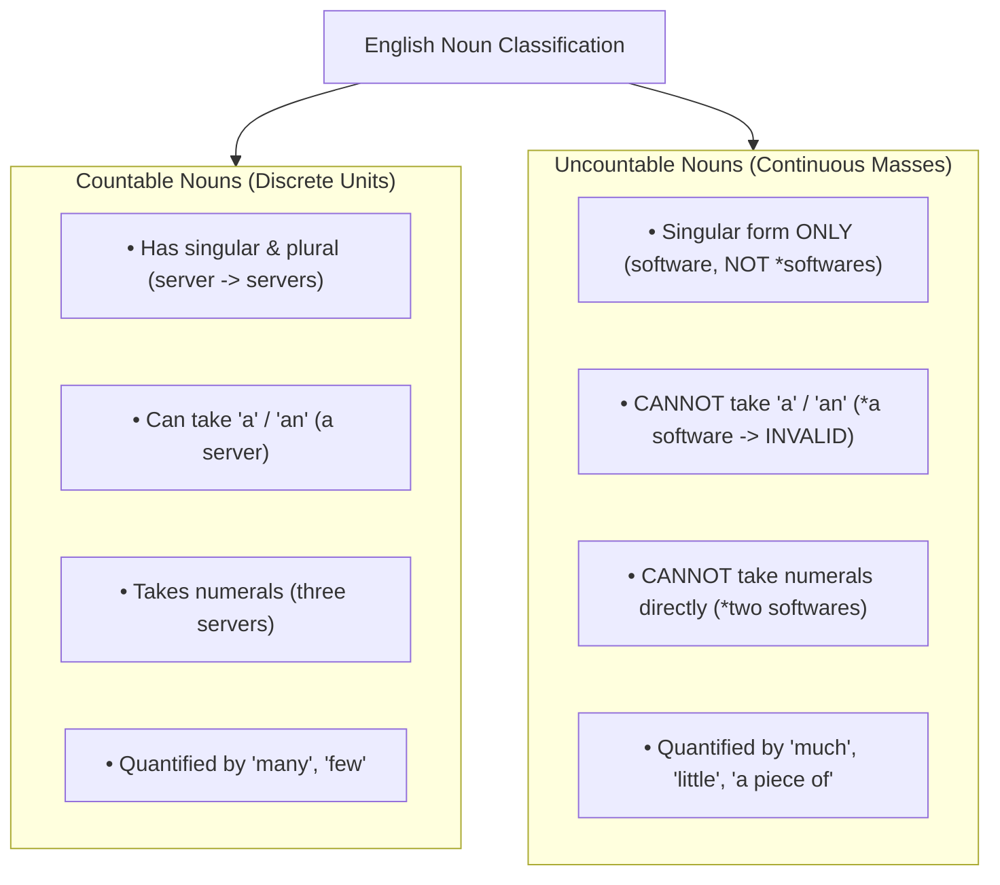
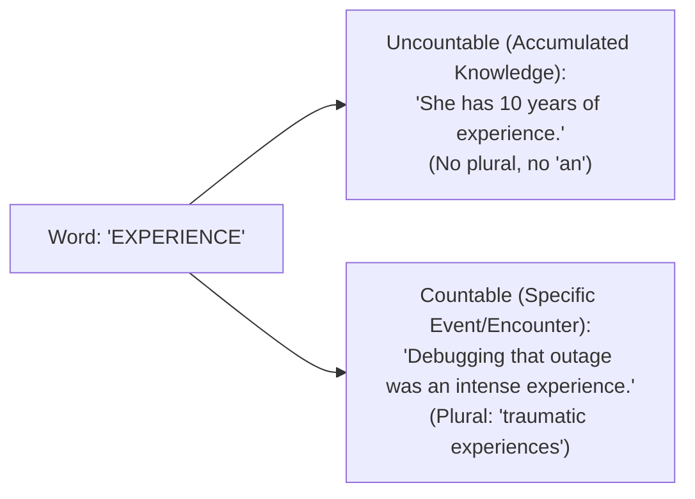

# Countable and Uncountable Nouns 🔢⚖️

> **Level:** CEFR A1–B1 (Nominal Semantics)  
> **Primary References:** Raymond Murphy (*English Grammar in Use*, Units 69–70); Michael Swan (*Practical English Usage*, §11, 184–188)  
> **Core Concept:** **Countable nouns** represent discrete, individual entities that can be counted directly ($1, 2, 3$). **Uncountable (mass) nouns** represent continuous substances, materials, or abstract concepts viewed as an undivided whole.

---

## 1. Intent & The "Discrete vs. Continuous" Mental Model

---

## 2. The Four Inviolable Laws of Uncountable Nouns

Whenever a noun is classified as uncountable in English, four strict grammatical rules apply:

$$\mathbf{1.\ No\ Plural\ Form} \quad (\text{Never append } \text{-s}: \text{feedback}, \text{NOT } *\text{feedbacks})$$
$$\mathbf{2.\ No\ Indefinite\ Article} \quad (\text{Never use } a/an: \text{advice}, \text{NOT } *\text{an advice})$$
$$\mathbf{3.\ Singular\ Verb\ Concord} \quad (\mathbf{Uncountable\ Noun} + \mathbf{Singular\ Verb}: \text{Information } \mathbf{is})$$
$$\mathbf{4.\ Mass\ Quantifiers\ Only} \quad (\text{Use } \textit{much, little, some, a lot of}, \text{NOT } \textit{many, few})$$

---

## 3. High-Frequency Technical Uncountable Traps

Software engineering literature is notorious for non-native noun countability bugs. Memorize this core blacklist:

| Uncountable Noun | Common Syntax Error (❌) | Correct Technical Phrasing (✅) | Partitive Unit Counter |
| :--- | :--- | :--- | :--- |
| **Software** | ❌ *We built a new software.* | ✅ *We built **a new software application**.* | *a piece / suite of software* |
| **Hardware** | ❌ *Buy two hardwares.* | ✅ *Buy **two pieces of hardware**.* | *a piece / component of hardware* |
| **Information** | ❌ *These informations are vital.*| ✅ *This **information is** vital.* | *a piece / item of information* |
| **Feedback** | ❌ *Give me feedbacks on my PR.* | ✅ *Give me **feedback** on my PR.* | *some feedback / a piece of feedback* |
| **Code** | ❌ *I wrote many codes today.* | ✅ *I wrote **a lot of code** today.* | *lines / blocks / repositories of code* |
| **Data** | ❌ *A data was missing.* | ✅ *Some **data was** missing.* (Mass) | *a data point / an entry / a record* |
| **Documentation**| ❌ *Read the documentations.* | ✅ *Read the **documentation**.* | *a page / piece of documentation* |
| **Traffic** | ❌ *The traffics are high.* | ✅ *The **traffic is** high.* | *volume / packets of traffic* |
| **Storage / RAM**| ❌ *Buy more storages.* | ✅ *Buy more **storage**.* | *gigabytes / terabytes of storage* |
| **Research** | ❌ *We made a research on AI.* | ✅ *We **conducted research** on AI.* | *a study / body of research* |
| **Infrastructure**| ❌ *Deploy multi-infrastructures.*| ✅ *Deploy **cloud infrastructure**.* | *instances / tiers of infrastructure* |

---

## 4. Dual-Nature Nouns (Countable vs. Uncountable Senses)

Many words shift countability based on whether they refer to an abstract quality or a concrete instance:

| Noun | Uncountable Sense (Mass / General) | Countable Sense (Individual / Instance) |
| :--- | :--- | :--- |
| **Memory** | *The server ran out of **memory**.* (RAM capacity) | *I have fond **memories** of that startup.* (Recollections) |
| **Experience** | *The candidate has extensive **experience**.* (Knowledge) | *The migration was a challenging **experience**.* (Specific incident) |
| **Security** | *Enterprise **security** is our priority.* (Condition) | *The company trades in government **securities**.* (Financial bonds) |
| **Work** | *Engineers have too much **work**.* (Labor / Tasks) | *The **works** of Shakespeare.* (Literary creations) |
| **Time** | *We don't have enough **time**.* (Clock duration) | *How many **times** did the query fail?* (Occasions / Instances) |
| **Paper** | *The printer ran out of **paper**.* (Substance) | *The researcher published two **papers**.* (Academic publications) |

---

## 5. Partitives: How to Count the Uncountable

To quantify an uncountable noun into discrete units, English uses **Partitive Expressions** ($\mathbf{Unit\ Noun} + \mathbf{of} + \mathbf{Uncountable\ Noun}$):

- *a **piece of** software* / *three **pieces of** hardware*
- *an **item of** documentation* / *a **sheet of** paper*
- *a **line of** code* / *a **stream of** network traffic*
- *a **byte of** data* / *two **slices of** bread* / *a **drop of** water*

---

## 6. Dual-Domain Practical Examples

### Everyday Conversational English
1. *Can you give me some **advice**?* (Uncountable advice)
2. *I need to buy a loaf of **bread**.* (Partitive unit)
3. *The **furniture** in this apartment is modern.* (Collective mass noun)
4. *We had bad **weather** during our vacation.* (Uncountable weather)
5. *She has long, dark **hair**.* (Mass hair vs. *a hair in my soup*)
6. *How much **luggage** do you have?* (Uncountable luggage/baggage)
7. *He drank two glasses of **water**.* (Partitive drink)
8. *Success requires **patience** and **hard work**.* (Abstract qualities)

### Professional Software Engineering Context
9. *The engineering team requires actionable **feedback** on the new microservice architecture.*  
   $\to$ Uncountable *feedback* (never *feedbacks*).
10. *Our cluster consumed thirty gigabytes of **RAM** during the benchmark.*  
    $\to$ Uncountable technical mass noun.
11. *The developer refactored 500 lines of legacy **code**.*  
    $\to$ Partitive expression (*lines of code*), not *codes*.
12. *All confidential customer **data was** encrypted before persistence.*  
    $\to$ Uncountable noun *data* governing singular verb *was*.
13. *We purchased three new pieces of **hardware** for the on-premise datacenter.*  
    $\to$ Partitive *pieces of hardware*.
14. *The platform **documentation is** comprehensive and up to date.*  
    $\to$ Uncountable noun *documentation* taking singular verb *is*.
15. *The proxy absorbed an overwhelming volume of malicious network **traffic**.*  
    $\to$ Uncountable noun *traffic*.

---

## 7. Common Mistakes & Diagnostic Anti-Patterns

| Bug (Ungrammatical Nominal Syntax) | Patch (Syntactically Correct) | Root Cause Diagnostic |
| :--- | :--- | :--- |
| ❌ *We built a new **software**.* | ✅ *We built a new **software application** (or **a new tool**).* | *Software* is uncountable; cannot be preceded by indefinite article *a*. |
| ❌ *Please send me your **feedbacks**.* | ✅ *Please send me your **feedback**.* | *Feedback* has no plural form in English. |
| ❌ *The engineer fixed many **codes**.* | ✅ *The engineer fixed a lot of **code** (or **many bugs**).* | *Code* cannot be pluralized when referring to computer programs. |
| ❌ *The **informations** provided are incorrect.* | ✅ *The **information** provided **is** incorrect.* | *Information* is strictly uncountable and takes a singular verb. |
| ❌ *We conducted **a research** on microservices.* | ✅ *We conducted **research** on microservices.* | *Research* is uncountable; omit article *a*. |

---

## 8. Self-Assessment Practice Exercises

### Section A: Countable vs. Uncountable Classification
Identify whether each bold noun is being used as **Countable** or **Uncountable**:

1. The candidate possesses extensive [**experience**] with distributed databases.
2. Debugging that multi-threaded race condition was a memorable [**experience**].
3. The server requires additional [**memory**] to prevent out-of-memory errors.
4. He shared vivid childhood [**memories**] of his first computer.
5. Our platform processes petabytes of telemetry [**data**] daily.
6. The architect authored three academic [**papers**] on consensus protocols.

### Section B: Sentence Error Spotting & Repair
Identify and correct the countability bugs in the following technical statements:

7. *The security team delivered several critical advices regarding our cloud configuration.*
8. *We need to purchase a new software for automated visual regression testing.*
9. *All the documentations for the REST API are located in the wiki.*
10. *The developer wrote thousand lines of codes over the weekend.*
11. *Network traffics were redirected to the secondary region during maintenance.*
12. *The platform engineers gave us valuable feedbacks on our pull request.*

---

## 9. Comprehensive Answer Key & Explanations

1. **Uncountable** — Refers to accumulated professional skill/knowledge.
2. **Countable** — Refers to a specific individual event (preceded by *a*).
3. **Uncountable** — Refers to abstract digital RAM storage capacity.
4. **Countable** — Pluralized (*memories*) referring to discrete recollections.
5. **Uncountable** — Mass data volume treated as an undifferentiated whole.
6. **Countable** — Pluralized (*papers*) referring to individual published articles.
7. **Correction:** *The security team delivered **some critical advice** (or **pieces of advice**) regarding our cloud configuration.*  
   *Explanation:* *Advice* is strictly uncountable; never *advices*.
8. **Correction:** *We need to purchase **new software** (or **a new software tool / application**).*  
   *Explanation:* *Software* cannot take article *a*.
9. **Correction:** *All the **documentation** for the REST API **is** located in the wiki.*  
   *Explanation:* *Documentation* is uncountable and governs singular verb *is*.
10. **Correction:** *The developer wrote a thousand **lines of code** over the weekend.*  
    *Explanation:* *Code* cannot be pluralized; use partitive *lines of code*.
11. **Correction:** *Network **traffic was** redirected to the secondary region during maintenance.*  
    *Explanation:* *Traffic* is uncountable; takes singular verb *was*.
12. **Correction:** *The platform engineers gave us valuable **feedback** on our pull request.*  
    *Explanation:* *Feedback* has no plural form.

---

## 10. Revision Flashcards & Key Takeaways

- **The Uncountable Blacklist:** *software, hardware, information, feedback, code, documentation, traffic, equipment, advice, research*.
- **The Golden Rules:**
  - No plural `-s` (*feedback*, NOT *feedbacks*).
  - No *a/an* (*software*, NOT *a software*).
  - Singular verbs (*The information is*, NOT *are*).
- **Unitizing Masses:** Use partitives: *a piece of software*, *a line of code*, *an item of feedback*.
- **Dual-Senses:** *Experience* (knowledge) = Uncountable; *an experience* (an incident) = Countable.
