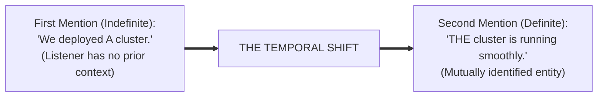
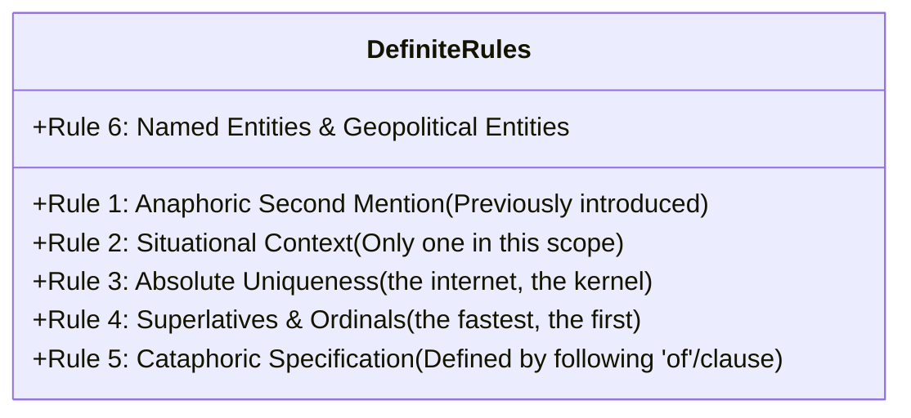

# The Definite Article: The 🎯

> **Level:** CEFR A1–B2 (Definiteness Architecture)  
> **Primary References:** Raymond Murphy (*English Grammar in Use*, Units 72–78); Michael Swan (*Practical English Usage*, §12, 217–228)  
> **Core Concept:** The definite article **the** signals that the noun refers to an entity that is **identifiable and mutually known** to both the speaker/writer and the listener/reader.

---

## 1. Intent & The "Shared Mental Context" Model

Unlike *a/an* (which introduces a new or random entity), **the** refers to a specific, identifiable referent already present in the shared memory of the conversation:

$$\mathbf{The} \implies \text{"You and I both know which specific entity I am talking about"}$$

---

## 2. Phonetic Pronunciation of `The`

The pronunciation of **the** shifts depending on the following sound:

| Following Sound | Phonetic Form | Auditory Quality | Production Example |
| :--- | :---: | :---: | :--- |
| **Before Consonant Sounds** | **/ðə/** | Reduced weak vowel (schwa) | *the server, the user, the database, the URL* |
| **Before Vowel Sounds** | **/ðiː/** | Long tense vowel ("thee") | *the API, the endpoint, the infrastructure, the hour* |
| **Emphatic / Prominent** | **/ðiː/** | Emphasizes uniqueness | *"Is that THE Linus Torvalds?"* |

---

## 3. The Six Cardinal Rules of Definiteness

### Rule 1: Anaphoric Second Mention
When an entity has already been introduced into the discourse:
- *We noticed [**a** memory leak] in staging. [**The** memory leak] caused pod evictions.*

### Rule 2: Situational Local Uniqueness
When only one such entity exists in the immediate environment or technical architecture:
- *Please check **the database**.* (Both engineers know there is only one primary database for this service).
- *Open **the terminal** and inspect **the logs**.*

### Rule 3: Absolute Global System Uniqueness
Entities of which only one exists in the digital or physical universe:
- ***the** internet*, ***the** cloud*, ***the** kernel*, ***the** operating system*, ***the** root directory*.
- *Physical world:* ***the** sun*, ***the** moon*, ***the** equator*, ***the** earth*.

### Rule 4: Superlatives, Ordinals, and Uniqueness Adjectives
When adjectives identify an item as occupying an absolute rank or solitary status:
- **Superlatives:** ***the** fastest query, **the** most resilient architecture, **the** lowest latency*.
- **Ordinals:** ***the** first commit, **the** second sprint, **the** last release*.
- **Uniqueness Markers:** ***the** only bottleneck, **the** same configuration, **the** primary key*.

### Rule 5: Cataphoric Post-Modification (*The ... of ...*)
When a noun is made specific by a following prepositional phrase or defining relative clause:
- * **The** configuration **of our production cluster** is invalid.* (Specific configuration).
- * **The** pull request **that Sarah submitted** was merged.*

### Rule 6: Conventions with Proper Names and Institutions
- **Organizations & Foundations:** ***the** Linux Foundation, **the** Apache Software Foundation, **the** IETF, **the** United Nations*.
- **Plural Geopolitical Entities:** ***the** United States, **the** Netherlands, **the** Philippines*.
- **Entities with "Republic", "Kingdom", "Union":** ***the** United Kingdom, **the** Czech Republic, **the** European Union*.
- **Oceans, Seas, and Rivers:** ***the** Atlantic Ocean, **the** Pacific, **the** Amazon*.

---

## 4. Dual-Domain Practical Examples

### Everyday Conversational English
1. *Pass me **the** salt, please.* (Situational context: on the table)
2. *I saw a dog. **The** dog was barking.* (Second mention)
3. *She is **the** tallest person in the class.* (Superlative)
4. *We walked along **the** river.* (Local environment)
5. * **The** sun sets in the west.* (Unique entity)
6. *This is **the** first time I've been here.* (Ordinal)
7. *They traveled across **the** United States.* (Plural nation)
8. *He plays **the** guitar.* (Musical instrument generic)

### Professional Software Engineering Context
9. *The client sends an API request; **the** request is validated by the reverse proxy.*  
   $\to$ Anaphoric second mention of *request*.
10. *The developer analyzed **the** query planner output.*  
    $\to$ Specific, mutually understood output in the working context.
11. *Our microservice communicates over **the** internet using TLS 1.3.*  
    $\to$ Unique digital infrastructure entity (*the internet*).
12. *Redis provides **the** lowest read latency among our persistent storage layers.*  
    $\to$ Superlative adjective (*the lowest*).
13. *This is **the** only microservice that requires root filesystem access.*  
    $\to$ Uniqueness modifier (*the only*).
14. * **The** architecture **of this payment system** enforces strict idempotency.*  
    $\to$ Cataphoric post-modification with *of*.
15. *The protocol standard was published by **the** Internet Engineering Task Force.*  
    $\to$ Formal institutional body (*the IETF*).

---

## 5. Common Mistakes & Diagnostic Anti-Patterns

| Bug (Misuse of 'The') | Patch (Syntactically Correct) | Root Cause Diagnostic |
| :--- | :--- | :--- |
| ❌ *This is **fastest** query.* | ✅ *This is **the fastest** query.* | Superlatives strictly require the definite article *the*. |
| ❌ *We deploy on **internet**.* | ✅ *We deploy on **the internet**.* | Unique global infrastructure entities demand *the*. |
| ❌ *She made **first** commit.* | ✅ *She made **the first** commit.* | Ordinal numbers (*first, second, third*) demand *the*. |
| ❌ *The engineer is in **the France**.* | ✅ *The engineer is in **France**.* | Singular country names do not take *the*. |
| ❌ *We use **the same configuration like** Bob.* | ✅ *We use **the same configuration as** Bob.* | *The same* must be paired with *as*, not *like*. |

---

## 6. Self-Assessment Practice Exercises

### Section A: Definite Article Application
Decide whether **the** is required or should be omitted:

1. [____] internet is a decentralized network.
2. We deployed our microservice in [____] Germany.
3. This is [____] primary reason for the latency spike.
4. The security breach affected [____] United States regional cluster.
5. In my opinion, Rust is [____] most memory-safe systems language.
6. She was [____] only developer with access to the master private key.

### Section B: Sentence Error Spotting & Repair
Identify and patch the definite article errors in the following technical statements:

7. *The database administrator optimized slowest query in the report.*
8. *Our servers communicate securely across internet.*
9. *The engineer joined Google in the 2021.*
10. *This is first time the auto-scaler has tripped the circuit breaker.*
11. *We migrated all workloads to the Switzerland datacenter.*
12. *The team agreed on same architectural blueprint.*

---

## 7. Comprehensive Answer Key & Explanations

1. **The** internet — Globally unique entity.
2. **$\emptyset$ (Zero Article)** — Singular country names take no article (*in Germany*).
3. **the** primary reason — Uniqueness adjective *primary* demands *the*.
4. **the** United States — Plural nation name demands *the*.
5. **the** most memory-safe — Superlative adjective demands *the*.
6. **the** only developer — Uniqueness marker *only* demands *the*.
7. **Correction:** *The database administrator optimized **the slowest query** in the report.*  
   *Explanation:* Superlative *slowest* requires *the*.
8. **Correction:** *Our servers communicate securely across **the internet**.*  
   *Explanation:* *The internet* is unique and requires *the*.
9. **Correction:** *The engineer joined Google in **2021**.*  
    *Explanation:* Calendar years take zero article (never *the 2021*).
10. **Correction:** *This is **the first time** the auto-scaler has tripped the circuit breaker.*  
    *Explanation:* Ordinal *first* demands *the*.
11. **Correction:** *We migrated all workloads to the **Swiss** datacenter (or **the datacenter in Switzerland**).*  
    *Explanation:* *Switzerland* takes no article; if modifying *datacenter*, use *the Swiss datacenter*.
12. **Correction:** *The team agreed on **the same** architectural blueprint.*  
    *Explanation:* *Same* strictly requires the definite article *the*.

---

## 8. Revision Flashcards & Key Takeaways

- **The Core Function of 'The':** Marks a noun as identifiable to both writer and reader.
- **Always Use 'The' With:**
  - Superlatives (*the best, the fastest*).
  - Ordinals (*the first, the third*).
  - Unique modifiers (*the only, the same, the primary*).
  - Globally unique nouns (*the internet, the cloud, the kernel*).
  - Plural nations and unions (*the United States, the European Union*).
- **Pronunciation Code:**
  - `/ðə/` before consonants (*the server*).
  - `/ðiː/` before vowels (*the API, the endpoint*).
