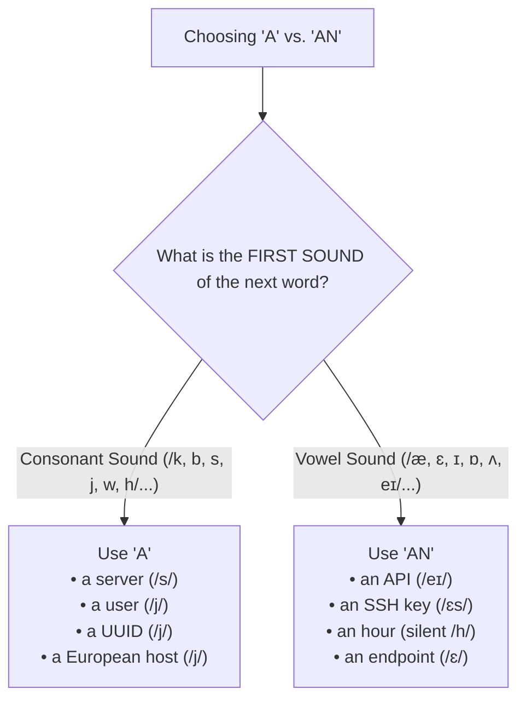
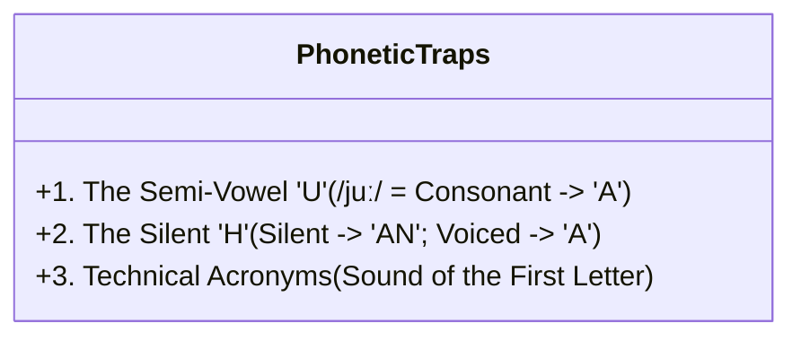
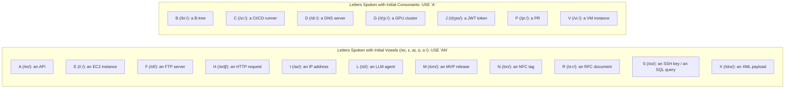

# The Indefinite Article: A and An 🔤

> **Level:** CEFR A1–A2 (Core Phonetic Law)  
> **Primary References:** Raymond Murphy (*English Grammar in Use*, Units 71–72); Michael Swan (*Practical English Usage*, §12, 210–216)  
> **The Golden Law:** The selection between **a** and **an** is governed strictly by the **initial phonetic sound** of the following word—**never by spelling letters**.

---

## 1. Intent & The Phonetic Sound Invariant

The indefinite article introduces a singular countable noun that is non-specific, unmentioned previously, or representative of a generic class:

$$\mathbf{A} + \mathbf{Consonant\ Sound} \quad [\text{e.g., } \text{a server, a worker, a unit}]$$
$$\mathbf{AN} + \mathbf{Vowel\ Sound\ (/æ, ɛ, ɪ, ɒ, ʌ, iː, eɪ, aɪ, oʊ, aʊ/)} \quad [\text{e.g., } \text{an API, an hour, an endpoint}]$$

---

## 2. The Phonetic Traps of Technical English

In software documentation, engineers frequently produce bugs because English letters do not map 1:1 to English phonetic sounds.

### Trap 1: The Semi-Vowel `U` (`/juː/` = Consonant Sound)
When the letter `u` (or `eu`) produces the sound `/juː/` (identical to the consonant *y* in *yellow*), you must use **a**, not *an*:

| Term | Phonetic Transcription | First Sound | Correct Article | Syntax Bug (❌) |
| :--- | :--- | :---: | :---: | :--- |
| **UUID** | `/eɪ ˈjuː.juː.aɪ.diː/` | Consonant `/j/` | **a UUID** | ❌ *an UUID* |
| **URL** | `/eɪ ˈjuː.ɑːr.ɛl/` | Consonant `/j/` | **a URL** | ❌ *an URL* |
| **User** | `/ˈjuːzər/` | Consonant `/j/` | **a user** | ❌ *an user* |
| **Unique ID** | `/juːˈniːk aɪˈdiː/` | Consonant `/j/` | **a unique ID** | ❌ *an unique ID* |
| **European server** | `/ˌjʊərəˈpiːən/` | Consonant `/j/` | **a European server**| ❌ *an European server* |
| **Unified logging** | `/ˈjuːnɪfaɪd/` | Consonant `/j/` | **a unified system** | ❌ *an unified system* |

> [!NOTE]
> Contrast with true vowel `u` sounds (`/ʌ/` or `/ʊ/`):
> - * **an** update* (`/ˈʌpdeɪt/` $\to$ Vowel)
> - * **an** upstream proxy* (`/ˈʌpstriːm/` $\to$ Vowel)
> - * **an** unexpected exception* (`/ˌʌnɪkˈspɛktɪd/` $\to$ Vowel)

### Trap 2: The Silent `H` vs. Voiced `H`
- **Silent `h` (Starts with vowel sound $\to$ `an`):**
  - * **an** hour* (`/aʊər/`)
  - * **an** honest mistake* (`/ˈɒnɪst/`)
  - * **an** honor* (`/ˈɒnər/`)
- **Voiced `h` (Starts with consonant `/h/` $\to$ `a`):**
  - * **a** host* (`/hoʊst/`)
  - * **a** hard drive* (`/hɑːrd/`)
  - * **a** hash function* (`/hæʃ/`)
  - * **a** hypervisor* (`/ˈhaɪpərvaɪzər/`)

---

## 3. Technical Acronyms and Initialisms

When pronouncing acronyms letter-by-letter, the article depends on the **vocal sound of the first letter**:

> [!TIP]
> **The SQL Pronunciation Exception:**
> - If pronounced letter-by-letter ("S-Q-L" $\to$ `/ɛs.kjuː.ɛl/`): * **an** SQL query*.
> - If pronounced as a word ("Sequel" $\to$ `/ˈsiːkwəl/`): * **a** SQL query*.
> Both are standard depending on company convention; maintain internal consistency!

---

## 4. Syntactic Functions of `A/An`

1. **First Mention in Discourse:**
   - *We deployed **a** microservice. **The** microservice handles authentication.*
2. **Classification / Category Definition:**
   - *Docker is **a** containerization engine.*
   - *Python is **an** interpreted programming language.*
3. **Rates, Speeds, and Frequencies:**
   - *The API processes 5,000 requests **a** second.*
   - *We deploy updates twice **a** week.*
4. **Numerical Equivalence to "One":**
   - *a hundred nodes*, *a thousand transactions*, *a million users*.

---

## 5. Dual-Domain Practical Examples

### Everyday Conversational English
1. *She is **a** doctor.* (Profession / Classification)
2. *We waited for **an** hour.* (Silent *h*)
3. *He bought **a** used car.* (Consonant `/juːzd/`)
4. *It was **an** unusual situation.* (Vowel `/ʌn/`)
5. *I have **a** European passport.* (Consonant `/jʊərə/`)
6. *She sent me **an** email.* (Vowel `/iːmeɪl/`)
7. *He works forty hours **a** week.* (Rate marker)
8. *That was **an** honest opinion.* (Silent *h*)

### Professional Software Engineering Context
9. *The client must provide **an** API token in the `Authorization` header.*  
   $\to$ Initial vowel sound `/eɪ/` demands *an*.
10. *Each user record is assigned **a** UUID at insertion time.*  
    $\to$ Semi-vowel consonant sound `/juː/` demands *a*.
11. *The developer generated **an** SSH key pair for bastion host access.*  
    $\to$ Letter S pronounced `/ɛs/` (vowel initial) demands *an*.
12. *The gateway intercepted **an** HTTP POST request.*  
    $\to$ Letter H pronounced `/eɪtʃ/` demands *an*.
13. *We provisioned **a** GPU-accelerated cluster for model inference.*  
    $\to$ Letter G pronounced `/dʒiː/` (consonant initial) demands *a*.
14. *The cluster experienced **an** unexpected network partition.*  
    $\to$ True vowel sound `/ʌn/` demands *an*.
15. *The backend processes 25,000 transactions **a** second.*  
    $\to$ Rate/frequency indicator.

---

## 6. Common Mistakes & Diagnostic Anti-Patterns

| Bug (Article Phonetic Error) | Patch (Syntactically Correct) | Root Cause Diagnostic |
| :--- | :--- | :--- |
| ❌ *We generated **an UUID**.* | ✅ *We generated **a UUID**.* | Phonetic sound starts with consonant `/j/`; requires article *a*. |
| ❌ *The client sent **a HTTP** request.* | ✅ *The client sent **an HTTP** request.* | Initialism H begins with vowel sound `/eɪtʃ/`; requires *an*. |
| ❌ *We built **a API**.* | ✅ *We built **an API**.* | Initialism A begins with vowel sound `/eɪ/`; requires *an*. |
| ❌ *The engineer is **a honest** person.*| ✅ *The engineer is **an honest** person.*| *Honest* has a silent *h*; word begins with vowel sound `/ɒ/`. |
| ❌ *The node has **an high** load.* | ✅ *The node has **a high** load.* | *High* has a fully voiced consonant sound `/h/`; requires *a*. |

---

## 7. Self-Assessment Practice Exercises

### Section A: Phonetic Article Selection
Fill in the blanks with either **a** or **an**:

1. [____] API gateway
2. [____] UUID primary key
3. [____] SSH key pair
4. [____] HTTP status code
5. [____] URL redirect
6. [____] European datacenter
7. [____] unit test
8. [____] unexpected exception
9. [____] GPU instance
10. [____] RFC standard
11. [____] honest postmortem
12. [____] hard reboot

---

## 8. Comprehensive Answer Key & Explanations

1. **an API** — Letter A pronounced `/eɪ/` (vowel sound).
2. **a UUID** — Letter U pronounced `/juː/` (consonant sound).
3. **an SSH key** — Letter S pronounced `/ɛs/` (vowel sound).
4. **an HTTP code** — Letter H pronounced `/eɪtʃ/` (vowel sound).
5. **a URL** — Letter U pronounced `/juː/` (consonant sound).
6. **a European** — Letters *Eu* pronounced `/juː/` (consonant sound).
7. **a unit test** — Letter U pronounced `/juː/` (consonant sound).
8. **an unexpected** — Starts with true vowel sound `/ʌ/`.
9. **a GPU instance** — Letter G pronounced `/dʒiː/` (consonant sound).
10. **an RFC standard** — Letter R pronounced `/ɑːr/` (vowel sound).
11. **an honest** — The letter *h* is silent; begins with vowel sound `/ɒ/`.
12. **a hard reboot** — The letter *h* is fully voiced as consonant `/h/`.

---

## 9. Revision Flashcards & Key Takeaways

- **Sound, Not Spelling:** Listen to the spoken sound, not the typed alphabet letter.
- **The Semi-Vowel `/juː/` Law:** Words starting with a `/juː/` sound (*user, URL, UUID, unique, European*) take **A** (*a user*, *a URL*).
- **The Silent `H` Law:** *an hour, an honest mistake, an honor*.
- **The Acronym Test:**
  - Starts with *A, E, F, H, I, L, M, N, O, R, S, X* $\implies$ Use **AN** (*an API, an SSH key, an RFC*).
  - Starts with *B, C, D, G, J, K, P, Q, T, U, V, W, Y, Z* $\implies$ Use **A** (*a PR, a CI runner, a GPU*).
