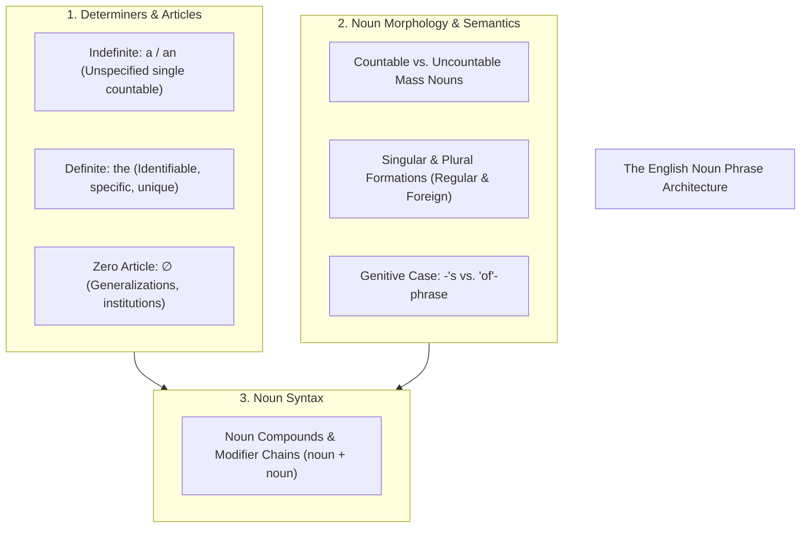
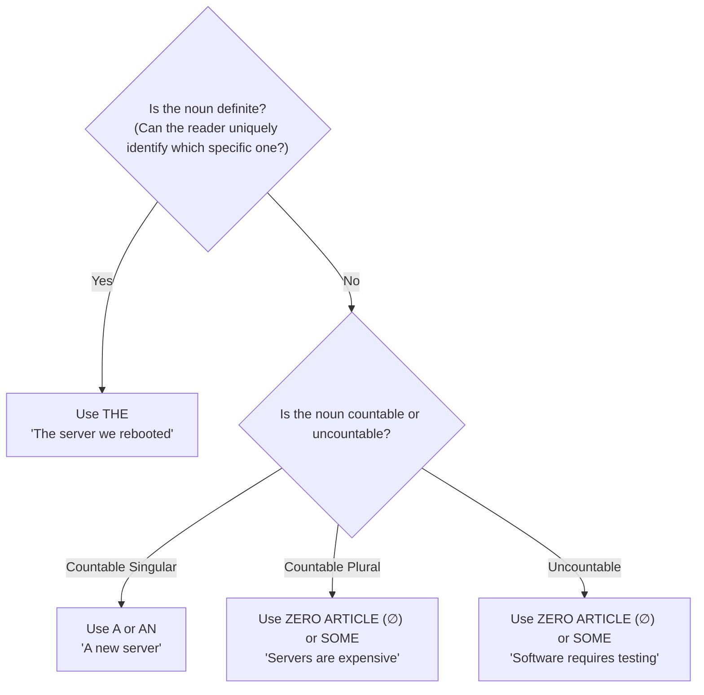

# Nouns and Articles 📦🏷️

> *"Nouns populate the universe of discourse. Articles tell the listener whether those nouns are new discoveries, shared context, unique invariants, or universal categories."*  
> — Reference: Raymond Murphy (*English Grammar in Use*, Units 69–81); Michael Swan (*Practical English Usage*, §11–12)

Welcome to the **Nouns and Articles** module of the English Grammar Knowledge System. This module provides the rules governing English noun phrases: countability, pluralization, compound modification, possessives, and the article system (*a, an, the, $\emptyset$*).

---

## 🧭 Topic Catalog & Navigation

| Document | Core Focus | CEFR Level | Key Practical Takeaway |
| :--- | :--- | :---: | :--- |
| **[1. Countable and Uncountable Nouns](countable-and-uncountable-nouns.md)** | Mass nouns, abstract nouns, partitive expressions | A1–B1 | Eliminate uncountable errors (*information*, *software*, *feedback*, *traffic*). |
| **[2. Singular and Plural Forms](singular-and-plural-forms.md)** | Regular plurals, Latin/Greek plurals, invariant nouns | A1–B2 | Correctly navigate irregular technical plurals (*data/datum*, *criteria/criterion*). |
| **[3. Noun Compounds & Phrases](noun-compounds-and-noun-phrases.md)** | Noun + noun modifiers, stress patterns, hyphens | B1–B2 | Build readable technical terms without awkward multi-word noun piles. |
| **[4. Possessive Forms (Genitive)](possessive-forms-genitive.md)** | `-'s` vs `of`-phrase, double genitives | A2–B1 | Use `-'s` for people/agents and `of` for inanimate system components. |
| **[5. Indefinite Articles (`a` / `an`)](indefinite-articles-a-an.md)** | Phonetic rules (vowel sounds vs letters), first mention | A1 | Master phonetic selection (*an API*, *a UUID*, *a European user*, *an hour*). |
| **[6. Definite Article (`the`)](definite-article-the.md)** | Anaphoric reference, uniqueness, superlatives | A1–B2 | Understand when shared context makes a system component definite. |
| **[7. Zero Article & Omission](zero-article-and-omission.md)** | Plural generalizations, institutions, transport | A2–B2 | Know when **NOT** to use *the* (e.g., *Developers love Python*, not *The developers...*). |

---

## ⚡ The Master Article Selection Algorithm

When selecting an article for any noun in English, follow this decision tree:

