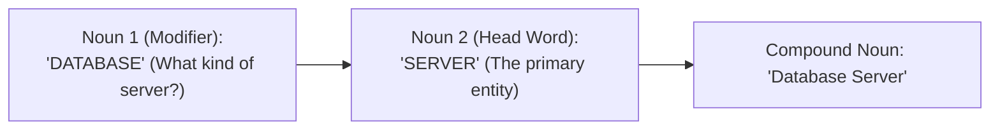
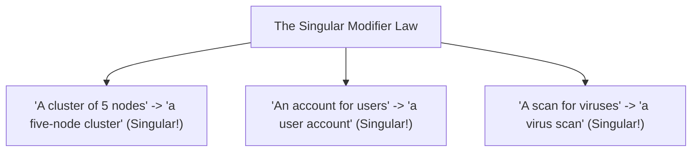

# Noun Compounds and Noun Phrases 🧩🏗️

> **Level:** CEFR B1–B2 (Nominal Architecture)  
> **Primary References:** Raymond Murphy (*English Grammar in Use*, Unit 80); Michael Swan (*Practical English Usage*, §11, 198–200)  
> **Core Concept:** In English, a noun can serve as an adjectival modifier (**Noun Adjunct**) directly preceding a head noun ($\mathbf{Noun_1} + \mathbf{Noun_2}$). In technical documentation, noun compounds form the vocabulary of modern engineering (*database server, load balancer, cache key*).

---

## 1. Intent & The "Modifier + Head" Mental Model

In a two-noun compound, the **first noun ($\mathbf{Noun_1}$)** categorizes, specializes, or restricts the **second noun ($\mathbf{Noun_2}$)**, which remains the grammatical **Head**:

$$\mathbf{Noun_1\ (Modifier/Category)} + \mathbf{Noun_2\ (Grammatical\ Head)}$$

- *a **database** server* $\implies$ A server specifically engineered to run databases.
- *a **server** database* $\implies$ A database that stores information about servers.
- *The word order dictates the fundamental semantic hierarchy!*

---

## 2. The Singular Modifier Invariant

> [!CRITICAL]
> Even if the modifying noun ($\mathbf{Noun_1}$) conceptually refers to multiple entities, it **must remain in the singular form**:
> - A cluster composed of ten nodes $\implies$ *a **ten-node** cluster* (NOT *a ten-nodes cluster*).
> - An administrator who manages thousands of databases $\implies$ *a **database** administrator* (NOT *a databases administrator*).
> - A timeout that lasts thirty seconds $\implies$ *a **thirty-second** timeout* (NOT *a thirty-seconds timeout*).

---

## 3. The Three Structural Orthographies of Compounds

Noun compounds evolve along a standard morphological continuum as they become standardized:

| Compound Type | Formatting Style | Phonetic Stress | Production Technical Examples |
| :--- | :--- | :---: | :--- |
| **1. Open Compounds** | Two separate words | Stress on **First Noun** | *data center, message broker, cache hit, source code* |
| **2. Hyphenated Compounds** | Joined by hyphen (`-`) | Stress on **First Noun** | *multi-threading, client-side, zero-day, thread-safe* |
| **3. Closed Compounds** | Fused into single word | Stress on **First Syllable** | *database, bandwidth, codebase, filename, deadlock* |

> [!TIP]
> **Compound Noun vs. Adjective + Noun Stress Rule:**
> - Compound Noun ($\mathbf{N + N}$): Spoken stress on the **FIRST** word (*`DATA` center*, *`KEY` board*).
> - Adjective + Noun ($\mathbf{Adj + N}$): Spoken stress on the **SECOND** word (*a new `SERVER`*, *a fast `QUERY`*).

---

## 4. The "Noun Pile" Antipattern in Technical Writing

In technical engineering documentation, engineers frequently concatenate four or five nouns together, creating an incomprehensible **Noun Pile** (or "Noun Stack"):

$$\mathbf{Noun_1} + \mathbf{Noun_2} + \mathbf{Noun_3} + \mathbf{Noun_4} + \mathbf{Noun_5} \quad \mathbf{[READABILITY\ BUG]}$$

### Refactoring a Noun Pile
- ❌ *Enterprise cloud data access management policy protocol.* (5-Noun Pile!)
- *Step 1: Identify the true Head Noun:* `protocol`.
- *Step 2: Unpack modifiers using prepositions (`for, of, in`):*
- ✅ *Protocol for managing data access policies in the enterprise cloud.*

---

## 5. Dual-Domain Practical Examples

### Everyday Conversational English
1. *I need to buy a **coffee cup**.* (Cup for coffee — Stress on *coffee*)
2. *We took a **two-hour** walk in the park.* (Singular modifier *two-hour*)
3. *She works at a **bookstore**.* (Closed compound)
4. *He booked a **hotel room**.* (Open compound)
5. *They live in an **apartment building**.* (Modifier + Head)
6. *I forgot my **car keys**.* (Singular modifier *car*)
7. *He bought a **ten-dollar** sandwich.* (Singular currency unit modifier)
8. *The **bus driver** was very polite.* (Open compound)

### Professional Software Engineering Context
9. *The **cache key** format must be standardized across all microservices.*  
   $\to$ Open compound noun (*cache* modifies *key*).
10. *We configured a **sixty-second** socket timeout on the reverse proxy.*  
    $\to$ Hyphenated compound modifier (*sixty-second*) adhering to the singular modifier invariant.
11. *The **user account** service publishes events to RabbitMQ.*  
    $\to$ Singular noun adjunct *user* modifying *account*.
12. *The system administrator updated the **firewall rules**.*  
    $\to$ Noun adjunct *firewall* specifying *rules*.
13. *The team eliminated a dangerous **thread deadlock** in the connection pool.*  
    $\to$ Closed compound *deadlock* modified by *thread*.
14. *The CI runner validates **pull request** descriptions against semantic conventions.*  
    $\to$ Open compound noun *pull request*.
15. *We must unpack this [cloud database disaster recovery protocol runbook] into [a disaster recovery runbook for cloud database protocols].*  
    $\to$ Dismantling a dense technical noun pile for clarity.

---

## 6. Common Mistakes & Diagnostic Anti-Patterns

| Bug (Compound Noun Defect) | Patch (Syntactically Correct) | Root Cause Diagnostic |
| :--- | :--- | :--- |
| ❌ *a **five-nodes** cluster* | ✅ *a **five-node** cluster* | **Plural Modifier Error:** Modifying nouns in compound phrases must remain singular. |
| ❌ *a **users** management service* | ✅ *a **user** management service* | *User* acts as an adjectival noun adjunct; must be singular. |
| ❌ *a **two-hours** performance test* | ✅ *a **two-hour** performance test* | Numerical measure modifiers preceding nouns must be singular and hyphenated. |
| ❌ *The team needs **datas** analysis.* | ✅ *The team needs **data** analysis.* | *Data* as a modifier is singular/mass; never append `-s`. |
| ❌ *We resolved a **memory-leak**.* (as noun) | ✅ *We resolved a **memory leak**.* | Open compound nouns are two separate words (hyphens are for compound adjectives). |

---

## 7. Self-Assessment Practice Exercises

### Section A: Singular Modifier Transformation
Convert each descriptive phrase into a compact compound noun following the Singular Modifier Invariant:

1. A cluster that consists of eight nodes $\implies$ a [______] cluster.
2. A timeout that lasts thirty seconds $\implies$ a [______] timeout.
3. An administrator who manages databases $\implies$ a [______] administrator.
4. A license that lasts for three years $\implies$ a [______] license.
5. An engine that processes events $\implies$ an [______] engine.
6. A migration that took five hours $\implies$ a [______] migration.

### Section B: Noun Pile Refactoring & Error Correction
Correct the errors and refactor the awkward technical noun stacks:

7. *We launched a four-nodes database cluster in us-east-1.*
8. *The platform engineer updated the users permission table.*
9. *The API gateway enforces a ten-minutes rate-limiting window.*
10. *Refactor: The microservice distributed transaction rollback error log handler.*
11. *We scheduled a two-days architectural summit.*
12. *The operations team performed a viruses scan across all virtual disks.*

---

## 8. Comprehensive Answer Key & Explanations

1. **eight-node** — Hyphenated compound with singular noun *node*.
2. **thirty-second** — Singular unit *second* preceded by hyphen.
3. **database** — Singular noun adjunct *database* (not *databases*).
4. **three-year** — Singular unit *year*.
5. **event** — Singular noun adjunct *event* (not *events*).
6. **five-hour** — Singular unit *hour*.
7. **Correction:** *We launched an **eight-node** database cluster in us-east-1.*  
   *Explanation:* Modifying noun must be singular (*node*, not *nodes*).
8. **Correction:** *The platform engineer updated the **user** permission table.*  
   *Explanation:* Noun adjunct must be singular (*user*).
9. **Correction:** *The API gateway enforces a **ten-minute** rate-limiting window.*  
   *Explanation:* Hyphenated numerical modifier requires singular *ten-minute*.
10. **Refactored:** *The error log handler for distributed microservice transaction rollbacks.*  
    *Explanation:* Unpacking the 6-noun pile using prepositions (*for, of*) restores readability.
11. **Correction:** *We scheduled a **two-day** architectural summit.*  
    *Explanation:* Numerical compound modifier must be singular (*two-day*).
12. **Correction:** *The operations team performed a **virus** scan across all virtual disks.*  
    *Explanation:* Modifying noun must be singular *virus* (not *viruses*).

---

## 9. Revision Flashcards & Key Takeaways

- **Compound Noun Structure:** $\mathbf{Noun_1\ (Modifier)} + \mathbf{Noun_2\ (Head)}$.
- **The Singular Modifier Law:** Nouns acting as modifiers are strictly singular (*a five-node cluster*, *a thirty-second timeout*, *user accounts*).
- **Spoken Stress:** In compound nouns, the vocal stress hits the **FIRST** noun (`DATA center`, `DATABASE`).
- **Refactoring Noun Piles:** Never chain more than 3 nouns together in technical writing. Unpack using *of, for, in* (*protocol for managing data*, not *data management protocol*).
