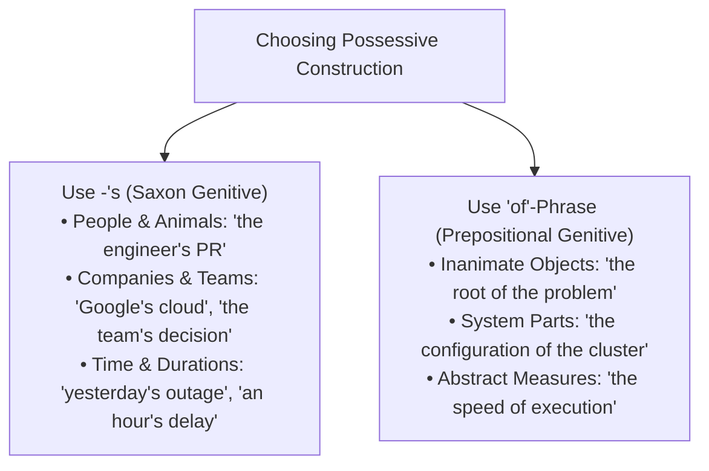
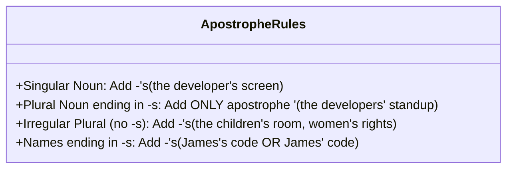
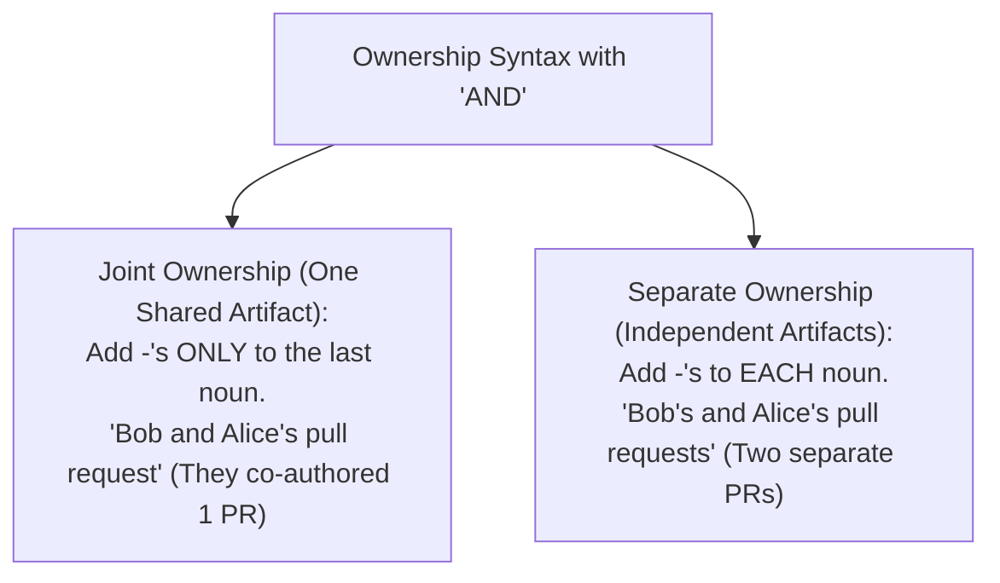

# Possessive Forms (The Genitive Case) 🏷️

> **Level:** CEFR A2–B1 (Nominal Case & Attribution)  
> **Primary References:** Raymond Murphy (*English Grammar in Use*, Unit 81); Michael Swan (*Practical English Usage*, §11, 201–209)  
> **Core Principle:** English expresses ownership, origin, and attribution through two syntactic mechanisms: the **Saxon Genitive (`-'s`)** (primarily for people, organizations, and time) and the **Prepositional Genitive (`of`-phrase)** (primarily for inanimate objects and system components).

---

## 1. Intent & The Selection Matrix: `-'s` vs. `of`-Phrase

| Noun Category | Preferred Construction | Correct Example (✅) | Unnatural Phrasing (❌) |
| :--- | :--- | :--- | :--- |
| **People** | `-'s` | *Sarah's workstation* | ❌ *the workstation of Sarah* |
| **Organizations & Teams**| `-'s` (or *of*) | *the committee's approval* | ⚠️ *the approval of the committee* |
| **Inanimate Objects** | `of`-phrase | *the root of the filesystem* | ❌ *the filesystem's root* |
| **System Components** | `of`-phrase | *the latency of the network* | ❌ *the network's latency* |
| **Temporal Periods** | `-'s` | *yesterday's build* | ❌ *the build of yesterday* |
| **Durations** | `-'s` | *two weeks' notice* | ❌ *notice of two weeks* |

---

## 2. Orthography Rules for the Apostrophe `-'s`

### 1. Singular Nouns: Add `-'s`
Regardless of the final letter, append an apostrophe followed by `s`:
- *the developer**'s** code*
- *the boss**'s** office* (`/ˈbɒsɪz/` — adds an extra syllable)
- *Linus**'s** commit*

### 2. Regular Plural Nouns Ending in `-s`: Add Only `'`
When a plural noun already ends in `-s`, append only an apostrophe after the `-s` (do not add a second `s`!):
- *the developer**s'** workstations* (The workstations belonging to multiple developers).
- *the user**s'** private cryptographic keys*.

### 3. Irregular Plural Nouns Not Ending in `-s`: Add `-'s`
- *the children**'s** playground*
- *the people**'s** choice*

---

## 3. Joint vs. Separate Ownership

In technical collaboration, distinguishing joint contributions from individual artifacts is essential:

1. **Joint Ownership (Shared Single Entity):**
   - *Harry and Bob**'s** book on Python architecture.* (They co-wrote one book).
2. **Individual Separate Ownership (Distinct Entities):**
   - *Brian**'s** and Martin**'s** methodologies.* (Brian's methodology + Martin's methodology).

---

## 4. The Double Genitive (*a friend of mine*)

When a possessive relationship is non-definite (preceded by *a, an, some, any, this, that*), English pairs the preposition `of` with a possessive pronoun or `-'s` noun (**The Double Genitive**):

$$\mathbf{a/some/this} + \mathbf{Noun} + \mathbf{of} + \mathbf{mine/yours/the\ architect's}$$

- ❌ *a my colleague* (Syntax Bug: Double determiner!)
- ✅ *a colleague **of mine***
- ❌ *this Linus's kernel*
- ✅ *this kernel patch **of Linus's***

---

## 5. Dual-Domain Practical Examples

### Everyday Conversational English
1. *This is my sister's car.* (Singular possessive)
2. *We are going to my grandparents' house.* (Plural possessive with `'`)
3. *Yesterday's newspaper is on the table.* (Temporal possessive)
4. *They need three weeks' vacation.* (Duration possessive)
5. *He is a good friend of mine.* (Double genitive)
6. *The roof of the house was damaged in the storm.* (Inanimate `of`-phrase)
7. *Jack and Jill's wedding was wonderful.* (Joint ownership)
8. *Charles's phone is ringing.* (Singular name ending in `-s`)

### Professional Software Engineering Context
9. *The database administrator revoked the **developer's** write privileges.*  
   $\to$ Singular possessive (`-'s`) applied to an engineer.
10. *The security gate verified all **users'** multi-factor tokens.*  
    $\to$ Plural possessive (`users'`) with apostrophe after the `-s`.
11. *We analyzed **yesterday's** production outage logs.*  
    $\to$ Temporal possessive (*yesterday's*).
12. *The operations team optimized the **latency of the message queue**.*  
    $\to$ Inanimate system component using the `of`-construction.
13. *We reviewed **Martin and Alexander's** refactoring principles.*  
    $\to$ Joint ownership of the shared curriculum.
14. *A senior colleague **of the architect's** suggested an alternative sharding strategy.*  
    $\to$ Double genitive (*of + architect's*).
15. *The infrastructure required **two weeks'** preparation before the cutover.*  
    $\to$ Temporal duration possessive (*two weeks'*).

---

## 6. Common Mistakes & Diagnostic Anti-Patterns

| Bug (Ungrammatical Possessive) | Patch (Syntactically Correct) | Root Cause Diagnostic |
| :--- | :--- | :--- |
| ❌ *the **server's** hard drive* | ✅ *the **hard drive of the server** (or **the server hard drive**)* | Inanimate entities prefer `of`-phrase or a compound noun (*server hard drive*). |
| ❌ *all **developer's** laptops* (plural) | ✅ *all **developers'** laptops* | Plural possessive requires apostrophe after the plural `-s` (*developers'*). |
| ❌ *a **my** friend* | ✅ *a friend **of mine*** | English strictly forbids stacking indefinite articles with possessive determiners. |
| ❌ *the **companys** policy* | ✅ *the **company's** policy* | Missing apostrophe before the `-s` in a singular genitive. |
| ❌ *We need two **week** notice.* | ✅ *We need two **weeks'** notice.* | Plural duration requires an apostrophe (*two weeks'*). |

---

## 7. Self-Assessment Practice Exercises

### Section A: Genitive Transformation
Express the relationship using `-'s`, `-'`, or an `of`-phrase:

1. The laptop belonging to the engineer $\implies$ the [______] laptop.
2. The workstations belonging to all the engineers $\implies$ all the [______] workstations.
3. The root of the file system $\implies$ the [______].
4. The outage that happened yesterday $\implies$ [______] outage.
5. A vacation that lasts for three weeks $\implies$ three [______] vacation.
6. The pull request co-authored jointly by Dave and Lisa $\implies$ [______] pull request.

### Section B: Sentence Error Spotting & Repair
Identify and correct the possessive syntax bugs in the following statements:

7. *All of the user's data were migrated to the new region.* (Multiple users intended)
8. *The architect reviewed a this pull request of Bob.*
9. *We need to investigate the database's root cause.*
10. *The company announced two days notice for the office relocation.*
11. *Bob's and Alice's shared repository is hosted on GitLab.* (They share one repository)
12. *The CPU's temperature reached eighty degrees.* (Use technical compound or `of`)

---

## 8. Comprehensive Answer Key & Explanations

1. **engineer's** — Singular noun adds `-'s`.
2. **engineers'** — Plural noun ending in `-s` adds only an apostrophe `'`.
3. **root of the file system** — Inanimate components demand the `of`-phrase.
4. **yesterday's** — Temporal noun takes `-'s`.
5. **weeks'** — Plural duration takes apostrophe after `-s` (*weeks'*).
6. **Dave and Lisa's** — Joint co-authorship adds `-'s` only to the final noun.
7. **Correction:** *All of the **users'** data was migrated to the new region.*  
   *Explanation:* Plural possessive requires apostrophe after `-s` (*users'*); *data* takes singular verb *was*.
8. **Correction:** *The architect reviewed **this pull request of Bob's** (or **Bob's pull request**).*  
   *Explanation:* Double genitive requires *of + Bob's*; eliminate stacked *a this*.
9. **Correction:** *We need to investigate the **root cause of the database failure**.*  
   *Explanation:* Inanimate abstract cause prefers the `of`-construction.
10. **Correction:** *The company announced two **days'** notice for the office relocation.*  
    *Explanation:* Plural temporal measure requires an apostrophe (*two days'*).
11. **Correction:** * **Bob and Alice's** shared repository is hosted on GitLab.*  
    *Explanation:* Shared joint ownership attaches `-'s` only to the second name (*Bob and Alice's*).
12. **Correction:** *The **temperature of the CPU** reached eighty degrees (or **The CPU temperature**).*  
    *Explanation:* Prefer the `of`-phrase or compound noun (*CPU temperature*) over inanimate `-'s`.

---

## 9. Revision Flashcards & Key Takeaways

- **The `-'s` vs `of` Rule of Thumb:**
  - Animate (People, Teams, Companies) $\to$ **`-'s`** (*the engineer's PR, Google's API*).
  - Inanimate (Objects, Systems, Hardware) $\to$ **`of`-phrase** (*the root of the directory, the speed of the bus*).
- **Plural Apostrophe Rule:**
  - Singular: *developer**'s***
  - Plural ending in -s: *developers**'***
- **Temporal Exception:** Time and durations take `-'s` (*yesterday's logs*, *two weeks' notice*).
- **Joint Ownership:** *Bob and Alice's PR* = One shared PR.
- **Double Genitive:** *A colleague of mine* (never *a my colleague*).
