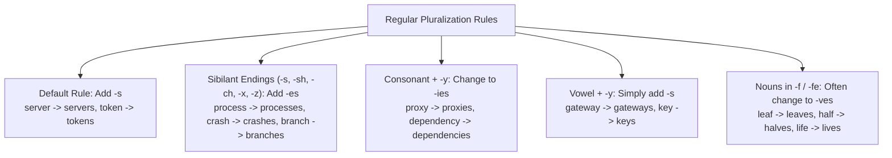
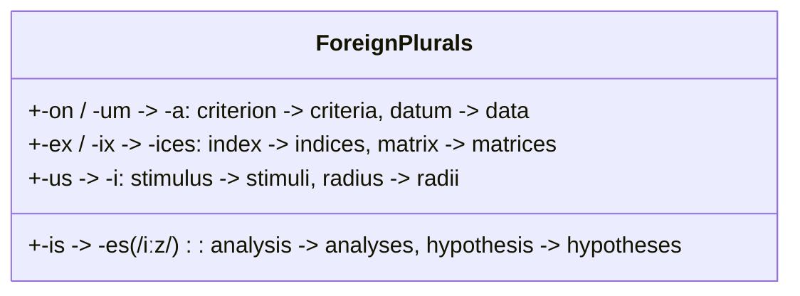

# Singular and Plural Noun Formations 👥

> **Level:** CEFR A1–B2 (Morphological Precision)  
> **Primary References:** Raymond Murphy (*English Grammar in Use*, Unit 79); Michael Swan (*Practical English Usage*, §11, 189–197)  
> **Core Architecture:** While standard English forms plurals by suffixing `-s` or `-es`, software engineering and scientific literature inherit extensive classical **Latin and Greek plural paradigms** (*analyses, criteria, indices*) and **invariant plural-only nouns** (*credentials*).

---

## 1. Regular Pluralization Mechanics

| Ending Pattern | Suffix Operation | Pronunciation | Production Examples |
| :--- | :--- | :---: | :--- |
| **Standard Consonant / Vowel** | Append `-s` | `/s/` or `/z/` | *pod $\to$ pods, container $\to$ containers* |
| **Sibilants (`-s, -sh, -ch, -x, -z`)**| Append `-es` | `/ɪz/` (Extra syllable) | *class $\to$ classes, patch $\to$ patches, box $\to$ boxes* |
| **Consonant + `-y`** | Change `-y` to `-ies` | `/iz/` | *repository $\to$ repositories, query $\to$ queries* |
| **Vowel + `-y`** | Retain `-y` + `-s` | `/z/` | *array $\to$ arrays, deploy $\to$ deploys* |
| **Nouns in `-f / -fe`** | Change to `-ves` | `/vz/` | *shelf $\to$ shelves, half $\to$ halves* (Exception: *belief $\to$ beliefs*) |
| **Nouns in `-o`** | Append `-es` or `-s` | `/z/` | *echo $\to$ echoes*; Tech/Modern: *macro $\to$ macros, photo $\to$ photos* |

---

## 2. Classical Latin and Greek Plural Formations in Computing

Modern technical English retains classical inflection patterns for words borrowed from Latin and Greek. Using regular `-s` on these words often introduces stylistic bugs:

| Classical Pattern | Singular Form (V1) | Plural Form (V2) | Pronunciation Change | Production Technical Example |
| :--- | :--- | :--- | :--- | :--- |
| **`-is` $\to$ `-es`** | *analysis* | **analyses** | `/əˈnæləsɪs/` $\to$ `/əˈnæləsiːz/` | *Perform comparative static **analyses**.* |
| **`-is` $\to$ `-es`** | *hypothesis* | **hypotheses** | `/haɪˈpɒθəsɪs/` $\to$ `/haɪˈpɒθəsiːz/` | *The data rejected both **hypotheses**.* |
| **`-is` $\to$ `-es`** | *basis* | **bases** | `/ˈbeɪsɪs/` $\to$ `/ˈbeɪsiːz/` | *On regular operational **bases**.* |
| **`-is` $\to$ `-es`** | *parenthesis* | **parentheses** | `/pəˈrɛnθəsɪs/` $\to$ `/pəˈrɛnθəsiːz/`| *Wrap parameters in **parentheses**.* |
| **`-on` $\to$ `-a`** | *criterion* | **criteria** | `/kraɪˈtɪəriən/` $\to$ `/kraɪˈtɪəriə/` | *The release met all security **criteria**.* |
| **`-on` $\to$ `-a`** | *phenomenon* | **phenomena** | `/fəˈnɒmɪnən/` $\to$ `/fəˈnɒmɪnə/` | *Observe distributed network **phenomena**.* |
| **`-ex/-ix` $\to$ `-ices`**| *index* | **indices** (or *indexes*) | `/ˈɪndɛks/` $\to$ `/ˈɪndɪsiːz/` | *Database **indices** accelerate lookups.* |
| **`-ex/-ix` $\to$ `-ices`**| *matrix* | **matrices** | `/ˈmeɪtrɪks/` $\to$ `/ˈmeɪtrɪsiːz/` | *Dense covariance **matrices**.* |
| **`-ex/-ix` $\to$ `-ices`**| *appendix* | **appendices** | `/əˈpɛndɪks/` $\to$ `/əˈpɛndɪsiːz/` | *See the document **appendices**.* |
| **`-us` $\to$ `-i`** | *radius* | **radii** | `/ˈreɪdiəs/` $\to$ `/ˈreɪdiaɪ/` | *Compute cluster proximity **radii**.* |
| **`-um` $\to$ `-a`** | *datum* | **data** | Historical singular $\to$ Modern mass noun | *Telemetry **data is** validated.* |

> [!TIP]
> **Index vs. Indices:**
> In computer science and mathematics, the classical plural **indices** is standard for database structures (*B-tree indices*). In publishing, **indexes** refers to alphabetical lists at the back of books.

---

## 3. Invariant Zero Plurals (Identical Singular & Plural)

Certain technical nouns possess identical singular and plural morphological forms:

- **Series:**
  - Singular: *A new microservice **series was** introduced.*
  - Plural: *Three distinct benchmark **series were** executed.*
- **Species:** *A rare species of malware was isolated.* / *Multiple species were found.*
- **Aircraft / Craft:** *One aircraft landed.* / *Ten aircraft landed.*

---

## 4. Plural-Only Nouns (Invariable Plurals)

Some English nouns exist **only in the plural form** and must govern a **plural verb**:

$$\mathbf{Plural\text{-}Only\ Noun} + \mathbf{Plural\ Verb\ (are/were/have)}$$

- **Credentials:** *The user's authentication credentials **are** expired.* (Never: *a credential is*).
- **Premises:** *The on-premise datacenter **premises are** restricted.*
- **Headquarters:** *Company headquarters **are** located in California.*
- **Assets:** *Digital cryptographic assets **require** hardware protection.*
- **Earnings:** *Quarterly earnings **surpassed** analyst projections.*

---

## 5. Dual-Domain Practical Examples

### Everyday Conversational English
1. *I bought two new **watches** yesterday.* (Regular sibilant `-es`)
2. *She visited three European **countries**.* (Consonant + `-y` $\to$ `-ies`)
3. *Leaves fell from the **trees** in autumn.* (`-f` $\to$ `-ves`)
4. *Both **phenomena** were thoroughly investigated by scientists.* (Greek `-on` $\to$ `-a`)
5. *These scissors **are** dull.* (Plural-only pair noun)
6. *He provided two distinct **hypotheses** for the experiment.* (Greek `-is` $\to$ `-es`)
7. *They built houses on both **halves** of the property.* (`half $\to$ halves`)
8. *The company **headquarters are** nearby.* (Plural-only)

### Professional Software Engineering Context
9. *The database query planner utilizes composite **indices** to accelerate join filters.*  
   $\to$ Classical plural of *index*.
10. *All security acceptance **criteria have been** satisfied for the current milestone.*  
    $\to$ Plural *criteria* governing plural verb *have*.
11. *The telemetry subsystem completed three automated memory **analyses**.*  
    $\to$ Classical Greek plural of *analysis* (`/əˈnæləsiːz/`).
12. *The authorization server confirmed that the client **credentials were** valid.*  
    $\to$ Invariable plural *credentials* governing plural verb *were*.
13. *Our cluster architecture contains twenty Kubernetes **namespaces** and forty **proxies**.*  
    $\to$ Regular plural *namespaces* and inflected *proxies*.
14. *The application handles multi-dimensional sparse **matrices** in RAM.*  
    $\to$ Classical plural of *matrix*.
15. *A comprehensive **series** of integration tests **was** executed prior to cutover.*  
    $\to$ Singular usage of invariant noun *series* governing *was*.

---

## 6. Common Mistakes & Diagnostic Anti-Patterns

| Bug (Plural Morphology Error) | Patch (Syntactically Correct) | Root Cause Diagnostic |
| :--- | :--- | :--- |
| ❌ *The acceptance **criterias** are met.* | ✅ *The acceptance **criteria** are met.* | *Criteria* is already plural (singular = *criterion*); double plural *criterias* is ungrammatical. |
| ❌ *This **criteria is** important.* | ✅ *This **criterion is** important.* (or *These **criteria are**...*) | Number mismatch: singular requires *criterion is*; plural requires *criteria are*. |
| ❌ *The security team performed two **analysis**.* | ✅ *The security team performed two **analyses**.* | Plural of Greek loanword *analysis* is *analyses*. |
| ❌ *The user's **credentials is** valid.* | ✅ *The user's **credentials are** valid.* | *Credentials* is an invariable plural noun; demands plural verb *are*. |
| ❌ *Our team maintains three **proxys**.* | ✅ *Our team maintains three **proxies**.* | Consonant + `-y` (*proxy*) inflects to `-ies` (*proxies*). |

---

## 7. Self-Assessment Practice Exercises

### Section A: Classical & Irregular Plural Formation
Provide the correct plural form for each singular noun:

1. `analysis` $\to$ ______
2. `criterion` $\to$ ______
3. `matrix` $\to$ ______
4. `proxy` $\to$ ______
5. `hypothesis` $\to$ ______
6. `index` (in databases) $\to$ ______
7. `parenthesis` $\to$ ______
8. `series` $\to$ ______

### Section B: Number Concord & Morphological Debugging
Correct all pluralization and verb agreement errors in the following statements:

9. *The acceptance criterias was reviewed during sprint grooming.*
10. *Both security analysises revealed unpatched dependencies.*
11. *A valid user credential are required to authenticate with the bastion host.*
12. *Wrap the mathematical expression in parenthesises.*

---

## 8. Comprehensive Answer Key & Explanations

1. **analyses** — Greek `-is` changes to `-es` (pronounced `/siːz/`).
2. **criteria** — Greek `-on` changes to `-a`.
3. **matrices** — Latin `-ix` changes to `-ices`.
4. **proxies** — Consonant + `-y` changes to `-ies`.
5. **hypotheses** — Greek `-is` changes to `-es`.
6. **indices** (or **indexes**) — Classical computational plural is *indices*.
7. **parentheses** — Greek `-is` changes to `-es`.
8. **series** — Invariant zero plural (*one series, two series*).
9. **Correction:** *The acceptance **criteria were** reviewed during sprint grooming.*  
   *Explanation:* Eliminate redundant *criterias*; *criteria* is plural and takes plural verb *were*.
10. **Correction:** *Both security **analyses** revealed unpatched dependencies.*  
    *Explanation:* Plural of *analysis* is *analyses* (not *analysises*).
11. **Correction:** *Valid user **credentials are** required (or **A valid credential is**).*  
    *Explanation:* In technical contexts, plural *credentials are* is the standard noun.
12. **Correction:** *Wrap the mathematical expression in **parentheses**.*  
    *Explanation:* Plural of *parenthesis* is *parentheses* (not *parenthesises*).

---

## 9. Revision Flashcards & Key Takeaways

- **Classical Greek `-is` $\to$ `-es`:** *analysis $\to$ analyses*, *hypothesis $\to$ hypotheses*, *parenthesis $\to$ parentheses*.
- **Classical Greek `-on` $\to$ `-a`:** *criterion $\to$ criteria*, *phenomenon $\to$ phenomena*. (Never say *criterias*!).
- **Latin `-ix/-ex` $\to$ `-ices`:** *index $\to$ indices*, *matrix $\to$ matrices*.
- **Invariable Plurals:** *Credentials are*, *headquarters are*, *premises are* $\implies$ Plural verb required.
- **Invariant Noun:** *One series was*, *two series were*.
