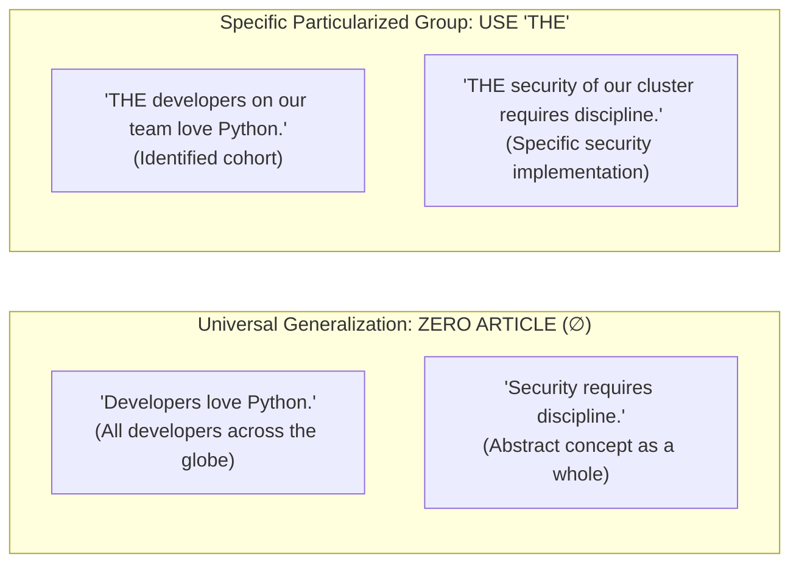
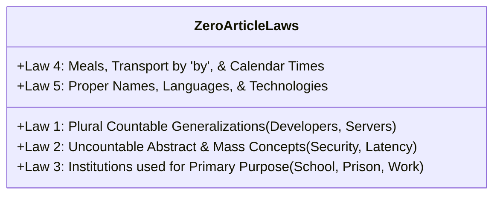

# The Zero Article and Article Omission 🚫🏷️

> **Level:** CEFR A2–B2 (Grammatical Restraint)  
> **Primary References:** Raymond Murphy (*English Grammar in Use*, Units 74–78); Michael Swan (*Practical English Usage*, §12, 222–228)  
> **The Golden Law:** The absence of an article (**The Zero Article $\mathbf{\emptyset}$**) is an active grammatical choice. It signals that plural nouns or uncountable nouns refer to a **generic class as a whole**, or that an institution is being referenced for its **primary social purpose**.

---

## 1. Intent & The "Generalization vs. Specificity" Model

One of the most persistent non-native English errors is inserting *the* where English syntax demands the **Zero Article**:

- ❌ *The microservices are popular.* (Bug: Sounds like you mean a specific list of microservices).
- ✅ *Microservices are popular.* (Valid: The architectural paradigm in general).

---

## 2. The Five Major Zero Article Laws

### Law 1: Plural Countable Generalizations
When speaking about a category in its entirety, use the bare plural noun:
- *[$\mathbf{\emptyset}$] **Software engineers** solve complex problems.*
- *[$\mathbf{\emptyset}$] **Databases** store persistent state.*
- Contrast: * **The** databases **in our production VPC** are encrypted.* (Specific subset).

### Law 2: Uncountable Abstract and Mass Concepts
Abstract nouns used in general statements take no article:
- *[$\mathbf{\emptyset}$] **Latency** degrades user experience.*
- *[$\mathbf{\emptyset}$] **Security** is an architectural continuous process.*
- Contrast: * **The** latency **of our payment endpoint** increased.* (Specific latency).

### Law 3: Institutions Used for Their Primary Purpose
English omits the article when referring to institutions visited for their inherent social function (Swan §12):

| Institution | Zero Article ($\mathbf{\emptyset}$): Primary Purpose | Definite Article (`the`): Physical Building |
| :--- | :--- | :--- |
| **School / College** | *She goes to [$\mathbf{\emptyset}$] **school**.* (As a student) | *He walked to **the school** to fix the router.* |
| **Hospital** | *He was admitted to [$\mathbf{\emptyset}$] **hospital**.* (As a patient)| *She visited her friend in **the hospital**.* |
| **Prison / Jail** | *The hacker went to [$\mathbf{\emptyset}$] **prison**.* (As an inmate)| *The lawyer visited **the prison**.* |
| **Work** | *I am at [$\mathbf{\emptyset}$] **work**.* (Engaged in labor) | *The office building.* |
| **Bed** | *It is time to go to [$\mathbf{\emptyset}$] **bed**.* (To sleep) | *The cat jumped onto **the bed**.* |

### Law 4: Meals, Transport with `By`, and Time Frameworks
1. **Meals:** *have [$\mathbf{\emptyset}$] breakfast, eat [$\mathbf{\emptyset}$] lunch, invite for [$\mathbf{\emptyset}$] dinner*.
   - (Exception: *We had **a** wonderful dinner last night* — modified by an adjective).
2. **Transport with `by`:** *by [$\mathbf{\emptyset}$] train, by bus, by air, by car*.
   - (Contrast: *on **the** bus*, *in **a** car*).
3. **Calendar Periods:** *on [$\mathbf{\emptyset}$] Monday, in [$\mathbf{\emptyset}$] September, in [$\mathbf{\emptyset}$] spring, in 2024*.

### Law 5: Technologies, Programming Languages, and Single Geographies
- **Programming Languages:** *written in [$\mathbf{\emptyset}$] **Python**, compiled with **Rust**, running on **Go***. (Never: *the Python*).
- **Proper Names & Brands:** *Docker, Kubernetes, AWS, Google, Microsoft*.
- **Single Geographies:** *in [$\mathbf{\emptyset}$] **Germany**, in **California**, in **Tokyo**, on **Mount Everest***.

---

## 3. Dual-Domain Practical Examples

### Everyday Conversational English
1. *I love [$\mathbf{\emptyset}$] **music**.* (Abstract generalization)
2. *[$\mathbf{\emptyset}$] **Cats** are independent animals.* (Plural generalization)
3. *We usually have [$\mathbf{\emptyset}$] **dinner** at 19:00.* (Meal)
4. *She travels to work by [$\mathbf{\emptyset}$] **train**.* (Transport with *by*)
5. *He is studying [$\mathbf{\emptyset}$] **economics**.* (Academic discipline)
6. *She was taken to [$\mathbf{\emptyset}$] **hospital** after the accident.* (As a patient)
7. *We went to [$\mathbf{\emptyset}$] **bed** late last night.* (Primary purpose)
8. *He speaks [$\mathbf{\emptyset}$] **Spanish** fluently.* (Language)

### Professional Software Engineering Context
9. *[$\mathbf{\emptyset}$] **Microservices** provide independent deployment boundaries.*  
   $\to$ Plural countable generalization (no *the*).
10. *Our backend services are written in [$\mathbf{\emptyset}$] **Python** and compiled with [$\mathbf{\emptyset}$] **Rust**.*  
    $\to$ Programming languages take zero article.
11. *[$\mathbf{\emptyset}$] **High availability** requires redundant hardware infrastructure.*  
    $\to$ Abstract engineering concept (no *the*).
12. *The operations team communicates via [$\mathbf{\emptyset}$] **Slack** and sends alerts by [$\mathbf{\emptyset}$] **email**.*  
    $\to$ Communication tool names and transport idioms.
13. *The cloud provider deployed data centers across [$\mathbf{\emptyset}$] **Europe** and [$\mathbf{\emptyset}$] **Asia**.*  
    $\to$ Continents take zero article.
14. *The engineers discussed [$\mathbf{\emptyset}$] **concurrency** during the sprint retro.*  
    $\to$ Theoretical domain topic.
15. *[$\mathbf{\emptyset}$] **Data persistence** is guaranteed by the Raft consensus algorithm.*  
    $\to$ Abstract system concept (*Data persistence*).

---

## 4. Common Mistakes & Diagnostic Anti-Patterns

| Bug (Erroneous 'The' Insertion) | Patch (Syntactically Correct) | Root Cause Diagnostic |
| :--- | :--- | :--- |
| ❌ *We develop software using **the Python**.* | ✅ *We develop software using **Python**.* | Programming languages never take an article. |
| ❌ * **The software engineers** write tests.* (general) | ✅ * **Software engineers** write tests.* | Universal plural generalizations require the Zero Article. |
| ❌ *The microservice sent logs by **the email**.* | ✅ *The microservice sent logs by **email**.* | Transport idiom *by + noun* strictly forbids articles. |
| ❌ * **The security** is important.* | ✅ * **Security** is important.* | Abstract mass concepts used generally take no article. |
| ❌ *The team traveled by **the plane**.* | ✅ *The team traveled by **plane**.* | Idiomatic transport with *by* takes zero article. |

---

## 5. Self-Assessment Practice Exercises

### Section A: Zero Article vs. Definite Article
Decide whether to insert **the** or leave the space as **Zero Article ($\mathbf{\emptyset}$)**:

1. [____] Python is known for its readability and concise syntax.
2. [____] Python that we used in our legacy service was version 2.7.
3. [____] Security is a shared responsibility across all engineering teams.
4. [____] security of our database was validated by external penetration testers.
5. In my spare time, I enjoy reading [____] books about distributed systems.
6. [____] books that Bob recommended were exceptionally insightful.
7. The notification worker dispatches alerts by [____] SMS.
8. The on-call engineer was at [____] work when the incident began.

### Section B: Sentence Error Spotting & Repair
Identify and correct the unnecessary article bugs in the following technical statements:

9. *The developers should always write unit tests for edge cases.* (General statement)
10. *Our company migrated our database to the Switzerland last year.*
11. *The latency is a critical metric for financial trading applications.*
12. *We deployed the application using the Docker in the staging.*

---

## 6. Comprehensive Answer Key & Explanations

1. **$\emptyset$** — Programming languages take zero article (*Python*).
2. **The** — Specific historical version post-modified by *that we used*.
3. **$\emptyset$** — Abstract concept in general statement.
4. **The** — Cataphoric post-modification (*The security of our database...*).
5. **$\emptyset$** — Plural countable generalization (*reading books*).
6. **The** — Specific identified books (*that Bob recommended*).
7. **$\emptyset$** — Transport/channel idiom *by + SMS*.
8. **$\emptyset$** — Primary institutional purpose (*at work*).
9. **Correction:** * **Developers** should always write unit tests for edge cases.*  
   *Explanation:* Universal generalization about all developers requires Zero Article.
10. **Correction:** *Our company migrated our database to **Switzerland** last year.*  
    *Explanation:* Singular countries take zero article (eliminate *the*).
11. **Correction:** * **Latency** is a critical metric for financial trading applications.*  
    *Explanation:* Abstract technical noun in a universal definition takes Zero Article.
12. **Correction:** *We deployed the application using **Docker** in **staging**.*  
    *Explanation:* Proprietary brand names (*Docker*) and internal environments (*staging*) take zero article.

---

## 7. Revision Flashcards & Key Takeaways

- **The Zero Article Principle:** Omission of articles is deliberate; it signifies **generic universality**.
- **No Article For:**
  - Plural generalizations (*Engineers build tools*).
  - Abstract mass nouns (*Security matters*).
  - Programming languages (*written in Go, Python, Rust*).
  - Proper names and single countries (*in Germany, at Google*).
  - Means of transport/communication with *by* (*by email, by bus*).
  - Institutions used for primary intent (*at work, in hospital, at school*).
- **The Specificity Test:** If the noun is narrowed down by *of* or a relative clause, switch from $\mathbf{\emptyset}$ to **THE** (*Latency is bad* vs *The latency of this query is bad*).
