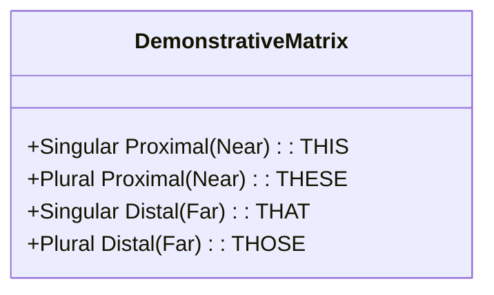
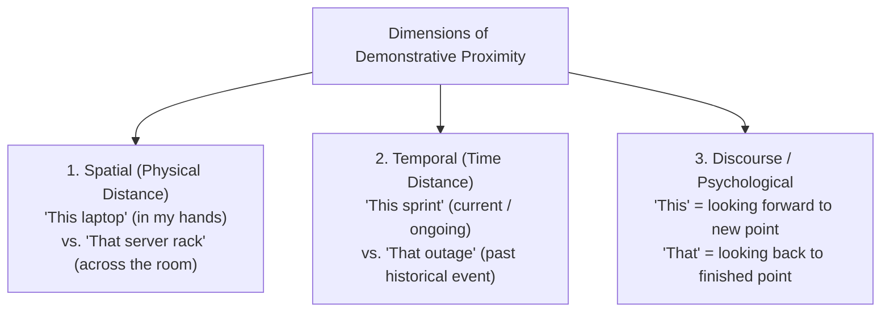

# Demonstratives: This, That, These, and Those 🧭📍

> **Level:** CEFR A1–B2 (Deictic Reference)  
> **Primary References:** Raymond Murphy (*English Grammar in Use*, Unit 84); Michael Swan (*Practical English Usage*, §12, 227–228)  
> **Core Concept:** **Demonstratives** perform *deictic* operations: they point to entities across **physical space**, **time**, and **textual discourse**, calibrating proximity (Near vs. Distant) and grammatical number (Singular vs. Plural).

---

## 1. The Two-Dimensional Demonstrative Matrix

| Proximity Dimension | Singular ($\mathbf{Sg}$) | Plural ($\mathbf{Pl}$) | Semantic Core |
| :--- | :---: | :---: | :--- |
| **Proximal (Near)** | **this** | **these** | Present moment; physical closeness; upcoming topic (*cataphora*). |
| **Distal (Far)** | **that** | **those** | Completed past; physical distance; previously mentioned topic (*anaphora*). |

---

## 2. The Three Dimensions of Proximity

### 1. Spatial Proximity
- * **This** workstation is running Ubuntu.* (Here, right beside me).
- * **That** network switch over there needs a reboot.* (Distant across the room).

### 2. Temporal Proximity
- *We are releasing version 2.0 **this** week.* (Current, ongoing period).
- *Remember **that** incident in 2022?* (Distant historical memory).

### 3. Discourse Signposting (Anaphora vs. Cataphora)
- **Forward-Looking (Cataphora $\to$ `This`):** Points forward to something about to be said:
  - *Consider **this**: if we shard by tenant ID, query complexity doubles.*
- **Backward-Looking (Anaphora $\to$ `That`):** Points back to something already completed:
  - *The database deadlocked, and the API crashed. **That** was our worst outage.*

---

## 3. Determiner vs. Independent Pronoun

Demonstratives operate in two distinct syntactic positions:

1. **Demonstrative Determiner (+ Noun):** Modifies an overt noun:
   - * **This** [microservice] handles authentication.*
   - * **Those** [metrics] indicate elevated memory contention.*
2. **Demonstrative Pronoun (Standalone):** Replaces the noun phrase entirely:
   - * **This** is our production database.*
   - * **Those** are the compromised API tokens.*

---

## 4. The "Vague This" Bug in Technical Documentation

In technical writing, using a standalone *this* without an anchoring noun often produces confusing ambiguity:

- ❌ *The gateway dropped the connection, restarted the worker, and purged the cache. **This** caused elevated latency.*  
  *(Reader: What caused latency? The dropping? The restarting? Or the cache purging?)*
- ✅ * **This cache purge** caused elevated latency.* (Precise: Demonstrative + Summary Noun).

> [!TIP]
> **Technical Writing Best Practice:**
> Whenever you write *this* at the beginning of a sentence, always pair it with a **Summary Noun**:
> - *This architectural decision...*
> - *This latency spike...*
> - *These benchmark findings...*

---

## 5. Formal Comparisons: *That of* and *Those of*

In formal architectural benchmarks, use **that of** (singular) or **those of** (plural) to avoid awkward, repetitive noun phrases:

$$\mathbf{Singular\ Comparison} \implies \mathbf{that\ of} \quad [\text{e.g., } \text{The latency of A is lower than that of B}]$$
$$\mathbf{Plural\ Comparison} \implies \mathbf{those\ of} \quad [\text{e.g., } \text{The features of A exceed those of B}]$$

- ❌ *The throughput of Redis is higher than the throughput of SQLite.* (Repetitive)
- ✅ *The throughput of Redis is higher than **that of** SQLite.*
- ❌ *The endpoints of Service A are more secure than the endpoints of Service B.*
- ✅ *The endpoints of Service A are more secure than **those of** Service B.*

---

## 6. Dual-Domain Practical Examples

### Everyday Conversational English
1. *I like **this** shirt, but **that** one over there is too expensive.* (Spatial)
2. * **These** shoes are very comfortable.* (Plural proximal)
3. *Who was **that** on the phone?* (Telephone convention)
4. *Listen to **this**; you won't believe what happened!* (Cataphoric)
5. *We had a great time **that** summer.* (Distant past)
6. * **Those** are my keys on the kitchen counter.* (Plural distal)
7. *Hello, **this** is David speaking.* (Self-identification on call)
8. * **That** sounds like a wonderful idea!* (Reaction to prior statement)

### Professional Software Engineering Context
9. * **This** architectural decision ensures high availability during regional outages.*  
   $\to$ Demonstrative determiner + summary noun.
10. *The query response time of DynamoDB is lower than **that of** PostgreSQL under key-value lookups.*  
    $\to$ Formal comparative *that of*.
11. * **These** benchmark results prove that the new garbage collector minimizes stop-the-world pauses.*  
    $\to$ Plural proximal determiner (*these*).
12. *The memory requirements of microservices often exceed **those of** a monolithic application.*  
    $\to$ Formal plural comparative *those of*.
13. *We noticed three open security ports; **those** must be closed immediately.*  
    $\to$ Standalone demonstrative pronoun (*those*).
14. *Consider **this**: if we decouple the ingestion engine, backpressure will not cascade.*  
    $\to$ Cataphoric forward-pointing discourse marker.
15. *The server crashed due to an out-of-memory error. **That** issue was resolved in patch 1.2.*  
    $\to$ Anaphoric backward-looking reference (*That issue*).

---

## 7. Common Mistakes & Diagnostic Anti-Patterns

| Bug (Demonstrative Error) | Patch (Syntactically Correct) | Root Cause Diagnostic |
| :--- | :--- | :--- |
| ❌ *The speed of C++ is higher than Python.* | ✅ *The speed of C++ is higher than **that of** Python.* | **Faulty Parallel Comparison:** You are comparing the *speed* of C++ to the *language* Python, not its speed. |
| ❌ * **This** metrics are alarming.* | ✅ * **These** metrics are alarming.* | Plural noun *metrics* requires plural demonstrative *these*. |
| ❌ *The engineer fixed **that** bugs.* | ✅ *The engineer fixed **those** bugs.* | Plural noun *bugs* requires plural distal *those*. |
| ❌ *The database died. **This** was bad.* (vague) | ✅ *The database died. **That failure** was severe.* | Vague standalone *this*; replace with backward-looking *that* + summary noun. |
| ❌ *The latency of API A is lower than **those of** API B.* | ✅ *The latency of API A is lower than **that of** API B.* | Singular noun *latency* requires singular comparative *that of*. |

---

## 8. Self-Assessment Practice Exercises

### Section A: Demonstrative Selection
Choose the correct demonstrative (**this, that, these, those, that of, those of**):

1. [____] benchmark graphs on my screen right now indicate zero packet loss.
2. The memory footprint of Go is substantially smaller than [____] Java.
3. Look at [____] server rack over there on the far side of the datacenter.
4. The security guarantees of TLS 1.3 exceed [____] TLS 1.2.
5. We have discussed the database migration; [____] concludes our technical agenda for today.
6. The team must remediate [____] three critical vulnerabilities before Friday.

### Section B: Sentence Error Spotting & Repair
Identify and correct the demonstrative bugs in the following technical statements:

7. *This integration tests are failing intermittently.*
8. *The throughput of the new pipeline is twice as fast as the old pipeline.* (Use that of)
9. *Those bug was introduced in the last commit.*
10. *The endpoints of Service A are more reliable than that of Service B.*
11. *Listen to that: we are going to open-source our testing framework!* (Forward-looking)
12. *The cache was invalidated. This caused a surge in backend queries.* (Fix vague this)

---

## 9. Comprehensive Answer Key & Explanations

1. **These** — Plural noun *graphs* + immediate present location (*on my screen right now*).
2. **that of** — Replaces singular noun phrase *the memory footprint of*.
3. **that** — Singular noun *server rack* + physical distance (*over there on the far side*).
4. **those of** — Replaces plural noun phrase *the security guarantees of*.
5. **that** — Concluding a finished topic looks backward $\implies$ *that concludes...*
6. **these** — Plural noun *three critical vulnerabilities* requiring immediate focus.
7. **Correction:** * **These** integration tests are failing intermittently.*  
   *Explanation:* Plural noun *tests* demands plural demonstrative *These*.
8. **Correction:** *The throughput of the new pipeline is twice as fast as **that of** the old pipeline.*  
   *Explanation:* Formal comparison requires *that of* to parallel *the throughput of*.
9. **Correction:** * **That** bug was introduced in the last commit.*  
   *Explanation:* Singular noun *bug* demands singular demonstrative *That*.
10. **Correction:** *The endpoints of Service A are more reliable than **those of** Service B.*  
    *Explanation:* Plural noun *endpoints* requires plural comparative *those of*.
11. **Correction:** *Listen to **this**: we are going to open-source our testing framework!*  
    *Explanation:* Forward-pointing cataphoric signposting requires *this*.
12. **Correction:** *The cache was invalidated. **This cache invalidation** caused a surge in backend queries.*  
    *Explanation:* Eliminate vague standalone *this* by supplying an anchoring summary noun.

---

## 10. Revision Flashcards & Key Takeaways

- **Singular vs. Plural:** *this / that* $\implies$ Singular; *these / those* $\implies$ Plural.
- **Near vs. Far:**
  - *This / These* = Near in space, current in time, forward-looking in text.
  - *That / Those* = Far in space, past in time, backward-looking in text.
- **The "That Of" Pattern:**
  - Singular: *The latency of A is lower than **that of** B*.
  - Plural: *The metrics of A are better than **those of** B*.
- **Avoid Vague "This":** Always bind *this* to a summary noun (*This decision, This failure*).
