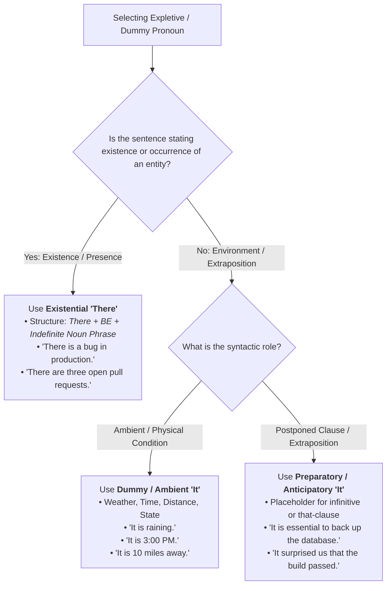
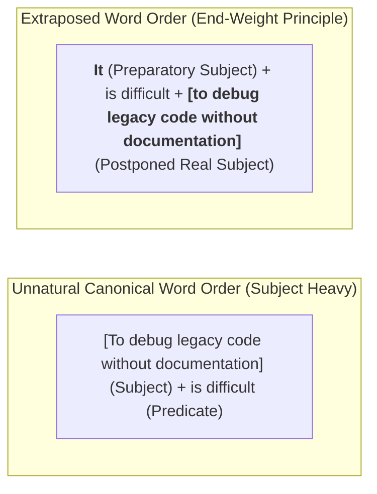
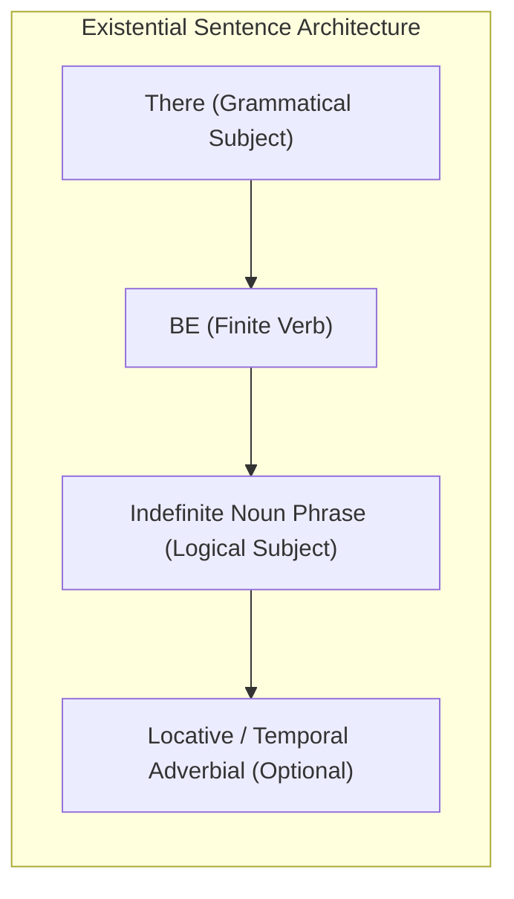

# Dummy and Preparatory Pronouns: It and There 🤖📍

> **Level:** CEFR B1–B2 (Expletive Syntax & Extraposition)  
> **Primary References:** Raymond Murphy (*English Grammar in Use*, Unit 84); Michael Swan (*Practical English Usage*, §13, §268, 546–548)  
> **Core Concept:** English is a **non-pro-drop language**; every finite clause (except imperatives) requires an overt grammatical subject. When a clause lacks a semantic agent or moves a heavy clausal subject to the end for balance, English inserts the **dummy/expletive pronouns** `it` or `there` to fulfill syntactic requirements.

---

## 1. The Expletive Dichotomy: `It` vs. `There`



---

## 2. Dummy (Ambient) `It`: The Syntactic Filler

When describing environmental conditions, time, distance, or identification, English inserts `it` as an empty grammatical subject with no referential meaning.

### 1. Categories of Dummy `It`
- **Time and Dates:**
  - * **It** is 9:30 AM.*
  - * **It** is Monday morning.*
- **Weather and Climate:**
  - * **It** is raining heavily outside the data center.*
  - * **It** was freezing cold yesterday.*
- **Distance and Measurement:**
  - * **It** is two kilometers from our office to the headquarters.*
  - * **It** takes 45 minutes to execute the end-to-end integration suite.*
- **Sensory and Situational Status:**
  - * **It** is quiet in the server room.*
  - * **It** looks like the deployment succeeded.*

> [!IMPORTANT]
> Speakers of pro-drop languages (such as Spanish, Italian, Russian, Hindi, or Arabic) often omit this dummy subject:
> - ❌ *Is raining today.*
> - ✅ * **It** is raining today.*
> - ❌ *Is necessary to restart the container.*
> - ✅ * **It** is necessary to restart the container.*

---

## 3. Preparatory (Anticipatory) `It`: Extraposition

In English stylistic syntax, **heavy clausal subjects** (infinitive phrases or *that*-clauses) sound awkward at the front of a sentence. To maintain **end-weight** (placing heavy information at the end of the clause), English uses **extraposition**:



### 1. Extraposition of To-Infinitive Clauses
- **Unnatural:** *To optimize the database queries is crucial.*
- **Natural Extraposition:** * **It is crucial to optimize** the database queries.*
- **Formula:**
  $$\text{It} + \text{be} + \text{Adjective} + (\text{for someone}) + \text{to-infinitive}$$
- * **It is impossible for us to meet** the Friday release deadline without additional QA engineers.*

### 2. Extraposition of `That`-Clauses and Wh-Clauses
- **Unnatural:** *That the memory leak crashed the cluster is clear.*
- **Natural Extraposition:** * **It is clear that** the memory leak crashed the cluster.*
- * **It is surprising how quickly** the microservice recovered from the failover.*
- * **It doesn't matter which** cloud provider we choose, as long as it supports Kubernetes.*

### 3. Anticipatory Object `It`
When a clausal direct object is followed by an object complement (adjective or noun), English requires a preparatory `it` between the verb and the complement:

- **Formula:**
  $$\text{Subject} + \text{Verb (find / make / consider / feel)} + \mathbf{it} + \text{Adjective} + \text{to-infinitive / that-clause}$$
- *We find **it difficult to parse** unformatted XML payloads.* (❌ NOT: *We find difficult to parse...*)
- *The new compiler flags make **it possible to optimize** vector operations.*
- *I consider **it vital that** all commits undergo automated static analysis.*

### 4. Cleft Sentences with `It` (Syntactic Focus)
To place sharp focus or contrast on a specific constituent, English uses an *it*-cleft structure:

$$\mathbf{It} + \text{be} + \text{Focused Element} + \text{that / who} + \text{Remainder of Clause}$$

- * **It was Sarah who** discovered the concurrency race condition.* (Focusing the agent).
- * **It was during the migration that** the database dropped the primary keys.* (Focusing the time).
- * **It is cost efficiency that** drives our transition to serverless functions.* (Focusing the motivation).

---

## 4. Existential `There`: Presenting New Information

While `it` refers to conditions or extraposed clauses, existential `there` introduces the **existence, occurrence, or presence** of an entity into the discourse.



### 1. Subject-Verb Agreement with Existential `There`
Grammatically, `there` occupies the subject position, but the verb agrees with the **logical subject (the following noun phrase)**:

| Logical Subject | Verb Form | Example Sentence |
| :--- | :--- | :--- |
| **Singular Countable Noun** | Singular (`is / was / has been`) | *There **is** an active socket connection.* |
| **Plural Countable Noun** | Plural (`are / were / have been`) | *There **are** three active socket connections.* |
| **Uncountable Mass Noun** | Singular (`is / was / has been`) | *There **is** sufficient memory available on this host.* |
| **Compound Subject (A and B)** | Agrees with **first item** (Proximity) | *There **is a** router and two switches on the rack.* |

> [!TIP]
> In informal spoken English, native speakers frequently contract *there is* into *there's* before plural nouns (*There's three servers down*). However, in **formal writing, code comments, and technical specifications**, you must maintain strict plural concord: *There are three servers down*.

### 2. The Definiteness Restriction
The noun phrase following existential *there* must usually be **indefinite** (*a, an, some, many, few, no, zero*):
- ❌ *There is the bug in this function.* (Unnatural if introducing existence; use *The bug is in this function*).
- ✅ *There is **a** bug in this function.*
- ✅ *There are **several** anomalies in the metric graph.*

---

## 5. Practical Dual-Domain Examples

### Everyday Conversation

1. * **It** is freezing outside; make sure you wear a warm jacket.*
2. * **It** takes twenty minutes to walk from the train station to my house.*
3. * **It is wonderful to see** you again after such a long time.*
4. * **It doesn't matter** whether we eat Italian or Mexican food tonight.*
5. *We found **it hard to believe** that he solved the puzzle so quickly.*
6. * **There is** a strange noise coming from the air conditioner.*
7. * **There are** several good restaurants in this neighborhood.*
8. * **It was John who** suggested taking the scenic route.*

### Software Engineering & Technical Documentation

9. * **It is critical to sanitize** all user inputs before querying the relational database.*
10. * **It is evident that** the high CPU usage correlates directly with the garbage collection cycle.*
11. *The framework makes **it trivial to implement** JWT authentication.*
12. *We consider **it bad practice to commit** API secrets to version control repositories.*
13. * **It was the failover script that** accidentally terminated the primary database cluster.*
14. * **There are** twenty active worker threads processing incoming webhook events.*
15. * **There is** insufficient disk space remaining on the root partition `/dev/sda1`.*
16. * **There have been** three major security incidents reported this quarter.*
17. * **It takes** approximately four minutes to compile the C++ binaries from source.*
18. * **It remains to be seen whether** the new GraphQL endpoint reduces mobile client latency.*

---

## 6. Common Antipatterns & Diagnostic Table

| Incorrect Antipattern | Corrected Grammar | Rule & Explanation |
| :--- | :--- | :--- |
| ❌ *Is important to write unit tests.* | ✅ * **It is** important to write unit tests.* | English clauses require an overt subject. Extraposition uses dummy *it*. |
| ❌ *There is many errors in the log.* | ✅ *There **are** many errors in the log.* | Existential *there* requires the verb to agree with the logical plural subject (*many errors*). |
| ❌ *We find impossible to scale this service.* | ✅ *We find **it** impossible to scale this service.* | Anticipatory object *it* is syntactically required between verb (*find*) and adjective complement (*impossible*). |
| ❌ *It has a meeting in room 4B.* | ✅ * **There is** a meeting in room 4B.* | *It has* denotes possession. Describing presence/existence requires existential *there is*. |
| ❌ *To deploy on Friday is dangerous.* | ✅ * **It is** dangerous to deploy on Friday.* | While grammatically valid, fronting an infinitive clause violates standard English end-weight; use extraposed *it*. |
| ❌ *There were Sarah who fixed the pipeline.* | ✅ * **It was** Sarah who fixed the pipeline.* | Cleft sentences for focal emphasis strictly use *It + BE*, never existential *there*. |
| ❌ *Takes two hours to run the backup.* | ✅ * **It takes** two hours to run the backup.* | Environmental, temporal, and duration clauses require dummy *it*. |

---

## 7. Self-Assessment Exercises

### Exercise 1: `It` vs. `There` Selection
Choose whether to insert **it** or **there**:

1. ________ is a known memory leak in version 2.4 of the runtime.
2. ________ is midnight already; we should stop debugging and resume tomorrow.
3. ________ was clear that the network switch had lost power.
4. ________ are five pending pull requests awaiting your approval.
5. ________ is essential to monitor cluster ingress traffic continuously.

### Exercise 2: Extraposition & Object `It` Repair
Rewrite or complete the following sentences to fix expletive errors:

6. *Rewrite using preparatory 'it':* To configure a reverse proxy requires root privileges.
7. *Fix the missing pronoun:* Modern container engines make easy to deploy microservices across environments.
8. *Correct the subject-verb agreement:* There was three unhandled exceptions thrown during the checkout flow.
9. *Fix the cleft sentence:* There was David who wrote the initial design document for this system.
10. *Fix the pro-drop error:* Is not recommended to store plain-text passwords in configuration files.

<details>
<summary>View Complete Answer Key & Diagnostic Explanations</summary>

1. **There** — Introducing the existence of an entity (*a known memory leak*).
2. **It** — Dummy subject denoting clock time (*midnight*).
3. **It** — Preparatory subject extraposing the noun clause (*that the network switch had lost power*).
4. **There** — Existential construction introducing a plural logical subject (*five pending pull requests*).
5. **It** — Preparatory subject extraposing the infinitive clause (*to monitor cluster ingress traffic continuously*).
6. **It requires root privileges to configure a reverse proxy.** (or *It is necessary to have root privileges...*).
7. Modern container engines make **it** easy to deploy microservices across environments. (Preparatory object *it*).
8. There **were** three unhandled exceptions thrown during the checkout flow. (Concord with plural *exceptions*).
9. **It was** David who wrote the initial design document for this system. (Cleft sentences use *It was*, not *There was*).
10. **It is** not recommended to store plain-text passwords in configuration files. (Dummy *it* satisfies the non-pro-drop requirement).

</details>

---

## 8. Revision Flashcards

```
Q: Why can't English sentences begin with "Is necessary to..." like Spanish or Italian?
A: English is a non-pro-drop language. Except in imperative commands, every finite clause must have an overt grammatical subject (dummy "it" in this case).

Q: What is "extraposition" and why is it used?
A: Extraposition moves a heavy clausal subject (like an infinitive or that-clause) to the end of the sentence and places preparatory "it" at the front to satisfy end-weight.

Q: What is the rule for anticipatory object "it" with verbs like "find", "make", and "consider"?
A: When a verb takes an infinitive or that-clause object followed by an adjective complement, "it" must be placed as a dummy object: "Subject + Verb + IT + Adjective + to-infinitive" ("We make IT easy to install").

Q: How is subject-verb agreement determined with existential "there"?
A: The verb agrees with the logical subject following the verb ("There IS a server", "There ARE two servers"), not with "there" itself.

Q: What is an "it-cleft" sentence and what is its purpose?
A: A construction ("It is/was [focus] that/who...") used to highlight or contrast a specific element of the clause ("It was the firewall that blocked the packet").
```
