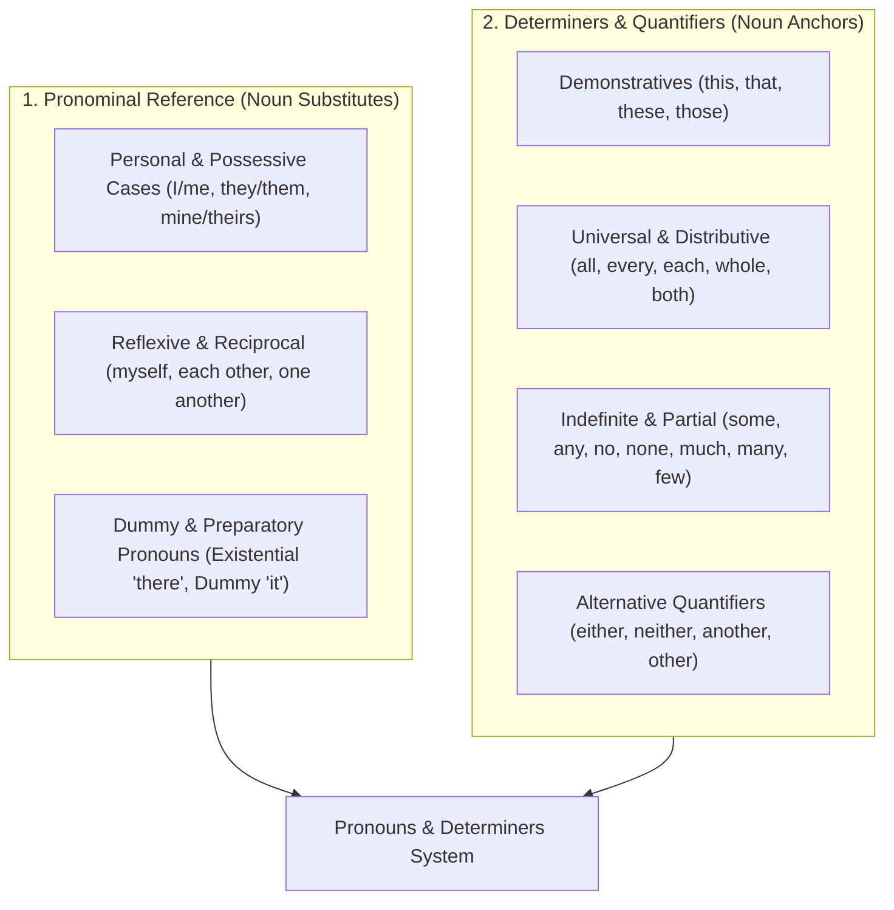

# Pronouns and Determiners 🧭

> *"Pronouns prevent discourse fatigue by replacing antecedents. Determiners anchor nouns to reality by specifying quantity, possession, proximity, and scope."*  
> — Reference: Raymond Murphy (*English Grammar in Use*, Units 82–91); Michael Swan (*Practical English Usage*, §12–14)

Welcome to the **Pronouns and Determiners** module of the English Grammar Knowledge System. This module covers English anaphoric references, case systems, quantification matrices, and structural preparatory pronouns.

---

## 🧭 Topic Catalog & Navigation

| Document | Core Focus | CEFR Level | Key Practical Takeaway |
| :--- | :--- | :---: | :--- |
| **[1. Personal & Possessive Pronouns](personal-and-possessive-pronouns.md)** | Nominative vs. Objective cases, possessive determiners vs pronouns | A1–B1 | Eliminate pronoun case errors (*between you and I* $\to$ *between you and me*). |
| **[2. Reflexive & Reciprocal Pronouns](reflexive-and-reciprocal-pronouns.md)** | `-self` forms, emphatic use, *each other* vs *one another* | A2–B1 | Stop misusing *myself* as a substitute for *me* in business emails. |
| **[3. Demonstratives](demonstratives.md)** | *This, that, these, those* across space, time, and discourse | A1–A2 | Use demonstratives for precise signposting in technical architectural documentation. |
| **[4. Universal & Distributive Quantifiers](quantifiers-universal-and-distributive.md)** | *All, every, each, whole, both* | A2–B2 | Understand individual distributive scope (*each*) vs collective scope (*all*). |
| **[5. Indefinite & Partial Quantifiers](quantifiers-indefinite-and-partial.md)** | *Some, any, no, none, much, many, little, few* | A2–B2 | Master positive vs non-assertive scope (*some* in polite offers vs *any* in questions). |
| **[6. Alternative Quantifiers](quantifiers-alternative.md)** | *Either, neither, another, other, others, the other* | B1–B2 | Differentiate binary choices (*either/neither*) from open collections (*another/other*). |
| **[7. Dummy and Preparatory Pronouns](dummy-and-preparatory-pronouns.md)** | Existential *there* vs preparatory *it* (clefts, extraposition) | B1–C1 | Master information packaging and avoid ungrammatical missing subjects in technical reports. |

---

## ⚡ The Determiner vs. Pronoun Distinction

A single word form can function as either a **Determiner** (modifying a following noun) or an independent **Pronoun** (standing alone):

- * **This** [architecture] ($\mathbf{Noun}$) is scalable.* $\implies$ **Determiner** (modifies *architecture*).
- * **This** ($\mathbf{Subject}$) is scalable.* $\implies$ **Demonstrative Pronoun** (stands alone).
- * **Each** [pod] ($\mathbf{Noun}$) exposes metrics.* $\implies$ **Determiner**.
- * **Each** ($\mathbf{Subject}$) exposes metrics.* $\implies$ **Distributive Pronoun**.
