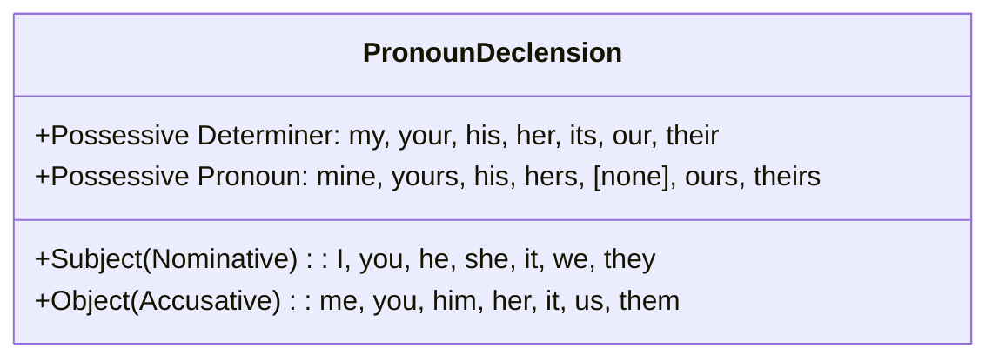
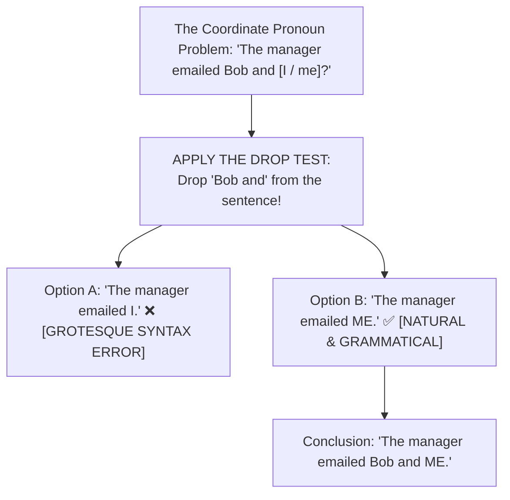
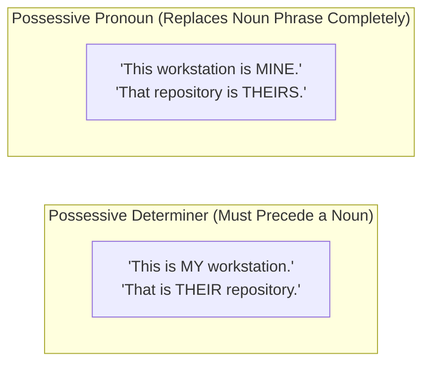

# Personal and Possessive Pronouns 👤👥

> **Level:** CEFR A1–B1 (Core Pronominal Declension)  
> **Primary References:** Raymond Murphy (*English Grammar in Use*, Units 82–83); Michael Swan (*Practical English Usage*, §14, 258–265)  
> **Core Architecture:** Modern English preserves its historical Indo-European case system almost exclusively in **personal pronouns**: **Subject (Nominative) Case**, **Object (Accusative) Case**, **Possessive Determiner**, and **Possessive Pronoun**.

---

## 1. The Master Pronoun Declension Matrix

| Person & Number | Subject Case | Object Case | Possessive Determiner (+ Noun) | Possessive Pronoun (Standalone) |
| :--- | :---: | :---: | :---: | :---: |
| **1st Person Singular** | **I** | **me** | **my** (*my code*) | **mine** (*The code is mine*) |
| **2nd Person (Sing/Pl)** | **you** | **you** | **your** (*your branch*) | **yours** (*The branch is yours*) |
| **3rd Person Masc.** | **he** | **him** | **his** (*his PR*) | **his** (*The PR is his*) |
| **3rd Person Fem.** | **she** | **her** | **her** (*her design*) | **hers** (*The design is hers*) |
| **3rd Person Neuter** | **it** | **it** | **its** (*its configuration*) | — (Not used standalone) |
| **1st Person Plural** | **we** | **us** | **our** (*our cluster*) | **ours** (*The cluster is ours*) |
| **3rd Person Plural** | **they** | **them** | **their** (*their service*) | **theirs** (*The service is theirs*) |

---

## 2. The Great Coordinate Case Bug & The "Drop Test"

The most prevalent grammatical defect in professional technical correspondence is **Hypercorrection**: using *I* where English syntax demands *me*, or using *me* where syntax demands *I*.

### The Drop Test Algorithm
Whenever you have a compound noun phrase (*X and [pronoun]*):
1. **Temporarily remove the other person ($X$) and the conjunction ($and$).**
2. **Read the sentence with the pronoun alone:**
   - *[Bob and I / me] reviewed the architecture.* $\implies$ *[**I** reviewed the architecture]* $\implies$ ✅ *Bob and **I** reviewed the architecture.*
   - *The architect assigned the task to [Bob and I / me].* $\implies$ *[assigned to **me**]* $\implies$ ✅ *assigned to Bob and **me**.*
   - *Between [you and I / me].* $\implies$ Preposition *between* demands object case $\implies$ ✅ *Between you and **me**.*

---

## 3. Possessive Determiner vs. Standalone Possessive Pronoun

- **Determiner:** *This is **our** production database.* (Modifies noun *database*).
- **Pronoun:** *This production database is **ours**.* (Stands alone as subject complement).
- *Never append apostrophes to possessive pronouns!*
  - ❌ *The laptop is **your's**.*
  - ✅ *The laptop is **yours**.*
  - ❌ *The decision was **their's**.*
  - ✅ *The decision was **theirs**.*

---

## 4. Singular "They" in Modern Technical English

In contemporary engineering documentation and corporate communication, **they/them/their** is standard to refer to a single individual of unspecified or non-binary gender:

$$\mathbf{Singular\ Antecedent}\ (\text{developer, engineer, user}) \implies \mathbf{they / them / their}$$

- *If **a user** forgets their password, **they** can initiate a reset.*
- *Every **developer** must sign **their** commits.*
> [!NOTE]
> Even when *they* refers to a singular individual, it governs a **plural verb**:
> - *The on-call engineer called. **They are** investigating the outage.*

---

## 5. Dual-Domain Practical Examples

### Everyday Conversational English
1. *She lent **her** car to **me**.* (Determiner + Object pronoun)
2. *Is this umbrella **yours** or **mine**?* (Possessive pronouns)
3. *Sarah and **I** went to the supermarket.* (Subject Drop Test: *I went*)
4. *The manager praised Dave and **me**.* (Object Drop Test: *praised me*)
5. *Between you and **me**, I don't trust him.* (Prepositional object case)
6. *The dog chased **its** tail.* (Possessive determiner *its*, no apostrophe)
7. *Someone left **their** coat on the chair.* (Singular *they*)
8. *We solved the problem together; the victory is **ours**.* (Possessive pronoun)

### Professional Software Engineering Context
9. *The engineering director assigned the migration task to Sarah and **me**.*  
   $\to$ Drop Test: *assigned the task to me* $\implies$ *Sarah and me*.
10. *Bob and **I** conducted a comprehensive load benchmark on the API gateway.*  
    $\to$ Drop Test: *I conducted* $\implies$ *Bob and I*.
11. *The microservice lost **its** connection to the Redis cache.*  
    $\to$ Possessive determiner *its* (never *it's*).
12. *Our team pushed our changes, but the frontend developers haven't committed **theirs** yet.*  
    $\to$ Standalone possessive pronoun *theirs*.
13. *If **a client** sends invalid parameters, return an HTTP 400 response to **them**.*  
    $\to$ Singular *they* objective case (*them*).
14. *Between you and **me**, the legacy monolith will not scale past Q4.*  
    $\to$ Preposition *between* governing objective pronoun *me*.
15. *The infrastructure repository is **ours**, but the deployment script is **theirs**.*  
    $\to$ Predicate possessive pronouns (*ours* and *theirs*).

---

## 6. Common Mistakes & Diagnostic Anti-Patterns

| Bug (Ungrammatical Pronoun Case) | Patch (Syntactically Correct) | Root Cause Diagnostic |
| :--- | :--- | :--- |
| ❌ *The manager emailed Bob and **I**.* | ✅ *The manager emailed Bob and **me**.* | **Hypercorrection Error:** *Emailed* is a transitive verb requiring direct object *me*. |
| ❌ *Between you and **I**, the build is broken.* | ✅ *Between you and **me**, the build is broken.* | Preposition *between* demands the objective case (*me*). |
| ❌ *The server lost **it's** socket.* | ✅ *The server lost **its** socket.* | *It's* is a contraction for *it is*; possessive is *its*. |
| ❌ *The codebase is **your's**.* | ✅ *The codebase is **yours**.* | Possessive pronouns never take an apostrophe (*yours, theirs, ours*). |
| ❌ *Me and Bob wrote the tests.* | ✅ *Bob and **I** wrote the tests.* | Compound subject requires nominative *I*, placed second for courtesy. |

---

## 7. Self-Assessment Practice Exercises

### Section A: Case Selection via the Drop Test
Choose the grammatically correct pronoun in brackets:

1. The incident commander assigned the investigation to Sarah and [I / me].
2. Alex and [I / me] refactored the database connection pool.
3. The CTO scheduled an architectural sync with the frontend team and [we / us].
4. Between you and [I / me], I don't think this caching strategy will work.
5. The platform engineer and [she / her] configured the Kubernetes ingress.
6. The security auditor asked Dave and [I / me] to provide the access logs.

### Section B: Possessive & Pronoun Debugging
Correct all pronoun and possessive errors in the following sentences:

7. *The server restored it's database from the snapshot.*
8. *The pull request in question is your's, not their's.*
9. *Me and the lead developer reviewed the code yesterday.*
10. *If a user enters the wrong token, redirect him or her to the login page.* (Modernize to singular they)
11. *The CTO invited Bob and I to discuss the architectural roadmap.*
12. *Our team finished our sprint goals; did your's finish theirs?*

---

## 8. Comprehensive Answer Key & Explanations

1. **me** — Drop Test: *assigned to me* $\implies$ *Sarah and me*.
2. **I** — Drop Test: *I refactored* $\implies$ *Alex and I*.
3. **us** — Preposition *with* demands objective pronoun *us* (*with us*).
4. **me** — Preposition *between* demands objective pronoun *me*.
5. **she** — Compound subject requires nominative *she* (*The platform engineer and she configured*).
6. **me** — Transitive verb *asked* demands direct object *me* (*asked Dave and me*).
7. **Correction:** *The server restored **its** database from the snapshot.*  
   *Explanation:* Possessive determiner is *its* (no apostrophe).
8. **Correction:** *The pull request in question is **yours**, not **theirs**.*  
   *Explanation:* Possessive pronouns never take apostrophes.
9. **Correction:** * **The lead developer and I** wrote the tests.*  
   *Explanation:* Subject case requires *I*; etiquette places the other person first.
10. **Correction:** *If a user enters the wrong token, redirect **them** to the login page.*  
    *Explanation:* Singular *them* is modern, concise, and gender-neutral.
11. **Correction:** *The CTO invited Bob and **me** to discuss the architectural roadmap.*  
    *Explanation:* Drop Test: *The CTO invited me* $\implies$ *Bob and me*.
12. **Correction:** *Our team finished our sprint goals; did **yours** finish theirs?*  
    *Explanation:* Possessive pronoun is *yours* (no apostrophe).

---

## 9. Revision Flashcards & Key Takeaways

- **The Drop Test is Infallible:** When in doubt between *X and I* vs. *X and me*, remove *X and* and test the sentence alone (*emailed me*, NOT *emailed I*).
- **Preposition Rule:** Always use the objective case after prepositions (*between you and me*, *to him and us*).
- **No Apostrophes in Possessives:** *yours, theirs, ours, hers, its* **never** take an apostrophe.
- **`Its` vs `It's`:** *Its* = belonging to it. *It's* = it is.
- **Singular They:** Use *they/them/their* for generic single users and engineers (*Each user must enter their token*).
