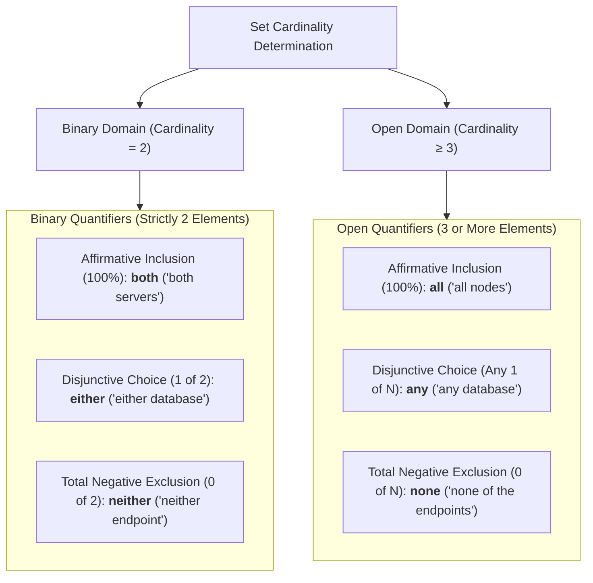
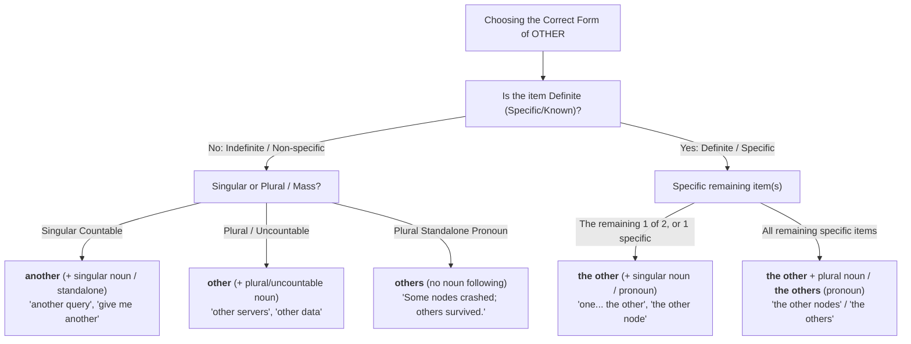

# Alternative Quantifiers: Both, Either, Neither, Other, Another 🔄⚖️

> **Level:** CEFR B1–B2 (Binary vs. Non-Binary Alternation)  
> **Primary References:** Raymond Murphy (*English Grammar in Use*, Units 89–90); Michael Swan (*Practical English Usage*, §13, 222–234)  
> **Core Concept:** English strictly distinguishes between **binary sets** (exactly two entities: *both, either, neither*) and **open/unbounded sets** (three or more entities: *all, any, none*), alongside precise morphological rules governing **incremental or contrastive alternation** (*another, other, others, the other, the others*).

---

## 1. The Binary vs. Non-Binary Scope Architecture

In English syntax, selecting the wrong quantifier when referring to a set of exactly two items creates a semantic error:



> [!WARNING]
> Never use *all*, *any*, or *none* when the discourse context has established exactly two entities.
> - ❌ *None of my two microservices is responding.*
> - ✅ * **Neither** of my two microservices is responding.*
> - ❌ *You can pick all of the two options.*
> - ✅ *You can pick **both** of the two options.*

---

## 2. Syntax & Mechanics of `Both`, `Either`, and `Neither`

### 1. Syntactic Distribution Matrix

| Form | Direct Determiner (+ Noun) | Pronoun (+ `of the/these/my` + Plural Noun) | Standalone Pronoun | Verb Concord |
| :--- | :--- | :--- | :--- | :--- |
| **`Both`** | `both` + **plural noun**<br>*(both clusters)* | `both (of)` + plural NP / object pronoun<br>*(both of the clusters / both of them)* | Takes plural reference directly | **Always Plural** |
| **`Either`** | `either` + **singular count noun**<br>*(either algorithm)* | `either of` + plural NP / object pronoun<br>*(either of the algorithms / either of us)* | Refers to one of two | **Singular** (Formal)<br>Plural (Informal) |
| **`Neither`** | `neither` + **singular count noun**<br>*(neither server)* | `neither of` + plural NP / object pronoun<br>*(neither of the servers / neither of them)* | Refers to zero of two | **Singular** (Formal)<br>Plural (Informal) |

### 2. Concord and Subject-Verb Agreement Rules

1. **`Both` always takes a plural verb:**
   - *Both configurations **are** valid.*
   - *Both of the pull requests **have** passed code review.*

2. **`Either` and `Neither` with singular nouns take a singular verb:**
   - *Either option **is** acceptable to the tech lead.*
   - *Neither solution **meets** our latency requirements.*

3. **`Either of` / `Neither of` + Plural Noun:**
   - In formal writing, architecture documents, and academic prose, use a **singular verb**:
     - *Neither of the microservices **is** deployed yet.* (Strict grammatical standard).
     - *Either of the proposed designs **fulfills** the contract.*
   - In informal everyday speech, plural verbs frequently occur (*Neither of them are ready*), but technical documentation should strictly preserve singular concord.

### 3. Correlative Conjunction Pairs
- **`Both ... and ...`** connects two coordinated syntactic elements (plural verb):
  - *The load balancer supports **both** HTTP/2 **and** gRPC.*
- **`Either ... or ...`** expresses exclusive alternative:
  - *The client must provide **either** an API key **or** an OAuth Bearer token.*
  - **Agreement rule of proximity:** The verb agrees with the closer subject:
    - *Either the primary server or the backup **nodes are** handling traffic.*
    - *Either the backup nodes or the primary **server is** handling traffic.*
- **`Neither ... nor ...`** expresses joint negation (no negative verb needed):
  - * **Neither** the lead architect **nor** the senior developers **were** notified.*
  - *The compiler threw an error because **neither** the header file **nor** the library **was** linked.*

---

## 3. The `Other` Family: `Another` vs. `Other` vs. `Others` vs. `The Other(s)`

Learners frequently confuse the morphology of *other*. The choice depends on **countability**, **definiteness**, and whether the word is operating as a **determiner** (modifying a noun) or an independent **pronoun**.



### Morphological Matrix

| Form | Part of Speech | Noun Combination | Example Sentence |
| :--- | :--- | :--- | :--- |
| **`Another`** | Determiner or Pronoun | Singular Countable ONLY (`an` + `other`) | *We need **another** instance of Redis.* / *This token expired; generate **another**.* |
| **`Other`** | Determiner ONLY | Plural Countable or Uncountable Nouns | *Are there **other** parameters we should benchmark?* / *We need **other** information.* |
| **`Others`** | Pronoun ONLY (plural) | **NEVER** followed by a noun | *Some pipelines succeeded; **others** failed on integration.* |
| **`The other`** | Determiner or Pronoun | Singular or Plural Specific Noun | *One pod is healthy; **the other** pod is crashing.* / *Where is **the other** cable?* |
| **`The others`** | Pronoun ONLY (plural) | Specific remaining group; **NEVER** followed by a noun | *Three engineers approved; **the others** haven't reviewed yet.* |

> [!CAUTION]
> 1. **Never pluralize `other` when it is an adjective/determiner modifying a noun!**
>    - ❌ *We should test the others components.*
>    - ✅ *We should test the **other** components.*
>    - ✅ *We should test the **others**.*
> 2. **Never use `another` with plural or uncountable nouns (except with numbers):**
>    - ❌ *We received another informations.*
>    - ✅ *We received **other** information.*
>    - ✅ *We need **another three** days.* (Permissible because *three days* functions as a single temporal unit).

---

## 4. Practical Dual-Domain Examples

### Everyday Conversation

1. *Do you want tea or coffee? — **Either** is fine with me, thank you.*
2. *I tried calling both of your numbers, but **neither** was reachable.*
3. * **Both** my brother and I enjoy playing tennis on weekends.*
4. *Could I have **another** glass of water, please?*
5. *Some people prefer reading physical books, while **others** prefer e-readers.*
6. *I found one of my running shoes, but I can't find **the other**.*
7. *Two guests arrived early, and **the others** are coming around 7 PM.*
8. *We don't need to decide tonight; we have **other** days to discuss this.*

### Software Engineering & Technical Documentation

9. *The cluster runs in dual availability zones; **both** regions maintain active-passive replicas.*
10. * **Neither** database replica has synchronized the latest change log.*
11. *You can deploy using **either** Docker Compose **or** Helm charts.*
12. *If the primary broker disconnects, the consumer automatically switches to **the other** broker.*
13. *The first two unit tests passed, but all **the other** tests failed due to mock misconfiguration.*
14. * **Both** TLS 1.2 and TLS 1.3 are supported, but **neither** SSLv3 nor TLS 1.0 is permitted.*
15. *One microservice uses REST; **the others** communicate via asynchronous RabbitMQ messages.*
16. *The scheduler requires **another** worker thread to process queued background jobs.*
17. *We evaluated AWS and GCP; **either** cloud provider satisfies our compliance constraints.*
18. *Some developers favor functional paradigms, whereas **others** advocate strict object-oriented patterns.*

---

## 5. Common Antipatterns & Diagnostic Table

| Incorrect Antipattern | Corrected Grammar | Rule & Explanation |
| :--- | :--- | :--- |
| ❌ *None of the two servers is active.* | ✅ * **Neither** of the two servers is active.* | Use *neither* for binary sets (2 items). *None* is restricted to 3 or more. |
| ❌ *Any of my parents can sign the form.* | ✅ * **Either** of my parents can sign the form.* | Humans have 2 biological parents; binary choice requires *either*, not *any*. |
| ❌ *Neither the frontend nor backend are updated.* | ✅ *Neither the frontend nor backend **is** updated.* | Proximity concord: singular noun (*backend*) nearest the verb takes a singular verb. |
| ❌ *We should check the others logs.* | ✅ *We should check the **other** logs.* | Adjectives/determiners in English never take plural *-s*. *Others* is strictly an independent pronoun. |
| ❌ *Let's discuss another topics tomorrow.* | ✅ *Let's discuss **other** topics tomorrow.* | *Another* = *an* + *other*; it can only modify singular countable nouns. |
| ❌ *We need another advices from the architect.* | ✅ *We need **more** advice / **other** advice.* | *Advice* is uncountable mass. *Another* requires singular countable nouns. |
| ❌ *Both didn't pass the validation.* | ✅ * **Neither** passed the validation.* | Natural English avoids *both + negative verb*; use *neither + affirmative verb*. |

---

## 6. Self-Assessment Exercises

### Exercise 1: Binary vs. Open Choice
Choose between **both, either, neither, all, any, none**:

1. We compared PostgreSQL and MySQL. ________ database met our sub-millisecond latency requirement. (Neither / None)
2. A smartphone screen displays ________ portrait or landscape mode depending on device orientation. (either / any)
3. The system administrator inspected the twelve cluster nodes and confirmed that ________ of them were compromised. (neither / none)
4. ________ Alice and Bob have submitted their pull requests for review. (Both / All)
5. You can select ________ of the two authentication mechanisms provided. (either / any)

### Exercise 2: `Other`, `Others`, `Another`, `The Other`, `The Others`
Fill in the correct form:

6. One replica is stationed in Frankfurt, and ________ replica is located in Dublin.
7. We have resolved five vulnerabilities, but several ________ security alerts remain open.
8. This worker process crashed; let's spawn ________ process immediately.
9. Some engineers prefer remote work, while ________ thrive in an office environment.
10. Ten microservices are deployed; two are healthy, but ________ are failing health checks.

<details>
<summary>View Complete Answer Key & Diagnostic Explanations</summary>

1. **Neither** — The comparison involves exactly two entities (PostgreSQL and MySQL), so negative exclusion requires *neither*, not *none*.
2. **either** — Screen orientation is a binary toggle (two states: portrait or landscape); therefore, *either* is required.
3. **none** — Twelve nodes constitute an open set (≥ 3), requiring *none*, not *neither*.
4. **Both** — Correlative pairing with *and* referring to two individuals (*Alice and Bob*).
5. **either** — The prompt explicitly limits the options to "the two authentication mechanisms".
6. **the other** — There are two specific replicas; referring to the second one requires *the other*.
7. **other** — Determiner modifying the plural noun *security alerts*.
8. **another** — Indefinite singular countable noun (*process*).
9. **others** — Standalone plural pronoun contrasting with *some engineers* (no noun follows).
10. **the others** — Standalone plural pronoun referring to the specific remainder of the ten microservices (the remaining eight).

</details>

---

## 7. Revision Flashcards

```
Q: What is the grammatical distinction between "neither" and "none"?
A: "Neither" is strictly binary (referring to 0 out of 2 entities). "None" is non-binary (referring to 0 out of 3 or more entities).

Q: Can "others" ever modify a noun directly (e.g., "others servers")?
A: No! "Others" is exclusively a pronoun. When modifying a noun, use the invariant determiner "other" ("other servers").

Q: What is the subject-verb agreement rule for "Either of the servers..." in formal technical writing?
A: In formal English, "either of" + plural noun takes a SINGULAR verb ("Either of the servers is capable of handling the load").

Q: Why is "both didn't pass" considered an unidiomatic antipattern in English?
A: Standard English prefers "neither passed" rather than using "both" with a negative verb.

Q: When can "another" be used before a plural noun?
A: Only when followed by a number or quantity expression that forms a single collective unit (e.g., "another three weeks", "another ten dollars").
```
