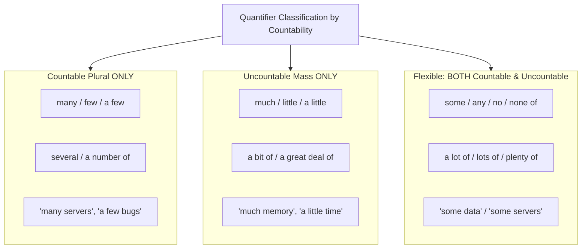
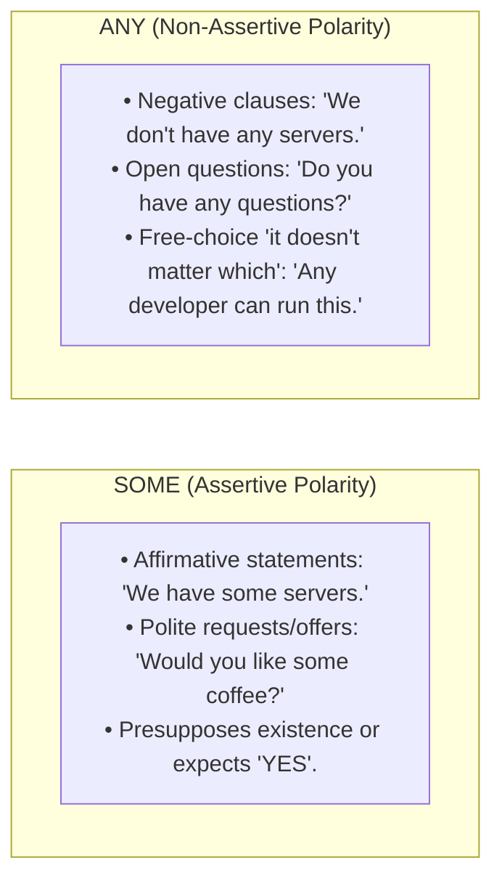
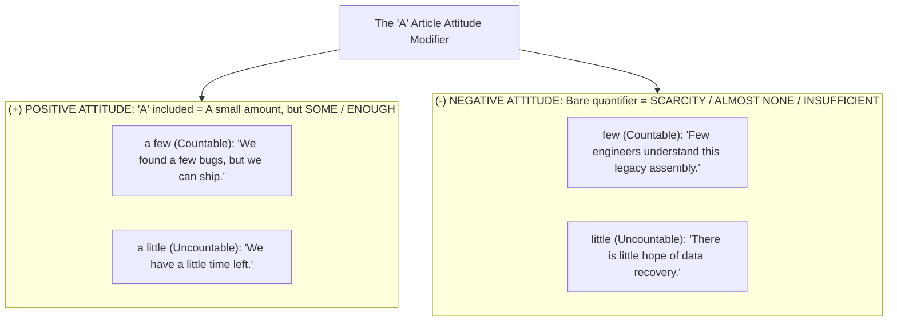
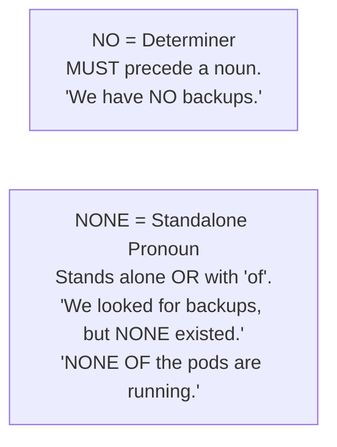

# Indefinite and Partial Quantifiers 📊⚖️

> **Level:** CEFR A2–B2 (Quantification Nuances)  
> **Primary References:** Raymond Murphy (*English Grammar in Use*, Units 85–87); Michael Swan (*Practical English Usage*, §13, 244–257)  
> **Core Concept:** Indefinite quantifiers specify incomplete quantities or subsets of a domain. Mastering them requires managing **syntactic polarity** (*some* vs. *any*), **countability alignment** (*much* vs. *many*), and **psychological attitude** (*few* vs. *a few*).

---

## 1. The Countability Alignment Matrix

English quantifiers are strictly segregated by whether their target noun is **Countable Plural** or **Uncountable Mass**:

---

## 2. Polarity: `Some` vs. `Any`

### 1. `Some` (Assertive / Positive Presupposition)
- *The pipeline identified **some** regression bugs.* (Affirmative statement).
- *Could you give me **some** advice on this architecture?* (Polite request where an affirmative answer is expected).

### 2. `Any` (Non-Assertive / Open Scope)
- *The container does not have **any** open ports.* (Negative statement with *not*).
- *Are there **any** unhandled exceptions in the log?* (Open inquiry).
- **Free-Choice `Any` (Meaning "It doesn't matter which"):**
  - * **Any** engineer with commit rights can merge this hotfix.*
  - *You can deploy this container on **any** cloud provider.*

---

## 3. The Psychological Divide: `Few` vs. `A Few` & `Little` vs. `A Little`

The inclusion or omission of the indefinite article `a` radically alters the speaker's emotional and operational evaluation:

| Quantifier | Noun Type | Semantic Value | Pragmatic Implication | Production Technical Example |
| :--- | :---: | :---: | :--- | :--- |
| **a few** | Countable | **Positive (+)** | Some; a small quantity exists. | *We resolved **a few** minor defects before release.* |
| **few** | Countable | **Negative (-)** | Scarcity; almost none; deficient. | * **Few** engineers understand this monolithic codebase.* |
| **a little**| Uncountable | **Positive (+)** | Some; a small amount is available.| *We have **a little** memory headroom remaining.* |
| **little** | Uncountable | **Negative (-)** | Deficit; almost zero; alarming. | *The server has **little** disk space left; purge logs now.*|

---

## 4. Determiner `No` vs. Standalone Pronoun `None`

- **`No` (+ Noun):** *There are **no** active connection locks.*
- **`None` (Standalone):** *We checked all worker threads, but **none** responded.*
- **`None of` (+ Determiner + Noun):** * **None of the** integration tests failed.*

---

## 5. Dual-Domain Practical Examples

### Everyday Conversational English
1. *I have **some** good news.* (Affirmative statement)
2. *Do you have **any** questions?* (Open inquiry)
3. *Would you like **some** tea?* (Polite offer)
4. *She has **a few** close friends.* (Positive small number)
5. *Unfortunately, **few** people attended the lecture.* (Negative scarcity)
6. *We have **a little** time before the train departs.* (Sufficient time)
7. *There is **little** chance of snow today.* (Almost no chance)
8. *I looked for apples, but there were **none**.* (Standalone pronoun)

### Professional Software Engineering Context
9. *The compiler generated **several** warnings, but **no** fatal errors.*  
   $\to$ Countable *several* paired with negative determiner *no*.
10. * **Few** systems can sustain 500,000 concurrent WebSocket connections without degradation.*  
    $\to$ Negative scarcity quantifier (*few*) emphasizing extreme rarity.
11. *We have **a few** minor linter issues to address before merging the pull request.*  
    $\to$ Positive quantifier (*a few*) indicating a manageable number.
12. *The server was thrashing because it had **little** free RAM available.*  
    $\to$ Uncountable scarcity quantifier (*little*) describing dangerous memory deficit.
13. * **Any** authenticated user can generate read-only API access tokens.*  
    $\to$ Free-choice *any* meaning "it doesn't matter who".
14. *We tested four candidate caching solutions, but **none of them** met our sub-millisecond SLA.*  
    $\to$ Pronoun construction *none of them*.
15. *The engineering team requires **much** patience to refactor this twenty-year-old codebase.*  
    $\to$ Uncountable quantifier *much* modifying *patience*.

---

## 6. Common Mistakes & Diagnostic Anti-Patterns

| Bug (Quantifier Defect) | Patch (Syntactically Correct) | Root Cause Diagnostic |
| :--- | :--- | :--- |
| ❌ *The server has **few memory** left.* | ✅ *The server has **little memory** left.* | *Memory* is uncountable; cannot be quantified by countable *few*. |
| ❌ *We don't have **some** servers.* | ✅ *We don't have **any** servers.* | Negative clauses require non-assertive *any*, not *some*. |
| ❌ *The engineer has **many experience**.* | ✅ *The engineer has **much experience** (or **a lot of experience**).* | *Experience* (knowledge) is uncountable; demands *much* or *a lot of*. |
| ❌ *There is **none** free port.* | ✅ *There is **no** free port.* | *None* cannot modify a noun directly; use determiner *no*. |
| ❌ *We made **few** progress.* | ✅ *We made **little** progress.* | *Progress* is uncountable; requires *little*, not *few*. |

---

## 7. Self-Assessment Practice Exercises

### Section A: Quantifier Selection & Attitude
Choose the most accurate quantifier in brackets:

1. Look at the disk gauge! There is [little / a little] space remaining; clean up old snapshots immediately!
2. Don't worry, we still have [few / a few] minutes before the maintenance window closes.
3. [Much / Many] microservices in our fleet are written in Go.
4. The incident commander asked if there were [some / any] unresolved blocker tickets.
5. We have [no / none] intention of deprecating the v2 REST API this quarter.
6. We benchmarked five database instances, but [no / none] of them passed the latency threshold.
7. [Few / A few] engineers understand how the internal garbage collector works; only two people on the team know it.
8. Would you like [some / any] help reviewing that massive pull request? (Polite offer)

### Section B: Sentence Error Spotting & Repair
Identify and correct the quantifier bugs in the following technical statements:

9. *The database does not support some unauthenticated queries.*
10. *We received many negative feedbacks from users regarding the UI update.*
11. *There was few documentation available for the legacy proprietary protocol.*
12. *We tested three caching proxies, but no met our requirements.*

---

## 8. Comprehensive Answer Key & Explanations

1. **little** — Alarming scarcity requiring immediate emergency action.
2. **a few** — Positive small number (*some minutes are left*).
3. **Many** — Modifies countable plural noun *microservices*.
4. **any** — Open question in an inquiry demands non-assertive *any*.
5. **no** — Determiner modifying the noun *intention*.
6. **none** — Pronoun construction *none of them*.
7. **Few** — Emphasizes rarity/scarcity (*only two people know it*).
8. **some** — Polite offer where a positive response is anticipated.
9. **Correction:** *The database does not support **any** unauthenticated queries.*  
   *Explanation:* Negative statements demand non-assertive *any*.
10. **Correction:** *We received **a lot of negative feedback** from users.*  
    *Explanation:* *Feedback* is uncountable; cannot be modified by *many* or pluralized.
11. **Correction:** *There was **little** documentation available for the legacy proprietary protocol.*  
    *Explanation:* *Documentation* is uncountable; demands *little*, not *few*.
12. **Correction:** *We tested three caching proxies, but **none** met our requirements.*  
    *Explanation:* Standalone subject pronoun must be *none*, not determiner *no*.

---

## 9. Revision Flashcards & Key Takeaways

- **Countable vs. Uncountable:**
  - Countable: *many, few, a few, several*.
  - Uncountable: *much, little, a little*.
- **The "A" Factor (Attitude):**
  - *a few / a little* = **Positive (+)** $\implies$ A small amount, but enough.
  - *few / little* = **Negative (-)** $\implies$ Scarcity, almost none, inadequate.
- **Some vs. Any:**
  - *Some* = Affirmative statements & polite offers (*Would you like some?*).
  - *Any* = Negatives, open questions, and free choice (*Any server will do*).
- **No vs. None:**
  - *No* + Noun (*No errors*).
  - *None* stands alone (*None were found*).
