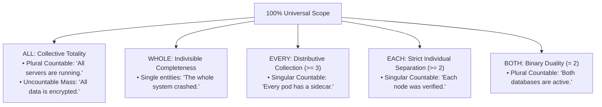
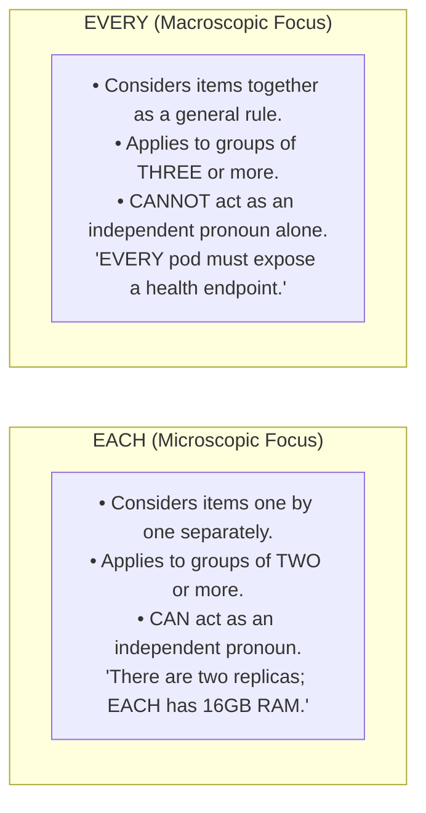

# Universal and Distributive Quantifiers: All, Every, Each, Whole, and Both 🌐🔍

> **Level:** CEFR A2–B2 (Quantification Semantics)  
> **Primary References:** Raymond Murphy (*English Grammar in Use*, Units 88–91); Michael Swan (*Practical English Usage*, §13, 232–243)  
> **Core Concept:** Universal quantifiers cover 100% of a domain. However, English grammar distinguishes between viewing items as a **Collective Whole** (*all*), an **Indivisible Entity** (*whole*), **Individuals Together** (*every*), **Separate Individuals One-by-One** (*each*), or a **Binary Pair** (*both*).

---

## 1. The Universal Quantification Matrix

| Quantifier | Noun Type Required | Verb Concord | Minimum Scope | Structural Syntactic Pattern |
| :--- | :--- | :---: | :---: | :--- |
| **All** | Plural Countable / Uncountable | **Plural / Singular** | $\ge 3$ (or mass) | `All (of the) servers are...` / `All data is...` |
| **Whole** | Singular Countable (Indivisible) | **Singular** | 1 complete entity| `The whole cluster was...` |
| **Every** | Singular Countable | **Singular** | $\ge 3$ | `Every developer writes...` |
| **Each** | Singular Countable | **Singular** | $\ge 2$ | `Each developer writes...` / `Each has...` |
| **Both** | Plural Countable | **Plural** | $= 2$ | `Both servers are...` / `Both of them are...` |

---

## 2. In-Depth Structural Rules

### 1. `All` vs. `Whole`
- **`All`** can modify plural countable nouns or uncountable mass nouns:
  - *All database connections **were** closed.* (Plural)
  - *All telemetry data **was** persisted.* (Uncountable $\implies$ singular verb).
- **`Whole`** describes an undivided single entity from start to finish. It requires a determiner (*the, a, my*) **before** it:
  - ❌ *We refactored all system.* (Unnatural)
  - ✅ *We refactored **the whole system**.*
  - ✅ *We refactored **all of the system**.*
  - ❌ *the all week* $\implies$ ✅ ***the whole week*** / ***all week***.

### 2. `Each` vs. `Every` (The Distributive Contrast)

> [!CRITICAL]
> **The Concord Invariant:**
> Both **each** and **every** strictly govern a **Singular Countable Noun** and a **Singular Verb**:
> - ❌ *Every developers have laptops.*
> - ✅ *Every **developer has** a laptop.*
> - ❌ *Each microservices are independent.*
> - ✅ *Each **microservice is** independent.*

### 3. `Both` (The Binary Duality Operator)
Applies strictly to exactly **two** entities. It takes a plural verb:
- *Both APIs **support** GraphQL.*
- * **Both of the** cluster regions **are** operational.*
- Negative duality is expressed by **neither**, never *both not*:
  - ❌ *Both servers are not responding.*
  - ✅ * **Neither** server is responding.*

---

## 3. The "Each of" Construction

When followed by *of + plural noun phrase*, **each** retains its strict singular grammatical concord:

$$\mathbf{Each\ of} + \mathbf{the/these/our} + \mathbf{Plural\ Noun} \implies \mathbf{Singular\ Verb}$$

- *Each of the worker nodes **maintains** a local heartbeat.* (Singular verb *maintains*).
- *Each of the proposed architectures **has** trade-offs.* (Singular verb *has*).

---

## 4. Dual-Domain Practical Examples

### Everyday Conversational English
1. * **All** students must register online.* (Plural totality)
2. *I spent **the whole** day reading.* (Entirety of a single day)
3. * **Every** child received a present.* (Singular *every*)
4. *There were four books, and **each** was signed by the author.* (Pronoun *each*)
5. * **Both** my sisters are doctors.* (Binary *both*)
6. *She checked **each** door carefully.* (Separate one-by-one verification)
7. * **All of the** milk was spilled.* (Uncountable mass)
8. *He ate **a whole** pizza by himself.* (Complete single entity)

### Professional Software Engineering Context
9. * **All** microservices must enforce mutual TLS encryption.*  
   $\to$ Plural collective universal statement (*all microservices*).
10. * **The whole** datacenter lost power during the thunderstorm.*  
    $\to$ Complete entity entirety (*the whole datacenter*).
11. * **Every** API request requires a valid bearer token in the headers.*  
    $\to$ Singular distributive modifier *every* governing singular verb *requires*.
12. *There are three availability zones; **each** operates on an isolated electrical grid.*  
    $\to$ Independent distributive pronoun *each* governing singular verb *operates*.
13. * **Both** PostgreSQL and MySQL satisfy our transactional ACID requirements.*  
    $\to$ Binary duality operator *both ... and*.
14. *Each of the database replicas **synchronizes** asynchronously with the master.*  
    $\to$ Construction *Each of + plural noun* governing singular verb *synchronizes*.
15. *The infrastructure team spent **the whole** sprint resolving technical debt.*  
    $\to$ Entirety of a single sprint period.

---

## 5. Common Mistakes & Diagnostic Anti-Patterns

| Bug (Quantifier Scope Error) | Patch (Syntactically Correct) | Root Cause Diagnostic |
| :--- | :--- | :--- |
| ❌ * **Every** microservices **are** containerized.* | ✅ * **Every** microservice **is** containerized.* | *Every* demands a singular countable noun and singular verb. |
| ❌ *Each of the nodes **have** 32 GB RAM.* | ✅ *Each of the nodes **has** 32 GB RAM.* | The subject is singular *Each*, which dictates singular verb *has*. |
| ❌ *We refactored **all system**.* | ✅ *We refactored **the whole system** (or **all of the system**).* | *All* cannot precede a singular countable noun without *of the*; use *the whole*. |
| ❌ * **Both** servers are **not** online.* | ✅ * **Neither** server **is** online.* | Standard English rejects *both not*; negative duality requires *neither*. |
| ❌ *There were two clusters; **every** was tested.* | ✅ *There were two clusters; **each** was tested.* | *Every* cannot stand alone as a pronoun, nor can it apply to a pair of two; use *each*. |

---

## 6. Self-Assessment Practice Exercises

### Section A: Quantifier Selection & Concord
Fill in the blanks with **all, every, each, whole,** or **both**:

1. [____] of the two database nodes must be upgraded tonight.
2. The team spent the [____] sprint refactoring the payment gateway.
3. [____] pull request requires at least two peer approvals before merging.
4. There are three staging clusters; [____] possesses an independent VPC.
5. [____] of the telemetry data was encrypted at rest.
6. [____] developers on our platform engineering team use Linux.

### Section B: Sentence Error Spotting & Repair
Identify and correct the quantifier bugs in the following statements:

7. *Every integration tests must pass before the deployment pipeline continues.*
8. *Each of the microservice expose a Prometheus metrics endpoint.*
9. *Both of the network switches does not support 100 Gbps Ethernet.*
10. *We reviewed all document from start to finish.*
11. *There were two applicants for the senior role, and every had strong Python skills.*
12. *Each database replicas have been synchronized.*

---

## 7. Comprehensive Answer Key & Explanations

1. **Both** — Strictly refers to the binary count of two nodes.
2. **whole** — Preceded by *the*; denotes the entire single sprint period.
3. **Every** (or **Each**) — Singular countable noun *pull request* demands singular *Every/Each*.
4. **each** — Independent standalone pronoun referring to items one by one.
5. **All** — Modifies uncountable mass noun *data* (*All of the data*).
6. **All** — Modifies plural countable noun *developers*.
7. **Correction:** * **Every integration test must pass** before the deployment pipeline continues.*  
   *Explanation:* *Every* demands singular noun *test* (not *tests*).
8. **Correction:** *Each of the **microservices exposes** a Prometheus metrics endpoint.*  
   *Explanation:* Plural noun after *of the* (*microservices*), but singular verb governed by *Each* (*exposes*).
9. **Correction:** * **Neither of the network switches supports** 100 Gbps Ethernet.*  
   *Explanation:* Replace ungrammatical *both not* with negative dual quantifier *neither*.
10. **Correction:** *We reviewed **the whole document** (or **all of the document**).*  
    *Explanation:* Singular entity completeness requires *the whole document*.
11. **Correction:** *There were two applicants for the senior role, and **each** had strong Python skills.*  
    *Explanation:* Groups of two demand *each*, which can function independently as a pronoun.
12. **Correction:** *Each database **replica has** been synchronized.*  
    *Explanation:* *Each* governs singular noun *replica* and singular verb *has*.

---

## 8. Revision Flashcards & Key Takeaways

- **The Singular Invariants:** $\mathbf{Every} + \mathbf{Noun_{sg}} + \mathbf{Verb_{sg}}$ and $\mathbf{Each} + \mathbf{Noun_{sg}} + \mathbf{Verb_{sg}}$.
- **Each of the + Plural Noun:** Still demands a **singular verb** (*Each of the servers is healthy*).
- **All vs Whole:**
  - *All* + Plural / Uncountable (*All servers*, *All data*).
  - *The whole* + Singular entity (*The whole system*, *The whole sprint*).
- **Both:** Strictly for two entities. Negative of two is **neither** (never *both not*).
- **Pronoun Capability:** *Each* can stand alone as a pronoun (*Each has its own key*); *Every* must precede a noun or combine with *-one / -thing* (*everyone, everything*).
