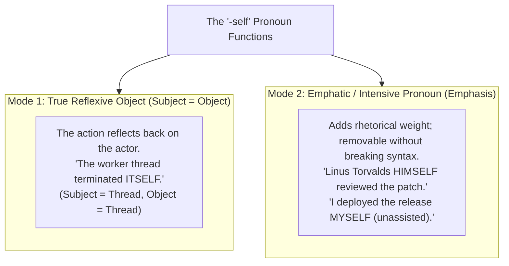
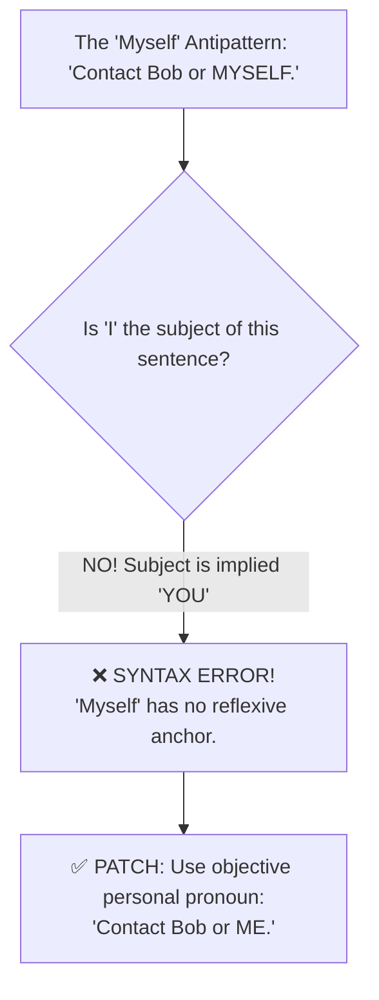
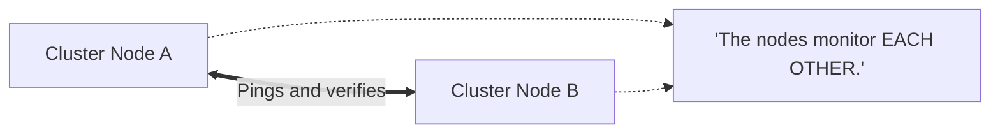

# Reflexive and Reciprocal Pronouns 🔁🤝

> **Level:** CEFR A2–B1 (Reference Loops)  
> **Primary References:** Raymond Murphy (*English Grammar in Use*, Unit 82); Michael Swan (*Practical English Usage*, §14, 266–267)  
> **The Golden Law:** A **reflexive pronoun** is syntactically permitted **only** when the object of the clause is identical to the subject ($\mathbf{Subject = Object}$). Using *myself* where there is no preceding *I* in the clause is a rampant grammatical defect.

---

## 1. Intent & The Two Behavioral Modes of `-self` Pronouns

Reflexive forms (*myself, yourself, himself, herself, itself, ourselves, yourselves, themselves*) perform two distinct grammatical operations:

---

## 2. The Complete Reflexive & Intensive Declension

| Person | Singular Form | Plural Form |
| :--- | :--- | :--- |
| **1st Person** | **myself** (*I fixed it myself*) | **ourselves** (*We managed it ourselves*) |
| **2nd Person** | **yourself** (*You should protect yourself*) | **yourselves** (*Did you all see yourselves?*) |
| **3rd Person Masc.** | **himself** (*He taught himself Rust*) | **themselves** (*The nodes sync themselves*) |
| **3rd Person Fem.** | **herself** (*She authorized it herself*) | **themselves** (*The nodes sync themselves*) |
| **3rd Person Neuter** | **itself** (*The server restarted itself*) | **themselves** (*The nodes sync themselves*) |
| **Generic / Impersonal**| **oneself** (*To preserve oneself*) | — |

> [!WARNING]
> **Morphological Bugs:**
> The forms *theirself, theirselves,* and *hisself* are non-standard dialectal errors. Always use **themselves** and **himself**.

---

## 3. The Corporate "Myself" Antipattern

In business correspondence and software reviews, non-native and native speakers alike frequently misuse *myself* under the false impression that it sounds more formal or humble than *me*:

### Diagnostic Comparison:
- ❌ *If you have questions, reach out to Sarah or **myself**.* (Bug: Subject is *you*; *myself* has no referent).
- ✅ *If you have questions, reach out to Sarah or **me**.*
- ❌ *The architecture was reviewed by Bob and **myself**.*
- ✅ *The architecture was reviewed by Bob and **me**.*
- ✅ * **I** reviewed the architecture **myself**.* (Valid: *I* is the subject).

---

## 4. Reciprocal Pronouns: *Each Other* vs. *One Another*

**Reciprocal pronouns** denote a two-way mutual action where entity $A$ acts upon $B$, and entity $B$ acts upon $A$:

$$\mathbf{A} \longleftrightarrow \mathbf{B}$$

1. **`Each other`:** Traditionally used for two entities:
   - *The primary database and the standby replica ping **each other** every second.*
2. **`One another`:** Traditionally used for three or more entities:
   - *All nodes in the distributed Raft cluster communicate with **one another**.*
3. **Possessive Reciprocals (`-'s`):**
   - *The microservices monitor **each other's** health endpoints.* (Not *each others'*).

---

## 5. Idiomatic Phrasing: *By myself* vs. *On my own*

Both expressions mean **alone** or **without assistance**:
- *The script executed **by itself**.* (Automatically; without human intervention).
- *I refactored the legacy module **on my own**.* (Without help from colleagues).

---

## 6. Dual-Domain Practical Examples

### Everyday Conversational English
1. *Be careful with that knife; you might cut **yourself**.* (Reflexive)
2. *She looked at **herself** in the mirror.* (Reflexive)
3. *The president **himself** signed the order.* (Emphatic)
4. *They looked at **each other** and laughed.* (Reciprocal)
5. *I live **by myself** in a small apartment.* (Alone)
6. *Did you bake this cake **yourself**?* (Unassisted)
7. *We enjoyed **ourselves** at the party.* (Idiomatic reflexive)
8. *The team members trust **one another**.* (Reciprocal)

### Professional Software Engineering Context
9. *When the container runs out of memory, the process terminates **itself**.*  
   $\to$ True reflexive: subject *process* acts upon object *itself*.
10. *The principal architect **himself** authored the core consensus algorithm.*  
    $\to$ Emphatic intensive pronoun adding rhetorical prestige.
11. *The two Redis instances synchronize with **each other** over TLS.*  
    $\to$ Reciprocal relationship between two database nodes.
12. *If you encounter merge conflicts, ping Sarah or **me** on Slack.*  
    $\to$ Correct objective pronoun *me* (avoiding the *myself* bug).
13. *The distributed worker threads coordinate with **one another** via a distributed lock.*  
    $\to$ Reciprocal pronoun for multi-node clusters.
14. *The self-healing cluster recovered **by itself** within twenty seconds.*  
    $\to$ *By itself* denoting automated execution without human intervention.
15. *The microservices validate **each other's** cryptographic tokens.*  
    $\to$ Possessive reciprocal form (*each other's*).

---

## 7. Common Mistakes & Diagnostic Anti-Patterns

| Bug (Ungrammatical Construction) | Patch (Syntactically Correct) | Root Cause Diagnostic |
| :--- | :--- | :--- |
| ❌ *Please submit the pull request to **myself**.* | ✅ *Please submit the pull request to **me**.* | **Corporate Myself Trap:** Subject is implied *you*; *myself* cannot be used as a polite object. |
| ❌ *The nodes sync **theirselves**.* | ✅ *The nodes sync **themselves**.* | *Theirselves* is a non-standard morphological error; use *themselves*. |
| ❌ *The servers monitor **each others** health.* | ✅ *The servers monitor **each other's** health.* | Possessive reciprocal requires apostrophe before `-s` (*each other's*). |
| ❌ *The engineer fixed it by **himself alone**.* | ✅ *The engineer fixed it **by himself** (or **alone**).* | Redundancy: *by himself* already means *alone*. |
| ❌ *John and **myself** will lead the sprint.* | ✅ *John and **I** will lead the sprint.* | Subject position requires nominative pronoun *I*. |

---

## 8. Self-Assessment Practice Exercises

### Section A: Reflexive vs. Personal Pronoun Selection
Select the correct pronoun in brackets:

1. If you need assistance with the deployment, notify Bob or [me / myself].
2. The platform engineer taught [him / himself] Rust over the weekend.
3. The CEO [himself / hisself] attended our postmortem review.
4. This pull request was approved by the tech lead and [me / myself].
5. The container orchestrator restarts [it / itself] whenever a panic occurs.
6. The two microservices exchange JWTs with [each other / one other].

### Section B: Sentence Error Spotting & Repair
Identify and correct the reflexive/reciprocal errors in the following statements:

7. *You can direct any architectural questions to Dave or myself.*
8. *The cluster nodes ping theirselves every five seconds.*
9. *Me and myself built this automated testing harness.*
10. *The services validate each others' configuration files.*
11. *The developer was proud of him for solving the concurrency bug.* (Self-directed pride)
12. *The background worker terminated it after completing the batch.* (Self-termination)

---

## 9. Comprehensive Answer Key & Explanations

1. **me** — Direct object of *notify*; *myself* has no subject anchor *I*.
2. **himself** — Subject *engineer* and object are identical $\implies$ reflexive *himself*.
3. **himself** — Emphatic intensifier; *hisself* is non-standard.
4. **me** — Preposition *by* demands objective pronoun *me*.
5. **itself** — Reflexive loop: the orchestrator restarts its own process.
6. **each other** — Reciprocal pronoun denoting mutual exchange.
7. **Correction:** *You can direct any architectural questions to Dave or **me**.*  
   *Explanation:* Preposition *to* demands objective pronoun *me*.
8. **Correction:** *The cluster nodes ping **themselves** every five seconds.*  
   *Explanation:* Standard 3rd-person plural reflexive is *themselves*.
9. **Correction:** * **I** built this automated testing harness **myself**.*  
   *Explanation:* Subject *I* + emphatic intensifier *myself*.
10. **Correction:** *The services validate **each other's** configuration files.*  
    *Explanation:* Possessive reciprocal is *each other's* (apostrophe before *s*).
11. **Correction:** *The developer was proud of **himself** for solving the concurrency bug.*  
    *Explanation:* Subject *The developer* refers to the same person; requires reflexive *himself*.
12. **Correction:** *The background worker terminated **itself** after completing the batch.*  
    *Explanation:* Self-terminating action requires reflexive pronoun *itself*.

---

## 10. Revision Flashcards & Key Takeaways

- **The Reflexive Invariant:** $\mathbf{Subject = Object} \implies \mathbf{\text{-}self\ form}$ (*I hurt myself*, *The process killed itself*).
- **The "Myself" Trap:** Never say *"Contact myself"* or *"Between John and myself"*. Always use **me**.
- **Emphatic Intensifiers:** *The architect herself approved it* (adds rhetorical weight, but grammatically removable).
- **Reciprocal Action:**
  - *each other* = two entities acting mutually.
  - *one another* = three or more entities.
  - Possessive: *each other's* (apostrophe before *s*).
