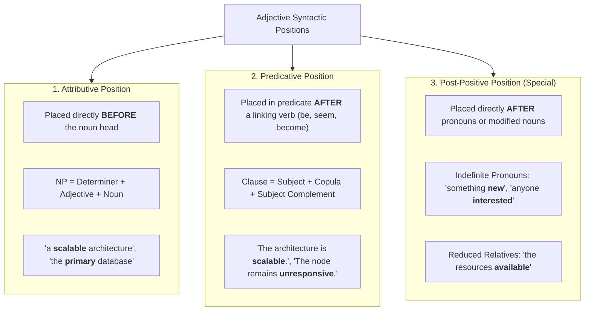
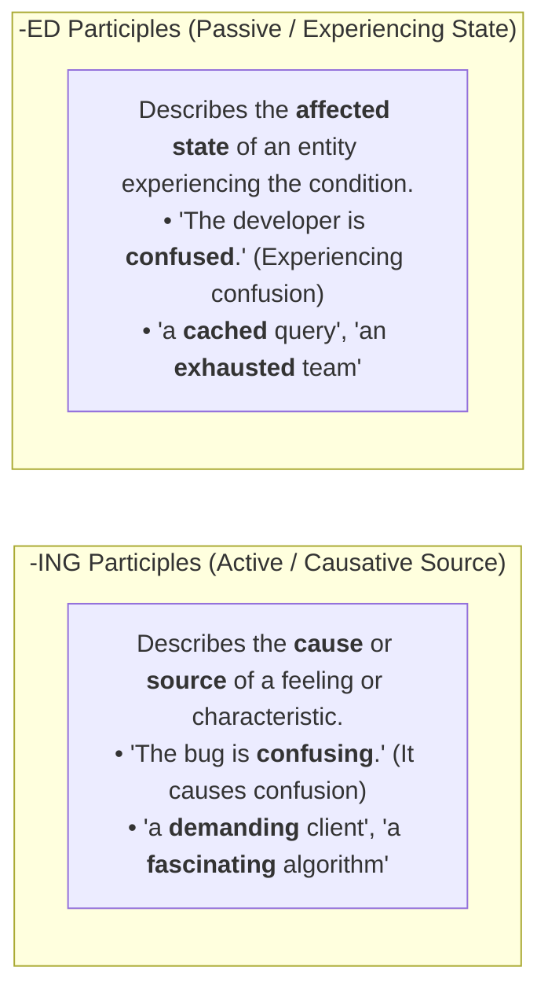

# Attributive and Predicative Adjectives (and Participial -ed/-ing Forms) 🏷️🔍

> **Level:** CEFR A2–B2 (Positional Syntax & Participles)  
> **Primary References:** Raymond Murphy (*English Grammar in Use*, Units 98–99); Michael Swan (*Practical English Usage*, §15.1–15.3, §10.2)  
> **Core Concept:** Adjectives occupy two primary structural positions in English syntax: **attributive** (positioned inside the noun phrase before the noun) and **predicative** (positioned in the predicate after a linking copular verb). Additionally, **participial adjectives** encode a fundamental distinction between the **source** of a quality (*-ing*) and the **affected experiencer/state** (*-ed*).

---

## 1. Syntactic Positions of Adjectives



---

## 2. Positionally Restricted Adjectives

While most English adjectives are **central** (capable of appearing in both attributive and predicative positions, e.g., *a fast query* / *the query is fast*), certain classes are restricted strictly to one syntactic position.

### 1. Predicative-Only Adjectives
Adjectives that can **only** follow a linking verb and cannot precede a noun directly. Many begin with the prefix `a-`:

| Predicative-Only Form | ❌ Incorrect Attributive | ✅ Correct Attributive Alternative |
| :--- | :--- | :--- |
| **`alive`** | ❌ *an alive process* | ✅ *a **running / active / live** process* |
| **`asleep`** | ❌ *an asleep technician* | ✅ *a **sleeping** technician* |
| **`awake`** | ❌ *an awake monitor* | ✅ *an **alert / awake** monitor* (or *the monitor is awake*) |
| **`alone`** | ❌ *the alone server* | ✅ *the **solitary / isolated** server* |
| **`afraid`** | ❌ *an afraid engineer* | ✅ *a **fearful** engineer* (or *the engineer is afraid*) |
| **`ashamed`** | ❌ *an ashamed developer* | ✅ *an **embarrassed** developer* |
| **`aware`** | ❌ *an aware team* | ✅ *a **cognizant / informed** team* |
| **`unable`** | ❌ *an unable worker* | ✅ *an **incapable** worker* (or *the worker was unable to...*) |
| **`glad` / `pleased`** | ❌ *a glad customer* | ✅ *a **happy / satisfied** customer* |

- *The background worker is still **alive**.* (Predicative ✅)
- ❌ *We terminated the alive background worker.* (Attributive error!)
- ✅ *We terminated the **active** background worker.*

### 2. Attributive-Only Adjectives
Adjectives that can **only** precede a noun and cannot function as standalone subject complements after a linking verb:

| Attributive Category | Examples | Attributive Use | ❌ Predicative Error |
| :--- | :--- | :--- | :--- |
| **Emphasizing / Intensifying** | *sheer, utter, pure, total, absolute, outright* | *It was **sheer** coincidence.* | ❌ *The coincidence was sheer.* |
| **Classifying / Categorical** | *atomic, chemical, main, principal, chief, primary* | *This is our **main** data center.* | ❌ *This data center is main.* |
| **Temporal / Identifying** | *former, latter, eventual, future, previous, sole* | *The **former** tech lead resigned.* | ❌ *The tech lead is former.* |

---

## 3. Participial Adjectives: `-ed` vs. `-ing`

Participial adjectives derive from verbs and encode grammatical **voice and causality**:



### Contrast Matrix

| Root Verb | Active Cause / Property (`-ing`) | Experiencing State / Completed Effect (`-ed`) |
| :--- | :--- | :--- |
| **confuse** | *The stack trace is **confusing**.* | *The junior developer was **confused** by the stack trace.* |
| **exhaust** | *Debugging concurrency bugs is **exhausting**.* | *The team was **exhausted** after the overnight outage.* |
| **satisfy** | *The benchmark results were **satisfying**.* | *The client was **satisfied** with the performance boost.* |
| **bore** | *The documentation was dry and **boring**.* | *The trainees grew **bored** during the lecture.* |
| **surprise** | *The sudden traffic spike was **surprising**.* | *We were **surprised** by the zero error rate.* |
| **lock** | *a **locking** mechanism* (the mechanism that locks) | *a **locked** database record* (the record affected by a lock) |
| **cache** | *a **caching** layer* (the layer performing caching) | *the **cached** response* (the payload that has been cached) |

---

## 4. Post-Positive Adjectives (Special Syntactic Positions)

In specific syntactic contexts, adjectives follow the noun or pronoun:

### 1. Indefinite Pronouns (`-thing`, `-body`, `-one`, `-where`)
Adjectives modifying compound indefinite pronouns **must** follow the pronoun:
- *We need **someone senior** to review this cryptographic logic.* (❌ NOT: *a senior someone*)
- *Is there **anything unusual** reported in the system logs?*
- *Let's deploy to **somewhere safe** before rolling out globally.*

### 2. Reduced Relative Clauses with Adjectives of Availability
Adjectives expressing temporary status or availability (*available, present, involved, concerned*) can appear post-positively:
- *We examined all **the nodes available** in region `us-east-1`.*  
  (= *...all the nodes [that were] available...*)
- *The **engineers present** voted unanimously to approve the release.*  
  (*The present engineers* = current/now serving; *The engineers present* = physically attending the meeting).
- *The **parties concerned** agreed on the data processing agreement.*

---

## 5. Practical Dual-Domain Examples

### Everyday Conversation

1. *I was **embarrassed** when I forgot my colleague's name.*
2. *The movie was deeply **disappointing**, but the acting was commendable.*
3. *The children were **asleep** when the storm began.*
4. *There is **nothing interesting** on television tonight.*
5. *She is an **utter** genius when it comes to solving puzzles.*
6. *Are you **aware** of the road closures downtown?*
7. *He bought a **used** car that runs like brand new.*
8. *We are **glad** to hear that your flight landed safely.*

### Software Engineering & Technical Documentation

9. *The database engine maintains an **in-memory** table for **frequently accessed** records.*
10. *The primary node remained **unresponsive** for thirty seconds before triggering automated failover.*
11. *Our **chief** objective this sprint is eliminating memory leaks in the telemetry daemon.*
12. *The architecture relies on a **non-blocking** event loop to handle concurrent I/O requests.*
13. *It was **sheer** luck that the network partition did not cause data loss.*
14. *The API gateway filters out **malformed** JSON requests before forwarding.*
15. *All **patches applied** during maintenance were thoroughly verified against staging.*
16. *The microservice returns a `503 Service Unavailable` status code if the backend is **overloaded**.*
17. *We need **something lightweight** to handle metrics aggregation on edge devices.*
18. *The **monitoring** agent detected five **zombie** processes on the worker node.*

---

## 6. Common Antipatterns & Diagnostic Table

| Incorrect Antipattern | Corrected Grammar | Rule & Explanation |
| :--- | :--- | :--- |
| ❌ *We terminated the asleep worker.* | ✅ *We terminated the **sleeping / idle** worker.* | *Asleep* is an `a-` adjective restricted to predicative position. Use *sleeping* or *idle* attributively. |
| ❌ *The reason was main.* | ✅ *The **main reason** was network latency.* | *Main* is an attributive-only classifying adjective; it cannot stand as a predicate complement. |
| ❌ *The explanation was very confused.* | ✅ *The explanation was very **confusing**.* | The explanation is the active *source* of confusion; use the `-ing` participle. |
| ❌ *I am very interesting in distributed systems.* | ✅ *I am very **interested** in distributed systems.* | The person is the affected experiencer of interest; use the `-ed` participle. |
| ❌ *We need a new something for our stack.* | ✅ *We need **something new** for our stack.* | Adjectives modifying indefinite pronouns (*something, anything*) must follow post-positively. |
| ❌ *The alone instance crashed.* | ✅ *The **isolated / single** instance crashed.* | *Alone* cannot precede a noun; use *isolated, single*, or say *the instance was alone*. |
| ❌ *The query performance is utter slow.* | ✅ *The query performance is **utterly** slow.* | Adjectives modify nouns. Modifying an adjective (*slow*) requires an adverb (*utterly*). |

---

## 7. Self-Assessment Exercises

### Exercise 1: Attributive vs. Predicative Constraints
Identify whether the sentence is grammatically valid. If invalid, correct the italicized word:

1. The *alive* organisms were analyzed in the laboratory environment.
2. The network downtime was an *utter* disaster for our quarterly SLA.
3. Our strategy was *principal* during the early growth phase.
4. The engineer was *unable* to reproduce the race condition locally.
5. We noticed an *asleep* daemon thread holding the database mutex.

### Exercise 2: `-ed` vs. `-ing` Participles
Choose the correct participial adjective:

6. The error logs contain a (frustrated / frustrating) amount of cryptic hex codes.
7. The tech lead was (pleased / pleasing) with the test coverage metrics.
8. We introduced an asynchronous (locking / locked) protocol for distributed consensus.
9. Several (exhausted / exhausting) developers stayed up all night to mitigate the DDoS attack.
10. The security team published a report detailing a (worrying / worried) vulnerability in OpenSSL.

<details>
<summary>View Complete Answer Key & Diagnostic Explanations</summary>

1. **Invalid** — *Alive* is predicative-only. Correction: *The **living** organisms were analyzed...*
2. **Valid** — *Utter* is an attributive-only intensifier modifying the noun *disaster*.
3. **Invalid** — *Principal* is attributive-only. Correction: *Our **principal strategy** was...* (or *Our strategy was paramount / primary*).
4. **Valid** — *Unable* is a predicative-only adjective following the copular verb *was*.
5. **Invalid** — *Asleep* cannot modify a noun attributively. Correction: *...an **idle / sleeping** daemon thread...*
6. **frustrating** — The cryptic codes are the active source causing frustration (`-ing`).
7. **pleased** — The tech lead is the experiencer feeling satisfaction (`-ed`).
8. **locking** — The protocol performs the action of locking (`-ing`).
9. **exhausted** — The developers experienced physical fatigue (`-ed`).
10. **worrying** — The vulnerability causes concern or anxiety to the team (`-ing`).

</details>

---

## 8. Revision Flashcards

```
Q: What is the syntactic difference between attributive and predicative adjectives?
A: Attributive adjectives sit inside the noun phrase before the noun ("a resilient node"); predicative adjectives follow a linking verb as subject complements ("the node is resilient").

Q: Name four common "a-" adjectives restricted to predicative position.
A: Alive, asleep, alone, afraid, awake, aware (e.g., "The server is alive", NOT "an alive server").

Q: Why can't you say "The reason was main"?
A: "Main" is an attributive-only classifying adjective; it must directly precede a noun ("the main reason").

Q: What is the rule for choosing between "-ed" and "-ing" participial adjectives?
A: Use "-ing" for the active cause/source of a quality ("a confusing bug"); use "-ed" for the entity experiencing that condition or affected state ("a confused developer").

Q: Where must an adjective be placed when modifying indefinite pronouns like "something" or "anyone"?
A: Post-positively (immediately following the pronoun: "something new", "anyone interested").
```
