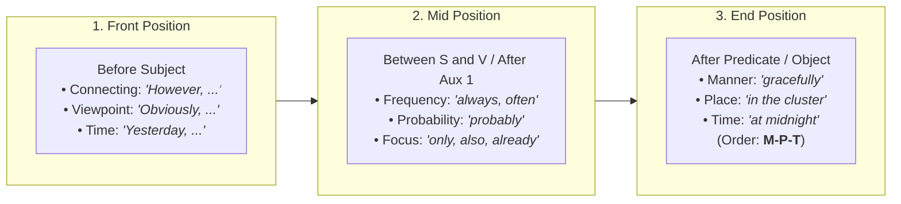
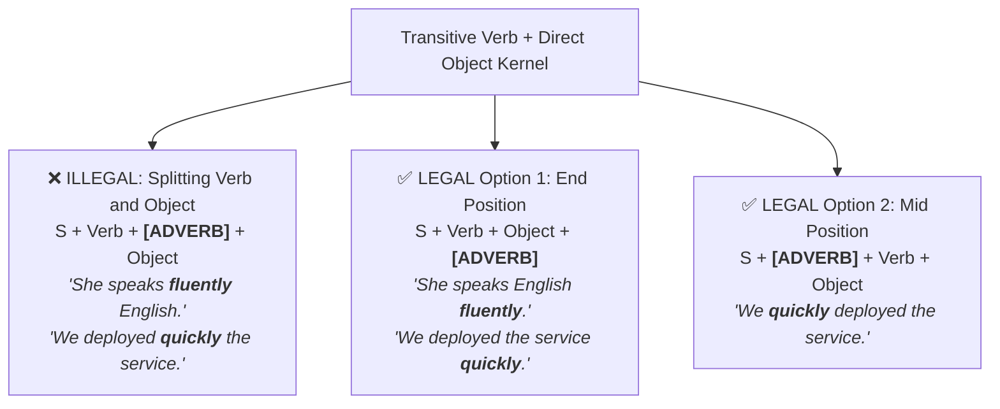
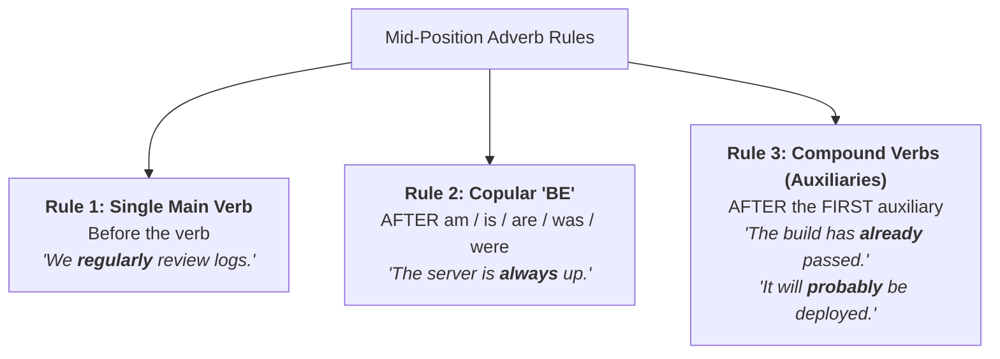
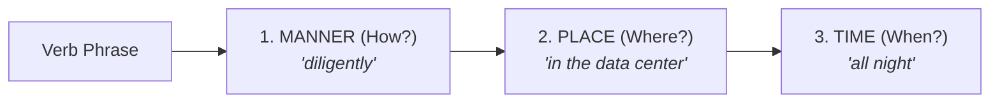

# Adverb Placement and Word Order Laws 🎯📍

> **Level:** CEFR B1–B2 (Positional Syntax & Adjacency Constraints)  
> **Primary References:** Raymond Murphy (*English Grammar in Use*, Units 109–110); Michael Swan (*Practical English Usage*, §16.4–16.6)  
> **Core Concept:** Unlike many other languages, English strictly restricts where adverbs may appear within a clause. The most critical positional law is the **Verb-Object Adjacency Rule** (an adverb must never split a transitive verb from its direct object). Adverbs occupy three primary structural zones: **Front Position**, **Mid Position**, and **End Position** (governed by the Manner-Place-Time sequence).

---

## 1. The Three Sentence Positions of Adverbs



---

## 2. The Cardinal Invariant: The Verb-Object Adjacency Rule

In standard English syntax, a transitive verb and its direct object form an **indivisible syntactic kernel**. Modifiers cannot intrude between them:



> [!CAUTION]
> This is one of the most pervasive grammatical bugs made by non-native speakers (especially speakers of French, Spanish, German, or Slavic languages).
> - ❌ *I like very much this framework.*
> - ✅ *I like this framework **very much**.*
> - ❌ *The script executes automatically the unit tests.*
> - ✅ *The script **automatically executes** the unit tests.* (or *...executes the unit tests **automatically**.*)

---

## 3. Mid-Position Laws (Auxiliary & Copular Alignment)

Mid-position adverbs (adverbs of frequency, probability, and focus such as *always, often, never, rarely, probably, definitely, already, just, almost*) follow three strict placement rules:



### 1. With a Single Main Verb (Except `be`)
Place the adverb **immediately before** the main verb:
- *We **rarely** see concurrency deadlocks in this service.*
- *The script **automatically** cleans up temporary files.*
- *She **almost** missed the architecture review.*

### 2. With the Copular Verb `BE` (`am, is, are, was, were`)
Place the adverb **after** the form of `be`:
- *The Kubernetes API is **always** accessible.* (❌ NOT: *is always accessible* ✅ vs *always is accessible* ❌)
- *The metrics were **clearly** visible on Grafana.*
- *We are **definitely** interested in adopting Rust.*

### 3. With Compound Verb Tenses (One or More Auxiliaries)
Place the adverb **immediately after the FIRST auxiliary verb**:
- *The pipeline **has already** executed the integration tests.*
- *The pods **have definitely been** terminated.* (After *have*, before *been*).
- *You **should never** commit plaintext secrets to Git.* (After modal *should*, before lexical verb *commit*).
- *The database **is currently being** migrated to Postgres 16.*

---

## 4. End-Position Sequence: The Manner-Place-Time (M-P-T) Rule

When multiple adverbs or adverbial prepositional phrases appear at the end of a sentence, English organizes them in the canonical order of **Manner $\rightarrow$ Place $\rightarrow$ Time**:

$$\text{Subject} + \text{Verb} + (\text{Object}) + \mathbf{Manner} + \mathbf{Place} + \mathbf{Time}$$



### Canonical Examples of the M-P-T Sequence
- *The engineers worked **tirelessly** (Manner) **in the server room** (Place) **yesterday** (Time).*
- *The worker thread wrote the records **synchronously** (Manner) **to the database** (Place) **at 03:00 AM** (Time).*
- *She spoke **brilliantly** (Manner) **at the tech conference** (Place) **last Friday** (Time).*

> [!NOTE]
> Verbs of movement (*go, come, arrive, travel*) often take **Place** before **Manner**:
> - *The packet traveled **to the gateway** (Place) **at wire speed** (Manner).*

---

## 5. Front-Position: Viewpoint, Transition & Scene Setting

Adverbs in the front position set the scene or qualify the entire sentence:

### 1. Viewpoint and Sentence Evaluators
- * **Regrettably**, the root certificate expired before the renewal job ran.*
- * **Theoretically**, horizontal scaling solves our throughput bottleneck.*

### 2. Discourse Connectors
- * **However**, the backup replication failed to sync.*
- * **Consequently**, downstream microservices experienced timeout cascades.*

### 3. Temporal Contrast & Scene Setting
- * **Yesterday**, our cluster handled 40,000 requests per second.*
- * **In 2024**, the company migrated completely to cloud-native microservices.*

---

## 6. Practical Dual-Domain Examples

### Everyday Conversation

1. *I **always** drink a cup of black coffee before starting work.* (Mid: Frequency before main verb)
2. *She is **never** late for our weekly sync meetings.* (Mid: After copular *be*)
3. *We have **already** booked our flights to Tokyo.* (Mid: After first auxiliary *have*)
4. *He plays tennis **exceptionally well**.* (End: After direct object *tennis*)
5. * **Suddenly**, the lights went out across the entire neighborhood.* (Front: Scene setting)
6. *They walked **briskly** (Manner) **through the park** (Place) **this morning** (Time).* (M-P-T order)
7. *I will **probably** see you at the gym tomorrow.* (Mid: After auxiliary *will*)
8. *She speaks German **fluently**.* (Verb-Object Adjacency respected)

### Software Engineering & Technical Documentation

9. *The background worker **periodically** polls the SQS queue for incoming tasks.*
10. *We have **successfully** patched the remote code execution vulnerability.*
11. *The ingress controller **silently** drops malformed HTTP request headers.*
12. *The system administrators monitored the replication **closely** (Manner) **in the war room** (Place) **during the maintenance window** (Time).*
13. *Our engineers **rarely** deploy breaking API changes without a deprecation window.*
14. *The cluster nodes are **currently** undergoing rolling kernel updates.*
15. * **Unfortunately**, the failover configuration was not tested prior to the launch.*
16. *The telemetry daemon sends heartbeats **reliably** (Manner) **to the observability platform** (Place) **every five seconds** (Time).*
17. *We **definitely** must optimize the nested database joins.*
18. *The cron job executes **hourly** to aggregate user engagement statistics.*

---

## 7. Common Antipatterns & Diagnostic Table

| Incorrect Antipattern | Corrected Grammar | Rule & Explanation |
| :--- | :--- | :--- |
| ❌ *We deploy quickly the application.* | ✅ *We **quickly** deploy the application.* / *...deploy the application **quickly**.* | Verb-Object Adjacency: an adverb cannot split a verb (*deploy*) from its direct object (*the application*). |
| ❌ *The server always is offline.* | ✅ *The server is **always** offline.* | Frequency adverbs sit AFTER copular *be* (*is, are, was, were*). |
| ❌ *The team has completed successfully the sprint.* | ✅ *The team has **successfully completed** the sprint.* | Place mid-position adverbs after the first auxiliary (*has*) and before the main verb (*completed*). |
| ❌ *He reads thoroughly the documentation.* | ✅ *He reads the documentation **thoroughly**.* | Adverb cannot split transitive verb from direct object. |
| ❌ *They worked yesterday in the office hard.* | ✅ *They worked **hard** (M) **in the office** (P) **yesterday** (T).* | Violation of the Manner-Place-Time (M-P-T) sequence. |
| ❌ *I like also Python.* | ✅ *I **also** like Python.* | Focus adverb *also* sits before single main verbs, not between verb and object. |
| ❌ *The pods have been completely restarted already.* | ✅ *The pods have **already** been completely restarted.* | Time/aspect focus adverbs (*already*) follow the first auxiliary (*have*). |

---

## 8. Self-Assessment Exercises

### Exercise 1: Identifying Position Errors
Identify whether the sentence violates adverb word order rules. If invalid, rewrite it correctly:

1. The distributed scheduler dispatches efficiently the incoming jobs.
2. The database administrator has verified already the data checksums.
3. Our production servers are never left unmonitored during weekends.
4. She explained clearly the architectural pattern to the junior engineers.
5. We yesterday migrated twenty microservices to the new cluster.

### Exercise 2: Sentence Reconstruction (M-P-T & Mid-Position)
Reassemble the scrambled elements into a natural English sentence:

6. [the API response / parsed / the client / asynchronously]
7. [were / in the conference room / discussing the RFC / the architects / intensely / all morning]
8. [the cache / invalidates / automatically / the background daemon]
9. [has / been / our team / researching / dedicatedly / WebAssembly]
10. [in production / will / fail / probably / the legacy script]

<details>
<summary>View Complete Answer Key & Diagnostic Explanations</summary>

1. **Invalid** — Splits verb and object. Correction: *The distributed scheduler **efficiently dispatches** the incoming jobs* (or *...dispatches the incoming jobs **efficiently**.*).
2. **Invalid** — *Already* must follow the first auxiliary *has*. Correction: *The database administrator has **already verified** the data checksums.*
3. **Valid** — Frequency adverb *never* correctly follows the copular auxiliary *are*.
4. **Valid** — The adverb *clearly* is placed after the direct object *the architectural pattern*. (Also valid: *She **clearly explained** the architectural pattern...*).
5. **Invalid** — Time adverb *yesterday* is unnatural between subject and verb. Correction: * **Yesterday**, we migrated twenty microservices...* (or *We migrated twenty microservices ... **yesterday**.*).
6. **The client parsed the API response asynchronously.** (or *The client asynchronously parsed the API response.*)
7. **The architects were discussing the RFC intensely** (Manner) **in the conference room** (Place) **all morning** (Time).
8. **The background daemon automatically invalidates the cache.** (or *...invalidates the cache automatically.*)
9. **Our team has been dedicatedly researching WebAssembly.** (or *Our team has dedicatedly been researching...*)
10. **The legacy script will probably fail in production.**

</details>

---

## 9. Revision Flashcards

```
Q: What is the Verb-Object Adjacency Rule?
A: An adverb must never intrude between a transitive verb and its direct object (e.g., "She speaks English fluently", NEVER "She speaks fluently English").

Q: Where does an adverb of frequency sit when the verb is "be"?
A: Immediately AFTER the form of "be" ("The server is ALWAYS responsive", NOT "always is").

Q: Where does a mid-position adverb sit when there are multiple auxiliaries (e.g., "has been running")?
A: Immediately after the FIRST auxiliary verb ("The server has ALREADY been running for days").

Q: What is the M-P-T rule for end-position adverbs?
A: When multiple adverbs appear at the end of a clause, order them Manner (How), Place (Where), and Time (When).

Q: Where are viewpoint/evaluative adverbs like "obviously" or "fortunately" typically placed?
A: In front position, separated by a comma ("Fortunately, the database snapshot was intact").
```
