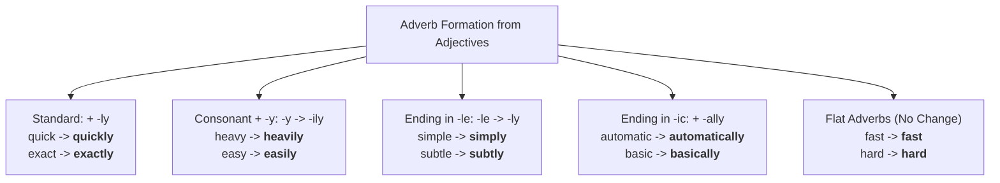
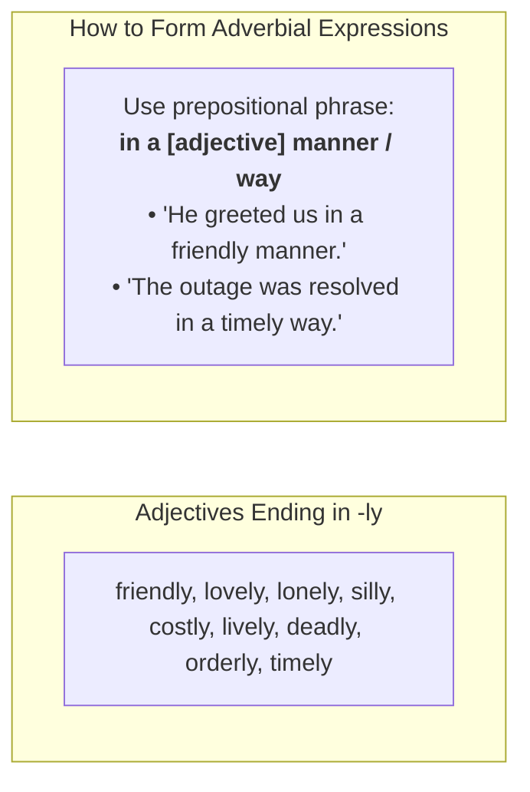
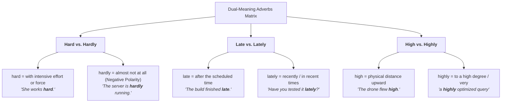
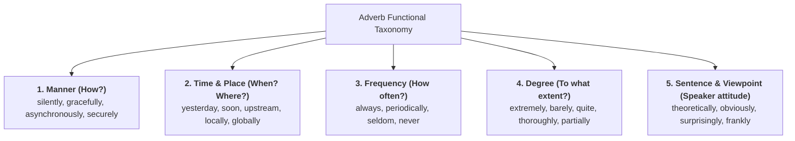

# Adverbs: Formation, Classification, and Flat Adverbs ⚡🎯

> **Level:** CEFR A2–B2 (Morphology & Semantics)  
> **Primary References:** Raymond Murphy (*English Grammar in Use*, Units 100–101); Michael Swan (*Practical English Usage*, §16.1–16.3, §15.2)  
> **Core Concept:** Adverbs are grammatical modifiers that qualify **verbs, adjectives, other adverbs, prepositional phrases, or entire clauses**. While the productive rule forms adverbs by affixing `-ly` to an adjective, English preserves a crucial class of **flat adverbs** (identical in form to adjectives) and **dual-form adverbs** whose `-ly` counterparts convey radically different semantic meanings.

---

## 1. Adverb Morphology & Suffixation Rules



### Orthographic Alterations Table

| Base Adjective Ending | Rule | Adjective Example | Adverb Form |
| :--- | :--- | :--- | :--- |
| **Standard consonant/vowel** | Add `-ly` | *resilient, smooth, rapid* | *resiliently, smoothly, rapidly* |
| **Consonant + `-y`** | Change `-y` to `-ily` | *happy, easy, temporary* | *happily, easily, temporarily* |
| **Silent `-le`** | Replace `-le` with `-ly` | *simple, subtle, feasible* | *simply, subtly, feasibly* |
| **Ending in `-ic`** | Add `-ally` (pronounced /ɪkli/) | *automatic, strategic, dramatic* | *automatically, strategically, dramatically* *(Exception: public $\rightarrow$ publicly)* |
| **Ending in `-ue`** | Drop `-e`, add `-ly` | *true, due* | *truly, duly* |
| **Ending in `-ll`** | Add only `-y` | *full, dull* | *fully, dully* |

---

## 2. False Adverbial Adjectives (`-ly` Adjectives)

Certain common words end in `-ly` but are **strictly adjectives**, NOT adverbs. They cannot modify verbs directly:



> [!CAUTION]
> Never say *He coded friendly* or *The migration failed costlily*:
> - ❌ *The team welcomed the new engineer friendly.*
> - ✅ *The team welcomed the new engineer **in a friendly manner**.*
> - ❌ *The latency increased deadly.*
> - ✅ *The latency increased **at a fatal / deadly rate**.*

---

## 3. Flat Adverbs & Dual-Meaning Traps

Flat adverbs share the exact same morphological form as their adjective counterparts (*fast, hard, late, early, high, low, direct, straight, wrong, right*). When an `-ly` suffix is added to some of these bases, the meaning changes completely:



### The Dual-Form Disambiguation Table

| Base Word | Flat Adverb Meaning & Example | `-ly` Adverb Meaning & Example |
| :--- | :--- | :--- |
| **`hard`** | **With vigor, effort, force:**<br>*The CPU was working **hard**.* | **Scarcely, almost not at all:**<br>*The battery has **hardly** any charge left.* |
| **`late`** | **After the expected or appointed time:**<br>*The release was shipped two hours **late**.* | **Recently, of late:**<br>*We have observed erratic latencies **lately**.* |
| **`high`** | **Physical altitude or distance:**<br>*The load graph spiked **high** into the red.* | **To a high degree / with praise:**<br>*His PR was **highly** praised by the architect.* |
| **`deep`** | **Physical depth or distance within:**<br>*The fiber cable was buried **deep** underground.* | **Intensely, profoundly (emotional/cognitive):**<br>*We are **deeply** concerned about data integrity.* |
| **`near`** | **Close in physical distance or time:**<br>*Don't step too **near** the power transformer.* | **Almost / nearly completed:**<br>*The migration is **nearly** finished (98%).* |
| **`free`** | **Without payment or cost:**<br>*You can download the community edition **free**.* | **Without restriction or constraint:**<br>*Network traffic flows **freely** through the proxy.* |
| **`direct`** | **Without stopping or detour:**<br>*The client connects **direct** to the read replica.* | **Directly (manner, immediacy, or instantly):**<br>*The change **directly** impacts downstream consumers.* |
| **`short`** | **Abruptly, before the expected point:**<br>*The request stopped **short** of the gateway.* | **Soon, in a brief period:**<br>*The release will be deployed **shortly**.* |

---

## 4. Functional Classifications of Adverbs

Adverbs are classified by the semantic question they answer:



### 1. Adverbs of Manner
Describe how an action is performed. Typically end in `-ly`:
- *The consumer process reads messages **asynchronously**.*
- *The cryptographer verified the mathematical proof **rigorously**.*

### 2. Adverbs of Time and Place
Indicate when or where an event occurs:
- *We will deploy the containerized cluster **tomorrow**.* (Time)
- *The telemetry data is stored **locally** on each node.* (Place)

### 3. Adverbs of Frequency
Quantify the recurrence of an event:
- *Definite Frequency:* *hourly, daily, weekly, twice a minute*
- *Indefinite Frequency:* *always, usually, frequently, often, sometimes, rarely, seldom, never*

### 4. Adverbs of Degree
Modify adjectives, verbs, or other adverbs to specify intensity:
- *The index rebuild was **partially** completed before the shutdown.*
- *The query was **astonishingly** fast, resolving in 2 milliseconds.*

### 5. Sentence (Viewpoint / Evaluative) Adverbs
Modify the entire proposition, expressing the speaker's assessment or domain perspective:
- * **Technically**, the transaction committed before the network severed.*
- * **Fortunately**, the backup snapshot was taken right before the corruption.*
- * **Obviously**, unindexed foreign keys degrade join throughput.*

---

## 5. Practical Dual-Domain Examples

### Everyday Conversation

1. *She speaks three foreign languages **fluently**.*
2. *Please drive **carefully**; the roads are icy.*
3. *I have been feeling quite exhausted **lately**.*
4. *He worked **hard** all day to finish painting the house.*
5. *There was **hardly** any food left in the refrigerator.*
6. *She greeted the new neighbors **in a warm, friendly manner**.*
7. *The train was scheduled for 8:00 AM, but it arrived 30 minutes **late**.*
8. * **Honestly**, I don't think that plan is going to work.*

### Software Engineering & Technical Documentation

9. *The database engine flushes the write-ahead log to disk **synchronously**.*
10. *Our security audit revealed that the payload was **improperly** sanitized.*
11. *The new garbage collector operates **silently** in the background without pause spikes.*
12. *We can **hardly** maintain acceptable SLAs on this legacy infrastructure.*
13. *The caching layer was **highly** effective, reducing database reads by 84%.*
14. *The background worker polls the SQS queue **periodically** for new jobs.*
15. *The ingress controller routes traffic **direct** to healthy backend pods.*
16. * **Theoretically**, the consensus protocol can tolerate up to $f$ Byzantine faults.*
17. *The engineers handled the high-severity vulnerability **in a timely and orderly way**.*
18. *The cron job executes **hourly** to recalculate aggregate statistics.*

---

## 6. Common Antipatterns & Diagnostic Table

| Incorrect Antipattern | Corrected Grammar | Rule & Explanation |
| :--- | :--- | :--- |
| ❌ *The microservice executed fastly.* | ✅ *The microservice executed **fast**.* | *Fast* is a flat adverb; *fastly* does not exist in standard English. |
| ❌ *The team worked hardly to deploy.* | ✅ *The team worked **hard** to deploy.* | *Hardly* means "almost not". Intensive effort requires flat adverb *hard*. |
| ❌ *We haven't seen any incidents late.* | ✅ *We haven't seen any incidents **lately**.* | Referring to the recent past requires *lately*, not *late*. |
| ❌ *The engineer acted friendly.* | ✅ *The engineer acted **in a friendly way**.* | *Friendly* is an adjective. Adverbial modification requires a prepositional phrase. |
| ❌ *The transaction committed automatic.* | ✅ *The transaction committed **automatically**.* | Dynamic action verbs require an adverb of manner (*automatically*). |
| ❌ *The query ran extreme slowly.* | ✅ *The query ran **extremely** slowly.* | Modifying an adverb (*slowly*) requires another adverb (*extremely*), not an adjective. |
| ❌ *I feel badly about the deployment.* | ✅ *I feel **bad** about the deployment.* | *Feel* is a linking copular verb here, taking an adjective complement (*bad*). |

---

## 7. Self-Assessment Exercises

### Exercise 1: Adverb Formation & Flat Adverbs
Convert the adjective in parentheses into the correct adverb form:

1. The script generated the cryptographic hashes ________. (*automatic*)
2. The network throughput scaled ________ across all availability zones. (*dramatic*)
3. He solved the algorithmic challenge ________ in under ten minutes. (*easy*)
4. The race car rounded the hairpin corner ________. (*fast*)
5. The deployment completed ________ without any reported regressions. (*smooth*)

### Exercise 2: Dual-Form Disambiguation (`hard/hardly`, `late/lately`, `high/highly`)
Select the correct word:

6. The production server had (hard / hardly) any available swap memory left when it crashed.
7. She has been reviewing pull requests late into the evening (late / lately).
8. The tech lead spoke (high / highly) of your architectural refactoring.
9. Even though the team pushed (hard / hardly), they could not meet the deadline.
10. The package will arrive (short / shortly) via courier.

<details>
<summary>View Complete Answer Key & Diagnostic Explanations</summary>

1. **automatically** (Adjectives ending in `-ic` take `-ally`).
2. **dramatically** (Adjectives ending in `-ic` take `-ally`).
3. **easily** (Consonant + `-y` changes to `-ily`).
4. **fast** (Flat adverb; *fastly* is non-standard).
5. **smoothly** (Standard `-ly` addition).
6. **hardly** (Meaning "almost not", modifying *any available swap*).
7. **lately** (Meaning "in recent days/weeks").
8. **highly** (Meaning "with high praise / to a great degree").
9. **hard** (Meaning "with intense effort").
10. **shortly** (Meaning "soon / in a short time").

</details>

---

## 8. Revision Flashcards

```
Q: What is a "flat adverb"? Give three common examples.
A: An adverb that shares the identical morphological form as its corresponding adjective without taking "-ly" (e.g., "fast", "hard", "late", "early").

Q: What is the semantic difference between "He worked hard" and "He worked hardly"?
A: "He worked hard" means he expended great effort and vigor. "He worked hardly" is ungrammatical (or means "He scarcely worked at all").

Q: Why is "She spoke friendly" incorrect, and how should it be phrased?
A: "Friendly" is an adjective despite ending in "-ly". To use it adverbially, embed it in a prepositional phrase: "She spoke in a friendly manner/way".

Q: How do adjectives ending in "-ic" form their adverbs?
A: By adding "-ally" (e.g., "automatic" -> "automatically", "dramatic" -> "dramatically"). Exception: "public" -> "publicly".

Q: Contrast "late" and "lately" in engineering contexts.
A: "The build completed late" refers to clock time past the deadline. "We updated the pipeline lately" refers to recency in the past.
```
