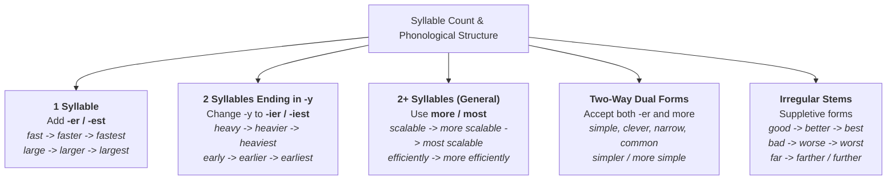
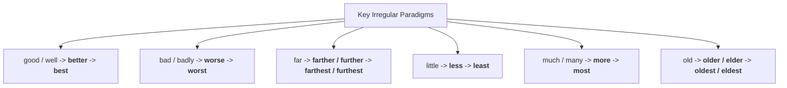
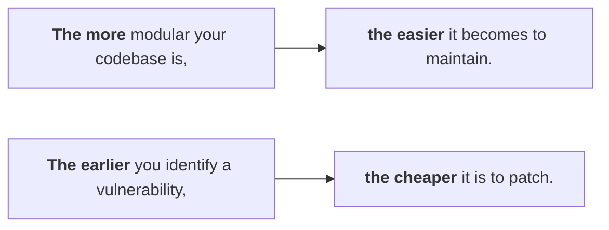
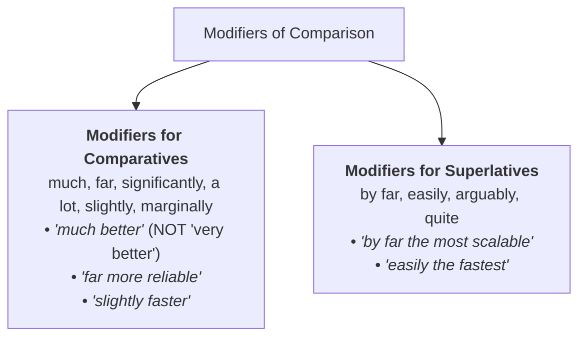

# Degrees of Comparison (Comparatives and Superlatives) 📈⚖️

> **Level:** CEFR A2–B2 (Comparative Morphology & Proportional Syntax)  
> **Primary References:** Raymond Murphy (*English Grammar in Use*, Units 105–108); Michael Swan (*Practical English Usage*, §17)  
> **Core Concept:** English expresses scalar comparison through three degrees: **Positive** (baseline attribute), **Comparative** (evaluating two entities/states), and **Superlative** (identifying the extreme within a set of three or more). Selection between synthetic affixation (`-er / -est`) and analytic periphrasis (`more / most`) is strictly governed by syllable count and phonetic structure.

---

## 1. The Morphological Decision Framework



### Morphological Inflection Rules

| Adjective Category | Rule | Positive | Comparative | Superlative |
| :--- | :--- | :--- | :--- | :--- |
| **1 syllable (standard)** | Add `-er`, `-est` | *fast, cold, high* | *faster, colder, higher* | *fastest, coldest, highest* |
| **1 syllable (C-V-C doubling)** | Double final consonant | *big, hot, fit* | *bigger, hotter, fitter* | *biggest, hottest, fittest* |
| **1 syllable ending in `-e`** | Add only `-r`, `-st` | *safe, wide, late* | *safer, wider, later* | *safest, widest, latest* |
| **2 syllables ending in `-y`** | Change `-y` to `-ier`, `-iest` | *easy, heavy, early* | *easier, heavier, earlier* | *easiest, heaviest, earliest* |
| **2+ syllables (standard)** | Prefix *more*, *most* | *robust, resilient, modern* | *more robust, more resilient* | *most robust, most resilient* |
| **Adverbs ending in `-ly`** | Prefix *more*, *most* | *quickly, slowly, reliably* | *more quickly, more slowly* | *most quickly, most slowly* |

---

## 2. Irregular and Dual-Form Paradigms



### 1. `Farther` vs. `Further`
- **`Farther`** refers exclusively to **physical, measurable distance**:
  - *The Frankfurt data center is **farther** from London than the Dublin facility.*
- **`Further`** can express physical distance, but is predominantly used for **abstract extent, time, or "additional" items**:
  - *We need **further** investigation into this memory leak.* (❌ NOT: *farther investigation*)
  - *Without **further** ado, let's deploy the hotfix.*

### 2. `Older` vs. `Elder`
- **`Older / Oldest`** applies universally to people, systems, technologies, and objects:
  - *This database version is **older** than Postgres 12.*
- **`Elder / Eldest`** is strictly **attributive** and reserved for **family relations**:
  - *My **elder** brother is a systems architect.* (❌ NOT: *My brother is elder than me* $\rightarrow$ use *older than*).

---

## 3. Comparative Structures & Syntax

### 1. The Comparative + `Than` Clause
When comparing two explicit entities, use `than` (never *that* or *as*):
- *Rust provides **lower** memory overhead **than** Java.*
- *The new caching algorithm executes **more efficiently than** the old one.*

### 2. Equative Comparison: `As ... As`
To state that two entities possess equal degree, use `as + adjective/adverb + as`:
- *The replica is **as up-to-date as** the primary node.*
- *The Go runtime compiles almost **as fast as** C.*

#### Negative Equative (Expressing Inferiority)
In negative sentences, you can use `not as ... as` or `not so ... as`:
- *The preview deployment is **not as stable as** production.*
- *The secondary pipeline does **not run as quickly as** the main runner.*

### 3. Proportional Comparison: The Double Comparative
To express that one variable correlates directly with another, use:

$$\mathbf{The} + \text{Comparative} \dots, \mathbf{the} + \text{Comparative} \dots$$



- * **The higher** the concurrent traffic, **the greater** the database thread contention.*
- * **The less** technical debt we accumulate, **the faster** we can ship new features.*

---

## 4. Modifying Comparatives and Superlatives

A major pitfall is modifying comparatives with *very*. **`Very` cannot modify comparative adjectives or adverbs!**



| Type of Scalar Modification | Permitted Modifiers | Example Sentence |
| :--- | :--- | :--- |
| **Large Difference (Comparative)** | *much, far, a great deal, significantly, substantially* | *Redis is **far faster than** disk-based storage.* |
| **Small Difference (Comparative)** | *slightly, marginally, a bit, a little, somewhat* | *The new build is **slightly heavier than** the previous release.* |
| **Extreme Degree (Superlative)** | *by far, easily, single-handedly, arguably* | *This is **by far the most complex** architecture we have built.* |

> [!CAUTION]
> - ❌ *This approach is very better.*
> - ✅ *This approach is **much better**.* / * **far better**.*
> - ❌ *The microservice is more faster.* (Double comparative error!)
> - ✅ *The microservice is **faster**.*

---

## 5. Practical Dual-Domain Examples

### Everyday Conversation

1. *My commute is **much longer than** it used to be.*
2. *This restaurant is **not as expensive as** the one we visited yesterday.*
3. * **The sooner** we leave, **the less** traffic we will encounter.*
4. *She is **the most talented** violinist in the symphony orchestra.*
5. *Could you please provide some **further** details about your itinerary?*
6. *This coffee tastes **slightly better** with a dash of cinnamon.*
7. *He is **by far the fastest** runner on the track team.*
8. *Your explanation is **clearer than** the one in the textbook.*

### Software Engineering & Technical Documentation

9. *The gRPC transport protocol is **substantially faster than** standard REST over HTTP/1.1.*
10. *The new ARM instances are **far more cost-effective than** previous x86 generations.*
11. * **The more** indexes you add to the table, **the slower** write operations become.*
12. *This is **by far the most severe** buffer overflow vulnerability discovered this year.*
13. *The fallback cache is **not as resilient as** our distributed Redis cluster.*
14. *The background worker processes queue items **more reliably** after the refactoring.*
15. *We must conduct **further** stress testing before approving the multi-region rollout.*
16. *The latency spike was **worse than** any incident recorded in Q1.*
17. *The revised schema design is **infinitely simpler than** the initial relational proposal.*
18. *Our production build is **three times as large as** the minimal staging container.*

---

## 6. Common Antipatterns & Diagnostic Table

| Incorrect Antipattern | Corrected Grammar | Rule & Explanation |
| :--- | :--- | :--- |
| ❌ *This algorithm is more faster.* | ✅ *This algorithm is **faster**.* | Double comparative: 1-syllable adjectives take *-er*, never *more + -er*. |
| ❌ *The new database is very better.* | ✅ *The new database is **much better**.* | *Very* cannot modify comparatives. Use *much, far*, or *significantly*. |
| ❌ *Node A is farther researched than Node B.* | ✅ *Node A is **further** researched than Node B.* | Figurative/abstract extent requires *further*, not *farther*. |
| ❌ *The cluster is not as robust than the old one.* | ✅ *The cluster is not as robust **as** the old one.* | Equative structures strictly pair *as ... as*, never *as ... than*. |
| ❌ *The more memory you allocate, the performance improves.* | ✅ *The more memory you allocate, **the better** the performance improves.* | Double comparatives require *The + Comparative ... the + Comparative*. |
| ❌ *Postgres is superior than MySQL in this regard.* | ✅ *Postgres is **superior to** MySQL in this regard.* | Latin comparatives (*superior, inferior, senior, junior*) take *to*, not *than*. |
| ❌ *He is my elder brother than me.* | ✅ *He is **older than** me.* | *Elder* is attributive only; post-copular comparisons require *older than*. |

---

## 7. Self-Assessment Exercises

### Exercise 1: Comparative & Superlative Forms
Supply the correct comparative or superlative form of the word in parentheses:

1. This database query is ________ than the unindexed version. (*fast*)
2. The distributed consensus algorithm is ________ than the centralized lock. (*complex*)
3. The server outage yesterday was the ________ disaster this quarter. (*bad*)
4. We need to gather ________ telemetry before making a decision. (*far / further*)
5. The revised UI is by far the ________ intuitive version we have designed. (*most / more*)

### Exercise 2: Error Correction & Proportional Syntax
Correct the grammatical errors in the following sentences:

6. The new cloud cluster is very more reliable than on-premise hardware.
7. The more you test your software, fewer bugs reach production.
8. This microservice is not so scalable than our event-driven system.
9. She is much elder than her colleagues on the development team.
10. The frontend bundle is more smaller after enabling tree-shaking.

<details>
<summary>View Complete Answer Key & Diagnostic Explanations</summary>

1. **faster** (1-syllable adjective takes *-er*).
2. **more complex** (2-syllable standard adjective takes *more*).
3. **worst** (Irregular superlative of *bad*).
4. **further** (Abstract additional data; *farther* is physical distance).
5. **most** (Superlative modified by *by far the*).
6. The new cloud cluster is **much / far more reliable** than on-premise hardware. (*Very* cannot modify comparatives).
7. The more you test your software, **the fewer** bugs reach production. (Double comparative requires parallel *the + comparative*).
8. This microservice is not so scalable **as** our event-driven system. (Equative uses *not so/as ... as*).
9. She is much **older than** her colleagues on the development team. (*Elder* cannot be used predicatively with *than*).
10. The frontend bundle is **smaller** after enabling tree-shaking. (Eliminate double comparative *more*).

</details>

---

## 8. Revision Flashcards

```
Q: Why is "more better" or "more faster" a severe grammatical error?
A: It is a "double comparative". One-syllable adjectives already form their comparative by adding "-er"; prefixing "more" is redundant and ungrammatical.

Q: How should you modify a comparative adjective to express a large difference (e.g. "very better")?
A: Use "much", "far", "a lot", or "significantly" (e.g., "much better", "far faster"). NEVER use "very" with comparatives.

Q: What is the syntactic rule for the "double comparative" construction?
A: "The + [comparative], the + [comparative]" (e.g., "The more code you write, the more tests you need").

Q: When must you use "further" instead of "farther"?
A: Use "further" for abstract progress, depth, time, or when meaning "additional" (e.g., "further information"). "Farther" is restricted to physical spatial distance.

Q: What preposition must follow Latin comparatives like "superior" or "inferior"?
A: "To" (e.g., "superior to", NOT "superior than").
```
