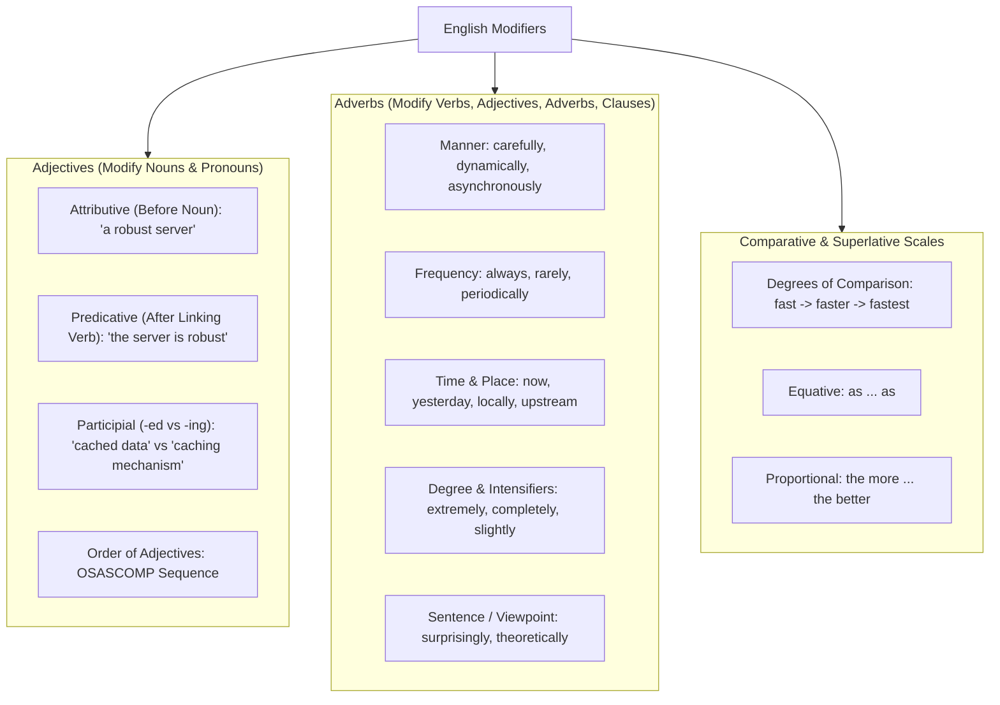

# Module 06: Adjectives and Adverbs 🎨⚙️

> **Level:** CEFR A1–B2 (Modifiers, Gradability & Sentence Dynamics)  
> **Primary References:** Raymond Murphy (*English Grammar in Use*, Units 98–112); Michael Swan (*Practical English Usage*, §15–17)  
> **Core Concept:** Adjectives modify **nominal entities** (attributes, states, classifications), while Adverbs modify **actions, processes, adjectives, other adverbs, or entire propositions**. Mastering modifiers requires understanding syntactic position (attributive vs. predicative), strict positional constraints (OSASCOMP ordering, verb-object adjacency), and scale gradability.

---

## 1. The Modifier Taxonomy



---

## 2. Topic Curriculum

This module contains **6 comprehensive guides** covering every dimension of adjectival and adverbial syntax:

| Guide | Core Focus | Target CEFR | Authoritative Literature |
| :--- | :--- | :---: | :--- |
| **01. [Attributive & Predicative Adjectives](adjectives-attributive-and-predicative.md)** | Pre-nominal vs post-copular position, predicative-only (*alive, asleep*), attributive-only (*main, utter*), and *-ed* vs *-ing* participles | A2–B2 | Murphy Units 98–99; Swan §15 |
| **02. [Order of Adjectives](order-of-adjectives.md)** | The OSASCOMP ordering sequence (Opinion, Size, Age, Shape, Color, Origin, Material, Purpose), comma rules for coordinate adjectives | B1–B2 | Murphy Unit 99; Swan §15.4 |
| **03. [Adverbs: Formation and Types](adverbs-formation-and-types.md)** | Suffixation (`-ly`), flat adverbs (*fast, hard, late* vs *lately, hardly*), classifications (manner, place, time, frequency, degree) | A2–B2 | Murphy Units 100–101; Swan §16 |
| **04. [Adverb Placement & Word Order](adverb-placement-and-word-order.md)** | Front, mid, and end position laws; auxiliary-verb mid-position; strict prohibition of verb-object splitting | B1–B2 | Murphy Units 109–110; Swan §16.4–16.6 |
| **05. [Degrees of Comparison](degrees-of-comparison.md)** | Synthetic (`-er/-est`) vs analytical (`more/most`), irregular comparatives, equative *as... as*, double comparative (*the more, the better*) | A2–B2 | Murphy Units 105–108; Swan §17 |
| **06. [Intensifiers, Mitigators & Degree Modifiers](intensifiers-mitigators-degree-modifiers.md)** | Scalable vs ungradable adjectives, *very* vs *too*, *so* vs *such*, *quite, rather, fairly, entirely, barely, enough* syntax | B1–B2 | Murphy Units 102–104, 111; Swan §15–16 |

---

## 3. The Modifier Decision Flowchart

When qualifying an action, state, or object, apply this decision sequence:

```mermaid
graph TD
    Start["What are you modifying?"]
    
    Start -->|A Noun or Pronoun| CheckPosition{"Where is the modifier located?"}
    CheckPosition -->|Directly before the noun| Attrib["Use Attributive Adjective<br/><i>'a resilient cluster'</i>"]
    CheckPosition -->|After a linking verb (be, seem, look)| Pred["Use Predicative Adjective<br/><i>'the cluster is resilient'</i>"]
    
    Start -->|A Verb, Adjective, or Adverb| CheckVerb{"Is the main verb dynamic or copular?"}
    CheckVerb -->|Copular / Linking Verb (smell, feel, appear)| CopAdj["Use Adjective!<br/><i>'the response feels slow'</i><br/>(NOT slowly)"]
    CheckVerb -->|Dynamic Action Verb| DynamicAdv["Use Adverb of Manner!<br/><i>'the query executed slowly'</i>"]
    
    Start -->|An Entire Sentence / Proposition| SentenceAdv["Use Viewpoint / Evaluative Adverb<br/><i>'Obviously, latency increased.'</i>"]
```

---

## 4. Cross-Reference Directory
- **Foundations:** [Sentence Elements & Word Order](../01-foundations/sentence-elements-and-word-order.md) (Subject complements vs Adverbials).
- **Verbs:** [Linking Verbs & Copulas](../02-verbs-and-auxiliaries/linking-verbs-copulas.md) (Why linking verbs require adjectives, not adverbs).
- **Disambiguation:** [Comparisons & Disambiguation](../13-comparisons-and-disambiguation/) (Deep-dive matrices on *so* vs *such*, *hard* vs *hardly*, *too* vs *enough*).
- **Technical Writing:** [Practical Technical Communication](../15-practical-english-and-communication/) (Precision modifiers in RFCs, SLAs, and architecture documentation).
