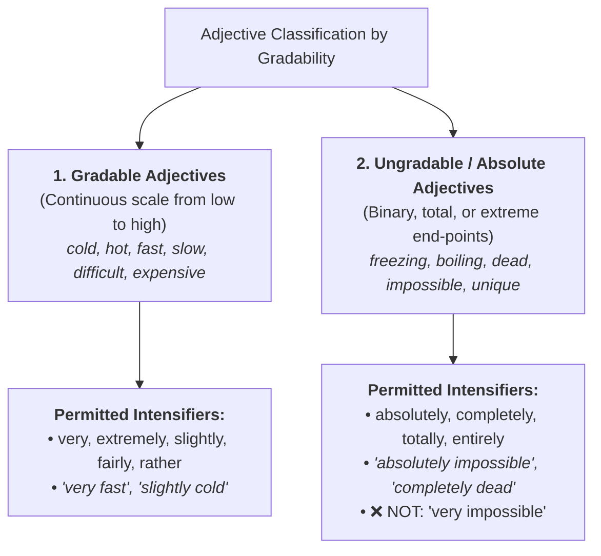
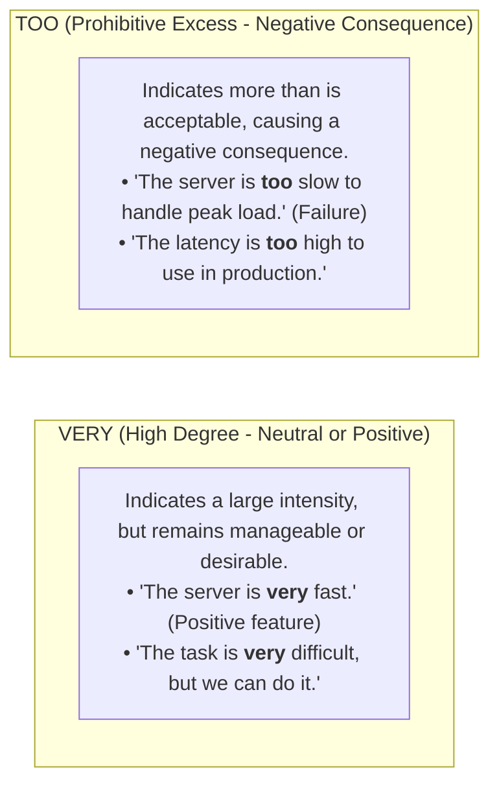
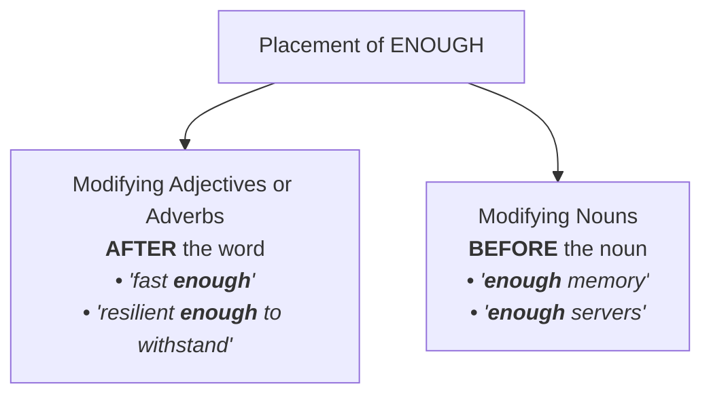
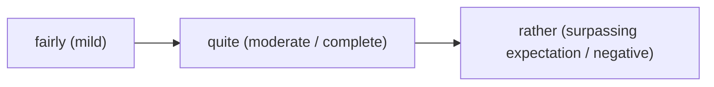

# Intensifiers, Mitigators, and Degree Modifiers 🎚️🌡️

> **Level:** CEFR B1–B2 (Scalar Gradability & Submodifications)  
> **Primary References:** Raymond Murphy (*English Grammar in Use*, Units 102–104, 111); Michael Swan (*Practical English Usage*, §15.5–15.6, §16.7)  
> **Core Concept:** Modifiers of degree calibrate the intensity or limitation of adjectives and adverbs. Their syntax depends on whether an adjective is **gradable** (measurable on a continuum) or **ungradable/absolute** (binary or extreme). Key functional pairs include **`very` vs. `too`** (high degree vs. prohibitive excess), **`so` vs. `such`** (adjectival vs. nominal scope), and **`enough`** (post-adjectival vs. pre-nominal placement).

---

## 1. Gradable vs. Ungradable (Absolute) Adjectives

In English, pairing the wrong intensifier with an adjective violates semantic logic:



### The Gradability Compatibility Matrix

| Adjective Class | Semantic Nature | Prototypical Examples | Valid Modifiers | ❌ Invalid Antipatterns |
| :--- | :--- | :--- | :--- | :--- |
| **Gradable** | Scalar quality on a spectrum | *fast, slow, big, tired, cold, expensive* | *very, extremely, quite, fairly, somewhat, slightly* | ❌ *completely fast*<br>❌ *absolutely slow* |
| **Extreme (Superlative quality)** | Already represents an extreme peak | *freezing, boiling, exhausted, terrified, minute* | *absolutely, utterly, completely, totally* | ❌ *very freezing*<br>❌ *slightly exhausted* |
| **Absolute (Binary State)** | Either true or false (no continuum) | *dead, alive, impossible, unique, identical, fatal* | *completely, totally, entirely, practically, almost* | ❌ *very impossible*<br>❌ *more unique* |
| **Classifying** | Defines a non-scalar category | *atomic, digital, chemical, wooden, financial* | *strictly, purely, truly* | ❌ *very atomic*<br>❌ *extremely digital* |

---

## 2. `Very` vs. `Too`: High Degree vs. Prohibitive Excess

One of the most dangerous false-friend errors in professional communication is confusing `very` with `too`:



### The `Too ... to [Infinitive]` Construction
$$\text{Too} + \text{Adjective} + (\text{for someone/something}) + \mathbf{to\text{-infinitive}}$$
- *The legacy code is **too complex to refactor** before Friday's deadline.*  
  (= The complexity prevents us from refactoring it).
- *The database connection timeout was **too short for large queries to complete**.*

> [!WARNING]
> Complimenting a colleague by saying *"Your PR is too good"* sounds like an unidiomatic error or implies a negative catch. Say: *"Your PR is **extremely / very good**."*

---

## 3. `So` vs. `Such`: Adjectival vs. Nominal Scope

`So` and `such` both intensify meaning and commonly introduce a result clause with `that`:

```mermaid
graph TD
    SoSuch["Choosing Between SO and SUCH"]
    
    SoSuch --> CheckHead{"What syntactic element follows?"}
    
    CheckHead -->|Adjective or Adverb ALONE| UseSo["Use <b>SO</b><br/>• <b>so</b> + adjective / adverb (+ that)<br/>• <i>'The query was <b>so slow that</b> it timed out.'</i><br/>• <i>'He ran <b>so quickly that</b> he won.'</i>"]
    
    CheckHead -->|Noun Phrase (with optional adjectives)| UseSuch["Use <b>SUCH</b><br/>• <b>such (a/an)</b> + (adj) + noun (+ that)<br/>• <i>'It was <b>such a slow query that</b> it timed out.'</i><br/>• <i>'They had <b>such great ideas that</b> we approved them.'</i>"]
```

### Contrast Structure Table

| Pattern | Syntactic Structure | Example Sentence |
| :--- | :--- | :--- |
| **`so` + Adjective** | `so` + Adj + (`that`-clause) | *The cluster was **so unstable that** we initiated a rollback.* |
| **`so` + Adverb** | `so` + Adv + (`that`-clause) | *The daemon crashed **so frequently that** the alert silenced itself.* |
| **`so` + Quantifier** | `so much / many / few / little` + Noun | *There were **so many requests that** the gateway throttled traffic.* |
| **`such` + Singular Count Noun** | `such a / an` + Adj + Singular Noun | *It was **such an unexpected bug that** no test caught it.* |
| **`such` + Plural / Mass Noun** | `such` + Adj + Plural/Mass Noun | *They experienced **such severe packet loss that** connections dropped.* |

---

## 4. `Enough`: The Positional Chameleon

Unlike all other English degree modifiers, `enough` changes its position based on what it modifies:



### The `Enough ... to [Infinitive]` Construction
- **With Adjective:** *The CPU is fast **enough to process** 10,000 frames per second.* (❌ NOT: *enough fast*)
- **With Noun:** *We do not have **enough disk space to perform** the migration.*

---

## 5. Mitigators: `Quite`, `Rather`, `Fairly`, `Pretty`

Mitigators soften or scale back the intensity of an adjective:



### 1. `Quite` (Dual Meaning Nuance)
- Before **gradable** adjectives: means "moderately / fairly":
  - *The new framework is **quite good**, though it has minor flaws.*
- Before **ungradable / absolute** adjectives: means "**completely / entirely**":
  - *The assertion was **quite impossible**.* (= entirely impossible)
  - *The system state was **quite unique**.* (= completely unique)

### 2. `Rather`
Often expresses a negative judgment, or indicates that something exceeded expectations:
- *The database migration took **rather long**.* (Expressing slight frustration).
- *The legacy code was **rather well-documented**, which surprised us.* (Surpassing expectation).

---

## 6. Practical Dual-Domain Examples

### Everyday Conversation

1. *It was **so cold that** the lake froze solid.*
2. *We had **such a wonderful time** in Barcelona.*
3. *Is the soup hot **enough for you**, or should I reheat it?*
4. *I am **too exhausted to go** out for dinner tonight.*
5. *The performance was **absolutely fantastic**; everyone gave a standing ovation.*
6. *She was **quite pleased** with her exam results.*
7. *He spoke **too fast for us to understand**.*
8. *We don't have **enough time to finish** the board game before bedtime.*

### Software Engineering & Technical Documentation

9. *The database deadlock was **absolutely fatal** to the transaction pipeline.*
10. *The API gateway latency is **too high for real-time algorithmic trading**.*
11. *The microservice handles requests **so efficiently that** CPU usage remains under 10%.*
12. *This was **such a critical security flaw that** the patch was deployed out of band.*
13. *The staging environment is **stable enough to run** end-to-end integration tests.*
14. *We do not have **enough compute capacity** to train the large language model locally.*
15. *The consensus failure was **completely unexpected** given the redundant heartbeat links.*
16. *The server rack was **rather noisy**, exceeding the standard occupational health threshold.*
17. *The proposed architecture is **fairly straightforward**, requiring only three Docker containers.*
18. *The test assertions were **quite identical**, indicating a redundant test case.*

---

## 7. Common Antipatterns & Diagnostic Table

| Incorrect Antipattern | Corrected Grammar | Rule & Explanation |
| :--- | :--- | :--- |
| ❌ *The crash was very impossible.* | ✅ *The crash was **completely / absolutely impossible**.* | *Impossible* is an ungradable absolute adjective; it cannot be modified by *very*. |
| ❌ *The microservice is enough fast.* | ✅ *The microservice is **fast enough**.* | *Enough* must sit AFTER adjectives and adverbs. |
| ❌ *It was a so slow database.* | ✅ *It was **such a slow** database.* | *Such (a)* modifies noun phrases; *so* can only modify standalone adjectives. |
| ❌ *The server is too fast! I love it.* | ✅ *The server is **extremely / very fast**! I love it.* | *Too* carries a prohibitive negative meaning; use *very/extremely* for high positive degree. |
| ❌ *We had so many great news.* | ✅ *We had **such great news**.* | *News* is uncountable mass. Combine with *such* without an indefinite article. |
| ❌ *The code is too complex for understand.* | ✅ *The code is **too complex to understand**.* | The formula is *too + adjective + to-infinitive*, not *for + bare verb*. |
| ❌ *Postgres is more unique than MySQL.* | ✅ *Postgres is **unique**.* (or *more distinctive*). | *Unique* is absolute (one of a kind); it cannot accept comparative degrees. |

---

## 8. Self-Assessment Exercises

### Exercise 1: Gradable vs. Ungradable Modifiers
Choose between **very** and **absolutely**:

1. The latency regression was ________ catastrophic for our SLA metrics.
2. The team felt ________ tired after mitigating the distributed attack.
3. It is ________ impossible to decrypt ciphertext without the private key.
4. The new dashboard UI is ________ intuitive for first-time operators.
5. The hard drive was ________ full, triggering automated alerts. (*completely / very*)

### Exercise 2: `So`, `Such`, `Too`, and `Enough` Syntax
Complete the sentence with the appropriate word:

6. The query took ________ long that the browser connection dropped.
7. We encountered ________ an enormous surge in traffic that the cache crashed.
8. The host does not have ________ memory to spawn additional worker processes.
9. The cluster is resilient ________ to survive the loss of two availability zones.
10. The payload is ________ large to fit inside a single UDP packet.

<details>
<summary>View Complete Answer Key & Diagnostic Explanations</summary>

1. **absolutely** (Catastrophic is an extreme, ungradable adjective).
2. **very** (Tired is a standard gradable adjective).
3. **absolutely** (Impossible is an absolute binary state).
4. **very** (Intuitive is a gradable quality).
5. **completely** (Full is an ungradable limit adjective).
6. **so** (Modifies standalone adjective *long* before *that*).
7. **such** (Modifies the noun phrase *an enormous surge*).
8. **enough** (Precedes the noun *memory*).
9. **enough** (Follows the adjective *resilient*).
10. **too** (Indicates excessive size causing a prohibitive result: *too large to fit*).

</details>

---

## 9. Revision Flashcards

```
Q: Why is "very impossible" or "very unique" a grammatical error?
A: "Impossible" and "unique" are absolute/ungradable adjectives. They represent binary states and must be modified by totality adverbs like "absolutely" or "completely", never "very".

Q: What is the semantic difference between "very" and "too"?
A: "Very" indicates high intensity (often positive or neutral). "Too" indicates an excessive degree that causes an undesirable or prohibitive consequence ("too slow to use").

Q: Where does "enough" sit when modifying an adjective versus when modifying a noun?
A: "Enough" sits AFTER adjectives/adverbs ("fast enough"), but BEFORE nouns ("enough memory").

Q: What is the formula for "so ... that" versus "such ... that"?
A: "So + Adjective/Adverb + that" (e.g., "so fast that...") vs. "Such + (a/an) + (Adj) + Noun + that" (e.g., "such a fast server that...").

Q: What does "quite" mean when modifying an absolute adjective like "impossible"?
A: It means "completely" or "entirely" ("quite impossible" = completely impossible), whereas with gradable adjectives it means "moderately/fairly" ("quite good").
```
