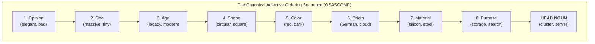
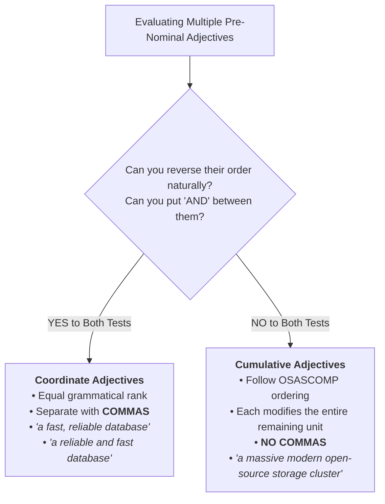

# Order of Adjectives (The OSASCOMP Sequence) 📐🧱

> **Level:** CEFR B1–B2 (Adjective Hierarchy & Cumulative Modification)  
> **Primary References:** Raymond Murphy (*English Grammar in Use*, Unit 99); Michael Swan (*Practical English Usage*, §15.4)  
> **Core Concept:** When two or more adjectives precede a noun attributively, English enforces a strict, subconscious cognitive ordering known as the **OSASCOMP hierarchy**. Violating this sequence sounds unnatural to native speakers. Furthermore, adjectives are grammatically divided into **coordinate adjectives** (which require commas) and **cumulative adjectives** (which prohibit commas).

---

## 1. The Canonical OSASCOMP Architecture

In English, adjectives closer to the noun represent intrinsic, permanent, and objective properties (material, purpose), while adjectives farther from the noun express subjective, variable judgments (opinion, size).



### The 8 Levels of the Hierarchy

| Rank | Category | Core Meaning | Prototypical Examples | Technical Computing Examples |
| :---: | :--- | :--- | :--- | :--- |
| **1** | **Opinion / Value** | Subjective assessment | *beautiful, terrible, great, lovely, expensive* | *elegant, robust, brittle, legacy, clunky* |
| **2** | **Size** | Physical or logical scale | *huge, tiny, small, large, massive, microscopic* | *compact, massive, monolithic, 64-bit* |
| **3** | **Age / Temporal** | How old or new | *old, young, modern, ancient, antique, brand-new* | *legacy, contemporary, deprecated, modern* |
| **4** | **Shape / Physical Quality** | Geometry, surface texture | *round, square, flat, rectangular, rough* | *distributed, modular, circular, planar* |
| **5** | **Color** | Visual hue, spectrum | *blue, dark, crimson, transparent, silver* | *monochrome, green-screen, dark-mode* |
| **6** | **Origin / Provenance** | Geographic or platform source | *Japanese, American, British, Italian* | *open-source, Linux-based, in-house, AWS* |
| **7** | **Material** | Substance composed of | *wooden, plastic, steel, copper, glass* | *silicon, optical, magnetic, solid-state* |
| **8** | **Purpose / Qualifier** | Specific functional role | *running (shoes), sleeping (bag), wedding (ring)* | *storage (node), caching (proxy), database (engine)* |

---

## 2. Coordinate vs. Cumulative Adjectives

Understanding when to place commas between multiple adjectives depends on whether they are **coordinate** or **cumulative**:



### 1. Cumulative Adjectives (No Commas)
Cumulative adjectives build upon each other in a hierarchical sequence. Do not insert commas between them:
- *We deployed a **massive new open-source storage** cluster.*
  - *massive* (Size) $\rightarrow$ *new* (Age) $\rightarrow$ *open-source* (Origin) $\rightarrow$ *storage* (Purpose) $\rightarrow$ *cluster* (Noun).
  - ❌ *We deployed a massive, new, open-source, storage cluster.* (Punctuation bug!)

### 2. Coordinate Adjectives (Separated by Commas)
Coordinate adjectives belong to the **same semantic category** (often two opinion adjectives or two physical attributes). They independently modify the noun:
- *The team authored a **clean, readable** codebase.*  
  (Test: *clean and readable* ✅; *readable, clean* ✅ $\rightarrow$ Coordinate $\rightarrow$ Comma required).
- *The incident report was **thorough, objective,** and **actionable**.*

---

## 3. Special Ordering Patterns & Adjective-Noun Compounds

### 1. Size vs. Shape Priority
Size almost always precedes shape:
- *a **large circular** buffer* (❌ NOT: *a circular large buffer*)
- *a **compact rectangular** microchip*

### 2. Age vs. Color Priority
Age precedes color:
- *an **old green** terminal interface* (❌ NOT: *a green old terminal*)
- *a **modern dark** theme*

### 3. Purpose Nouns Acting as Adjectives
When a noun functions as a modifier indicating purpose or type (a *noun adjunct*), it sits **immediately adjacent** to the head noun, behind all other adjectives:
- *an expensive Italian **leather** jacket* (Material before Purpose/Head)
- *an innovative California-based **software** company* (Origin before Purpose/Head)
- *a high-performance distributed **caching** layer* (Physical Quality + Origin/Type + Purpose)

---

## 4. Practical Dual-Domain Examples

### Everyday Conversation

1. *She wore a **beautiful long black silk** dress to the gala.* (Opinion $\rightarrow$ Size $\rightarrow$ Color $\rightarrow$ Material)
2. *We sat around a **huge old wooden** dining table.* (Size $\rightarrow$ Age $\rightarrow$ Material)
3. *He bought an **expensive new German sports** car.* (Opinion $\rightarrow$ Age $\rightarrow$ Origin $\rightarrow$ Purpose)
4. *They live in a **charming little 19th-century brick** cottage.* (Opinion $\rightarrow$ Size $\rightarrow$ Age $\rightarrow$ Material)
5. *Could you hand me that **small square plastic** container?* (Size $\rightarrow$ Shape $\rightarrow$ Material)
6. *She adopted a **playful young golden retriever** puppy.* (Opinion $\rightarrow$ Age $\rightarrow$ Color/Breed)
7. *He found an **interesting antique brass** compass in the attic.* (Opinion $\rightarrow$ Age $\rightarrow$ Material)
8. *It was a **long, exhausting, stressful** workday.* (Coordinate adjectives: commas inserted)

### Software Engineering & Technical Documentation

9. *We migrated our workloads to a **massive modern AWS cloud** infrastructure.* (Size $\rightarrow$ Age $\rightarrow$ Origin $\rightarrow$ Purpose)
10. *The compiler generates an **optimized compact 64-bit binary** executable.* (Opinion $\rightarrow$ Size $\rightarrow$ Spec $\rightarrow$ Type)
11. *The telemetry daemon stores metrics in a **circular in-memory ring** buffer.* (Shape $\rightarrow$ Origin/Material $\rightarrow$ Type $\rightarrow$ Noun)
12. *The client requested an **intuitive, responsive** dashboard interface.* (Coordinate opinion adjectives)
13. *Our engineers replaced the **clunky legacy Perl billing** script with a Go microservice.* (Opinion $\rightarrow$ Age $\rightarrow$ Language/Origin $\rightarrow$ Purpose)
14. *The server utilizes **high-speed optical fiber** connections for cross-datacenter sync.* (Quality $\rightarrow$ Material $\rightarrow$ Purpose)
15. *The vulnerability stemmed from an **obscure legacy C++ memory** management flaw.* (Opinion $\rightarrow$ Age $\rightarrow$ Origin $\rightarrow$ Purpose)
16. *The server rack is outfitted with **robust modular steel server** enclosures.* (Opinion $\rightarrow$ Shape/Quality $\rightarrow$ Material $\rightarrow$ Purpose)
17. *We need a **lightweight portable Linux** distribution for embedded edge devices.* (Size/Weight $\rightarrow$ Quality $\rightarrow$ Origin)
18. *The architect proposed an **elegant distributed consensus** algorithm.* (Opinion $\rightarrow$ Shape/Architecture $\rightarrow$ Purpose)

---

## 5. Common Antipatterns & Diagnostic Table

| Incorrect Antipattern | Corrected Grammar | Rule & Explanation |
| :--- | :--- | :--- |
| ❌ *a wooden big table* | ✅ *a **big wooden** table* | Size (*big*) must precede Material (*wooden*) in the OSASCOMP sequence. |
| ❌ *an optical expensive cable* | ✅ *an **expensive optical** cable* | Opinion (*expensive*) precedes Material/Type (*optical*). |
| ❌ *a red modern sports car* | ✅ *a **modern red sports** car* | Age (*modern*) must precede Color (*red*). |
| ❌ *a database distributed resilient system* | ✅ *a **resilient distributed database** system* | Opinion (*resilient*) $\rightarrow$ Architecture (*distributed*) $\rightarrow$ Purpose (*database*). |
| ❌ *a fast, red, sports car* | ✅ *a **fast red sports** car* | Cumulative adjectives (Opinion + Color + Purpose) do not take commas. |
| ❌ *an American open-source great project* | ✅ *a **great open-source American** project* | Opinion (*great*) must precede Origin (*open-source / American*). |
| ❌ *a circular small buffer* | ✅ *a **small circular** buffer* | Size (*small*) always precedes Shape (*circular*). |

---

## 6. Self-Assessment Exercises

### Exercise 1: Ordering Scrambled Adjectives
Arrange the adjectives in parentheses into their natural OSASCOMP order:

1. The data center installed a ________ cooling unit. (*industrial / massive / Japanese / new*)
2. The legacy application relies on a ________ relational database. (*clunky / monolithic / 1990s*)
3. She carries a ________ laptop bag. (*leather / black / sleek / Italian*)
4. We discovered a ________ memory leak during load testing. (*bizarre / tiny / C++*)
5. The technicians assembled a ________ motherboard tray. (*rectangular / modern / aluminum / compact*)

### Exercise 2: Comma Punctuation (Coordinate vs. Cumulative)
Determine whether commas are required between the adjectives. If yes, insert them; if no, leave them bare:

6. The platform provides a (robust / scalable) cloud architecture.
7. We analyzed the (ancient / green / CRT) monitor in the server room.
8. The author submitted a (concise / well-structured / readable) technical specification.
9. They designed a (modular / open-source / Python) testing framework.
10. The bug produced an (unexpected / catastrophic) failure across all nodes.

<details>
<summary>View Complete Answer Key & Diagnostic Explanations</summary>

1. **massive new Japanese industrial** (Size $\rightarrow$ Age $\rightarrow$ Origin $\rightarrow$ Purpose)
2. **clunky monolithic 1990s** (Opinion $\rightarrow$ Size/Architecture $\rightarrow$ Age)
3. **sleek black Italian leather** (Opinion $\rightarrow$ Color $\rightarrow$ Origin $\rightarrow$ Material)
4. **bizarre tiny C++** (Opinion $\rightarrow$ Size $\rightarrow$ Origin/Type)
5. **compact modern rectangular aluminum** (Size $\rightarrow$ Age $\rightarrow$ Shape $\rightarrow$ Material)
6. **robust, scalable** (Coordinate opinion/quality adjectives $\rightarrow$ comma required: *robust and scalable*).
7. **ancient green CRT** (Cumulative: Age $\rightarrow$ Color $\rightarrow$ Type $\rightarrow$ NO commas).
8. **concise, well-structured, and readable** (Coordinate descriptive adjectives $\rightarrow$ commas required).
9. **modular open-source Python** (Cumulative: Quality $\rightarrow$ Provenance $\rightarrow$ Language/Type $\rightarrow$ NO commas).
10. **unexpected, catastrophic** (Coordinate evaluative adjectives $\rightarrow$ comma required: *unexpected and catastrophic*).

</details>

---

## 7. Revision Flashcards

```
Q: What does the acronym OSASCOMP stand for?
A: Opinion, Size, Age, Shape, Color, Origin, Material, Purpose (the canonical ordering sequence for attributive adjectives).

Q: Why do native speakers naturally say "big wooden table" instead of "wooden big table"?
A: Physical qualities closer to the noun (Material: wooden) are intrinsic and permanent; qualities further away (Size: big) are comparative or subjective.

Q: How do you test whether multiple adjectives are "coordinate" (requiring commas)?
A: Apply two tests: (1) Can you reverse their order naturally? (2) Can you insert "and" between them? If YES to both, they are coordinate and take commas.

Q: Do cumulative adjectives like "massive new open-source database" take commas?
A: No! Cumulative adjectives build upon each other in OSASCOMP sequence and prohibit comma punctuation.

Q: Where does a "Purpose / Type" noun modifier sit relative to other adjectives?
A: Immediately before the head noun (e.g., "a modern German [storage] cluster").
```
