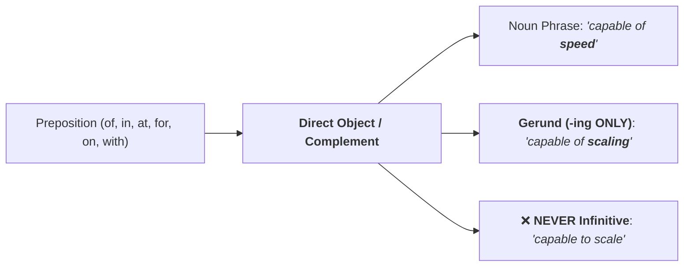
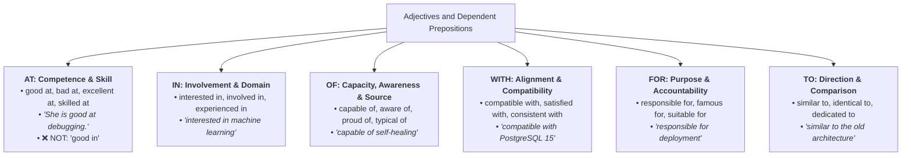
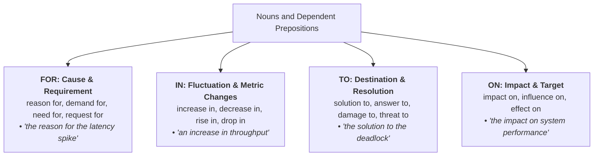

# Dependent Prepositions: Nouns and Adjectives 🔗🧲

> **Level:** CEFR B1–B2 (Collocational Syntax & Lexical Selection)  
> **Primary References:** Raymond Murphy (*English Grammar in Use*, Units 129–131); Michael Swan (*Practical English Usage*, §18.8, §8.4)  
> **Core Concept:** In English, many nouns and adjectives are grammatically bound to specific **dependent prepositions**. These pairings are lexicalized collocations; they do not follow general spatial logic. Furthermore, all dependent prepositions adhere to the **Inviolable Gerund Invariant**: any verb following a preposition must take the non-finite **gerund form (`-ing`)**, never a bare or to-infinitive.

---

## 1. The Inviolable Preposition + Gerund Invariant

Whenever a verb directly follows a preposition (whether dependent or independent), English syntax strictly requires the **gerund (`-ing`)**:



> [!CAUTION]
> One of the most prevalent errors among software engineers is inserting a *to-infinitive* where a preposition demands a gerund:
> - ❌ *The system is capable to handle 50k requests.*
> - ✅ *The system is **capable of handling** 50k requests.*
> - ❌ *We are interested to learn Kubernetes.*
> - ✅ *We are **interested in learning** Kubernetes.*

---

## 2. Adjectives with Dependent Prepositions

Adjectives pair with fixed prepositions to link their qualities to specific targets:



### High-Frequency Adjective Collocation Matrix

| Preposition | Adjective Collocations | Example Sentence | ❌ Preposition Bug |
| :---: | :--- | :--- | :--- |
| **`at`** | *good, bad, skilled, terrible, brilliant, hopeless* | *He is exceptionally **good at profiling** JVM memory.* | ❌ *good in profiling* |
| **`in`** | *interested, involved, experienced, successful, lacking* | *Our senior architect is deeply **experienced in distributed** systems.* | ❌ *experienced with / of* |
| **`of`** | *capable, aware, proud, ashamed, typical, jealous, conscious* | *The container engine is **capable of restarting** failed pods.* | ❌ *capable to restart* |
| **`with`** | *compatible, satisfied, pleased, familiar, consistent, popular* | *This library is completely **compatible with Linux** and macOS.* | ❌ *compatible to* |
| **`for`** | *responsible, famous, known, suitable, eligible, prepared* | *Who is **responsible for monitoring** production alerts?* | ❌ *responsible of* |
| **`to`** | *similar, identical, related, dedicated, opposed, sensitive* | *The new microservice is **similar to the legacy** daemon.* | ❌ *similar with* |
| **`from`** | *different, safe, free, separate, absent, protected* | *Go's syntax is noticeably **different from C++**.* | ❌ *different than* (in UK/formal) |
| **`on`** | *dependent, reliant, keen, based, focused* | *Downstream clients are heavily **dependent on our API**.* | ❌ *dependent of* |

---

## 3. Nouns with Dependent Prepositions

Nouns frequently inherit prepositional requirements that dictate their relational modifiers:



### High-Frequency Noun Collocation Matrix

| Noun + Preposition | Semantic Function | Technical Example | Common Error |
| :--- | :--- | :--- | :--- |
| **`reason for`** | Cause / Justification | *What was the **reason for** the pipeline failure?* | ❌ *reason of* |
| **`solution to`** | Resolution / Remedy | *We found an elegant **solution to** the cache invalidation problem.* | ❌ *solution for / of* |
| **`impact on`** | Consequence / Target | *The migration had zero **impact on** end-user latency.* | ❌ *impact in / to* |
| **`increase / decrease in`** | Scalar change in metric | *We noticed a 40% **drop in** memory consumption.* | ❌ *drop of* (when naming metric) |
| **`damage to`** | Physical or digital harm | *The lightning strike caused severe **damage to** the datacenter.* | ❌ *damage on / of* |
| **`demand for`** | Market / resource need | *There is massive **demand for** cloud architects.* | ❌ *demand of* |
| **`difference between`** | Contrast between items | *Explain the **difference between** processes and threads.* | ❌ *difference with* |
| **`relationship with / between`** | Connection / association | *We maintain a close **relationship with** our cloud provider.* | ❌ *relationship to* |

> [!NOTE]
> **Metric Shift Nuance:**
> - *An increase **in** latency* (names the parameter undergoing change).
> - *An increase **of** 20 milliseconds* (specifies the numerical quantity of change).

---

## 4. Practical Dual-Domain Examples

### Everyday Conversation

1. *She is exceptionally **good at playing** the piano.*
2. *Are you **interested in joining** our book club?*
3. *He is fully **capable of taking** care of himself.*
4. *We were deeply **disappointed with** the hotel accommodations.*
5. *What was the **reason for** your delay this morning?*
6. *She proposed an innovative **solution to** the neighborhood traffic problem.*
7. *His taste in music is very **similar to** mine.*
8. *I am not very **familiar with** this neighborhood.*

### Software Engineering & Technical Documentation

9. *The database engine is **capable of executing** 100,000 transactions per second.*
10. *Our DevOps team is **responsible for provisioning** Kubernetes clusters.*
11. *The developer was highly **skilled at reverse-engineering** network protocols.*
12. *This software version is completely **compatible with** legacy configuration formats.*
13. *What was the root **reason for** the cascade failure across the US-East cluster?*
14. *The incident commander proposed an immediate **solution to** the routing loop.*
15. *The breaking API change had an adverse **impact on** downstream microservices.*
16. *The engineering organization reported a significant **increase in** developer productivity.*
17. *The revised schema design is fundamentally **different from** the initial prototype.*
18. *Our production infrastructure is heavily **dependent on** AWS S3 availability.*

---

## 5. Common Antipatterns & Diagnostic Table

| Incorrect Antipattern | Corrected Grammar | Rule & Explanation |
| :--- | :--- | :--- |
| ❌ *The service is capable to process data.* | ✅ *The service is **capable of processing** data.* | *Capable* takes *of + gerund*, never a *to-infinitive*. |
| ❌ *He is very good in JavaScript.* | ✅ *He is very **good at** JavaScript.* | Competencies and skills take *good at*, never *good in*. |
| ❌ *What is the reason of the crash?* | ✅ *What is the **reason for** the crash?* | *Reason* takes the dependent preposition *for*, not *of*. |
| ❌ *We found a solution of the issue.* | ✅ *We found a **solution to** the issue.* | *Solution* pairs with *to*, not *of* or *for*. |
| ❌ *This library is compatible to our stack.* | ✅ *This library is **compatible with** our stack.* | Compatibility collocations take *with*. |
| ❌ *The change had a big impact in users.* | ✅ *The change had a big **impact on** users.* | The noun *impact* takes the dependent preposition *on*. |
| ❌ *She is responsible of the release.* | ✅ *She is responsible **for** the release.* | Accountability and duty take *responsible for*. |

---

## 6. Self-Assessment Exercises

### Exercise 1: Adjectives and Dependent Prepositions
Fill in the blanks with the correct preposition:

1. The distributed file system is capable ________ replicating blocks across datacenters.
2. Our security engineer is remarkably skilled ________ identifying buffer overflow bugs.
3. This SDK release is fully compatible ________ ARM64 architectures.
4. Who on the on-call rotation was responsible ________ merging the hotfix?
5. The GraphQL query structure is very similar ________ JSON syntax.

### Exercise 2: Nouns with Dependent Prepositions
Choose the appropriate preposition in parentheses:

6. The engineering team investigated the root reason (of / for) the high CPU utilization.
7. We have not yet discovered a permanent solution (of / for / to) the memory leak.
8. The database migration had a severe impact (on / in / to) end-user response times.
9. Management observed a sharp decrease (of / in) customer support tickets after the update.
10. The architect highlighted the fundamental differences (between / with) monoliths and microservices.

<details>
<summary>View Complete Answer Key & Diagnostic Explanations</summary>

1. **of** (*capable of replicating* — *capable* takes *of* + gerund).
2. **at** (*skilled at identifying* — skill/competence takes *at*).
3. **with** (*compatible with*).
4. **for** (*responsible for merging* — duty takes *for* + gerund).
5. **to** (*similar to*).
6. **for** (*reason for*).
7. **to** (*solution to*).
8. **on** (*impact on*).
9. **in** (*decrease in* names the metric undergoing change).
10. **between** (*differences between* distinct concepts).

</details>

---

## 7. Revision Flashcards

```
Q: What is the Preposition + Gerund rule?
A: In English, any verb following a preposition MUST take the gerund form (-ing), never a bare or to-infinitive (e.g., "capable of scaling", NOT "capable to scale").

Q: Why is "She is good in math" an error in standard English?
A: Skills, competencies, and aptitudes strictly take the dependent preposition "at" ("good at math", "skilled at coding").

Q: What dependent preposition follows the noun "solution"?
A: "To" ("a solution TO the problem", NOT "solution of" or "solution for").

Q: What dependent preposition follows the noun "reason"?
A: "For" ("the reason FOR the delay", NOT "reason of").

Q: Contrast "an increase in" with "an increase of".
A: "An increase IN" introduces the metric or quality changing ("an increase in latency"); "an increase OF" introduces the exact numerical quantity ("an increase of 15%").
```
