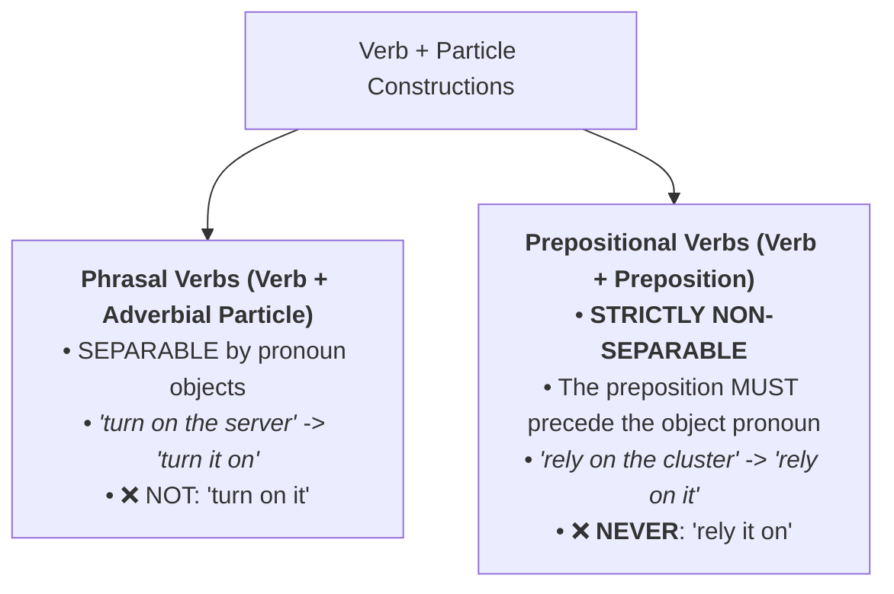
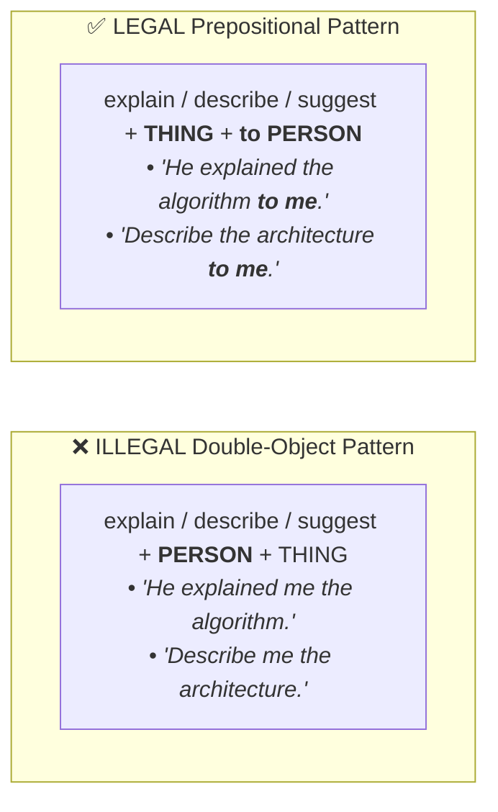
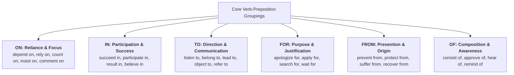

# Dependent Prepositions: Verbs (Prepositional Verbs) 🧲⚙️

> **Level:** CEFR B1–B2 (Verb-Preposition Collocations & Non-Separability)  
> **Primary References:** Raymond Murphy (*English Grammar in Use*, Units 132–136); Michael Swan (*Practical English Usage*, §18.9, §1)  
> **Core Concept:** A **prepositional verb** consists of a lexical verb plus a mandatory dependent preposition (*rely on, listen to, belong to*). Unlike phrasal verbs, prepositional verbs are **strictly non-separable**: their preposition must directly precede the object noun phrase or pronoun, never following it. Furthermore, several common verbs (*explain, describe, suggest*) forbid double-object ditransitive structures.

---

## 1. Prepositional Verbs vs. Phrasal Verbs (The Separability Test)



### The Inseparable Pronoun Invariant
In a prepositional verb, the preposition governs the object. It can **never** be separated from the verb by a pronoun:
- ✅ *We depend **on it**.*
- ❌ *We depend it on.*
- ✅ *Listen **to them**.*
- ❌ *Listen them to.*

---

## 2. The Ditransitive Trap: `Explain / Describe / Suggest`

In English, certain Latinate communication verbs **cannot take a double object (indirect object + direct object)**. They strictly require the direct object first, followed by `to + person`:



> [!CAUTION]
> This is one of the most pervasive errors in daily engineering standups and code reviews:
> - ❌ *Can you explain me how this endpoint works?*
> - ✅ *Can you explain **to me** how this endpoint works?* (or *...explain how this endpoint works **to me**.*)
> - ❌ *She suggested us a new testing tool.*
> - ✅ *She suggested a new testing tool **to us**.*

---

## 3. High-Frequency Verb + Preposition Matrix



### Comprehensive Verb Collocation Table

| Verb + Preposition | Syntax & Meaning | Software Engineering Example | ❌ Common Error |
| :--- | :--- | :--- | :--- |
| **`depend on / upon`** | Be contingent upon | *Latency **depends on** disk I/O throughput.* | ❌ *depends of* |
| **`rely on / upon`** | Place trust/dependency in | *Microservices **rely on** the service mesh.* | ❌ *rely in* |
| **`succeed in`** | Achieve a goal (`+ -ing`) | *We **succeeded in reducing** CPU consumption.* | ❌ *succeeded to reduce* |
| **`consist of`** | Be composed of elements | *The cluster **consists of** six nodes.* | ❌ *consists from / in* |
| **`belong to`** | Be property / part of | *This subnet **belongs to** the VPC.* | ❌ *belongs in (ownership)* |
| **`prevent ... from`** | Block an action (`+ -ing`) | *The firewall **prevents attackers from accessing** SSH.* | ❌ *prevents attackers to access* |
| **`protect ... from / against`** | Shield against damage | *Encryption **protects data from** eavesdropping.* | ❌ *protects data to* |
| **`apologize to ... for`** | Say sorry for an issue | *The vendor **apologized to us for** the outage.* | ❌ *apologized us* |
| **`result in`** | Produce an outcome | *Unchecked recursion **results in** a stack overflow.* | ❌ *results to* |
| **`result from`** | Originate from a cause | *The crash **resulted from** unhandled nulls.* | ❌ *resulted of* |
| **`listen to`** | Pay attention to sound/advice | *Always **listen to** compiler warnings.* | ❌ *listen compiler warnings* |
| **`wait for`** | Await an entity/event | *The worker thread **waits for** incoming jobs.* | ❌ *waits an incoming job* |

---

## 4. Multi-Preposition Verbs (Semantic Shifts)

Certain verbs pair with multiple prepositions, shifting meaning depending on the selection:

### 1. `Agree with` vs. `Agree to` vs. `Agree on`
- **`agree with [a person / opinion]`** — Share the same view:
  - *I **agree with** the lead architect on this proposal.*
- **`agree to [a proposal / action]`** — Give consent or permission:
  - *The client **agreed to** our updated service agreement.*
- **`agree on [a topic / plan]`** — Reach collective consensus about a subject:
  - *The team finally **agreed on** a release date.*

### 2. `Hear about` vs. `Hear of` vs. `Hear from`
- **`hear about`** — Receive detailed news or information:
  - *Did you **hear about** the security breach at Acme Corp?*
- **`hear of`** — Know that something exists (often negative):
  - *I have never **heard of** that JavaScript library before.*
- **`hear from`** — Receive communication directly from someone:
  - *We haven't **heard from** the client regarding the contract.*

### 3. `Care about` vs. `Care for`
- **`care about`** — Consider something important or valuable:
  - *Our engineering team deeply **cares about** accessibility.*
- **`care for`** — Look after (or formal for "like/want"):
  - *Would you **care for** a cup of coffee?*

---

## 5. Practical Dual-Domain Examples

### Everyday Conversation

1. *Can you explain this math problem **to me**?*
2. *I must apologize **to my neighbors for** the loud music.*
3. *She **succeeded in passing** her driving test on the first attempt.*
4. *Do you **believe in** making five-year plans?*
5. *He is waiting **for the bus** at the corner.*
6. *This beautiful old fountain **belongs to** the city museum.*
7. *I completely **agree with** your assessment of the situation.*
8. *I haven't **heard from** my brother in over two weeks.*

### Software Engineering & Technical Documentation

9. *The database engine **relies heavily on** OS filesystem page caching.*
10. *Could you please explain the OAuth token refresh sequence **to the team**?*
11. *The rate limiter **prevents rogue clients from overloading** the API.*
12. *Our team **succeeded in refactoring** the legacy billing engine ahead of schedule.*
13. *The distributed architecture **consists of** three primary and six worker nodes.*
14. *Unchecked memory leaks will eventually **result in** out-of-memory kernel panics.*
15. *The infrastructure team **agreed on** migrating all services to Kubernetes.*
16. *The security headers **protect the application from** cross-site scripting attacks.*
17. *We must wait **for all database transactions to finish** before rebooting.*
18. *The architect **objected to** introducing another third-party runtime dependency.*

---

## 6. Common Antipatterns & Diagnostic Table

| Incorrect Antipattern | Corrected Grammar | Rule & Explanation |
| :--- | :--- | :--- |
| ❌ *Please explain me the code.* | ✅ *Please explain the code **to me**.* | *Explain* cannot take a double object; it requires *explain [something] to [someone]*. |
| ❌ *The architecture depends of AWS.* | ✅ *The architecture **depends on** AWS.* | *Depend* strictly takes *on / upon*, never *of*. |
| ❌ *We succeeded to deploy on Friday.* | ✅ *We **succeeded in deploying** on Friday.* | *Succeed* takes *in + gerund*, never a *to-infinitive*. |
| ❌ *The cluster consists from four nodes.* | ✅ *The cluster **consists of** four nodes.* | *Consist* colits strictly with *of* to describe composition. |
| ❌ *We are waiting the response.* | ✅ *We are **waiting for** the response.* | *Wait* requires the preposition *for* when an object follows. |
| ❌ *The firewall prevents users to connect.* | ✅ *The firewall **prevents users from connecting**.* | *Prevent* takes *[object] + from + gerund*. |
| ❌ *Turn on it immediately.* | ✅ *Turn **it on** immediately.* | Phrasal verbs require pronoun objects inside; prepositional verbs (*rely on it*) do not. |

---

## 7. Self-Assessment Exercises

### Exercise 1: High-Frequency Verb-Preposition Selection
Supply the correct preposition:

1. The senior developer explained the race condition ________ the new hire.
2. Our backend infrastructure depends heavily ________ Redis for session management.
3. The on-call engineer apologized ________ the stakeholders ________ the unexpected downtime.
4. The security team succeeded ________ patching all zero-day vulnerabilities.
5. The platform consists ________ three load balancers and ten application servers.

### Exercise 2: Error Correction (Verb + Preposition Traps)
Rewrite and correct the grammatical bugs in the following sentences:

6. Can you describe me the layout of the distributed cache?
7. Network policies prevent unauthenticated pods to access the database.
8. The entire team agreed to the new sprint retrospective format. (*agreed to / agreed on*)
9. We are waiting the webhook callback before updating the user account.
10. The sudden spike in 500 errors resulted of a network partition.

<details>
<summary>View Complete Answer Key & Diagnostic Explanations</summary>

1. **to** (*explained [something] to [someone]*).
2. **on** (*depends on*).
3. **to** the stakeholders **for** the unexpected downtime (*apologize to [someone] for [something]*).
4. **in** (*succeeded in patching* — *succeed* takes *in* + gerund).
5. **of** (*consists of*).
6. Can you describe the layout of the distributed cache **to me**? (Eliminate double object).
7. Network policies prevent unauthenticated pods **from accessing** the database. (*Prevent from + gerund*).
8. The entire team **agreed on** the new sprint retrospective format. (Reaching collective consensus on a topic takes *agree on*).
9. We are **waiting for** the webhook callback before updating the user account. (*Wait* requires *for*).
10. The sudden spike in 500 errors **resulted from** a network partition. (Cause/origin takes *result from*; outcome takes *result in*).

</details>

---

## 8. Revision Flashcards

```
Q: Why can't you say "Can you explain me this feature?"
A: "Explain" cannot take an indirect object directly. It strictly follows the pattern "explain [something] to [someone]" ("Can you explain this feature TO me?").

Q: What is the syntactic difference between a prepositional verb ("rely on") and a phrasal verb ("turn on") regarding pronouns?
A: Prepositional verbs are non-separable; the pronoun MUST follow the preposition ("rely ON it"). Phrasal verbs are separable and demand that the pronoun sit between the verb and particle ("turn it ON").

Q: What dependent preposition follows "succeed" when describing an accomplishment?
A: "In" followed by a gerund ("We succeeded IN mitigating the attack", NOT "succeeded to mitigate").

Q: What dependent preposition follows "consist" when listing component parts?
A: "Of" ("The system consists OF three microservices", NOT "consists from").

Q: Distinguish between "agree with", "agree to", and "agree on".
A: "Agree with" a person/opinion; "agree to" a proposal or plan of action (giving consent); "agree on" a mutual decision or topic reached by a group.
```
