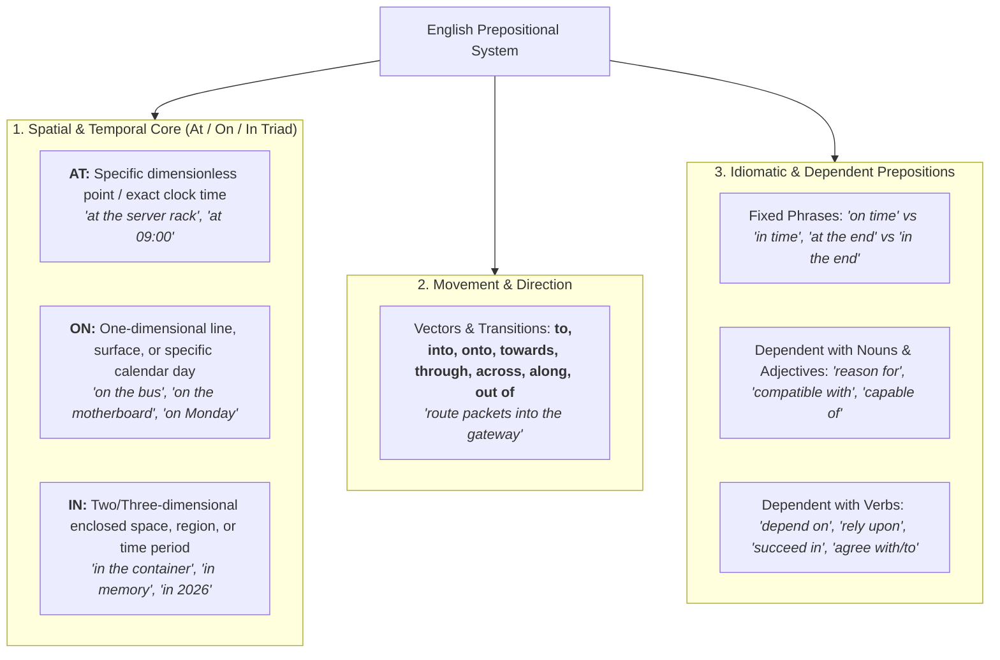
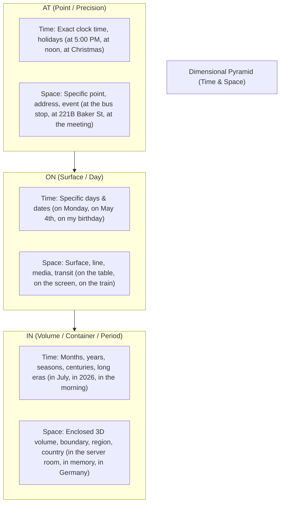

# Module 07: Prepositions and Prepositional Phrases 🧭⚓

> **Level:** CEFR A1–B2 (Relational Syntax & Collocational Nuance)  
> **Primary References:** Raymond Murphy (*English Grammar in Use*, Units 119–136); Michael Swan (*Practical English Usage*, §18)  
> **Core Concept:** Prepositions are grammatical function words that establish spatial, temporal, logical, or causal relationships between a **noun phrase (complement/object of preposition)** and the rest of the clause. Unlike inflected case systems, English relies extensively on prepositions and fixed collocational dependencies (*dependent prepositions*).

---

## 1. The Prepositional Architecture

---

## 2. Topic Curriculum

This module contains **6 comprehensive guides** covering every dimension of prepositional syntax:

| Guide | Core Focus | Target CEFR | Authoritative Literature |
| :--- | :--- | :---: | :--- |
| **01. [Prepositions of Time](prepositions-of-time.md)** | The *at / on / in* temporal pyramid, *during* vs *for* vs *while*, *by* vs *until*, *since*, and omission rules (*this, next, last*) | A1–B2 | Murphy Units 119–122; Swan §18.1–18.3 |
| **02. [Prepositions of Place and Position](prepositions-of-place-and-position.md)** | Spatial *at / on / in*, *above* vs *over*, *under* vs *below*, *between* vs *among*, and network topology descriptions | A1–B2 | Murphy Units 123–125; Swan §18.4–18.5 |
| **03. [Prepositions of Movement and Direction](prepositions-of-movement-and-direction.md)** | Vector transitions: *to, into, onto, towards, through, across, past, out of*, and preposition-verb movement idioms | A2–B2 | Murphy Units 126–128; Swan §18.6 |
| **04. [Prepositional Phrases and Idiomatic Uses](prepositional-phrases-and-idiomatic-uses.md)** | Nuanced idiom pairs: *on time* vs *in time*, *at the end* vs *in the end*, *by accident*, *under pressure*, *in charge of* | B1–B2 | Murphy Units 127–128; Swan §18.7 |
| **05. [Dependent Prepositions: Nouns and Adjectives](dependent-prepositions-nouns-and-adjectives.md)** | Collocational bonds: *reason for, impact on, difference between; interested in, capable of, compatible with, proud of* | B1–B2 | Murphy Units 129–131; Swan §18.8 |
| **06. [Dependent Prepositions: Verbs](dependent-prepositions-verbs.md)** | Prepositional verbs vs phrasal verbs, *depend on, listen to, apologize for, succeed in, agree with/to/on*, object placement laws | B1–B2 | Murphy Units 132–136; Swan §18.9 |

---

## 3. The Dimensional Decision Pyramid (At / On / In)

Whether describing spatial positioning or temporal milestones, English uses the same cognitive dimension hierarchy:

---

## 4. Cross-Reference Directory
- **Foundations:** [Punctuation Mastery](../01-foundations/punctuation-mastery.md) (Hyphenation in compound prepositional modifiers).
- **Verbs:** [Phrasal Verbs & Prepositional Verbs](../02-verbs-and-auxiliaries/phrasal-verbs-and-prepositional-verbs.md) (Particle movement and pronoun insertion rules).
- **Non-Finite Verbs:** [Gerunds vs Infinitives](../11-non-finite-verbs-verbals/) (The rule that prepositions are **always** followed by gerunds `-ing`, never bare or to-infinitives: *interested in learning*, *capable of scaling*).
- **Disambiguation:** [Comparisons & Disambiguation](../13-comparisons-and-disambiguation/) (Detailed contrast files: *since vs for*, *in vs on vs at*).
